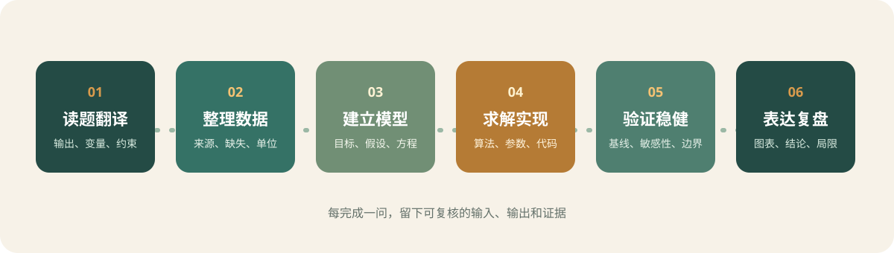

# 07 竞赛档案：把经历变成可复用的方法

这页只整理竞赛经历中的**方法线索**，不公开论文原文、成绩证明、参赛账号、队员信息或原始数据。它的用途是回答一个具体问题：下一次遇到相似题型时，应该从哪一份记录开始复习？

{ .modeling-workflow }

## 1. 按时间建立资料地图

| 时间 | 资料阶段 | 适合回看的问题 | 建议入口 |
| --- | --- | --- | --- |
| 2025 年 1 月 | 美赛准备与正式比赛 | 怎样在英文题面中拆出输出、假设和评价指标？ | [建模总流程](workflow.md)、[数据与论文](data-and-paper.md) |
| 2025 年 5 月 | 校赛训练 | 如何把电气工程背景翻译成可计算的指标和约束？ | [优化与评价](optimization-evaluation.md) |
| 2025 年 9 月 | 国赛准备 | 怎样处理规则、AI 使用边界、数据清洗和交稿检查？ | [比赛执行清单](competition-checklist.md) |
| 2025—2026 年 | 暑期培训与算法练习 | 什么时候用预测、分类、优化或评价模型？ | [算法选择](algorithm-selection.md) |
| 2026 年 5 月 | 校赛复盘 | 哪些模型可以迁移，哪些结论只对当时数据成立？ | [数据与论文](data-and-paper.md) |
| 2026 年 9 月 | 国赛复盘 | 如何在限时内保留验证证据并完成统一写作？ | [比赛执行清单](competition-checklist.md) |

这张表不等于“比赛年份越新越值得看”。先按题型找方法，再按时间回看代码、图表和复盘记录，效率更高。

## 2. 从原始目录中挑选公开入口

原始资料里有大量论文、数据表、代码、课堂课件和图片。公开网站只保留已经抽象成通用方法的内容：

- **可公开**：变量定义方法、数据清洗检查表、模型适用条件、图表规范、复盘模板和原创流程图；
- **谨慎处理**：带有具体赛事题面、整篇论文、课程讲义原文或第三方公众号水印的材料；
- **留在本地**：队员姓名、联系方式、账号信息、成绩证明、未脱敏数据和带修订记录的 Office 文件。

网站目前提供的 [预测模型讲义](resources/prediction-model.pdf)、[分类模型讲义](resources/classification-model.pdf)、[优化模型讲义](resources/optimization-model.pdf) 和 [评价模型讲义](resources/evaluation-model.pdf) 是经过筛选的通用材料。使用时要回到专题页，先看前提和验证要求，再打开 PDF 查公式。

## 3. 一次比赛的复盘顺序

### 3.1 先复盘判断，不先复盘代码

先回答三个问题：

1. 当时把每一问的输出写清楚了吗？
2. 模型的复杂度是否与数据量、时间和可解释性匹配？
3. 哪一张图或哪一个检验真正改变了结论？

如果这些问题回答不清楚，直接重跑代码通常只会得到更多数字，不能解释为什么路线有效。

### 3.2 再复盘数据和假设

给每个数据表保留四个字段：来源、单位、缺失规则、异常处理。把“默认认为”改写成可检查的假设，例如“研究期内参数不变”需要配一个上下浮动的情景；“样本独立”需要说明为什么时间相关性可以忽略。

### 3.3 最后复盘表达

论文每个小问至少要有一条从模型到结论的完整链路：

> 输入数据 → 关键假设 → 模型/算法 → 验证证据 → 面向题目的结论

若图表只展示结果、没有单位和样本范围，读者无法判断结论是否可靠。若结论只写“模型效果良好”，应改成误差、区间、排序稳定性或约束满足率等可核对的指标。

## 4. 给下一次比赛的最小复用包

比赛开始前，准备一个不依赖具体题目的小型仓库：

```text
modeling-kit/
├── data_dictionary.xlsx      # 字段、单位、来源、缺失规则
├── baseline/                 # 均值、线性回归、简单规划等基线
├── figures/                  # 统一字体、单位和导出尺寸
├── validation/               # 交叉验证、敏感性、极端情景
├── writing/                  # 摘要、符号表、假设与局限模板
└── README.md                 # 每个脚本的输入、输出和运行方式
```

基线的价值不是追求最高分，而是给复杂方法提供参照。如果复杂算法只比基线提高一点，却多出大量参数和解释成本，应优先检查数据和问题定义，而不是继续堆叠算法。

## 5. 一份可执行的复盘卡

每次训练或比赛结束后，用十分钟填写：

| 项目 | 记录内容 |
| --- | --- |
| 最早的判断 | 当时如何选择题目和路线？依据是什么？ |
| 最大的不确定性 | 数据、假设、模型还是写作？ |
| 失败尝试 | 为什么停用，留下了什么基线？ |
| 有效证据 | 哪个检验让结论更可信？ |
| 下一次动作 | 只写一个能在一周内完成的练习。 |

这份卡片比“下次要更努力”更有用，因为它把情绪性的复盘变成了可执行的学习计划。
