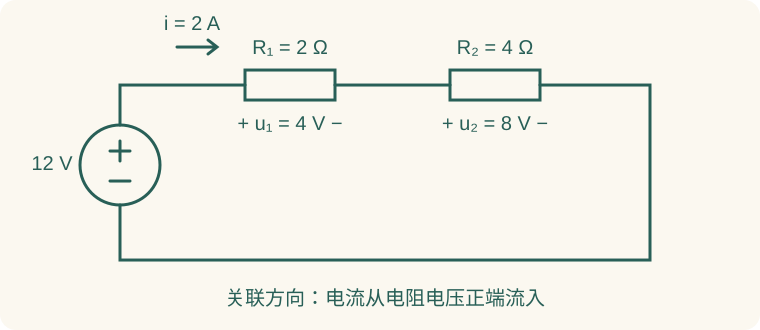

# 01 电路模型、参考方向与基本定律

电路方程由元件关系和拓扑约束共同确定。元件关系描述支路变量之间的联系；KCL 与 KVL 描述支路连接所满足的电流、电压约束。节点法、网孔法和端口法均以这两类关系为基础。

本章例题为课程配套练习。配套原讲义是[元件、信号、KCL 与 KVL](../resources/source-lectures/01-元件信号-KCL-KVL.pdf#page=1)；链接中的页码均指 PDF 的物理页序。

## 1. 从实际器件到集总模型

### 1.1 为什么可以用一个电阻表示一段导体

实际电路存在电磁场、导线传播延迟、寄生电容和寄生电感。低频下，如果器件及连线的几何尺寸远小于相关信号波长，并且传播延迟相对变化时间可以忽略，就能把电压、电流集中到元件端口描述。该近似的适用性取决于工作频率与几何尺寸。频率升高或连线变长时，可能需要把同一段连线改成传输线模型。

模型为问题服务：求稳态直流分压时，可把普通电阻近似成常数 $R$；研究高速边沿时，同一个器件可能需要附加寄生电感和电容。题目未说明的寄生效应不随意添加，但题目明确给出时也不能忽略。

### 1.2 读图时只认连接，不认摆放

- 一根连续理想导线上的点属于同一节点；导线弯折不会增加节点。
- 两元件只有在连接点没有第三条支路分流时才是串联。
- 两元件的两端分别接在同一对节点上，才是并联。
- 交叉线是否相连要看接点标记；资料图模糊时应先核对原图。
- 分析网络拓扑时，要声明采用“每个二端元件一支路”还是“无分叉串联链视作一支路”的约定，计数不能混用。

看不清串并联时，给导线涂上同一个节点名字，比凭图形形状猜更可靠。桥式电路中间电阻斜着画、横着画，都不改变它连接的两个节点。

## 2. 参考方向、负数和功率

定义 $u_{ab}=v_a-v_b$，就是把 $a$ 当作正端、$b$ 当作负端。电流方向可以先任意假定；若解得负值，表示实际方向与箭头相反。不能看到负值后直接取绝对值继续代入原方程。

对一个二端元件，若电流参考方向从电压正端流入，称为**关联参考方向**或被动符号约定，吸收功率为

$$p=ui.$$

$p>0$ 表示吸收，$p<0$ 表示发出。若电流从电压负端流入，按这一套非关联方向定义的变量，吸收功率应写成 $p=-ui$。电源既可能发电，也可能吸能，例如电池充电时就是吸能。

**例 1：串联电阻与功率平衡。** 电源上端为正，$U_s=12\,\mathrm V$；从上端依次串联 $R_1=2\,\Omega$、$R_2=4\,\Omega$ 回到下端。取顺时针电流，电阻电压均按电流流入端为正。

沿回路列 KVL：

$$-12+2i+4i=0\quad\Rightarrow\quad i=2\,\mathrm A.$$

因此 $u_1=4\,\mathrm V$、$u_2=8\,\mathrm V$，两个电阻吸收 $p_1=8\,\mathrm W$、$p_2=16\,\mathrm W$。电源电流从负端流入，电源吸收功率为 $p_s=-12\times2=-24\,\mathrm W$，所以 $p_s+p_1+p_2=0$。

若改取逆时针电流，应算得 $i'=-2\,\mathrm A$；电阻的物理功率仍为正。**换参考方向改变变量符号，不改变实际耗能。** 配套看[参考方向和功率，第 15—19 页](../resources/source-lectures/01-元件信号-KCL-KVL.pdf#page=15)。

## 3. 元件伏安关系：先写方向再写公式

### 3.1 线性电阻与非线性电阻

常数正电阻在关联方向下满足

$$u=Ri,\qquad p=Ri^2=\frac{u^2}{R}\ge0.$$

“电阻元件”不一定是常数正电阻。若关系为 $u=f(i)$，曲线不经过原点或不是直线，就不能直接应用线性电路的叠加定理。某工作点的**静态电阻** $R_s=U/I$ 是原点到工作点的割线斜率；**微分电阻** $r_d=du/di$ 是局部切线斜率。两者一般不同。

**例 2：非线性元件的工作点。** 设二端元件只在 $i\ge0$ 范围按 $u=2i+i^2$ 建模，电压单位 V、电流单位 A，式中系数具有对应单位。它与 $3\,\Omega$ 电阻串联，接 $6\,\mathrm V$ 电源。按关联方向：

$$6=3i+u=5i+i^2.$$

$$i^2+5i-6=0\quad\Rightarrow\quad i=1\,\mathrm A\quad\text{或}\quad i=-6\,\mathrm A.$$

题设模型仅在 $i\ge0$ 有效，因此舍去负根。元件电压 $u=3\,\mathrm V$，静态电阻 $R_s=3\,\Omega$；微分电阻 $r_d=2+2i=4\,\Omega$。电阻耗能 $3\,\mathrm W$，非线性元件耗能 $3\,\mathrm W$，与电源输出 $6\,\mathrm W$ 相等。

为什么不能把整个元件替换成 $4\,\Omega$？因为 $4\,\Omega$ 只描述该工作点附近的**增量**关系 $\Delta u\approx4\Delta i$，并不描述从原点到工作点的总量关系。以后模电中的小信号模型正是这个思想。

### 3.2 电容：连续的是电压，未必是电流

常数线性电容在关联方向下满足

$$q=Cu_C,\qquad i_C=C\frac{du_C}{dt},\qquad w_C=\frac12Cu_C^2.$$

对换路时刻两边积分：

$$u_C(0^+)-u_C(0^-)=\frac1C\int_{0^-}^{0^+}i_C(t)\,dt.$$

若电流不含冲激，这个无穷小区间的积分为零，电容电压连续。电流本身可以跳变。若理想电容被理想电压源强行改变电压，数学模型可能出现冲激电流，这时不能无条件套连续性。

直流稳态时 $du_C/dt=0$，电容支路电流为零，可以用开路求稳态电压。刚换路的 $0^+$ 不等于直流稳态；求瞬时其他量时，应把电容看成电压等于初值的理想电压源。

### 3.3 电感：连续的是电流，未必是电压

常数线性电感在关联方向下满足

$$u_L=L\frac{di_L}{dt},\qquad w_L=\frac12Li_L^2.$$

没有冲激电压时，$i_L(0^+)=i_L(0^-)$；直流稳态中 $u_L=0$，因此可用短路。刚换路求其他瞬时量时，把电感等效成电流等于初值的理想电流源，不能直接短路。初始储能元件是能量来源，所以无外加独立源的电路也可能有暂态响应。

## 4. 独立源与受控源

理想电压源规定端电压，支路电流由外部决定；理想电流源规定支路电流，端电压由外部决定。电压源置零是短路，电流源置零是开路。置零改变的是源的规定量，不能按图标形状随意删掉元件。

受控源用电路中另一个量决定输出：

| 类型 | 关系 | 系数单位 | 控制量 |
| --- | --- | --- | --- |
| 电压控制电压源 VCVS | $u_s=\mu u_x$ | 无量纲 | 电压 |
| 电压控制电流源 VCCS | $i_s=g u_x$ | S | 电压 |
| 电流控制电压源 CCVS | $u_s=r i_x$ | $\Omega$ | 电流 |
| 电流控制电流源 CCCS | $i_s=\beta i_x$ | 无量纲 | 电流 |

“没有独立源”不等于“受控源可以关掉”。求输入电阻时施加测试源，测试量会通过控制关系使受控源工作。受控源常代表放大器的模型，其实际能量来自未在小信号图中显式画出的电源。

**例 3：受控源的方向直接影响结果。** 节点 $a$ 通过 $2\,\Omega$ 接地，$1\,\mathrm A$ 独立源从地流向 $a$；跨导源也从地流向 $a$，大小为 $(0.1\,\mathrm S)v_a$。KCL 为

$$\frac{v_a}{2}=1+0.1v_a\quad\Rightarrow\quad v_a=2.5\,\mathrm V.$$

电阻电流为 $1.25\,\mathrm A$，其中独立源提供 $1\,\mathrm A$、受控源提供 $0.25\,\mathrm A$。电阻吸收 $3.125\,\mathrm W$；两个源的吸收功率分别为 $-2.5\,\mathrm W$、$-0.625\,\mathrm W$，相加为零。

若把受控源箭头反过来，方程变为 $v_a/2+0.1v_a=1$，解是 $5/3\,\mathrm V$。可见“受控源乘哪个量”与“箭头向哪边”必须同时说明。[受控源原讲义，第 37—41 页](../resources/source-lectures/01-元件信号-KCL-KVL.pdf#page=37)。

## 5. KCL、KVL 以及独立方程数

KCL 表达节点电荷守恒。在集总模型中，对任意节点或包围多个节点的闭合面，都有 $\sum i_k=0$。包围面内部的支路不跨边界，列外边界 KCL 时不计入；这就是超节点方法的依据。

KVL 表达闭合路径上的电位差代数和为零。感应效应若已经包含在电感、互感等元件电压中，就按元件电压列 KVL；对未纳入模型的外部时变磁通，不能照搬静电势直觉而忽略感应电动势。

对一个连通图，设节点数为 $n$、支路数为 $b$，则有 $n-1$ 个独立 KCL 方程、$b-n+1$ 个独立 KVL 方程。两者合计 $b$，再配合元件关系求支路未知量。所有节点都列 KCL 会多出一条相关方程，不代表获得了额外信息。

**例 4：KCL 算出负电流。** 某节点流入 $3\,\mathrm A$，两条流出支路分别假定为 $5\,\mathrm A$ 和 $i_x$。列式 $3=5+i_x$，得 $i_x=-2\,\mathrm A$。这条支路实际流入 $2\,\mathrm A$。若把 $-2$ 改写为 $2$ 却不反向箭头，节点就不守恒了。[基尔霍夫定律，第 42—45 页](../resources/source-lectures/01-元件信号-KCL-KVL.pdf#page=42)。

## 6. 串并联、桥平衡与星—三角

串联电阻 $R_{\rm eq}=\sum R_k$，并联电导 $G_{\rm eq}=\sum G_k$。两并联电阻的电流分配是“本支路电流与本支路电阻成反比”：

$$i_1=\frac{R_2}{R_1+R_2}i,\qquad i_2=\frac{R_1}{R_1+R_2}i.$$

**例 5：电桥先判断能不能删中间电阻。** 电源上节点为 $12\,\mathrm V$、下节点为地；左上/左下电阻为 $2\,\Omega,4\,\Omega$，右上/右下为 $3\,\Omega,6\,\Omega$，左右中点之间接任意正电阻 $R_5$。如果不接中间电阻，两个中点分别为

$$v_a=12\frac4{2+4}=8\,\mathrm V,\qquad v_b=12\frac6{3+6}=8\,\mathrm V.$$

两点等电位，接上 $R_5$ 后其电流仍为零。于是输入电阻为 $6\parallel9=3.6\,\Omega$，总电流 $10/3\,\mathrm A$，源输出 $40\,\mathrm W$。桥平衡条件是 $R_{\rm 左上}/R_{\rm 左下}=R_{\rm 右上}/R_{\rm 右下}$，应通过阻值比例或节点电位验证。一旦任一电阻改变，就必须重新检查。

桥不平衡又不能直接串并联时，可用星—三角。三角边为 $R_{ab},R_{bc},R_{ca}$，变成星形中心 $o$ 后：

$$R_{ao}=\frac{R_{ab}R_{ca}}{\Sigma_\Delta},\quad R_{bo}=\frac{R_{ab}R_{bc}}{\Sigma_\Delta},\quad R_{co}=\frac{R_{bc}R_{ca}}{\Sigma_\Delta},\quad \Sigma_\Delta=R_{ab}+R_{bc}+R_{ca}.$$

逆变换为 $R_{ab}=R_{ao}+R_{bo}+R_{ao}R_{bo}/R_{co}$，其余轮换。等边三角形每边 $6\,\Omega$ 对应星形每臂 $2\,\Omega$，从任意两端看进去都为 $4\,\Omega$，可作记忆检查。公式保持三个外端口等效，不保持变换内部每只电阻的功率。[星—三角原讲义，第 10 页起](../resources/source-lectures/02-等效法-2024.pdf#page=10)。

## 7. 源变换与对称化简的边界

电压源 $U_s$ 串联 $R$ 可与电流源 $I_s=U_s/R$ 并联同一个 $R$ 对外等效。方向按端口开路电压检查：电流源应把电流送向原电压正端。只有理想源而没有对应有限内阻时，不能硬套这一转换。

等效只保留端口伏安关系，内部电流和功率未必相同。若题目所求正好是被变换掉的那条内部电阻电流，转换后应通过原图回算。受控源也可作合法源变换，但控制量必须在新图中得到等价定义，不能把控制量所在支路一起丢掉。

对称结构也需要对称激励。关于中线镜像的电阻网络，如果激励偶对称，对应节点电位相等，中间连接电流为零；反对称激励下常出现虚地。先证明电位关系，再断开或短接，不能只凭图画得对称就化简。[电源等效变换，第 19—23 页](../resources/source-lectures/02-等效法-2024.pdf#page=19)。

## 8. 仪表不是总能忽略：加载效应的完整算例

“测量电压”本身也会改变连接。理想电压表输入电阻无穷，不从待测节点取电流；真实电压表有有限输入电阻，会与待测支路并联。理想电流表内阻为零，应串入支路；把它并在电源两端，等于额外短路，实际会触发保护甚至损坏仪表。求考试中的理想仪表题，首先按题设理想化；求实验误差则把内阻画出来。

**例 6：电压表把分压从 6 V 读成 4 V。** 12 V 源串联两个 $10\,\mathrm{k}\Omega$ 电阻，测量下方电阻电压。不接表时：

$$U_0=12\frac{10}{10+10}=6\,\mathrm V.$$

若电压表输入电阻只有 $10\,\mathrm{k}\Omega$，则下方电阻与表并联成 $5\,\mathrm{k}\Omega$，读数是

$$U_m=12\frac5{10+5}=4\,\mathrm V.$$

读数变化由电压表的加载效应引起：接入电表后，被测电路的实际电压发生了变化。若换成 $10\,\mathrm{M}\Omega$ 电压表，下端等效电阻约 $9.990\,\mathrm{k}\Omega$，读数约 $5.997\,\mathrm V$，加载误差才很小。测量高阻电路时应比较表内阻与**端口等效电阻**，不能只看表的精度位数。

从端口观点看，原分压网络的戴维南参数为 6 V 和 $5\,\mathrm{k}\Omega$；接入表后电压为 $6R_m/(5\,\mathrm{k}\Omega+R_m)$。这也解释为什么低输出电阻的电源更适合驱动低输入电阻负载。

## 9. 以电荷和能量检查动态元件

在考试中，积分关系常比“电压连续”四个字更有用。例如电容电流已知为矩形脉冲，就能直接算电压变化；电感电压已知为矩形脉冲，也能直接算电流变化，不必另求微分方程。

**例 7：一个电流脉冲给电容增加多少能量？** 电容 $C=2\,\mu\mathrm F$，初始电压 3 V。向正端注入 $4\,\mathrm{mA}$，持续 2 ms，随后电流为零。

$$\Delta q=I\Delta t=8\,\mu\mathrm C,\quad \Delta u=\frac{\Delta q}{C}=4\,\mathrm V.$$

终值为 7 V；储能变化为

$$\Delta w=\frac12C(7^2-3^2)=40\,\mu\mathrm J.$$

同一结果也可由 $\int ui\,dt$ 得到：电压从 3 V 线性升到 7 V，平均电压为 5 V，故输入能量是 $5\times4\,\mathrm{mA}\times2\,\mathrm{ms}=40\,\mu\mathrm J$。不能写成 $\tfrac12C(\Delta u)^2$，因为储能是总电压的平方，而不是电压增量的平方。

如果把电流脉冲方向反过来，电容会先降低电压，甚至可能穿过零值到负电压；功率在不同区间可正可负，但储能表达式始终非负。电感同理：$\Delta i=L^{-1}\int u_Ldt$，而 $\Delta w_L=\tfrac12L(i_2^2-i_1^2)$，电流符号和能量变化符号不能混为一谈。

## 10. 理想源模型的相容条件

理想化会带来约束冲突：两个不同电压的理想电压源直接并联，要求同一对节点同时具有两个电压，无解；两个不相等理想电流源孤立串联，要求同一电流同时取两个值，也无解。真实器件内阻和限流会避免数学矛盾，但不能在题目未给出时随意补一个内阻来“修好”原题。

相同电压源可以并联保持端电压，但理想模型本身不唯一确定各源分担电流；相同电流源可以串联保持电流，但不唯一确定各源分担电压。解出现“不唯一”，有时是模型结构造成，不一定是你漏了一条方程。

这类判断题的答法是指出矛盾的约束或缺少的约束。例如“5 V 源与 8 V 源同向并联”应写 $u=5\,\mathrm V$ 且 $u=8\,\mathrm V$ 相互矛盾，比只说“不允许并联”更准确；“两个相同 5 V 源并联”则不能一概判错。

## 11. 信号量：瞬时值、平均值和有效值

电压电流的瞬时值是某一时刻的代数值；周期平均值 $X_{\rm av}=T^{-1}\int_0^T x(t)dt$ 可能为零，不能用它代替交流的发热能力。有效值定义为 $X_{\rm rms}=\sqrt{T^{-1}\int_0^T x^2(t)dt}$，表示在相同电阻上产生相同平均热功率的直流量。

例如对称方波在 $+3\,\mathrm V$、$-3\,\mathrm V$ 之间各占半周期，平均值为零，有效值却为 3 V；正弦波峰值 3 V 的有效值才是 $3/\sqrt2\,\mathrm V$。不同波形不能统一除以 $\sqrt2$。题目给“220 V交流电”通常按有效值，给 $u(t)=10\cos\omega t$ 则系数 10 是峰值。将时域公式转成相量前，先确定采用哪套约定，后面的功率才不会差一倍。

最后做题时，把单位与适用条件一起写进答案：数值正确但模型选错，换一道变式仍然会失分。

## 12. 自测与解答

### 练习 A：参考方向

某元件定义电压左正右负 $u=5\,\mathrm V$，电流参考方向从右向左，计算值 $i=-2\,\mathrm A$。求实际电流与吸收功率。

??? answer "展开答案与检查"
    实际电流从左向右 $2\,\mathrm A$，流入正端，因此吸收 $10\,\mathrm W$。用题设非关联方向直接算，$p=-ui=-5(-2)=10\,\mathrm W$。把 $ui=-10\,\mathrm W$ 当作吸收功率是符号约定混用。

### 练习 B：星—三角

星形三臂 $R_a=1\,\Omega,R_b=2\,\Omega,R_c=3\,\Omega$，求三角形等效电阻。

??? answer "展开逐步解答"
    星形两两乘积和为 $1\times2+2\times3+3\times1=11\,\Omega^2$。三角形边对应分母取相对的星臂，故 $R_{ab}=11/3\,\Omega$、$R_{bc}=11\,\Omega$、$R_{ca}=11/2\,\Omega$。例如从 a、b 看且 c 开路，星形为 $1+2=3\,\Omega$；三角为 $(11/3)\parallel(11+11/2)=3\,\Omega$，相符。

### 练习 C：非线性工作点

非线性元件 $u=i^2$（V、A，限 $i\ge0$）与 $2\,\Omega$ 电阻串联接 $8\,\mathrm V$，求工作点、静态电阻与微分电阻。

??? answer "展开逐步解答"
    $i^2+2i=8$，解得 $i=2\,\mathrm A$（另一根 $-4\,\mathrm A$ 不在模型范围）。$u=4\,\mathrm V$，$R_s=u/i=2\,\Omega$，$r_d=2i=4\,\Omega$。总耗能为电阻 $8\,\mathrm W$ 加非线性元件 $8\,\mathrm W$，等于电源输出 $16\,\mathrm W$。

## 13. 本章复习要点

给出一张图，先能说清每个参考方向和元件模型，再判断哪些化简合法。分不清串并联时标节点；电流为负时保留代数符号；电容电感碰到换路时先辨稳态和瞬时；电桥遇到中间支路先查等电位；源变换后回头确认待求量和控制量还在。接着读[节点法与网孔法](02-equations.md)，把这些局部约束组织成完整方程。
