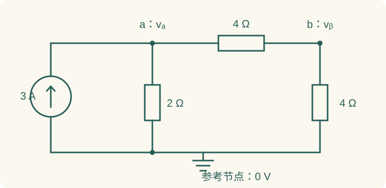
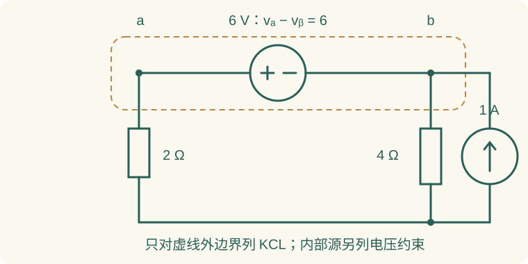

# 02 节点电压法、网孔法与方程检查

方程法通过选择独立未知量减少方程数量，并利用变量定义自动满足部分拓扑约束。选节点电压时，支路电压已经是两节点之差，KVL 自动满足；选独立回路电流时，支路电流由闭合回路电流组合而成，KCL 自动满足。

配套[电路方程原课件](../resources/source-lectures/03-电路方程-2024.pdf#page=1)。本页数值题为自编训练，连接和参考方向写在题设中，可用来练考试作答过程；不是原课件题目的转录。

## 1. 选方法前，先看两个特殊元件

理想电压源两端电压已知，但流过它的电流未知；理想电流源电流已知，但两端电压未知。普通节点方程习惯用“电压差除电阻”表示电流，遇到理想电压源就需要额外处理；普通网孔方程习惯把压降写成“电阻乘电流”，遇到理想电流源就需要额外处理。

| 电路特征 | 优先考虑 | 为什么 |
| --- | --- | --- |
| 非参考节点少、电流源多 | 节点电压法 | 电流源直接进入 KCL 右端 |
| 平面图、网孔少、电压源多 | 网孔电流法 | 电压源直接进入 KVL 右端 |
| 理想电压源跨两个未知节点 | 超节点，或增加源电流未知量 | 不能用电阻公式写源电流 |
| 理想电流源处于两网孔公共边 | 超网孔，或增加源电压未知量 | 公共边电压未知 |
| 电压源一端接地 | 直接得到另一端电位 | 不必专门设超节点 |
| 电流源位于一个网孔的外边 | 直接规定该网孔电流 | 不必专门设超网孔 |
| 受控源多或非平面网络 | 节点法、改进节点法 | 控制变量容易纳入方程 |

**超节点对应电压源，超网孔对应电流源**。这句话来自未知量的性质，比死记表格更可靠。节点法处理的是节点电压，网孔法处理的是面内闭合电流，不要把两类“超”结构混用。

## 2. 节点电压方程的建立 {#2-kcl}

选节点 0 为参考地，其余电位记为 $v_1,\ldots,v_{n-1}$。从节点 $k$ 经过电阻 $R_{kj}$ 流向节点 $j$ 的电流是 $(v_k-v_j)/R_{kj}$。若把独立电流源注入节点的电流记为正，KCL 可写为

$$\sum_j\frac{v_k-v_j}{R_{kj}}=I_{k,\mathrm{inj}}.$$

左端每项单位都是 A。不要把 $v_k/R$ 当成所有支路电流；只有另一端接地时才是这个形式。每个未知节点写一行，求完节点电压后再按原方向回算支路电流。

### 例 1：两个节点，写成矩阵再验算

节点 a 经 $2\,\Omega$ 接地，经 $4\,\Omega$ 接 b；b 经另一个 $4\,\Omega$ 接地。$3\,\mathrm A$ 电流源从地注入 a。

节点方程为

$$\begin{cases}
\dfrac{v_a}{2}+\dfrac{v_a-v_b}{4}=3,\\
\dfrac{v_b}{4}+\dfrac{v_b-v_a}{4}=0.
\end{cases}$$

乘以 4，得 $3v_a-v_b=12$、$-v_a+2v_b=0$，所以

$$v_a=4.8\,\mathrm V,\qquad v_b=2.4\,\mathrm V.$$

三个电阻电流分别为 $2.4\,\mathrm A$、从 a 到 b 的 $0.6\,\mathrm A$、从 b 到地的 $0.6\,\mathrm A$。节点 a 流出总电流为 $3\,\mathrm A$，节点 b 收支为零。

功率检查：$2.4^2\times2+0.6^2\times4+0.6^2\times4=14.4\,\mathrm W$，等于电流源发出的 $3\times4.8=14.4\,\mathrm W$。若只检查 a 节点但不回代 b 节点，仍可能漏掉一个符号错误。

### 导纳矩阵的结构

对两个节点的纯电阻网络，令 $G_i=1/R_i$：

$$\begin{bmatrix}G_1+G_3&-G_3\\-G_3&G_2+G_3\end{bmatrix}
\begin{bmatrix}v_a\\v_b\end{bmatrix}
=\begin{bmatrix}I_s\\0\end{bmatrix}.$$

对角项是连接本节点的电导之和，非对角项是连接这两个节点的电导负值。无受控源的双边电阻网络通常得到对称矩阵；加入受控源后矩阵不一定对称，不能为了“好看”擅自改成对称。

## 3. 理想电压源：超节点与直接约束

若电压源连接 a、b 两个未知节点，先把两节点连同源包围成超节点。对边界列 KCL，内部源电流不出现；再补充源电压约束。这样仍然有足够的方程，而不是把两节点误认为一个等电位节点。

### 例 2：超节点可以产生负电位

a 经 $2\,\Omega$ 接地，b 经 $4\,\Omega$ 接地；a、b 之间有 $6\,\mathrm V$ 理想电压源，a 为正端；另有 $1\,\mathrm A$ 从地注入 b。未知量为 $v_a,v_b$。

超节点的外边界只包含两个电阻和电流源，因此

$$\frac{v_a}{2}+\frac{v_b}{4}=1.$$

源约束为 $v_a-v_b=6$。代入 $v_a=v_b+6$：

$$2(v_b+6)+v_b=4\quad\Rightarrow\quad v_b=-\frac83\,\mathrm V,\quad v_a=\frac{10}3\,\mathrm V.$$

如果还要求电压源电流，定义它从 a 流向 b 为 $j$，回到 a 节点列 KCL：$v_a/2+j=0$，故 $j=-5/3\,\mathrm A$。实际流向是 b→a，电压源发出功率 $10\,\mathrm W$；独立电流源因为节点 b 为负而吸收 $8/3\,\mathrm W$，并非所有“电源”都一定向外供能。

**易错解法**：把 a、b 都称作“超节点”后令 $v_a=v_b$，等于把原来 6 V 电源短路。包围面只是消去内部电流的技巧，不改变内部电压关系。[超节点原讲义，第 25—26 页](../resources/source-lectures/03-电路方程-2024.pdf#page=25)。

## 4. 网孔法：共享支路写电流差

网孔是平面电路图中不再包含其他支路的最小闭合区域。网孔法可直接用于平面网络；非平面网络仍可选独立回路列方程，但不能机械地按图中每个“小格子”设网孔。统一取顺时针网孔电流，一只共享电阻上的实际支路电流是相邻网孔电流之差。

### 例 3：两个网孔的共享电阻

两个网孔共用 $R_3=1\,\Omega$；左网孔外侧电阻 $R_1=2\,\Omega$、电源 $10\,\mathrm V$（沿左网孔顺时针是电压升）；右网孔外侧只有 $R_2=3\,\Omega$。网孔电流 $I_1,I_2$ 都顺时针。

$$\begin{cases}2I_1+1(I_1-I_2)=10,\\3I_2+1(I_2-I_1)=0.\end{cases}$$

即 $3I_1-I_2=10$、$-I_1+4I_2=0$，得

$$I_1=\frac{40}{11}\,\mathrm A,\qquad I_2=\frac{10}{11}\,\mathrm A.$$

共享电阻按左网孔方向的电流为 $(40-10)/11=30/11\,\mathrm A$，不能误写成 $I_1$ 或 $I_1+I_2$。检查功率：

$$2\left(\frac{40}{11}\right)^2+3\left(\frac{10}{11}\right)^2+\left(\frac{30}{11}\right)^2=\frac{400}{11}\,\mathrm W=10I_1.$$

这一题中网孔电流与某些支路电流相等，但与共享支路电流不相等；解得网孔电流后一定要回原图确认待求量。

## 5. 电流源公共边：超网孔

电流源在两个网孔公共边时，其端电压未知。绕过公共边，对两个网孔外边界列 KVL，然后利用电流源提供的差值约束。公共边上的其他串联元件也要一起绕过；不能遗漏外边界的电阻或源。

### 例 4：超网孔还可以回求源电压

左右网孔均取顺时针；左外边有 $4\,\Omega$ 和 $12\,\mathrm V$ 电源（顺时针电压升），右外边有 $6\,\Omega$；公共边的电流源为 $1\,\mathrm A$，箭头由下向上。左网孔沿公共边向下、右网孔沿公共边向上，因此

$$I_2-I_1=1.$$

外边界 KVL 为 $4I_1+6I_2=12$，得

$$I_1=0.6\,\mathrm A,\qquad I_2=1.6\,\mathrm A.$$

定义电流源电压 $u_s$ 为上正下负，左网孔 KVL 为 $4I_1+u_s=12$，故 $u_s=9.6\,\mathrm V$。电流源电流从负端流入，所以发出 $9.6\,\mathrm W$；电压源发出 $12\times0.6=7.2\,\mathrm W$。两个电阻耗能 $4(0.6)^2+6(1.6)^2=16.8\,\mathrm W$，恰等于两源总输出。

若公共边箭头向下，则约束变为 $I_1-I_2=1$；外边界 KVL 形式不变。先把两网孔在公共边的方向画出来，符号就不会靠猜。[含理想电流源的回路法，第 16—17 页](../resources/source-lectures/03-电路方程-2024.pdf#page=16)。

## 6. 含受控源网络的方程

可暂时把受控源的值记作一个符号源值，列完普通方程后，再用节点电压或网孔电流表示控制量。这里的“暂时当作源值”绝不意味着可以把它按独立源置零。

### 例 5：跨导源使导纳矩阵不对称

沿用例 1 的三个电阻和 $3\,\mathrm A$ 注入源，再在 b 节点增加由地流向 b 的跨导源 $(0.25\,\mathrm S)v_a$。节点方程为

$$\begin{cases}\dfrac{v_a}{2}+\dfrac{v_a-v_b}{4}=3,\\
\dfrac{v_b}{4}+\dfrac{v_b-v_a}{4}=0.25v_a.
\end{cases}$$

第二式整理成 $-0.5v_a+0.5v_b=0$，所以 $v_b=v_a$，第一式给 $v_a=v_b=6\,\mathrm V$。两节点间电阻电流为零；a 经接地电阻流出 $3\,\mathrm A$，b 经接地电阻流出 $1.5\,\mathrm A$，恰由各自源提供。

矩阵的 a→b 非对角项为 $-0.25\,\mathrm S$，b→a 为 $-0.5\,\mathrm S$，不再对称。电阻耗能为 $18+9=27\,\mathrm W$，独立源输出 $18\,\mathrm W$、受控源输出 $9\,\mathrm W$。若把受控源漏掉，答案会退回例 1 的 $4.8\,\mathrm V,2.4\,\mathrm V$，可见控制关系不是一句无关说明。[含 VCCS 节点法，第 24 页](../resources/source-lectures/03-电路方程-2024.pdf#page=24)。

## 7. 改进节点法与图论数量检查

当理想电压源很多，可把源电流也设成未知量，列每个节点的 KCL，再列每个电压源的端电压关系。块矩阵可写成

$$\begin{bmatrix}G&B\\C&D\end{bmatrix}\begin{bmatrix}v\\i_s\end{bmatrix}=\begin{bmatrix}j\\e\end{bmatrix}.$$

对于仅含独立理想电压源的常见构造，$D=0$，$B,C$ 来自源的连接方向。含受控源后结构会变化，应由方程逐项填入，不能照搬某个固定模板。

对连通图选一棵树：树含全部 $n$ 个节点、没有回路、共有 $n-1$ 条树支。每加一条非树支，会产生一个基本回路，因此独立回路数为 $b-n+1$；基本割集数为 $n-1$。这些数量关系适合题目要求“只列方程不计算”时检查漏项。[回路、树与基本回路，第 2—6 页](../resources/source-lectures/03-电路方程-2024.pdf#page=2)。

例如一个连通网络有 5 个节点、8 条支路，独立 KCL 为 4 个，独立 KVL 为 4 个。若设 8 个支路电流，通常由 4 个 KCL 加 4 个代入元件关系后的 KVL 求解；有理想电流源时，源支路电流本身就是约束，必须相应调整未知量与方程，不能再套普通电阻压降公式。

## 8. 用改进节点法重做超节点例题

超节点法省去了电压源电流；若题目明确要求这个电流，改进节点法反而更直接。以例 2 为例，定义源电流 $j$ 从 a 流向 b，则未知量为 $v_a,v_b,j$：

$$\begin{cases}
\dfrac{v_a}{2}+j=0,\\
\dfrac{v_b}{4}-j=1,\\
v_a-v_b=6.
\end{cases}$$

这三个方程分别是 a 节点 KCL、b 节点 KCL、源电压关系，没有任何多余假设。矩阵形式为

$$\begin{bmatrix}0.5&0&1\\0&0.25&-1\\1&-1&0\end{bmatrix}
\begin{bmatrix}v_a\\v_b\\j\end{bmatrix}
=\begin{bmatrix}0\\1\\6\end{bmatrix}.$$

第三行的最后一项为零，不意味着方程“少了一项”，而是理想电压源的端电压不由流过它的电流决定。将前两行相加，就消去了 $j$，得到超节点方程；所以两种方法是同一组基本约束的不同消元方式。

这也解释选择参考地的重要性：若改选 b 为地，则 $v_a=6\,\mathrm V$ 已知，另一个原来的地节点成为未知。可以减少显式超节点，但所有电源和测量电压都要同步重写，不能一边换地一边继续沿用旧节点电位。

## 9. 电流控制源：控制量必须回到实际支路

受控源的控制电流经常不是某个网孔电流本身，而是两个网孔的差。节点法中，则通常需要先把控制电流表示为两节点电位差除电阻；若控制支路是理想电压源，就要额外引入其支路电流。把图上写的 $i_x$ 直接当成已知常数，是这类题的主要失分点。

**例 6：CCCS 的闭合控制关系。** 节点 a 经 $2\,\Omega$ 接到已知 10 V 节点，经 $4\,\Omega$ 接地；另有受控电流源从 a 流向地，值为 $0.5i_x$。控制电流 $i_x$ 定义为从 10 V 节点经过 $2\,\Omega$ 流向 a。

先写控制关系：

$$i_x=\frac{10-v_a}{2}.$$

再写节点收支：

$$i_x=\frac{v_a}{4}+0.5i_x\quad\Rightarrow\quad i_x=\frac{v_a}{2}.$$

联立得 $v_a=5\,\mathrm V$、$i_x=2.5\,\mathrm A$；接地电阻流 $1.25\,\mathrm A$，受控源也流 $1.25\,\mathrm A$。功率方面，2 Ω 电阻吸收 12.5 W，4 Ω 电阻吸收 6.25 W，受控源吸收 $5\times1.25=6.25\,\mathrm W$，10 V 源输出 $10\times2.5=25\,\mathrm W$，相符。

若把 $i_x$ 的方向改为 a→10 V，控制源表达式也必须改成 $-0.5i_x'$ 才描述同一个物理电路。只反转控制箭头不改控制关系，就是换了一道题。

## 10. 已知节点和零电阻支路的处理

理想电压源一端接地时，另一端节点电位已由源极性确定。例如 a 对地有 5 V 源且 a 为正，直接写 $v_a=5\,\mathrm V$，不必再为 a 写一条只含电阻的 KCL 来“求它”。若还要求电压源电流，再用 a 节点 KCL 回算。

理想导线或零电阻连接的两个节点应先合并，再写节点矩阵。把 $R=0$ 代入 $(v_a-v_b)/R$ 会产生除零，问题不在欧姆定律而在没有先做拓扑化简。反过来，断开的支路应删除其电导，不能凭空增加一个未知电流。开关题尤其需要在换路前后分别重画节点关系；图上位置相同的点，开关动作后未必仍然连通。

举例：a 通过闭合开关与 b 相连，a 对地接 2 Ω，b 对地接 4 Ω，向 a 注入 3 A。合并后只有一个未知电位 $v$，方程为 $v/2+v/4=3$，得 $v=4\,\mathrm V$。两个接地电阻电流为 2 A、1 A；开关支路从 a 到 b 流 1 A，须回原图用局部 KCL 求，不能因为合并节点后“看不见开关”便说开关电流为零。

实际交卷前，可以只做两次有针对性的回代：一次代回包含独立源的 KCL/KVL，检查激励项正负；一次代回包含受控源或超节点约束的方程，检查特殊条件。两条都过，再核算功率。若计算器给出小数，保留足够中间位数，最后再统一有效数字，不把 1/3 过早截成 0.3 导致后续功率不平衡。

## 11. 常见错法与查错顺序

拿到不合理答案，先回到方程，不要立刻重新按计算器。检查每条支路的两端节点；检查理想电压源有没有补电压约束；检查公共电阻究竟是电流差还是电流和；检查控制量的正负和单位。最后才是代数运算。

节点方程的每项单位应是 A，网孔 KVL 的每项应是 V；把跨导 $g$ 当作电阻写成 $u/g$，单位立刻暴露错误。解完至少代回两条原方程，再做功率平衡。含受控源的电路可以有负输入电阻，但普通正电阻自身的 $Ri^2$ 不能负。

对称性、短路和开路极限也是强检验：令两支路参数相等后，对应节点应相等；令某电阻趋无穷，其支路电流应趋零。但用于极限判断的数学式应保持其他独立约束相容，不能把理想电压源直接短路后仍要求其电压非零。

## 12. 列方程题的书写要求

这类题通常不要求繁复求解，但对未知量和参考方向的要求更严格。先在图上标参考节点或回路方向，再声明未知向量；每写一条 KCL/KVL，就注明对应节点或回路；受控关系单列，不把它埋进文字里。最后确认独立方程数等于未知量数。

节点法一般有 $n-1$ 个节点电位未知量，若增加 $m$ 个电压源电流作为未知量，就还要增加 $m$ 条源电压约束。超节点不是真的减少节点数量，而是将若干节点 KCL 相加，同时保留内部电压差约束。网孔法同理：公共边电流源以网孔电流差规定约束，外部一条 KVL 取代原来的两条含未知源电压 KVL。

矩阵奇异时先查两类结构：一是整个子网悬浮、没有规定其相对参考地电位，二是理想源形成相互矛盾或重复的约束。不应一见奇异就随手补“某节点等于零”，除非这个节点本来就是可自由选择的参考节点，且同步改写了所有节点定义。

## 13. 分层练习

### 练习 A：节点法与弥尔曼定理

某节点通过 $2\,\Omega$ 接 $10\,\mathrm V$ 已知节点，通过 $3\,\Omega$ 接地，另有 $1\,\mathrm A$ 电流源从该节点流向地。求节点电位。

??? answer "展开方程、数值与验算"
    $\dfrac{v-10}{2}+\dfrac v3+1=0$。乘以 6 得 $3v-30+2v+6=0$，所以 $v=4.8\,\mathrm V$。从 10 V 端流入 $2.6\,\mathrm A$，从节点流向接地电阻 $1.6\,\mathrm A$、电流源 $1\,\mathrm A$，KCL 成立。两节点网络的弥尔曼公式（Millman）只是这条节点 KCL 的整理形式，不是新的定律。

### 练习 B：超节点

a 经 $3\,\Omega$ 接地，b 经 $6\,\Omega$ 接地；a、b 间理想电压源规定 $v_a-v_b=9\,\mathrm V$，无其他源。求两个节点电压及电源电流。

??? answer "展开逐步解答"
    超节点 KCL 为 $v_a/3+v_b/6=0$，配合 $v_a-v_b=9$，得 $v_a=3\,\mathrm V,v_b=-6\,\mathrm V$。定义源电流从 a 流向 b，则 $j=-v_a/3=-1\,\mathrm A$，实际从 b 到 a。电源输出 $9\,\mathrm W$，电阻耗能 $3^2/3+(-6)^2/6=9\,\mathrm W$。

### 练习 C：超网孔

沿用例 4 的连接，但公共电流源改为向上 $2\,\mathrm A$，左外边电压源改为 $20\,\mathrm V$。求两个网孔电流。

??? answer "展开逐步解答"
    $I_2-I_1=2$，$4I_1+6I_2=20$。代入得 $10I_1+12=20$，所以 $I_1=0.8\,\mathrm A,I_2=2.8\,\mathrm A$。公共边上正下负电压为 $20-4(0.8)=16.8\,\mathrm V$。电阻总功率 $4(0.8)^2+6(2.8)^2=49.6\,\mathrm W$，源总输出 $20(0.8)+16.8(2)=49.6\,\mathrm W$。

## 14. 与端口方法衔接

若只问一个负载电流，而周围网络很复杂，不一定要把所有节点解完。节点法可以先求端口开路电压，再求等效电阻，把负载化成一行计算；这就是下一章的[网络定理与端口等效](03-theorems.md)。方程法提供稳定的底层计算，等效法负责减少重复劳动。
