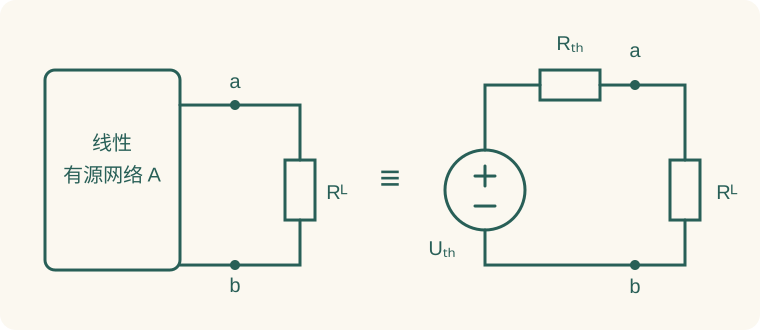

# 03 网络定理、端口等效与最优负载

如果负载会改变，或者只问一个支路的响应，先把其余网络看成一端口，常比完整重解网络省力。电路定理没有取代 KCL/KVL；它们利用线性、端口关系或已知工作点，把重复计算压缩了。

本章数值例题为自编训练。原资料主要对应[电路定理课件](../resources/source-lectures/04-电路定理-2024.pdf#page=1)与[等效法课件](../resources/source-lectures/02-等效法-2024.pdf#page=3)。所有 PDF 页码指实际物理页序。

## 1. 先区分三种“替换”

**等效变换**要求端口在允许的全部激励或负载下具有相同伏安关系。戴维南、诺顿就是这种对外等效，它不保证内部每个元件电流和功率不变。

**替代定理**从某个已经确定的工作状态出发，把一条支路换成能保持该状态电压或电流的源。它只保证这个状态不改变，不意味着改变外部激励后仍然等效。

**叠加定理**把多个独立激励的线性响应相加。求的是响应，不是把电路物理拆成互不影响的几个部分。三个概念混淆时，很容易出现“原来某支路是 2 V，所以以后永远当 2 V 电源”的错误。

## 2. 叠加定理

在线性网络中，保持同一输出参考方向，任一支路电压或电流等于各独立源单独作用时响应的代数和。将其他独立源置零：独立电压源短路、独立电流源开路；受控源及其控制关系保留。动态网络还要区分零输入响应与零状态响应：初始储能不能被漏掉，也不能在每个独立源子问题里重复计入。

### 例 1：同一道题顺便证明功率不能叠加

节点 a 经 $2\,\Omega$ 接 $10\,\mathrm V$ 已知节点，经 $3\,\Omega$ 接地；另有 $1\,\mathrm A$ 从地注入 a。求 a 电压及 $3\,\Omega$ 电阻功率。

只保留电压源时，电流源开路，分压得

$$v_a^{(U)}=10\frac3{2+3}=6\,\mathrm V.$$

只保留电流源时，电压源短路，节点所见电阻为 $2\parallel3=1.2\,\Omega$：

$$v_a^{(I)}=1\times1.2=1.2\,\mathrm V.$$

总电压 $v_a=7.2\,\mathrm V$，总功率

$$P=\frac{(6+1.2)^2}{3}=17.28\,\mathrm W.$$

若误把功率相加，只得到 $6^2/3+1.2^2/3=12.48\,\mathrm W$，少了交叉项 $2(6)(1.2)/3=4.8\,\mathrm W$。其原因是功率含变量的平方，不能直接应用线性叠加。直接节点检查为 $(v_a-10)/2+v_a/3=1$，代入 $7.2\,\mathrm V$ 成立。[叠加原讲义，第 2—4 页](../resources/source-lectures/04-电路定理-2024.pdf#page=2)。

不同频率的周期分量虽然不能合成一个相量，但平均功率中的某些交叉项会因正交而为零；这属于时间平均后的特殊性质，不是一般“功率可叠加”。

## 3. 戴维南和诺顿：端口关系是关键

取端口电压 $u$ 上正下负，负载电流 $i$ 从网络流出正端，则线性一端口可写成

$$u=U_{\rm th}-R_{\rm th}i.$$

令 $i=0$ 得开路电压 $U_{\rm oc}=U_{\rm th}$；令 $u=0$ 得短路电流 $I_{\rm sc}=U_{\rm th}/R_{\rm th}$。因此可等效为 $U_{\rm th}$ 串联 $R_{\rm th}$，也可等效为 $I_N=I_{\rm sc}$ 并联相同电阻。

要先划定边界：待求负载在端口外，其他元件在端口内。求开路电压是只移去负载，不能顺手把内部某条支路也断开。求短路电流要标方向；若将它定义为“从外部流入网络”，符号会与上述 $I_{\rm sc}$ 相反。

### 例 2：负载变化只算一遍内部网络

$12\,\mathrm V$ 电源经过 $3\,\Omega$ 到节点 a，a 经 $6\,\Omega$ 接地。负载接在 a 与地之间。

开路负载后，内部 $3\,\Omega$ 与 $6\,\Omega$ 仍构成分压：

$$U_{\rm th}=12\frac6{3+6}=8\,\mathrm V.$$

把独立电压源置零，则 $3\,\Omega$、$6\,\Omega$ 从端口看是并联：

$$R_{\rm th}=3\parallel6=2\,\Omega.$$

若 $R_L=4\,\Omega$，负载电流为 $I_L=8/(2+4)=4/3\,\mathrm A$，负载电压 $16/3\,\mathrm V$，功率 $64/9\,\mathrm W$。若短接端口，内部 $6\,\Omega$ 被短路，$I_{\rm sc}=12/3=4\,\mathrm A$，检查 $U_{\rm oc}/I_{\rm sc}=2\,\Omega$。换成 $R_L=6\,\Omega$ 时，不必重新列内部方程，直接算 $8/(2+6)=1\,\mathrm A$。

## 4. 含受控源端口的测试源法

求等效电阻应将**独立源**置零，保留受控源；对所得网络在端口施加测试电压 $U_t$，定义测试电流 $I_t$ 为流入端口正端，则

$$R_{\rm th}=\frac{U_t}{I_t}.$$

也可加测试电流求测试电压，常取 1 V 或 1 A 简化运算。测试源只是在数学上探测端口，不应与原网络中的独立源混为一谈。

### 例 3：受控源使等效电阻改变

端口节点 a 经 $2\,\Omega$ 接地；独立电流源 $1\,\mathrm A$ 从地注入 a；另有跨导源从地流向 a，大小为 $(0.25\,\mathrm S)u$，其中 $u=v_a$。

**第一步：开路电压。** 开路不意味着内部电阻电流为零：

$$\frac u2=1+0.25u\quad\Rightarrow\quad U_{\rm th}=4\,\mathrm V.$$

**第二步：测试源求电阻。** 关闭独立电流源（开路），保留跨导源。令 $U_t=1\,\mathrm V$，则电阻流出 $0.5\,\mathrm A$、跨导源注入 $0.25\,\mathrm A$，测试源向端口输入的净电流

$$I_t=0.5-0.25=0.25\,\mathrm A,\qquad R_{\rm th}=4\,\Omega.$$

**第三步：接负载检查。** $R_L=4\,\Omega$ 时，等效图给 $I_L=4/(4+4)=0.5\,\mathrm A$，$u=2\,\mathrm V$。原图 KCL 为 $u/2+u/4=1+0.25u$，也得到 $u=2\,\mathrm V$。

若误把受控源关闭，会得到 $R_{\rm th}=2\,\Omega$，负载响应随即错误。对纯受控源网络常出现 $U_{\rm oc}=I_{\rm sc}=0$，此时不能用 $0/0$ 求电阻，测试源法仍有效。某些有源网络还可能呈现负输入电阻；这时最大功率公式的常规正电阻条件不再自动满足。[戴维南与诺顿原讲义，第 16—20 页](../resources/source-lectures/04-电路定理-2024.pdf#page=16)。

## 5. 最大功率与负载约束

### 5.1 直流可变正电阻

若 $R_{\rm th}>0$、$U_{\rm th}$ 固定，负载为可变正电阻：

$$P_L=\frac{U_{\rm th}^2R_L}{(R_{\rm th}+R_L)^2}.$$

对 $R_L$ 求导：

$$\frac{dP_L}{dR_L}=\frac{U_{\rm th}^2(R_{\rm th}-R_L)}{(R_{\rm th}+R_L)^3}.$$

所以 $R_L=R_{\rm th}$ 时取最大值 $P_{\max}=U_{\rm th}^2/(4R_{\rm th})$。负载开路和短路时功率都趋零，也支持这个中间极大值。功率匹配时等效源内阻与负载耗能相等，等效电路的效率为 50%；但真实网络内部功率未必与戴维南内部相同，不能据此断言原复杂电源总体效率也是 50%。

### 5.2 交流：负载可变复阻抗

以下相量均用有效值。若 $Z_{\rm th}=R_s+jX_s$、$R_s>0$，负载实部和虚部均可调，则

$$Z_L=R_s-jX_s=Z_{\rm th}^*,\qquad P_{\max}=\frac{|\underline U_{\rm th}|^2}{4R_s}.$$

先用负载电抗抵消源电抗，再匹配电阻。此时谈的是有功功率最大，不是端口电压最大，也不是电流最大。

### 例 4：同一个源，两种负载限制

设 $\underline U_{\rm th}=12\angle0^\circ\,\mathrm V$，$Z_{\rm th}=3+j4\,\Omega$。

**可调复负载**：$Z_L=3-j4\,\Omega$，总阻抗为 $6\,\Omega$，$I=2\,\mathrm A$，负载有功功率 $I^2R_L=12\,\mathrm W$。

**只能接纯电阻**：负载电抗不能抵消 $j4$。此时

$$P_L=\frac{144R_L}{(3+R_L)^2+4^2}.$$

求导可得最优 $R_L=\sqrt{3^2+4^2}=5\,\Omega$，最大功率 $144\times5/(8^2+4^2)=9\,\mathrm W$。如果盲用 $R_L=3\,\Omega$，反而只有 $432/52\approx8.31\,\mathrm W$。

一般结论是：$X_L=0$ 且只能改变正电阻时，最优 $R_L=|Z_{\rm th}|$；$R_L$、$X_L$ 都可调时才是共轭匹配。峰值相量代入功率前要除以 $\sqrt2$，否则功率差一倍。[最大功率原讲义，第 23 页](../resources/source-lectures/04-电路定理-2024.pdf#page=23)。

## 6. 替代、补偿、互易与特勒根

### 6.1 替代定理：保持已知工作点

已知某支路电压 $u_k$ 和电流 $i_k$ 后，可用同电压的理想电压源或同电流的理想电流源替代它，只要替代前后解唯一、支路与其他部分没有被破坏的耦合或控制关系。该思想可用于线性和非线性电路，但只保持指定工作状态。

例如某电阻原工作电流为 2 A，用 2 A 电流源替代，在其他条件不变且解唯一时，外部工作状态可保持；若随后把外电源翻倍，原电阻电流一般改变，而理想 2 A 源不会改变，两者便不再等效。[替代定理及条件，第 11—13 页](../resources/source-lectures/04-电路定理-2024.pdf#page=11)。

### 6.2 补偿：不要把原电流和新电流写混

线性网络中某支路电阻由 $R$ 改为 $R+\Delta R$，可研究增量网络。常见两种准确构造是：在**改变后的电阻网络**中施加串联补偿电压 $-i\Delta R$，其中 $i$ 为原支路电流；或者在**原电阻网络**中施加 $-i'\Delta R$，其中 $i'$ 为改变后的电流。原独立源置零，受控源保留。两者不能混搭。

**例 5：用补偿计算变化量。** $12\,\mathrm V$ 源串联 $2\,\Omega$ 与 $4\,\Omega$，原电流 $i=2\,\mathrm A$。后者增至 $5\,\Omega$，$\Delta R=1\,\Omega$。

用改变后的总电阻 $7\,\Omega$ 和补偿电压 $-i\Delta R=-2\,\mathrm V$：

$$\Delta i=\frac{-2}{7}\,\mathrm A,\qquad i'=2-\frac27=\frac{12}7\,\mathrm A.$$

直接计算 $12/(2+5)=12/7\,\mathrm A$，完全相同。若误用原总电阻 $6\,\Omega$ 除 $-2\,\mathrm V$，得到 $-1/3\,\mathrm A$，那只是把新旧网络混用了。仅当变化很小时，一阶灵敏度近似 $di/i\approx-dR/(R_s+R_L)$ 才可以忽略更高阶项。

### 6.3 互易：激励与响应要成对交换

线性、双边的无源 RLC 网络在相应零初始条件下满足互易关系。例如以两个端口电流作为激励，开路阻抗参数具有 $Z_{12}=Z_{21}$；同一电流源从端口 1 移到端口 2，观察另一端口开路电压，保持端口参考方向对应，转移阻抗相同。

不能随便把“电压源放 A 测 B 电流”换成“电流源放 B 测 A 电压”而声称数值相同。含受控源或非互易器件时，一般不能直接套用无源双边网络的保证条件；某些特殊含源结构仍可互易，需由参数关系另证。

### 6.4 特勒根：拓扑层面的检查

同一网络在某一时刻的支路电压满足 KVL、支路电流满足 KCL，按统一关联方向有

$$\sum_k u_ki_k=0.$$

这是总功率平衡，对含非线性和受控元件的集总网络也适用。更一般地，同一拓扑下两组分别满足 KVL、KCL 的变量可构成 $\sum_k u_k^{(1)}i_k^{(2)}=0$；这些交叉乘积未必是某一实际状态的物理功率。用来验算时应把每个电源的吸收功率也算入，不能只加电阻。

## 7. 提高方法：对称性与密勒分解

对称性首先要求元件连接和参数对称，还要求激励以相应方式对称。偶对称时对应节点等电位，可删除两者之间不流电流的桥支路；反对称时中线可能是零电位面。拆半电路之前，把交换左右后电压或电流为何不变写清楚，比直接说“由对称性”更完整。

若跨接阻抗 $Z$ 的两端电压确定满足 $v_b=Kv_a$，从 a 端流向 b 的电流为 $(1-K)v_a/Z$，从 b 端流向 a 的电流为 $(1-1/K)v_b/Z$。于是对于该固定电压关系，可用两个对地阻抗描述端口电流：

$$Z_a=\frac Z{1-K},\qquad Z_b=\frac Z{1-1/K}.$$

这是密勒分解，$K=0$、$K=1$ 等特殊值需要按原电流关系取极限，不能除以零。若 $K=-4$、$Z=1\,\mathrm{k}\Omega$，则 $Z_a=200\,\Omega$、$Z_b=800\,\Omega$。例如 $v_a=1\,\mathrm V,v_b=-4\,\mathrm V$ 时，原跨接支路从 a 到 b 流 $5\,\mathrm{mA}$；分解后 a 对地 $5\,\mathrm{mA}$、b 对地 $-5\,\mathrm{mA}$，两端注入一致。这不是对任意外部激励都成立的无条件二端口替换，关键前提就是电压比已被其他电路确定。

## 8. 线性一端口的伏安关系

以流出网络的负载电流为 $i$，对线性网络固定内部独立源后，端口电压可写成仿射形式 $u=a+bi$。开路时 $i=0$ 得 $a=U_{\rm oc}$；关闭内部独立源，只保留端口电流作用，端口电压变化为 $-R_{\rm th}i$，所以 $b=-R_{\rm th}$。

这里负号来自“电流流出网络”的约定。求测试电阻时却习惯把测试电流定义为“流入网络”，因此测试关系是 $u=R_{\rm th}I_t$。如果把这两个电流方向混在一起，会把正电阻算成负电阻。建议在求开路、短路、加测试源的三张等效图上分别标方向，不共享一个含糊的 $I$。

还要注意等效形式可能退化：理想电压源输出电阻为零，没有有限的诺顿电流；理想电流源输出电阻为无穷，没有有限的戴维南电压。这不表示电路非法，只表示不能强求两种有限参数形式同时存在。含理想控制关系的奇异网络也需要先确认端口解存在且唯一，再使用熟悉公式。

## 9. 互易的数值演示：把“交换位置”讲清楚

考虑纯电阻二端口，共同参考地；a 经 $2\,\Omega$ 接地，b 经 $3\,\Omega$ 接地，a、b 之间经 $4\,\Omega$ 相连。两个端口电流均规定从外部注入网络，电压均相对共同地。

**状态一**：向 a 注入 1 A，b 端外部开路。方程为

$$\frac{v_a}{2}+\frac{v_a-v_b}{4}=1,\qquad
\frac{v_b}{3}+\frac{v_b-v_a}{4}=0.$$

整理为 $3v_a-v_b=4$、$-3v_a+7v_b=0$，解得 $v_a=14/9\,\mathrm V$、$v_b=2/3\,\mathrm V$，所以 $Z_{21}=v_b/I_a=2/3\,\Omega$。

**状态二**：撤去 a 端电流源（开路），向 b 注入相同 1 A。方程右端变为 $(0,1)$，解得 $v_a=2/3\,\mathrm V$、$v_b=2\,\mathrm V$，所以 $Z_{12}=2/3\,\Omega$，与前一次相同。

这并没有说两个端口自己的输入电阻相同：$Z_{11}=14/9\,\Omega$、$Z_{22}=2\,\Omega$ 就不相等。互易描述激励与响应位置交换后的转移关系，不要求网络具有几何对称性。有受控源时导纳矩阵可能不对称，不能只因为方程仍是线性就推断互易。

## 10. 受控量跨越端口时如何划边界

戴维南等效最稳妥的对象是**自成一体的线性一端口**：内部元件及控制关系都能由内部变量和端口变量完整描述。若控制量定义在待移去的负载内部，直接拆掉负载还继续沿用那个控制量，会改变题目。

例如受控电压源的值为 $r i_L$，而 $i_L$ 正是待求负载电流。可以保留 $i_L=i$ 的端口关系，把源影响纳入端口方程，再从斜率求等效电阻；但不能一拆负载就把 $i_L$ 当成独立常数，也不能把它永久设为开路时的零值。换了负载后，控制量随端口工作状态改变，控制关系仍要成立。

对这种题，先写含端口电流 $i$ 的关系 $u=U_0-R_{\rm out}i$，检查开路、短路和任意一个有限负载三种状态是否同时符合原图。三者都一致，才说明等效没有误删控制链。对只保持一次工作点的替代，则不要声称已经得到对全部负载通用的戴维南参数。

## 11. 定理的等效电路表示

网络定理可通过三组等效电路对照理解。第一组是叠加子电路：独立源如何短路、开路，受控源始终保留；第二组是端口三状态：开路求电压、短路求电流、关闭独立源后加测试源求电阻；第三组是最大功率的负载约束：可调纯电阻和可调复阻抗画成不同的问题。

做题时先写一句“本题网络线性，负载在端口外，独立源固定”或“本题负载只允许纯电阻”。这些前提会直接决定公式能否使用。随后用一条节点 KCL 或端口伏安式复核数值，比机械地把戴维南和诺顿两种图都画一遍更有效。

对于提高题，优先尝试明确的端口、桥平衡和对称关系，若不能快速减少未知量，就回到节点法。所谓巧解应能说明省掉哪几个未知量、用了哪些成立条件；省略推导而直接报答案，不构成可复用的方法。

## 12. 自测与完整答案

### 练习 A：纯电阻负载限制

源有效值 $20\,\mathrm V$，等效阻抗 $6+j8\,\Omega$。负载可任意取复数时、只能取纯电阻时，分别求最大功率。

??? answer "展开计算"
    任意可调复负载：$Z_L=6-j8\,\Omega$，$P_{\max}=400/(4\times6)=50/3\,\mathrm W$。只能纯电阻：$R_L=\sqrt{36+64}=10\,\Omega$，$P_{\max}=400\times10/[(6+10)^2+8^2]=12.5\,\mathrm W$。两个条件不同，第二个最大值不能超过第一个。

### 练习 B：测试源与负输入电阻

端口并联 $4\,\Omega$ 电阻和向端口注入 $g u$ 的 VCCS，无独立源。分别在 $g=0.1\,\mathrm S$、$g=0.5\,\mathrm S$ 时求输入电阻。

??? answer "展开计算与物理含义"
    加 $U_t=1\,\mathrm V$，流入端口净电流 $I_t=1/4-g$。当 $g=0.1$ 时，$R_{\rm in}=1/0.15=20/3\,\Omega$；当 $g=0.5$ 时，$R_{\rm in}=1/(-0.25)=-4\,\Omega$。负输入电阻表示该有源模型向端口供能。因为 $U_{\rm oc}=I_{\rm sc}=0$，两种情形都不能由 $0/0$ 求等效电阻；也不能把正内阻的最大功率公式生搬到负内阻情形。

### 练习 C：端口等效与内部功率

例 2 中把负载取为 $2\,\Omega$，求负载最大功率，并检查真实源效率是否为 50%。

??? answer "展开逐步解答"
    等效网络满足 $R_L=R_{\rm th}=2\,\Omega$，所以 $I_L=8/4=2\,\mathrm A$，$P_L=8\,\mathrm W$。真实端口电压为 4 V，内部 $6\,\Omega$ 电阻电流 $2/3\,\mathrm A$；真实电源电流 $(12-4)/3=8/3\,\mathrm A$，源输出 $32\,\mathrm W$。所以真实源到负载效率为 $8/32=25\%$。戴维南等效保留外部伏安关系，没有保留内部能量分配。

## 13. 网络定理的选择

只求一个负载且需反复改变参数，优先戴维南；独立源只有两三个、关闭后容易串并联，叠加值得用；有受控源先看控制变量是否跨端口，求电阻时用测试源保底；题目写“最大功率”先圈出允许调节的是电阻还是整个复阻抗；元件参数小幅改变可用补偿或灵敏度，但必须区分精确增量和一阶近似。

回到[电路方程](02-equations.md)至少用一种方法复核端口电压；再到[正弦稳态](04-ac.md)把这些定理从实电阻推广到阻抗网络。
