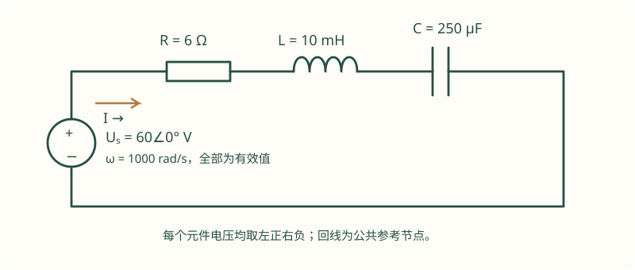
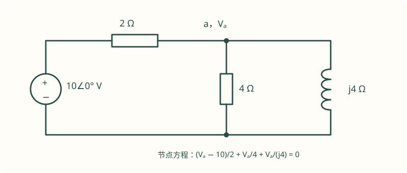

# 04 正弦稳态、谐振与交流功率

正弦稳态题的难处通常不在复数计算，而在“题目中的量到底是瞬时值、峰值、有效值，还是相量”。本章统一使用**余弦基准、有效值相量、被动符号约定**。先把约定固定，再列节点方程、计算功率或讨论谐振，整题才不会差一个 $\sqrt2$ 或一个共轭。

本章例题为依照课程知识范围编写的训练题，不标作历年真题。配套原讲义的实际 PDF 页码列在文末；页码指阅读器的页序号，不一定等于幻灯片上印刷的编号。

## 1. 有效值与相量：从定义开始

### 1.1 为什么电表常显示有效值

周期电压的有效值定义为

$$
U=\sqrt{\frac1T\int_{t_0}^{t_0+T}u^2(t)\,dt}.
$$

它表示同一个电阻上产生相同平均热量的直流电压。对于 $u(t)=U_m\cos(\omega t+\theta)$，一个周期内 $\cos^2$ 的平均值是 $1/2$，所以 $U=U_m/\sqrt2$。有效值不是整流平均值；也不是任何波形的峰值都可以除以 $\sqrt2$。方波、三角波以及含谐波信号，要回到定义或使用[非正弦有效值公式](06-three-phase.md)。

### 1.2 相量保留什么，省略什么

写成

$$
u(t)=\sqrt2U\cos(\omega t+\theta)
      =\sqrt2\operatorname{Re}\{\underline Ue^{j\omega t}\},\qquad
\underline U=Ue^{j\theta}.
$$

相量只保留有效值和初相，公共的时间因子省略了。它不是一个随时间旋转的瞬时电压，因此答案若要求 $u(t)$，最后必须把 $\sqrt2$ 和 $\cos(\omega t+\theta)$ 写回来。若题目给的是正弦，先用 $\sin x=\cos(x-90^\circ)$ 换成余弦，例如 $10\sin(1000t+30^\circ)$ 对应 $\underline U=(10/\sqrt2)\angle(-60^\circ)$。

复数计算中，相加减优先用直角坐标，乘除优先用极坐标。相位应通过象限正确的反正切求取；仅使用 $\arctan(y/x)$ 会把第二、第三象限判断错。

### 1.3 为什么微分变成 $j\omega$

因为 $d(e^{j\omega t})/dt=j\omega e^{j\omega t}$。将电感关系 $u_L=L\,di_L/dt$、电容关系 $i_C=C\,du_C/dt$ 代入，得到

$$
Z_R=R,\qquad Z_L=j\omega L,\qquad Z_C=\frac1{j\omega C}=-\frac j{\omega C}.
$$

这套替换得到的是**同一频率的正弦稳态特解**，不包含换路引起的自然响应。开关后还没进入稳态的题，应看[暂态专题](05-transients.md)，不能直接把 $L,C$ 换成阻抗就结束。

## 2. 阻抗电路仍然服从 KCL、KVL

串联阻抗相加，并联导纳相加；节点法、网孔法、戴维南定理在相量域仍适用。求等效时保留受控源，控制量也换为同频率相量。不同频率相量不能直接相加。

$$
Z_{\rm series}=\sum_k Z_k,\qquad
Y_{\rm parallel}=\sum_kY_k,\qquad Y=1/Z.
$$

阻抗角 $\arg Z=\arg\underline U-\arg\underline I$。当 $\operatorname{Im}Z>0$ 时网络呈感性，电流滞后电压；当 $\operatorname{Im}Z<0$ 时呈容性，电流超前。这里电压和电流必须是关联参考方向。不要把电压方向反向后仍沿用原来的超前、滞后结论。

### 例 1：串联 RLC，算完电流还要验 KVL

**题设。** $R=6\,\Omega$、$L=10\,\mathrm{mH}$、$C=250\,\mu\mathrm F$ 串联，电源 $u_s(t)=60\sqrt2\cos(1000t)\,\mathrm V$。电流从电源正端流向 $R,L,C$，各元件采用被动约定。求电流、元件电压及电源提供的有功、无功。

**第一步：把频率、相量和阻抗写齐。** $\omega=1000\,\mathrm{rad/s}$，$\underline U_s=60\angle0^\circ\,\mathrm V$，$X_L=10\,\Omega$、$X_C=4\,\Omega$，所以

$$
Z=6+j(10-4)=6+j6,\qquad
\underline I=\frac{60}{6+j6}=5-j5=5\sqrt2\angle(-45^\circ)\,\mathrm A.
$$

回到时域为 $i(t)=10\cos(1000t-45^\circ)\,\mathrm A$。这里相量的模是 $5\sqrt2$，瞬时电流的峰值是 $10$，两者不相同。

**第二步：元件电压。**

$$
\underline U_R=6(5-j5)=30-j30,
$$

$$
\underline U_L=j10(5-j5)=50+j50,\qquad
\underline U_C=-j4(5-j5)=-20-j20.
$$

三者相加确为 $60+j0$，KVL 成立。幅值分别约为 $42.43$、$70.71$、$28.28\,\mathrm V$；不能把这三个幅值直接相加与 $60\,\mathrm V$ 比较，因为它们相位不同。

**第三步：功率。** $|I|^2=50$，故 $P_R=50\times6=300\,\mathrm W$；$Q_L=500\,\mathrm{var}$、$Q_C=-200\,\mathrm{var}$。负载合计 $300+j300\,\mathrm{VA}$，电源向外提供相同数值。无功有正负，有功电阻耗散为正。

### 例 2：交流节点法，一次求清所有支路

**题设。** 电压源上端为 $10\angle0^\circ\,\mathrm V$，通过 $2\,\Omega$ 电阻接节点 $a$；$a$ 到地并接 $4\,\Omega$ 电阻与阻抗 $j4\,\Omega$ 的电感。求 $\underline V_a$、三条支路电流并验证复功率。

节点方程为

$$
\frac{\underline V_a-10}{2}+\frac{\underline V_a}{4}
 +\frac{\underline V_a}{j4}=0.
$$

化为 $(0.75-j0.25)\underline V_a=5$，解得 $\underline V_a=6+j2\,\mathrm V$。电源流向节点的电流为 $\underline I_s=(10-\underline V_a)/2=2-j1\,\mathrm A$。两个并联支路分别为

$$
\underline I_R=1.5+j0.5,\qquad
\underline I_L=0.5-j1.5\quad(\mathrm A).
$$

两者之和 $2-j1$ 正好等于电源电流。电源提供的复功率是 $10(2+j1)=20+j10$；串联电阻耗散 $|2-j1|^2\times2=10\,\mathrm W$，并联电阻耗散 $|6+j2|^2/4=10\,\mathrm W$，电感吸收无功 $|0.5-j1.5|^2\times4=10\,\mathrm{var}$，也完全相符。

这题若把 $1/(j4)$ 写成 $+j/4$，节点电压相位会反向。处理导纳时显式写 $1/j=-j$ 比心算更稳。

## 3. 复功率：共轭从哪里来

对 $u=\sqrt2U\cos(\omega t+\theta_u)$、$i=\sqrt2I\cos(\omega t+\theta_i)$ 相乘，得到

$$
p(t)=UI\cos(\theta_u-\theta_i)
     +UI\cos(2\omega t+\theta_u+\theta_i).
$$

后一项在整周期内均值为零，因此平均有功功率为 $P=UI\cos\varphi$，$\varphi=\theta_u-\theta_i$。复功率定义为

$$
\mathcal S=\underline U\underline I^*=P+jQ,\qquad
Q=UI\sin\varphi,\qquad |\mathcal S|=UI.
$$

用共轭恰好让两相角相减。若误用 $\underline U\underline I$，结果会随你选的参考初相改变，这显然不能代表实际有功功率。功率单位要区分：$P$ 用 W，$Q$ 用 var，$|\mathcal S|$ 用 VA。

电阻吸收 $P$，理想电感吸收正 $Q$，理想电容吸收负 $Q$。整个网络的复功率可以逐元件相加，然而电压、电流的幅值不能随意相加。电源如果使用电流流出正端的约定，所求是“提供功率”；若电流流入正端，则是“吸收功率”，符号应反过来。

## 4. 功率因数补偿：先减无功，再求电容

设理想交流电源电压有效值不变，负载有功功率为 $P$，原功率因数为 $\cos\varphi_1$。在负载两端并联电容，将功率因数提高到滞后的 $\cos\varphi_2$，则

$$
Q_C=-P(\tan\varphi_1-\tan\varphi_2),\qquad
C=\frac{P(\tan\varphi_1-\tan\varphi_2)}{\omega U^2}.
$$

上式适用于电容直接接在所用电压 $U$ 两端。三相电容组要区分星接还是角接，不能直接把线电压代入单相公式再乘三。若存在显著线路阻抗，补偿后负载端电压也可能改变，这时要联立线路重新求解，不能把有功功率不变当成绝对事实。

### 例 3：1 kW 负载从 0.6 补偿到 0.95

**题设。** 单相 $220\,\mathrm V$、$50\,\mathrm{Hz}$ 电源带 $P=1\,\mathrm{kW}$ 感性负载，原功率因数为 0.6；要求补偿到 0.95 滞后。忽略线路压降及电容损耗。

原无功为 $Q_1=1000\tan(\arccos0.6)=1333.33\,\mathrm{var}$；目标无功 $Q_2=1000\tan(\arccos0.95)=328.68\,\mathrm{var}$。故电容应提供 $1004.65\,\mathrm{var}$ 的容性无功：

$$
C=\frac{1004.65}{2\pi\times50\times220^2}
  =66.07\,\mu\mathrm F.
$$

电源电流从 $1000/(220\times0.6)=7.576\,\mathrm A$ 降到 $1000/(220\times0.95)=4.785\,\mathrm A$。有功功率仍为 $1\,\mathrm{kW}$，补偿降低的是电源承担的无功和线路电流，不是让电动机“少做功”。若算出补偿后电流更大，应检查无功正负或是否过补偿。

## 5. 谐振：先说清拓扑与激励

### 5.1 理想串联 RLC

$$
Z=R+j\left(\omega L-\frac1{\omega C}\right),\qquad
\omega_0=\frac1{\sqrt{LC}}.
$$

恒压源驱动时，$\omega_0$ 处阻抗最小、电流最大、输入功率因数为 1；理想 $L,C$ 的无功相消，但每个元件上的电压可能很大。定义

$$
Q=\frac{\omega_0L}{R}=\frac1{\omega_0CR},\qquad
\Delta\omega=\omega_2-\omega_1=\frac RL=\frac{\omega_0}{Q}.
$$

在半功率点 $|I|=I_{\max}/\sqrt2$，所以 $|\omega L-1/(\omega C)|=R$。精确解为

$$
\omega_{1,2}=\sqrt{\omega_0^2+\left(\frac R{2L}\right)^2}\mp\frac R{2L}.
$$

高 $Q$ 时才可把两点近似写成 $\omega_0\mp\Delta\omega/2$；精确关系是 $\omega_1\omega_2=\omega_0^2$，不是算术平均恰等于 $\omega_0$。

### 例 4：谐振电压与半功率带宽

$R=10\,\Omega$、$L=0.1\,\mathrm H$、$C=10\,\mu\mathrm F$ 串联，由 $10\,\mathrm V$ 有效值理想电压源驱动。求谐振角频率、品质因数、谐振时电流和电容电压、两个半功率频率。

有 $\omega_0=1000\,\mathrm{rad/s}$、$Q=10$。谐振时 $I=10/10=1\,\mathrm A$，$U_C=I/(\omega_0C)=100\,\mathrm V$，是源电压的 10 倍。两个半功率角频率为 $951.249$ 和 $1051.249\,\mathrm{rad/s}$，带宽为 $100\,\mathrm{rad/s}$。若要 Hz，分别除以 $2\pi$；不能把 rad/s 结果直接标为 Hz。

### 5.2 理想并联 RLC 与实际线圈

当 $R,L,C$ 各自并联时

$$
Y=\frac1R+j\left(\omega C-\frac1{\omega L}\right).
$$

在 $\omega_0$ 处导纳最小、阻抗最大。恒流源驱动时端电压最大，称为并联谐振的常用“选频”工作方式；恒压源驱动时输入电流最小，端电压被电源固定，不会凭空增大。理想并联形式的 $Q=R/(\omega_0L)=\omega_0RC$、$\Delta\omega=1/(RC)$。

若是带串联电阻 $r$ 的线圈与电容并联，则

$$
Y=\frac1{r+j\omega L}+j\omega C.
$$

令虚部为零可得 $\omega_r^2=1/(LC)-r^2/L^2$，且右端必须为正。在这个有损拓扑中，“输入电流同相的频率”与“阻抗幅值最大频率”一般不完全重合；不要把理想并联结论全部照搬。

## 6. 最大功率：负载能否调电抗决定答案

设源的戴维南参数为 $\underline U_{th}$、$Z_{th}=R_{th}+jX_{th}$，且 $R_{th}>0$。若负载的实部、虚部都能自由调整，有功最大条件为

$$
Z_L=Z_{th}^*,\qquad P_{\max}=\frac{|\underline U_{th}|^2}{4R_{th}}.
$$

若题目限制负载**只能是纯电阻**，那么 $X_L=0$ 无法抵消源电抗。写成

$$
P_L(R_L)=\frac{|\underline U_{th}|^2R_L}{(R_{th}+R_L)^2+X_{th}^2}
$$

再对 $R_L$ 求导，得到 $R_L=\sqrt{R_{th}^2+X_{th}^2}=|Z_{th}|$。例如 $\underline U_{th}=10\,\mathrm V$、$Z_{th}=3+j4\,\Omega$，自由匹配时取 $3-j4\,\Omega$、$P_{\max}=8.333\,\mathrm W$；纯电阻负载应取 $5\,\Omega$，只能得到 $500/(64+16)=6.25\,\mathrm W$。两项结果分别对应不同的负载约束。

## 7. 频率响应与极限分析

一阶 RC 低通输出取电容两端，$H(j\omega)=1/(1+j\omega RC)$。低频时电容近似开路，输出接近输入；高频时电容近似短路，输出接近零。截止角频率为 $1/(RC)$，此时幅值为低频值的 $1/\sqrt2$，相位为 $-45^\circ$。

若输出改取电阻两端，则 $H=j\omega RC/(1+j\omega RC)$，是高通。相同元件、不同输出端口，会得到不同频率特性。解题时一定先标输入和输出，不能看到 RC 就自动判断为低通。

原页面提到的“输入同时含直流、基波和二次谐波，求电阻电压”在[下一专题例 1](06-three-phase.md#1)展开为完整计算；各频率都要重新求阻抗。

### 7.1 相量图应该怎样画，才能帮助计算

相量图不只是算完之后补一幅示意图。先选一个公共量作水平参考，串联电路选电流、并联电路选电压，最容易看出哪些分量应当相加。串联 RLC 中，把 $\underline I$ 取为水平向右，$\underline U_R$ 与它同向，$\underline U_L$ 竖直向上，$\underline U_C$ 竖直向下。总电压的竖直分量是两个电抗电压之差，斜边才是电源电压。由直角三角形可得 $U^2=U_R^2+(U_L-U_C)^2$，而不是 $U=U_R+U_L+U_C$。

并联网络则把电压放在水平轴上。电阻电流同向，电感电流向下，电容电流向上，先相加电流的实部、虚部，再求总电流幅值。只有所有支路电流同相，幅值才可直接相加。这个画法也能帮助判断补偿：并联电容增加向上的电流分量，抵消原来向下的感性电流，而有功电流的水平分量保持不变。

画图前仍要核对极性。如果一条支路的电压方向故意反向，关联方向下的相位规律要随之调整，不能一边沿用原来的箭头、一边机械画“电感电压向上”。答卷中不必画得精美，但应标参考相量、直角关系、角度和需要的幅值，图与式能相互解释即可。

### 例 5：并联电流不是各支路有效值之和

一个 $100\,\mathrm V$ 有效值源并接 $R=50\,\Omega$、$Z_L=j100\,\Omega$、$Z_C=-j50\,\Omega$。以电压为零相角，电阻、电感、电容电流分别是 $2$、$-j1$、$j2\,\mathrm A$，因此总电流为 $2+j1\,\mathrm A$，有效值 $\sqrt5\,\mathrm A$。相量图中有功电流向右为 2 A，无功电流向上为 1 A。

总复功率为 $100(2-j1)=200-j100\,\mathrm{VA}$，功率因数 $2/\sqrt5\approx0.8944$，呈容性超前。如果错误地把三个支路电流幅值相加，会得到 5 A，比实际值大一倍以上。电感和电容虽然各有电流，部分电流只在两者之间交换能量，电源只承担它们的代数差。

若要求把这个网络补偿到单位功率因数，不能再增加电容。应该增加感性无功，或者减小原电容。由导纳虚部 $+0.01\,\mathrm S$ 判断，再补并联电感支路 $-j0.01\,\mathrm S$ 即可。这是先辨感性、容性再决定补偿元件的直接例子。

### 7.2 波特图的物理含义

幅频特性以 $20\log_{10}|H|$ 表示时，乘以十倍增益对应增加 20 dB，幅值减半约为 −6.02 dB，幅值变为 $1/\sqrt2$ 才是 −3.01 dB。−3 dB 只在参考阻抗和功率关系相同的情况下对应半功率；电压增益与功率增益之间还要考虑负载变化，不能看到 −3 就不加条件地说输出功率减半。

对一阶低通，低频幅值接近常数，高于极点后近似每十倍频率下降 20 dB，相位逐渐从 0°走向 −90°。一阶高通在低频端每十倍频率上升 20 dB，到了高频接近常数，相位从 +90°趋向 0°。需要准确数值时仍应代入复数函数，折线只是估计工具，在转折附近误差最大。

如果题目要求根据幅频图反推电路，先读低频、高频两个极限，再读斜率变化和转折频率。低频为零、高频为常数，通常提示高通而不是低通；两端都趋近零而中间通过，则提示带通。一个电路可以有多个储能元件但因极零抵消表现为较低阶，判断时要看实际传递函数，不单凭元件个数认阶数。

### 7.3 交流计算题的书写顺序

第一行写清角频率以及电源是峰值还是有效值。第二步画阻抗等效图，保留原电路的节点和源控制关系。然后决定列节点方程还是网孔方程；方程里的所有项先保持复数形式，求出节点电压或网孔电流之后再转极坐标。相角一开始就全写成小数，会使加减运算更繁琐，也增加四舍五入误差。

若题目只问一个负载的功率，常可先求戴维南端口，避免把无关支路电流全求出来。若已给功率和功率因数，可以直接还原复功率，再利用 $\mathcal S=|I|^2Z$ 或 $\mathcal S=|U|^2/Z^*$ 反求阻抗。这两式有共轭位置区别，最好从 $\underline U\underline I^*$ 当场推一遍，不死记。

最后至少做两项独立检查：KCL 或 KVL 回代一次，复功率平衡再核一次。数字看起来“不整齐”并不能说明错；但电阻吸收负有功、感性电流却超前、谐振频率缺少每秒单位、或输入电流在无负载时无故趋于无穷，都是值得重新检查的信号。对于理想谐振引起的真正奇异情形，应说明模型无损和激励条件，而不是强行给一个有限答案。

## 8. 自测与解答

??? question "练习 1：有效值、相位与瞬时值"
    $u(t)=20\sin(500t+60^\circ)\,\mathrm V$ 加在 $Z=4-j3\,\Omega$ 上。求有效值电流相量及 $i(t)$。

    **解。** 用余弦基准，$\underline U=10\sqrt2\angle(-30^\circ)$。$Z=5\angle(-36.87^\circ)$，所以 $\underline I=2\sqrt2\angle6.87^\circ\,\mathrm A$，$i(t)=4\cos(500t+6.87^\circ)\,\mathrm A$。电流超前电压 $36.87^\circ$，符合容性阻抗。

??? question "练习 2：反推元件参数"
    串联 RLC 在 $\omega_0=2000\,\mathrm{rad/s}$ 谐振，带宽 $\Delta\omega=200\,\mathrm{rad/s}$，已知 $L=20\,\mathrm{mH}$，求 $R,C,Q$。

    **解。** $R=L\Delta\omega=4\,\Omega$；$C=1/(\omega_0^2L)=12.5\,\mu\mathrm F$；$Q=\omega_0/\Delta\omega=10$。三个结果分别用 $R/(\omega_0L)$ 与 $\omega_0CR$ 互相核对。

??? question "练习 3：复功率中的电流共轭"
    关联方向下 $\underline U=100\angle20^\circ\,\mathrm V$，$\underline I=2\angle(-10^\circ)\,\mathrm A$，求 $P,Q$。若把电流参考方向反过来，吸收功率如何变？

    **解。** $\mathcal S=200\angle30^\circ=173.205+j100$，所以 $P=173.205\,\mathrm W$、$Q=100\,\mathrm{var}$。若只是反向定义电流，必须同时处理符号；新电流为原电流的负值，若仍直接求 $\underline U\underline I_{\rm new}^*$ 会得到负值，这表示采用的是非关联方向，不能误判为物理负载变成发电机。

### 8.1 三个容易被忽略的边界条件

**求阻抗时，频率是参数，不是未知常数。** 如果题目要求“在某个频率谐振”，应先保留 $\omega$，由虚部条件求频率；如果题目已给频率，只能在这个频率下比较电抗。频率改变时电感和电容阻抗同时变化，不能只改其中一个。一个公式中的 $f$ 与另一个公式中的 $\omega$ 也要统一，差一个 $2\pi$ 可能导致电容或电感相差数倍。

**理想源决定哪些量被固定。** 串联谐振说电流最大，通常隐含恒压源和非零串联电阻；并联谐振说电压最大，通常隐含恒流源以及有限损耗。如果把理想零内阻电压源直接并在理想无损并联 LC 两端，源会固定端电压，支路电流可以互相抵消；不能再声称该端电压随着谐振无限放大。要检查的是电路实际由什么源驱动。

**“最大功率”不是最高效率。** 对纯电阻戴维南网络，负载匹配时负载与源内阻各耗一半有功，效率只有一半；若希望提高效率，常需使负载远大于内阻，但此时负载获得的绝对功率又会下降。考题分别问最大输出功率和效率时，应分别作答，不能把匹配条件当作所有优化目标的答案。

## 9. 原讲义索引

| 现在要复习的内容 | 站内原资料及实际 PDF 页 |
| --- | --- |
| 相量、交流计算、功率因数、最大功率 | [2023 总结第 14—18 页](../resources/circuit-review-2023.pdf#page=14) |
| 谐振、品质因数与带宽 | [2023 总结第 19 页](../resources/circuit-review-2023.pdf#page=19) |
| 互感与理想变压器，衔接本系列第 08 章 | [2023 总结第 20—26 页](../resources/circuit-review-2023.pdf#page=20) |
| 从相量进入非正弦和滤波 | [非正弦原课件第 35—49 页](../resources/source-lectures/05-非正弦稳态-2024.pdf#page=35) |

复习时先独立做本文例题，再做课件中的题。课件若使用正弦基准或峰值相量，应先统一约定，避免把不同教材的中间量直接对照。
