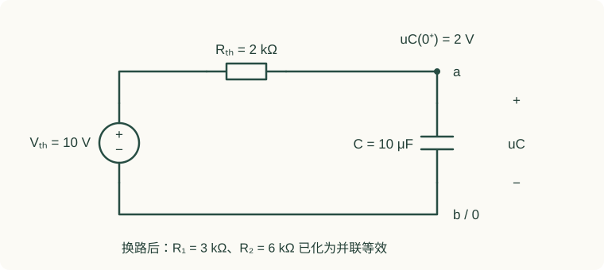
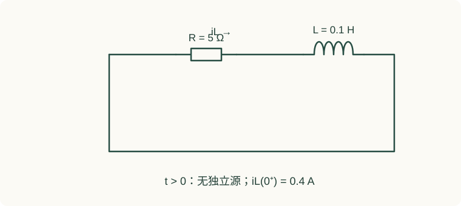
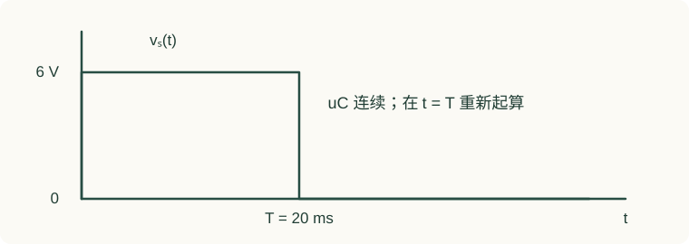
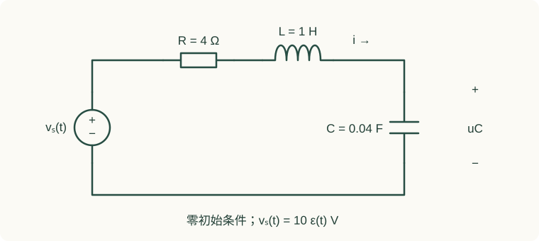

# 05 动态电路：从换路初值到二阶响应

开关一动，电阻上的电压、电流可以立即改变，电容电压和电感电流却通常带着换路前的信息进入新电路。这是暂态题与直流题最重要的区别。本章先用一阶电路把初值、终值和时间常数讲透，再推导二阶响应、非恒定激励和拉普拉斯方法。

**阅读约定**：未特别说明时，元件为线性时不变元件，电流流入电压正端；时间用秒，数值指数中的系数带有相应的秒倒数单位。本章数值题为课程配套练习。

配套讲义：[原有一阶课件](../resources/circuit-transient-first-order.pdf#page=8) · [阶跃与冲激](../resources/source-lectures/06-一阶暂态-阶跃冲激.pdf) · [二阶原课件](../resources/source-lectures/07-二阶暂态.pdf#page=2)。页码统一指 PDF 阅读器显示的页序。

## 1. 换路定则与状态量

### 1.1 状态量连续性的积分推导

对电容关系 $i_C=C\,du_C/dt$ 在换路时刻附近积分：

$$u_C(0^+)-u_C(0^-)=\frac1C\lim_{\varepsilon\to0^+}\int_{-\varepsilon}^{\varepsilon}i_C(t)\,dt.$$

若电流在这段区间有限，区间长度趋于零后积分为零，因此电容电压连续。同理，从 $u_L=L\,di_L/dt$ 得到：

$$i_L(0^+)-i_L(0^-)=\frac1L\lim_{\varepsilon\to0^+}\int_{-\varepsilon}^{\varepsilon}u_L(t)\,dt.$$

没有冲激电压时电感电流连续。这里的限制不能省略：理想电压源直接强迫电容电压跳变，会要求冲激电流；理想开关突然切断一个没有续流路径的电感，会要求很高电压，理想极限可能出现冲激。实际电路通常由寄生电容、接触电弧、钳位器件承担这个过程。

### 1.2 连续的只是状态量

若原来 $u_C(0^-)=3\,\mathrm V$，换路后它仍为 $3\,\mathrm V$，但电容电流可以从 $0$ 变成 $2\,\mathrm{mA}$；电感电流不变时，电感电压也可以跳变。不要把所有电压电流一律设为连续。

求 $0^+$ 的代数电路时，电容可暂用一个已知电压源 $u_C(0^-)$ 代替，电感可暂用一个已知电流源 $i_L(0^-)$ 代替。这是**只针对该瞬间**的替代，不代表它们整个暂态过程都是恒定源。

### 1.3 换路前后等效电路

| 图 | 元件处理 | 用途 |
| --- | --- | --- |
| 换路前已稳定的直流电路 | 电容开路、电感短路 | 求 $u_C(0^-),i_L(0^-)$ |
| 换路后 $0^+$ 瞬间 | 电容保留初始电压、电感保留初始电流 | 求其他支路初值及导数 |
| 换路后恒定激励的最终稳态 | 电容开路、电感短路 | 求终值；先确认网络稳定 |

如果换路前不是直流稳态，例如电源为正弦，不能用“电容开路、电感短路”；应先求该时刻的稳态瞬时值。若题目只给换路前维持了很长时间，也要先看激励类型。

**课件定位**：[换路连续性及初值步骤，PDF 第 8–11 页](../resources/circuit-transient-first-order.pdf#page=8)。

## 2. 从微分方程推导一阶三要素

### 2.1 RC：电容看进去的戴维南网络

把电容以外的线性电阻网络等效为 $V_{th}$ 串联 $R_{th}$。由 KVL 和电容关系：

$$V_{th}=R_{th}i_C+u_C=R_{th}C\frac{du_C}{dt}+u_C.$$

恒定 $V_{th}$ 的特解是 $u_{C,p}=V_{th}$，齐次解为 $Ae^{-t/(R_{th}C)}$。用初始电压确定 $A$ 后：

$$u_C(t)=u_C(\infty)+[u_C(0^+)-u_C(\infty)]e^{-t/\tau},\qquad \tau=R_{th}C.$$

### 2.2 RL 电路的时间常数 {#22-rl-lr-rc}

把电感外部网络等效为 $V_{th},R_{th}$，有

$$L\frac{di_L}{dt}+R_{th}i_L=V_{th},\qquad \tau=\frac L{R_{th}}.$$

因此 $i_L(t)$ 同样由初值、终值、时间常数确定。增大电阻使 RC 充放电更慢，却使 RL 电流衰减更快。这可以从时间常数直接判断，也能从“电容充电电流减小”与“电感释放能量功率变大”理解。

### 2.3 哪些量可以直接使用三要素

在稳定的一阶网络、换路后恒定激励下，电路中任意电压或电流通常都可写成“常数 + 一个指数”。但只有 $u_C,i_L$ 的初值可直接由连续性给出；其他支路量的初值必须通过 $0^+$ 电路计算。若输出量恰好不包含该指数分量，其初值等于终值，也可能只是该输出没有变化，不能据此断言整个电路没有暂态。

三要素中的“终值”还要求稳定：若有源网络从储能端看呈负电阻，指数可能增长，不能继续写成衰减过程。多个独立储能状态也不能未经分析就套一阶式；阶数由独立状态数决定，不仅是图上元件个数。

### 2.4 时间常数的物理意义

偏离终值的差额在 $t=\tau$ 时剩 $e^{-1}\approx36.8\%$，在 $3\tau$ 时约剩 $5.0\%$，在 $5\tau$ 时约剩 $0.67\%$。因此“经过 $5\tau$ 已稳定”是精度约定，不是指数在有限时间变成零。

**课件定位**：[一阶三要素，PDF 第 31–32 页](../resources/circuit-transient-first-order.pdf#page=31)。

## 3. 完整例题一：先求等效，再求电容电压与电流

**题设**：换路后，$15\,\mathrm V$ 理想直流源经 $R_1=3\,\mathrm{k\Omega}$ 接节点 a，$R_2=6\,\mathrm{k\Omega}$ 从 a 接地；$C=10\,\mu\mathrm F$ 也从 a 接地。已知 $u_C(0^-)=2\,\mathrm V$，上端为正。求 $u_C(t)$、$i_C(t)$ 及电容接近终值到误差 $1\%$ 所需时间。

**第一步：求终值。** 电容开路，a 点是分压点：

$$u_C(\infty)=15\frac6{3+6}=10\,\mathrm V.$$

**第二步：求时间常数。** 独立电压源短路，电容端口看到 $R_1\parallel R_2$，不是 $R_1+R_2$：

$$R_{th}=3\parallel6=2\,\mathrm{k\Omega},\qquad \tau=2000\times10^{-5}=0.02\,\mathrm s.$$

**第三步：使用初值。** 无冲激，$u_C(0^+)=2\,\mathrm V$，故

$$\boxed{u_C(t)=10-8e^{-50t}\ \mathrm V,\quad t\ge0.}$$

电容电流以由 a 流向地为正：

$$\boxed{i_C(t)=C\frac{du_C}{dt}=4e^{-50t}\ \mathrm{mA}.}$$

**第四步：用初始 KCL 验算。** $0^+$ 时，$R_1$ 向 a 提供 $(15-2)/3=13/3\,\mathrm{mA}$；$R_2$ 流走 $2/6=1/3\,\mathrm{mA}$；两者之差恰为 $4\,\mathrm{mA}$。

**第五步：解释“误差 $1\%$”。** 若指相对于初始差额的 $1\%$，有 $e^{-t/\tau}\le0.01$，所以 $t\ge\tau\ln100\approx92.1\,\mathrm{ms}$。若指相对于最终 $10\,\mathrm V$ 的 $1\%$，则 $8e^{-50t}\le0.1$，得到 $t\ge87.6\,\mathrm{ms}$。题目没有说明时，要把自己的误差定义写清楚。

**容易错的地方**：时间常数时没有关闭电压源；认为电容在 $0^+$ 开路；算导数时漏掉系数 $50$；把微法直接当法拉。这四种错误都能通过初始 KCL 发现。

## 4. 完整例题二：电感释放能量与电压反向

**题设**：换路后电感 $L=0.1\,\mathrm H$ 与电阻 $R=5\,\Omega$ 构成闭合回路，无独立源。沿原电流方向定义 $i_L$，已知 $i_L(0^-)=0.4\,\mathrm A$。求电流、电感关联电压和电阻消耗的总能量。

由 KVL：$L\,di_L/dt+Ri_L=0$，时间常数 $\tau=L/R=0.02\,\mathrm s$，故

$$i_L(t)=0.4e^{-50t}\,\mathrm A,\qquad u_L(t)=L\frac{di_L}{dt}=-2e^{-50t}\,\mathrm V.$$

负电压说明电感在原电流方向上表现为电压升，向电阻送出先前储存的磁场能量。电阻总耗能为

$$W_R=\int_0^\infty Ri_L^2dt=5\times0.16\int_0^\infty e^{-100t}dt=0.008\,\mathrm J.$$

这正等于初始磁场能 $Li_L^2(0)/2=0.008\,\mathrm J$。电阻消耗的能量应非负；若计算结果为负，应检查功率表达和积分符号。

## 5. 完整例题三：两次换路，第二段不能重置初值

**题设**：$R=2\,\mathrm{k\Omega},C=10\,\mu\mathrm F$ 串联，电容初始电压为零。输入在 $0\le t<T$ 为 $6\,\mathrm V$，在 $t\ge T$ 降为零，$T=20\,\mathrm{ms}$。求全过程电容电压。

第一段时间常数 $\tau=20\,\mathrm{ms}$：

$$u_C(t)=6(1-e^{-t/0.02}),\qquad 0\le t<0.02.$$

第二次换路前 $u_C(T^-)=6(1-e^{-1})\approx3.7927\,\mathrm V$；因此第二段是从这个值向零放电：

$$u_C(t)=6(1-e^{-1})e^{-(t-0.02)/0.02},\qquad t\ge0.02.$$

**检查**：左右两段在 $T$ 处相等，电压连续；但导数从正变负，电流允许跳变。若第二段写成 $6e^{-t/0.02}$，既用了错误初值，也忘记把局部时间平移到 $t-T$。

也可以把矩形脉冲写为 $6[\varepsilon(t)-\varepsilon(t-T)]$，对零状态阶跃响应使用时移和叠加。两种方法应得到同一结果。

## 6. 非恒定激励：三要素要换成“特解 + 自然响应”

三要素式中的常数终值只适用于恒定激励。输入是正弦时，稳态本身随时间振荡，不能给它取一个常数 $x(\infty)$。正确形式是

$$x(t)=x_p(t)+Ke^{-t/\tau}.$$

**完整例题四**：$R=1\,\Omega,L=1\,\mathrm H$ 串联，$t=0$ 接入 $v_s(t)=10\cos t\,\mathrm V$，$i_L(0^-)=0$。求电流。

用峰值相量求正弦特解，$Z=1+j$，所以

$$i_p(t)=5\sqrt2\cos(t-45^\circ)=5\cos t+5\sin t.$$

自然项是 $Ke^{-t}$。由于 $i_p(0)=5$，初值条件要求 $K=-5$：

$$\boxed{i_L(t)=5\cos t+5\sin t-5e^{-t}\ \mathrm A.}$$

代回方程 $i_L'+i_L=10\cos t$ 验证成立，且 $i_L(0)=0$。此题先求正弦特解时使用峰值相量只是为了方便还原时域，不用它直接计算复功率。

**与原讲义对照**：[正弦接入相位及一阶响应，PDF 第 2–3 页](../resources/source-lectures/06-一阶暂态-阶跃冲激.pdf#page=2)。接入相位决定初始特解与实际初值的差，因此也决定自然项的大小。

## 7. 二阶响应与初始条件

### 7.1 从串联 RLC 推出特征方程

对串联 RLC，选择电容电压 $u_C$，令电流流入电容正端：

$$LCu_C''+RCu_C'+u_C=v_s(t).$$

除以 $LC$ 得

$$u_C''+2\alpha u_C'+\omega_0^2u_C=\omega_0^2v_s(t),\qquad
\alpha=\frac R{2L},\quad\omega_0=\frac1{\sqrt{LC}}.$$

这里 $\alpha=R/(2L)$ 只针对**串联** RLC。对并联 RLC 的电压方程，阻尼系数变成 $1/(2RC)$，不能见到二阶就照搬串联公式。

### 7.2 用根的性质选择响应形式

特征根为 $s_{1,2}=-\alpha\pm\sqrt{\alpha^2-\omega_0^2}$。

| 条件 | 自然响应 | 物理表现 |
| --- | --- | --- |
| $\alpha>\omega_0$ | $A_1e^{s_1t}+A_2e^{s_2t}$ | 两种衰减速率，无固有振荡 |
| $\alpha=\omega_0$ | $(A_1+A_2t)e^{-\alpha t}$ | 重根，必须保留 $t$ 项 |
| $0<\alpha<\omega_0$ | $e^{-\alpha t}(A\cos\omega_dt+B\sin\omega_dt)$ | 衰减振荡，$\omega_d=\sqrt{\omega_0^2-\alpha^2}$ |
| $\alpha=0$ | $A\cos\omega_0t+B\sin\omega_0t$ | 理想无损持续振荡，未必存在终值 |

“临界阻尼最快”应理解为在给定自然频率、常见零初值阶跃设计下，避免振荡的边界情形；不能忽视初值和输出量，把它当作所有响应的绝对排序。

### 7.3 第二个条件从哪里来

电容电压初值由连续性得到，导数从 $i_C=C u_C'$ 得到：

$$u_C'(0^+)=\frac{i_L(0^+)}C.$$

因此二阶计算中，$u_C(0^+)$ 和 $i_L(0^+)$ 通常就是最方便的两个条件。若图上电感电流与流入电容正端的方向相反，式子前应加负号。

## 8. 完整例题五：欠阻尼 RLC 阶跃全过程

**题设**：串联 $R=4\,\Omega,L=1\,\mathrm H,C=0.04\,\mathrm F$，零初始储能，$t=0$ 接入 $10\,\mathrm V$ 直流源。求 $u_C(t),i(t)$，判断过冲。

特征参数：$\alpha=2\,\mathrm{s^{-1}}$，$\omega_0=5\,\mathrm{rad/s}$，$\omega_d=\sqrt{21}\,\mathrm{rad/s}$。因为是稳定直流最终稳态，$u_C(\infty)=10\,\mathrm V$。设

$$u_C=10+e^{-2t}(A\cos\sqrt{21}t+B\sin\sqrt{21}t).$$

用 $u_C(0)=0$ 得 $A=-10$。用 $i(0)=C u_C'(0)=0$ 得 $-2A+\sqrt{21}B=0$，所以 $B=-20/\sqrt{21}$。

$$\boxed{u_C(t)=10\left[1-e^{-2t}\left(\cos\sqrt{21}t+\frac2{\sqrt{21}}\sin\sqrt{21}t\right)\right]\ \mathrm V.}$$

求导后可得到非常简洁的电流：

$$\boxed{i(t)=\frac{10}{\sqrt{21}}e^{-2t}\sin\sqrt{21}t\ \mathrm A.}$$

**初始验算**：$i'(0)=10\,\mathrm{A/s}$，电感初始压降 $Li'(0)=10\,\mathrm V$，电阻和电容初始压降均为零，与 KVL 一致。

第一峰值出现在 $t_p=\pi/\omega_d\approx0.6856\,\mathrm s$。相对过冲为 $M_p=e^{-2\pi/\sqrt{21}}\approx25.38\%$，所以电容峰值约 $12.538\,\mathrm V$。电容电压暂时超过电源并不违反能量守恒，因为电感也在交换能量。

**变式**：仅把 $R$ 改为 $10\,\Omega$，则临界阻尼，零状态响应为 $10[1-(1+5t)e^{-5t}]$；把 $R$ 改为 $12.5\,\Omega$，特征根为 $-2.5,-10$，响应为 $10-\frac{40}3e^{-2.5t}+\frac{10}3e^{-10t}$。三式都应满足 $u_C(0)=u_C'(0)=0$。

**课件定位**：[二阶方程、阻尼、初值与实例，PDF 第 2–6 页](../resources/source-lectures/07-二阶暂态.pdf#page=2)。

## 9. 拉普拉斯法：初始能量是方程的一部分

用单边拉普拉斯变换，电容关系变成

$$I_C(s)=C[sU_C(s)-u_C(0^-)],$$

电感关系变成

$$U_L(s)=L[sI_L(s)-i_L(0^-)].$$

所以“电感换成 $sL$，电容换成 $1/(sC)$”只有零初始条件时才可以直接使用。有初始能量时，要在方程中保留初始项，或画含等效初始源的运算电路。

### 完整例题六：非零初值 RC 的变换解

设 $RC=0.02\,\mathrm s$，输入恒为 $10\,\mathrm V$，初始电压 $2\,\mathrm V$。微分方程为 $0.02u_C'+u_C=10$，变换后

$$0.02[sU_C(s)-2]+U_C(s)=\frac{10}s.$$

整理并部分分式分解：

$$U_C(s)=\frac{10/s+0.04}{0.02s+1}=\frac{10}s-\frac8{s+50}.$$

反变换即为 $u_C=10-8e^{-50t}$。这与例题一相同，但拉普拉斯法把初值、激励和自然项放进了同一套代数计算。

### 初值定理和终值定理的使用边界

通常有 $x(0^+)=\lim_{s\to\infty}sX(s)$，但若信号本身含冲激，需另行处理其广义函数部分。终值定理 $x(\infty)=\lim_{s\to0}sX(s)$ 要求 $sX(s)$ 的所有极点位于开左半平面；原点处的可约因子需要先正确处理。持续正弦、无阻尼振荡或不稳定增长都不能用它断言终值。

## 10. 阶跃、冲激与分段输入

对因果线性时不变系统，零状态阶跃响应 $g(t)$ 的导数是冲激响应 $h(t)$，需要包含可能出现的冲激项；任意输入的零状态输出为 $y=x*h$。以 RC 电容电压输出为例：

$$H(s)=\frac1{1+s\tau},\quad g(t)=(1-e^{-t/\tau})\varepsilon(t),\quad h(t)=\frac1\tau e^{-t/\tau}\varepsilon(t).$$

若 $x(t)=A[\varepsilon(t)-\varepsilon(t-T)]$，则输出是 $A[g(t)-g(t-T)]$；这里 $g$ 已带因果阶跃因子，不会在 $t<T$ 提前出现第二项。

更一般地，输入含若干次“改变幅值”，就把每次变化写成延迟阶跃。先写出电路的单位阶跃响应，再做幅度缩放和时间平移，通常比每段从微分方程重新开始更快。非零初始能量的零输入响应要另加，不能塞进传递函数定义。

## 11. 应试提速：哪些步骤值得写，哪些不能省

1. **只求时间常数**：不必求全响应。关闭独立源、保留受控源，从储能端求驱动点电阻。
2. **只求初始导数**：画 $0^+$ 电路，用 KCL/KVL 求 $i_C(0^+)$ 或 $u_L(0^+)$，再除以 $C$ 或 $L$。
3. **二阶题不急着求常数**：先写特征根类型。写错形式，后面解两个条件也救不回来。
4. **分段题保留精确指数**：中间先不要把 $e^{-1}$ 取成 $0.37$，避免后段误差累积。
5. **含受控源的时间常数**：仍可用测试源求电阻，但要确认最终是一阶且稳定；负等效电阻意味着有源供能，可能出现增长。
6. **暂态能量题**：先对比初、终储能，再计算独立源做功；不能默认“电容增加的能量就是源提供的全部能量”。

## 12. 分层练习与解答

### 练习 A：不能连续的量

RC 例题一在 $0^-$ 稳态时电容电流为零。换路后 $i_C(0^+)=4\,\mathrm{mA}$，是否违反换路定则？请解释并写出 $u_C'(0^+)$。

??? success "解答"
    不违反。有限电流允许跳变，连续的是电容电压。$u_C'(0^+)=i_C(0^+)/C=0.004/10^{-5}=400\,\mathrm{V/s}$。若错误地要求电流也连续，会得到零导数，与换路后 KCL 冲突。

### 练习 B：放电到指定阈值

$R=4\,\mathrm{k\Omega},C=5\,\mu\mathrm F$，电容从 $9\,\mathrm V$ 向零放电，多久第一次降到 $3\,\mathrm V$？

??? success "解答"
    $\tau=0.02\,\mathrm s$，$u_C=9e^{-t/0.02}$。令 $9e^{-t/0.02}=3$ 得 $t=0.02\ln3\approx21.97\,\mathrm{ms}$。不能用“经过一个时间常数降三分之一”代替精确求解，一个时间常数剩的是 $e^{-1}$。

### 练习 C：找导数，不求全响应

串联 RLC 在 $0^+$ 有 $v_s=5\,\mathrm V$、$R=2\,\Omega,L=0.5\,\mathrm H,C=0.1\,\mathrm F$，已知 $u_C(0^+)=1\,\mathrm V,i(0^+)=1\,\mathrm A$。求 $i'(0^+)$、$u_C'(0^+)$。

??? success "解答"
    KVL 给出 $Li'=v_s-Ri-u_C=5-2-1=2\,\mathrm V$，所以 $i'(0^+)=4\,\mathrm{A/s}$；$u_C'=i/C=10\,\mathrm{V/s}$。两者来自不同元件关系，不能把电感电流导数直接当成电容电压导数。

### 练习 D：临界阻尼元件选择

串联 RLC 中 $L=20\,\mathrm{mH},C=50\,\mu\mathrm F$。求临界阻尼电阻和无阻尼自然角频率。

??? success "解答"
    $R_{cr}=2\sqrt{L/C}=2\sqrt{0.02/(50\times10^{-6})}=40\,\Omega$；$\omega_0=1/\sqrt{LC}=1000\,\mathrm{rad/s}$。注意 $1000$ 是角频率，对应频率约 $159.15\,\mathrm{Hz}$。

### 练习 E：检查终值定理

有人对 $X(s)=1/(s^2+1)$ 使用 $\lim_{s\to0}sX(s)=0$，宣称 $\sin t$ 最终为零。问题在哪里？

??? success "解答"
    $sX(s)$ 在 $s=\pm j$ 有虚轴极点，不满足终值定理条件。$\sin t$ 持续振荡，不存在通常意义下的终值。计算某个代数极限，不等于满足使用定理的前提。

### 练习 F：能量账本

一个 $10\,\mu\mathrm F$ 电容经正电阻从 $2\,\mathrm V$ 接到 $10\,\mathrm V$ 理想直流源。求源做功、电容增能及电阻总耗能，验证与电阻具体阻值无关。

??? success "解答"
    源做功 $W_s=V_sC(V_s-U_0)=0.8\,\mathrm{mJ}$；电容增能 $\Delta W_C=C(V_s^2-U_0^2)/2=0.48\,\mathrm{mJ}$；电阻耗能为差额 $0.32\,\mathrm{mJ}=C(V_s-U_0)^2/2$。阻值改变过程快慢，不改变这三个总能量（要求最终稳定到 $10\,\mathrm V$）。

## 13. 课程资料索引

| 需要补的环节 | 资料位置 | 建议完成的工作 |
| --- | --- | --- |
| 初值和换路连续性 | [一阶课件第 8–11 页](../resources/circuit-transient-first-order.pdf#page=8) | 对照题图分别画 $0^-,0^+$ 两张图 |
| 时间常数与三要素 | [一阶课件第 31–32 页](../resources/circuit-transient-first-order.pdf#page=31) | 把每题的初值、终值、端口电阻写成三行 |
| 正弦接入响应 | [阶跃冲激课件第 2–3 页](../resources/source-lectures/06-一阶暂态-阶跃冲激.pdf#page=2) | 先写正弦特解，再用初值补自然项 |
| 二阶阻尼与初值 | [二阶课件第 2–6 页](../resources/source-lectures/07-二阶暂态.pdf#page=2) | 同一组 LC 改 R，比较三种根的形式 |
| 限时混合训练 | [过渡过程竞答题](../resources/source-lectures/10-过渡过程竞答题.pdf) | 做完再按“初值/等效/形式/代数”标出卡点 |

下一步可用[综合题](07-problems.md)将节点法、端口等效与暂态连接起来；需要复核阻抗和有效值约定时，回看[正弦稳态](04-ac.md)。
