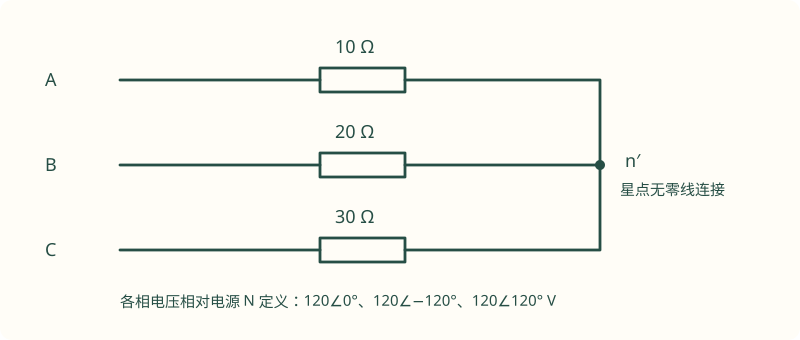

# 06 非正弦稳态与三相电路

非正弦与三相经常合在一道综合题里：既要区分频率，又要区分相别。可靠的做法是先沿“频率”拆开，再对每一个频率分析相序、接线和负载，最后回到时域叠加。不同频率的相量不能直接相加，同频率但不同相别的量可以按照拓扑相加减。

原页中的互感知识已展开在[第 08 章：耦合电感、理想变压器与二端口](08-coupling-twoports.md)，包括点标记、反射阻抗、去耦和完整例题；本章集中处理有效值、谐波、三相计算及功率测量。

## 1. 非正弦有效值：正交的是不同频率，不是任意两项

以有效值表示各谐波，令

$$
u(t)=U_0+\sqrt2\sum_{n=1}^{N}U_n\cos(n\omega_0t+\theta_n).
$$

在一个基波周期内，不同整数倍频率的正弦、余弦乘积平均为零，因此

$$
U_{\rm rms}=\sqrt{U_0^2+\sum_{n=1}^{N}U_n^2}.
$$

若题目写的是峰值 $U_{mn}$，则公式应改为 $U_{\rm rms}^2=U_0^2+\tfrac12\sum U_{mn}^2$。直流项不除以 $\sqrt2$。同频率的两项应先相量合并，再把合并后的有效值平方；例如 $\cos\omega t+\cos(\omega t+60^\circ)$ 不能把两项有效值直接平方相加，因为它们并不正交。

总平均功率同样只有**同频率的电压、电流配对**后才保留下来：

$$
P=U_0I_0+\sum_{n=1}^{N}U_nI_n\cos\varphi_n.
$$

这与“功率不能叠加”不矛盾。线性网络的叠加定理允许把不同独立激励产生的电压、电流响应相加，并不限于同频；但只有同频相量才能直接合并，功率一般仍含交叉项。这里对不同正交频率取共同基波的完整周期平均，交叉项恰好消失，因而各谐波平均功率可以相加。这个区别是非正弦综合题需要分清的概念。

### 例 1：直流、基波和二次谐波通过串联 RC

**题设。** 电源

$$
u_s(t)=2+10\sqrt2\cos(1000t)+5\sqrt2\cos(2000t)\quad(\mathrm V)
$$

加在串联 $R=1\,\Omega$、$C=1\,\mathrm{mF}$ 上，输出取电阻电压。电路已进入周期稳态，求电流、输出电压、输入有效值、电流有效值、平均功率及总功率因数。

**直流分量。** 稳态电容开路，$I_0=0$；电阻直流电压为 0，电容承受全部 $2\,\mathrm V$ 直流偏置。不要因为“直流被电容挡住”，就把电容的直流电压也删掉。

**基波。** $Z_1=1-j$，因此

$$
\underline I_1=\frac{10}{1-j}=5+j5=\sqrt{50}\angle45^\circ\,\mathrm A.
$$

**二次谐波。** $Z_2=1-j/2$，因此

$$
\underline I_2=\frac5{1-j/2}=4+j2=\sqrt{20}\angle26.565^\circ\,\mathrm A.
$$

若二次谐波仍使用 $Z_1$，幅值和相位都会算错。合成电流时回到时域：

$$
i(t)=10\cos(1000t+45^\circ)
 +\sqrt{40}\cos(2000t+26.565^\circ)\quad(\mathrm A).
$$

因为 $R=1\,\Omega$，电阻输出电压在数值上与电流相同，单位改为 V。有效值及功率为

$$
U_s=\sqrt{2^2+10^2+5^2}=\sqrt{129}\,\mathrm V,
\qquad I=\sqrt{50+20}=\sqrt{70}\,\mathrm A,
$$

$$
P=I^2R=70\,\mathrm W,\qquad
\lambda=\frac P{U_sI}=\frac{70}{\sqrt{129\times70}}\approx0.737.
$$

交叉复核：基波有功 $\operatorname{Re}\{10(5-j5)\}=50\,\mathrm W$，二次谐波有功 $\operatorname{Re}\{5(4-j2)\}=20\,\mathrm W$，合计仍为 70 W。输入有效值包括直流项，尽管直流没有电流；漏掉这一点会使总功率因数偏高。

### 原提纲题展开：串联 RLC 的基波与二次谐波

原提纲给出 $u_s(t)=5+4\cos\omega_0t+2\cos2\omega_0t$，没有给元件值，因此不能直接得到数值答案。为了把它做完，取一组明确参数：$R=1\,\Omega$、$L=1\,\mathrm{mH}$、$C=1\,\mathrm{mF}$、$\omega_0=1000\,\mathrm{rad/s}$，输出仍取电阻电压。

直流被串联电容阻断，电阻直流电压为零。基波下 $Z_1=1+j(1-1)=1\,\Omega$，发生串联谐振，故电阻输出的基波为 $4\cos1000t$ V。二次谐波下 $Z_2=1+j(2-1/2)=1+j1.5\,\Omega$，所以该分量的峰值为 $2/\sqrt{1+1.5^2}=4/\sqrt{13}$ V，相位为 $-\arctan1.5=-56.310^\circ$。

$$
u_R(t)=4\cos1000t+\frac4{\sqrt{13}}\cos(2000t-56.310^\circ)\quad(\mathrm V).
$$

电阻电压有效值平方为 $4^2/2+(4/\sqrt{13})^2/2=112/13$，因此电阻有功为 $112/13\approx8.615\,\mathrm W$。基波在谐振点，二次谐波却不是，这正是“同一电路不能给所有频率共用同一个阻抗”的完整示范。

## 2. 功率因数与谐波失真

正弦条件下 $\lambda=\cos\varphi$。非正弦条件下总功率因数定义仍是 $\lambda=P/(U_{\rm rms}I_{\rm rms})$，却通常没有一个单一的“总相角”能代表它。

若电压为纯基波，电流含基波和高次谐波、没有直流，则只有基波电流贡献平均有功：

$$
\lambda=\frac{I_1}{I_{\rm rms}}\cos\varphi_1
 =\frac{\cos\varphi_1}{\sqrt{1+\mathrm{THD}_I^2}},\qquad
\mathrm{THD}_I=\frac{\sqrt{\sum_{n\ge2}I_n^2}}{I_1}.
$$

$\cos\varphi_1$ 是位移因数，$I_1/I$ 是畸变因数。并联电容可改善基波无功，但不会自动消除电流谐波；在含谐波的电网中还可能与网络电感发生谐振，所以不能把正弦补偿公式当作所有情形的通用设计。

### 例 2：电流与电压“基波同相”，功率因数仍小于 1

$u(t)=100\sqrt2\cos\omega t\,\mathrm V$，$i(t)=4\sqrt2\cos\omega t+3\sqrt2\cos3\omega t\,\mathrm A$。基波位移角为零，但总电流 $I=\sqrt{4^2+3^2}=5\,\mathrm A$，平均有功 $P=100\times4=400\,\mathrm W$，视在功率为 500 VA，所以 $\lambda=0.8$。

若只看基波相位而回答功率因数为 1，就遗漏了谐波增加线路电流的作用。这里 $\mathrm{THD}_I=3/4=0.75$，也可由 $1/\sqrt{1+0.75^2}=0.8$ 验证。

## 3. 对称三相：把 30° 的来源算出来

取正序 A→B→C，相电压有效值相量为

$$
\underline U_{AN}=U_p\angle0^\circ,\quad
\underline U_{BN}=U_p\angle(-120^\circ),\quad
\underline U_{CN}=U_p\angle120^\circ.
$$

线电压是相电压之差：

$$
\underline U_{AB}=\underline U_{AN}-\underline U_{BN}
 =\sqrt3U_p\angle30^\circ.
$$

所以正序时 $U_{AB}$ 比 $U_{AN}$ 超前 30°；若换相序或换成 $U_{BA}$，相位关系也会改变。只记“乘 $\sqrt3$”而不记端点和相序，往往在相量图题中失分。

### 星形与三角形负载

星形负载的线电流就是该相支路电流；对称时线电压幅值是相电压幅值的 $\sqrt3$ 倍。三角形负载中每个支路承受线电压，线电流则是相邻两支路电流之差：

$$
\underline I_A=\underline I_{AB}-\underline I_{CA}.
$$

正序、对称时 $\underline I_A=\sqrt3\underline I_{AB}\angle(-30^\circ)$。因此三角形的相电流与线电流之间既有幅值关系，也有相位关系。只在相电流已知且对称时，才可以直接套这个转换。

### 例 3：同一组阻抗从星接改成角接

**题设。** 理想对称正序电源 $U_p=220\,\mathrm V$，所以 $U_L=220\sqrt3\,\mathrm V$，每个负载阻抗为 $22+j22\,\Omega$。先星接，再改三角形，求线电流和总有功。

星接时

$$
\underline I_A=\frac{220}{22+j22}=5-j5\,\mathrm A,
\qquad |I_A|=5\sqrt2\,\mathrm A.
$$

每相有功为 $|I_A|^2\times22=1100\,\mathrm W$，总功率 $P_Y=3300\,\mathrm W$，总无功同样为 3300 var。

角接时，AB 支路电流为 $\underline I_{AB}=\sqrt3\,5\sqrt2\angle(30^\circ-45^\circ)$，线电流 $\underline I_A=15-j15\,\mathrm A$，有效值变成星接的 3 倍。总功率为 $P_\Delta=9900\,\mathrm W$，也是星接的 3 倍。

这里“3 倍”成立的前提是**线电压不变、三个阻抗不变且负载对称**。若改接时电源条件、负载参数或控制方式也改变，就必须重新计算。

## 4. 总复功率：别把线电压和线电流直接配对

通用关系是逐相求和：

$$
\mathcal S=\sum_{k=A,B,C}\underline U_{kn'}\underline I_k^*.
$$

$n'$ 为负载星点。对称时可写成

$$
\mathcal S=3\underline U_p\underline I_p^*
          =\sqrt3U_LI_L(\cos\varphi+j\sin\varphi),
$$

其中最后一式的 $U_L,I_L$ 是**幅值**，$\varphi$ 是每相负载的电压与电流夹角。不能把带实际相角的 $\underline U_{AB}$ 与 $\underline I_A^*$ 直接相乘后仅乘 $\sqrt3$：正序下两者还差 30°，需要额外的相位修正。最稳妥的是回到对应的相电压和相电流。

不平衡时逐相求 $P_k,Q_k$ 再相加，不用对称公式“平均一下”。线损若未忽略，应另计每条线的 $|I_k|^2R_{\rm line}$，功率守恒要把线路也包括进去。

## 5. 不平衡星形：断零线后，星点会漂移

四线制且中性线理想时，负载星点与电源中性点等电位，各相可以独立计算。不接中性线时，星点电位 $\underline V_{n'N}$ 未知，由 KCL 得

$$
\frac{\underline U_{AN}-\underline V_{n'N}}{Z_A}
+\frac{\underline U_{BN}-\underline V_{n'N}}{Z_B}
+\frac{\underline U_{CN}-\underline V_{n'N}}{Z_C}=0,
$$

即

$$
\underline V_{n'N}=
\frac{\underline U_{AN}Y_A+\underline U_{BN}Y_B+\underline U_{CN}Y_C}
{Y_A+Y_B+Y_C}.
$$

有有限中性线阻抗 $Z_N$ 时，分母还应加 $Y_N=1/Z_N$，电源中性点取参考地。分母若为零，需回到原电路检查是否存在理想谐振或无解条件，不能机械除零。

### 例 4：不平衡纯电阻，分别算有零线与断零线

**题设。** 相电压 $120\,\mathrm V$、正序，星形负载 $R_A=10\,\Omega$、$R_B=20\,\Omega$、$R_C=30\,\Omega$，线路阻抗忽略。求断零线前后的电流。

**中性线接通。**

$$
\underline I_A=12,\quad \underline I_B=-3-j3\sqrt3,\quad
\underline I_C=-2+j2\sqrt3\quad(\mathrm A).
$$

若把中性线回流方向取为负载星点流向电源 N，则 $\underline I_N=\underline I_A+\underline I_B+\underline I_C=7-j\sqrt3\,\mathrm A$，有效值为 $\sqrt{52}\,\mathrm A$。三相总有功 $120^2(1/10+1/20+1/30)=2640\,\mathrm W$。

**断开中性线。** 由星点电压公式得到

$$
\underline V_{n'N}=\frac{420}{11}-j\frac{60\sqrt3}{11}
 \approx38.182-j9.448\,\mathrm V.
$$

三相电流分别是

$$
\underline I_A=\frac{90}{11}+j\frac{6\sqrt3}{11}
 \approx8.182+j0.945,
$$

$$
\underline I_B=-\frac{54}{11}-j\frac{30\sqrt3}{11}
 \approx-4.909-j4.724,
$$

$$
\underline I_C=-\frac{36}{11}+j\frac{24\sqrt3}{11}
 \approx-3.273+j3.779\quad(\mathrm A).
$$

三者相加严格为零；总有功为 $\sum|I_k|^2R_k=2356.364\,\mathrm W$。虽然三相电源仍然对称，负载端各相电压却已不再是 120 V。断零线的危险就在于这种重新分配，不能继续把各相独立接在额定相电压上计算。

若负载本来完全对称，星点漂移为零，断零线不改变理想工作状态。结论来自对称性，不适用于任意三相负载。

## 6. 两瓦特表法：总功率通用，相位公式有前提

在**三相三线制**中，线电流满足 $i_A+i_B+i_C=0$。取 B 线作两个电压线圈的公共端，电流线圈分别接 A、C 线，并保持规定极性，则两表读数代数和为总有功：

$$
P=W_A+W_C.
$$

这个求和结论对不平衡负载也成立，对非正弦波形在仪表带宽和真功率测量能力满足时仍可由瞬时功率关系得到。**从两表差求无功和功率因数**却要求对称正弦条件。

按本节的正序、接线与极性，若负载阻抗角为 $\varphi$：

$$
W_A=U_LI_L\cos(30^\circ+\varphi),\qquad
W_C=U_LI_L\cos(30^\circ-\varphi),
$$

$$
P=\sqrt3U_LI_L\cos\varphi,\qquad
Q=\sqrt3(W_C-W_A).
$$

不同教材可能交换表号，差值的正负也随之改变；使用前先画接线。以 $U_L=400\,\mathrm V$、$I_L=10\,\mathrm A$、$\varphi=60^\circ$ 为例，$W_A=0$、$W_C=3464.10\,\mathrm W$，总功率仍为 3464.10 W。若 $\varphi>60^\circ$，一表为负，读数应保留负号相加，不能取绝对值。

有中性线电流的四线制不能直接套这套两表接线，需要按测量系统增加功率通道。

## 7. 三次谐波为什么会在中性线上叠加

若三相电压波形相同、依次延迟基波周期的 $T/3$，则第 $n$ 次谐波的相位差为 $n\times120^\circ$。$n$ 为 3 的整数倍时，三相同频谐波同相，属于零序；$n=3k+1$ 为正序，$n=3k+2$ 为负序。对只有奇次谐波的波形，也常写成 $6k+1$ 正序、$6k-1$ 负序以及 $3(2k+1)$ 零序。

零序电压在线电压相减时抵消，零序电流却会在中性线相加。若每相三次谐波有效值为 2 A，理想中性线上该频率电流为 6 A；若每相基波电流为 4 A，线电流有效值为 $\sqrt{4^2+2^2}=\sqrt{20}\,\mathrm A$。三线制星形无回路时不能流过零序线电流；三角形内部若存在零序电势，则可能产生内部环流，但不会以同样方式出现在线电流里。必须先说明电源和负载接法，不能只记“第三次谐波等于三倍”。

### 7.1 傅里叶分解中，先利用对称性减少工作

对于分段周期波形，先找一个方便的时间原点，再判断奇偶对称和半波对称。偶函数只有余弦项，奇函数只有正弦项，奇偶性与选定的原点有关；满足 $x(t+T/2)=-x(t)$ 的波形没有直流和偶次谐波，半波对称性不因整体平移时间原点而改变。要从题目真实波形验证这些条件，不是“看起来像方波”就可以直接套奇次展开。

若把傅里叶级数写成 $x(t)=a_0+\sum(a_n\cos n\omega_0t+b_n\sin n\omega_0t)$，直流系数是 $a_0=(1/T)\int_Tx(t)dt$。有的教材把常数项写成 $a_0/2$，这时系数定义多一倍。读不同课件时，先看级数定义的第一项，再抄系数，避免让整条波形的直流偏置相差一倍。

对每个谐波，先把正弦、余弦合并为一个幅相形式。若输入只保留前几项，输出也是这个截断输入的精确线性响应，不一定等于原始方波的完整响应。估计误差时，应看网络对遗漏高次谐波是衰减还是放大；一个低通网络可能让很粗的输入展开就足够，而接近高次谐振时，忽略小幅高频项也可能造成明显误差。

### 7.2 为什么先分频，再做相量法

非正弦稳态可用叠加，是因为网络线性且参数不随时间变化。线性保证不同输入响应可以相加，时不变保证单一频率输入不会被转换到其他频率。若题目含二极管整流、饱和磁芯、周期切换开关或时变电容，不能直接说每个谐波互不耦合，需要先建立相应非线性或时变模型。

在适用的线性网络中，每个频率只会改变幅值与相位。计算表格可以设成“频率、输入相量、该频率等效电路、输出相量、时域项”五列。直流单独放第一行，把电感短路、电容开路后的约束写清；其余行逐次使用 $jn\omega_0L$、$1/(jn\omega_0C)$。最后一列再把相量有效值乘回 $\sqrt2$。这样能直接看见漏掉的直流项、频率写错的阻抗和时域合成中的单位。

如果只求总有效值，不必把时域所有余弦项完整展开，求出各频率有效值之后平方求和即可；如果问某个时刻的瞬时电压，必须保留相位后再代时间。最大值和峰峰值一般不能由各谐波幅值直接相加得到，因为各分量的峰值未必同时发生。这一点与有效值的正交求和完全不同。

### 7.3 不平衡三角形与“中性点漂移”是两类题

星形无中性线时出现未知星点，才需要求漂移电压。不平衡三角形负载的每条边仍直接跨在线电压上，若电源和线路理想，三条支路可分别用 $I_{AB}=U_{AB}/Z_{AB}$ 等求解，再由节点关系得到线电流。不能把三角形三条支路电流的幅值各乘 $\sqrt3$，因为不平衡时相邻支路不再相差120°且不等幅。

例如已算得 $I_{AB}=4+j1$ A、$I_{BC}=-2-j3$ A、$I_{CA}=1+j2$ A，按 A→B、B→C、C→A 定义支路方向，则 $I_A=3-j1$ A、$I_B=-6-j4$ A、$I_C=3+j5$ A，三者之和为零。这个恒等关系由接线决定，即使三相不对称也成立。能否用单相等效，则另需负载和激励同时对称。

遇到“断一相、某相短路、断中性线”时，把故障后的导线实际重画一次。断一相是删掉某条连接，短路是合并节点，断中性线是移除对星点电位的约束，三者不能混为一个口诀。尤其不应沿用故障前的相电压去计算已经浮动的负载相电压。

### 7.4 两瓦特表为什么能测不平衡总有功

按前述 B 线公共端接法，两个功率通道的瞬时乘积之和为

$$
(u_A-u_B)i_A+(u_C-u_B)i_C
=u_Ai_A+u_Ci_C-u_B(i_A+i_C).
$$

三线制 KCL 给出 $i_B=-(i_A+i_C)$，右边恰好等于三相瞬时总功率。这个推导没有使用等幅、120°或正弦假设，所以总有功的代数和关系可以推广到不平衡情形；但从两表差求无功的三角公式在推导时用了对称相量，不能跟着推广。

如果一表反偏需要反接电压线圈才能读数，最终记录值要带负号，不能只把仪表上看到的正数写入总和。若题目交换 A、C 两个功率表编号，$W_A+W_C$ 不变，$W_C-W_A$ 的符号却会反转。答题时画两个小标记说明电流流入端和电压正端，通常比争论“哪个表减哪个表”更有效。

## 8. 自测与详解

??? question "练习 1：同频项与不同频项如何合并"
    求 $u(t)=2+4\cos\omega t+4\sin\omega t+6\cos3\omega t$ 的有效值。

    **解。** 基波合成为 $4\sqrt2\cos(\omega t-45^\circ)$，其有效值为 4 V；三次谐波有效值为 $3\sqrt2$ V。故 $U=\sqrt{2^2+4^2+(3\sqrt2)^2}=\sqrt{38}$ V。本题中两项基波恰为正交，若相差不是90°，不能分别平方相加。

??? question "练习 2：对称负载的功率与电流"
    正序 $U_L=400\,\mathrm V$，星形每相阻抗 $Z=8+j6\,\Omega$。以 $U_{AN}$ 为0°，求 $I_A,P,Q$。

    **解。** $U_p=400/\sqrt3$，$Z=10\angle36.87^\circ$，所以 $I_A=(40/\sqrt3)\angle(-36.87^\circ)$ A。总有功 $P=3(1600/3)\times8=12800$ W，总无功 $Q=3(1600/3)\times6=9600$ var。注意这时 $U_{AB}$ 为30°；不能拿它与 $I_A$ 直接计算每相功率。

??? question "练习 3：两瓦特表的负读数"
    按本章接线，一表 $W_A=-200\,\mathrm W$，另一表 $W_C=800\,\mathrm W$，已知为对称正弦三相三线制。求总有功、无功及功率因数。

    **解。** $P=600$ W，$Q=\sqrt3(800-(-200))=1000\sqrt3$ var。功率因数 $P/\sqrt{P^2+Q^2}=600/\sqrt{3360000}\approx0.327$，为感性滞后。若把第一表改为正200 W再相加，就把总有功错误地变成1000 W。

??? question "练习 4：零序在中性线上如何合成"
    三相基波电流均为 5 A 且对称，每相三次谐波为 1 A 且同相，每相五次谐波为 2 A 且构成对称负序。求线电流与理想中性线有效值。

    **解。** 每条线 $I_L=\sqrt{5^2+1^2+2^2}=\sqrt{30}$ A。基波和五次谐波在三相相加时分别抵消，中性线只剩同相三次谐波，所以 $I_N=3$ A。先在每个频率内完成三相相量求和，再对不同频率求有效值平方和。

### 8.1 用“频率 × 相别”表避免综合题漏项

把每个频率作为一行、A/B/C和中性线作为各列。先在该行确定正序、负序还是零序，计算相电流、线电流与中性线电流；不同的频率各用自己的阻抗，做完一整行后再进入下一行。最终线电流的有效值由同一列各频率平方求和，中性线有效值也同样处理。这个表格同时防止两类错误：把不同频率相量相加，以及把基波的120°相差照搬给三次谐波。

若只是想检查计算，不妨先做两个退化条件：把所有高次谐波幅值设为零，结果应回到普通正弦三相；把三个负载设成相同且接入理想中性线，基波中性线电流应为零。若这两种最基本的情形都不能满足，就应先检查相序、节点定义和电流方向，暂时不要继续算复杂的总有效值。

## 9. 你的课程资料怎样对应本章

| 复习任务 | 经过核对的原 PDF 页序号 |
| --- | --- |
| 从傅里叶分解建立频谱 | [非正弦课件第 5—16 页](../resources/source-lectures/05-非正弦稳态-2024.pdf#page=5) |
| 有效值、平均功率、谐波分析 | [非正弦课件第 31—41 页](../resources/source-lectures/05-非正弦稳态-2024.pdf#page=31) |
| 三相谐波、零序与中性线 | [非正弦补充第 2—11 页](../resources/circuit-nonsinusoidal-steady-state.pdf#page=2) |
| 两组对称负载、电动机、两表法、无功补偿 | [三相补充解答第 1—6 页](../resources/circuit-three-phase-solutions.pdf#page=1) |
| 加入单相负载与断中性线后的变化 | [三相补充解答第 7 页](../resources/circuit-three-phase-solutions.pdf#page=7) |
| 更多三相综合题 | [2023 总结第 31—37 页](../resources/circuit-review-2023.pdf#page=31) |
| 分层练习 | [非正弦竞答题](../resources/source-lectures/09-非正弦竞答题.pdf) |

!!! note "原课件中的一处排版错误"
    三相补充解答 PDF 第 7 页把“9.735 + 2.2”排成了“911.93”，实际相加应为 11.935。该页断中性线后的端口等效还应结合全部保留的负载支路重新检查。原 PDF 保留供对照，本文的自编算例均从完整方程独立计算。

做完原资料中的题，建议另外写一行“如果去掉中性线、交换相序或增加三次谐波，哪一步必须重算”。能回答这一行，通常比多背一条三相功率公式更有用。
