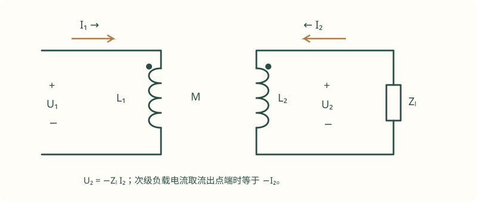

# 08 耦合电感、理想变压器与二端口

这一章把原来夹在三相页面中的互感内容单独展开。课程原总结明确列出了“列方程、去耦、空心变压器折算、理想变压器”等要求；二端口作为考研电路常用的补充方法，放在后半章，并与原课程范围分开说明。它们共同解决一个问题：一个端口接上负载后，另一个端口看到的电压、电流和阻抗怎样变化。

本章用 $\underline U,\underline I$ 表示有效值相量。所有完整算例为自编训练，不宣称来自某校真题。读题先写点标记、电压正端和电流方向，后面的每一个符号都由这三件事决定。

## 1. 点标记是极性关系，不是电流方向规定

设线圈 1、2 的电压 $u_1,u_2$ 都定义为“点端相对非点端”，电流 $i_1,i_2$ 都流入点端。那么

$$
u_1=L_1\frac{di_1}{dt}+M\frac{di_2}{dt},\qquad
u_2=M\frac{di_1}{dt}+L_2\frac{di_2}{dt}.
$$

若只把 $i_2$ 的参考方向反过来，而电压方向不变，则第二个电流变量在两式中都要反号；若连 $u_2$ 也反过来，第二式整体又要反号。不要只记“同名端加、异名端减”而不说明电流是否从同名端流入。

在相量域，上式成为

$$
\begin{bmatrix}\underline U_1\\\underline U_2\end{bmatrix}
=j\omega
\begin{bmatrix}L_1&M\\M&L_2\end{bmatrix}
\begin{bmatrix}\underline I_1\\\underline I_2\end{bmatrix}.
$$

把它与节点法、网孔法联立即可。若电路图较复杂，先单独写这两条元件关系，比直接凭图给每个网孔加 $\pm j\omega M$ 更不容易漏项。

## 2. 耦合系数与储能检查

互感大小写成

$$
M=k\sqrt{L_1L_2},\qquad 0\le k\le1.
$$

在上述关联方向下，储能为

$$
w=\frac12L_1i_1^2+Mi_1i_2+\frac12L_2i_2^2.
$$

被动耦合线圈要对所有电流组合都满足 $w\ge0$，因此 $M^2\le L_1L_2$。这个条件可以检查抄错参数、单位和点标记；例如 $L_1=10\,\mathrm{mH}$、$L_2=40\,\mathrm{mH}$，互感不可能超过 20 mH。

要注意，某些去耦等效中的一条虚构电感支路可以出现负参数。这不一定说明原网络有源，而可能是等效模型内部的数学表示。应检查**整体电感矩阵**是否半正定，而不是看到 $L_1-M<0$ 就直接判题目错误。

### 例 1：串联同向与反向，先判断互感符号

**题设。** 两线圈 $L_1=40\,\mathrm{mH}$、$L_2=90\,\mathrm{mH}$，$k=0.5$。线圈串联，求互感和两种串联方式的等效电感。

先求 $M=0.5\sqrt{0.04\times0.09}=0.03\,\mathrm H$。若串联电流同时流入两个线圈的点端，且总电压按沿电流方向取两压降之和，则

$$
L_+=L_1+L_2+2M=0.19\,\mathrm H.
$$

若一个电流流入点端、另一个流出点端，则

$$
L_-=L_1+L_2-2M=0.07\,\mathrm H.
$$

两者都应非负，因为 $L_1+L_2\ge2\sqrt{L_1L_2}\ge2M$。若算出负串联电感，先检查是否把 mH 当成 H，或把 $M$ 超过了允许上限。

## 3. T 形去耦：先写矩阵再认电路

当两个线圈的非点端共用一个参考节点，两个端口电压从点端指向公共端、电流都流入点端时，可以使用 T 形等效：左串联臂 $L_1-M$、右串联臂 $L_2-M$、中间公共支路 $M$。

为什么这张图正确？中间支路电流为 $i_1+i_2$，因此

$$
u_1=(L_1-M)\frac{di_1}{dt}+M\frac{d(i_1+i_2)}{dt}
   =L_1\frac{di_1}{dt}+M\frac{di_2}{dt},
$$

另一个端口同理。这里电流方向和共用端点是推导的一部分，不能把 T 形三条数值不加判断地搬到任意原图上。若改变一个线圈的点端或端口电压参考，互感符号变成负值，可用有符号互感 $M_s=\pm M$ 重新写矩阵后再配等效。

例如 $L_1=10\,\mathrm{mH}$、$L_2=40\,\mathrm{mH}$、$M=15\,\mathrm{mH}$ 满足 $M^2<L_1L_2$，左臂 $L_1-M=-5\,\mathrm{mH}$ 却为负。整体网络仍然被动；这个负支路不能单独拿出来当作可实际制作的独立电感。

## 4. 次级负载如何“反射”到原边

对无绕组电阻的耦合线圈，仍取两电流流入点端，次级接负载 $Z_L$，负载电流流出点端，所以

$$
\underline U_2=-Z_L\underline I_2.
$$

联立 $\underline U_2=j\omega M\underline I_1+j\omega L_2\underline I_2$ 得

$$
\underline I_2=-\frac{j\omega M}{Z_L+j\omega L_2}\underline I_1,
$$

$$
Z_{\rm in}=j\omega L_1+\frac{\omega^2M^2}{Z_L+j\omega L_2}.
$$

负载的反射项一般既有实部又有虚部。次级接电阻不意味着原边只增加一个纯电阻；线圈的励磁电抗也参与耦合。若有绕组损耗，将各绕组电阻放入各自 KVL，不能只在最后随便加一个电阻补上。

### 例 2：空心变压器负载与功率复核

**题设。** $L_1=20\,\mathrm{mH}$、$L_2=80\,\mathrm{mH}$、$M=20\,\mathrm{mH}$，$\omega=1000\,\mathrm{rad/s}$。次级接 $R_L=60\,\Omega$，原边加 $10\angle0^\circ\,\mathrm V$。求输入阻抗和两线圈电流。

先算 $\omega L_1=20$、$\omega L_2=80$、$\omega M=20$，于是

$$
Z_{\rm in}=j20+\frac{400}{60+j80}
          =j20+(2.4-j3.2)=2.4+j16.8\,\Omega.
$$

原边电流为

$$
\underline I_1=\frac{10}{2.4+j16.8}
             =\frac1{12}-j\frac7{12}\quad(\mathrm A).
$$

次级按流入点端方向定义，

$$
\underline I_2=-\frac{j20}{60+j80}\underline I_1
             =-\frac1{12}+j\frac1{12}\quad(\mathrm A).
$$

实际流过负载、从次级点端流出的电流为 $-\underline I_2$；负载电压 $\underline U_2=-60\underline I_2=5-j5\,\mathrm V$。负载有功 $P_L=60|I_2|^2=5/6\,\mathrm W$；原边输入有功 $\operatorname{Re}\{10\underline I_1^*\}=5/6\,\mathrm W$。理想线圈没有有功损耗，两者相等。

**变式检查。** 次级开路时 $I_2=0$、$Z_{\rm in}=j20$；次级短路时 $Z_{\rm in}=j\omega(L_1-M^2/L_2)=j15$。短接次级改变了原边电抗，但在没有任何电阻损耗的理想模型中不会凭空消耗有功。

## 5. 理想变压器：匝比、电流负号与功率守恒

理想变压器不是任意耦合线圈的直接同义词。它忽略损耗、漏磁和有限励磁电流，常由完全耦合且励磁电感很大的极限模型得到。规定两电压从点端到非点端，两电流都流入点端，匝比 $n=N_1/N_2>0$，则

$$
\underline U_1=n\underline U_2,\qquad
\underline I_1=-\frac1n\underline I_2.
$$

负号保证两端口总吸收功率为零：$\underline U_1\underline I_1^*+\underline U_2\underline I_2^*=0$。若把次级电流改定义为流出点端的负载电流 $I_L$，就有 $I_1=I_L/n$，公式没有显式负号。这两套写法都可以，但不能一半用流入、一半用流出。

接到次级的阻抗折算到原边为

$$
Z_L'=n^2Z_L.
$$

这是电压比与电流比共同作用的结果，不是 $nZ_L$。折算保留端口行为，但折算图中的电流、电压属于新侧，求完后要用匝比还原实际负载量。

### 例 3：负载折算与源内阻损耗

**题设。** 理想变压器 $n=2$，原边由 $120\,\mathrm V$ 有效值源串联 $R_s=2\,\Omega$ 供电，次级负载 $R_L=8\,\Omega$。求原边电流、次级电压、负载功率和源内阻损耗。

折算负载 $R_L'=2^2\times8=32\,\Omega$，故

$$
I_1=\frac{120}{2+32}=\frac{60}{17}\,\mathrm A.
$$

原边端电压 $U_1=32I_1=1920/17\,\mathrm V$，次级 $U_2=960/17\,\mathrm V$，负载电流 $I_L=U_2/8=120/17\,\mathrm A=2I_1$。

$$
P_L=\frac{115200}{289}\approx398.616\,\mathrm W,
\qquad P_{R_s}=\frac{7200}{289}\approx24.913\,\mathrm W.
$$

电源提供 $120I_1=7200/17\approx423.529\,\mathrm W$，正好等于二者之和。注意 $120\,\mathrm V$ 是源电压，不是变压器原边端电压；忽略串联内阻会把负载功率算高。

### 匝比用于匹配

若次级负载固定为 $R_L$，原边源为纯内阻 $R_s>0$，可选匝比使 $n^2R_L=R_s$ 获得最大负载功率。例如 $R_s=50\,\Omega$、$R_L=2\,\Omega$，取 $n=5$。若源内阻含电抗，纯实匝比只能按平方缩放负载阻抗，不能任意改变其相角；还需先说明是否允许额外匹配电抗。

## 6. 二端口参数：电流箭头决定负号

下面是考研网络分析常见的补充方法。先规定：$U_1,U_2$ 均为上端对下端，$I_1,I_2$ 均**流入**二端口上端。二端口条件要求每个端口流入、流出的电流相等；若有其他外接支路破坏这个条件，不能直接套二端口模型。

### 6.1 阻抗参数与导纳参数

$$
\begin{bmatrix}U_1\\U_2\end{bmatrix}
=\begin{bmatrix}z_{11}&z_{12}\\z_{21}&z_{22}\end{bmatrix}
\begin{bmatrix}I_1\\I_2\end{bmatrix}.
$$

$z_{11}=U_1/I_1|_{I_2=0}$ 是输出开路时的输入阻抗；$z_{21}=U_2/I_1|_{I_2=0}$ 是开路转移阻抗。其他两项同理。单位都是 $\Omega$。含理想电流约束的网络可能不存在有限完整 z 参数，不能假设任何二端口都有所有参数形式。

导纳参数则为 $[I_1,I_2]^T=\mathbf y[U_1,U_2]^T$，按另一端口短路来定义，单位为 S。若 $\mathbf z$ 可逆，则 $\mathbf y=\mathbf z^{-1}$。不是四个元素分别取倒数，矩阵求逆要保留耦合项。

对采用同一流入约定的互易网络，$z_{12}=z_{21}$、$y_{12}=y_{21}$；对称网络还需满足 $z_{11}=z_{22}$。互易和对称是两件事，不能用一个条件替代另一个。

### 6.2 传输参数适合级联

仍保持 $I_2$ 流入端口，定义

$$
\begin{bmatrix}U_1\\I_1\end{bmatrix}
=\begin{bmatrix}A&B\\C&D\end{bmatrix}
\begin{bmatrix}U_2\\-I_2\end{bmatrix}.
$$

这里显式使用 $-I_2$，因为级联时前一级流出的电流是后一级流入的电流。两段网络顺次级联时，传输矩阵按从输入到输出的次序相乘；顺序一般不能交换。$A,D$ 无量纲，$B$ 为 $\Omega$，$C$ 为 S。互易条件在这套约定下为 $AD-BC=1$。

一段串联阻抗 $Z$ 的矩阵为 $\begin{bmatrix}1&Z\\0&1\end{bmatrix}$，一段并联导纳 $Y$ 的矩阵为 $\begin{bmatrix}1&0\\Y&1\end{bmatrix}$。输出接 $Z_L$ 后，$U_2=Z_L(-I_2)$，所以

$$
Z_{\rm in}=\frac{AZ_L+B}{CZ_L+D}.
$$

### 例 4：T 网络的 z 参数与带载输入阻抗

**题设。** T 形纯电阻网络：输入到中间节点串联 $R_a=2\,\Omega$，中间节点到输出串联 $R_b=3\,\Omega$，中间节点接地 $R_c=4\,\Omega$。两端口电流均流入网络。求 z 参数；输出接 $R_L=6\,\Omega$ 后求输入阻抗。

中间电阻电流为 $I_1+I_2$，因此

$$
U_1=(R_a+R_c)I_1+R_cI_2,\qquad
U_2=R_cI_1+(R_b+R_c)I_2.
$$

所以 $\mathbf z=\begin{bmatrix}6&4\\4&7\end{bmatrix}\,\Omega$。负载条件 $U_2=-6I_2$，得到 $4I_1+13I_2=0$，即 $I_2=-4I_1/13$。代回第一式：

$$
Z_{\rm in}=6-\frac{16}{13}=\frac{62}{13}\,\Omega\approx4.769\,\Omega.
$$

直接串并联复核为 $2+[4\parallel(3+6)]=2+36/13=62/13\,\Omega$。这道题也说明，$z_{11}=6\,\Omega$ 只代表输出开路时的输入阻抗，并不是任何负载下的输入阻抗。

### 6.3 从 z 参数换到传输参数，顺便检查符号

当 $z_{21}\ne0$ 时，从 $U_2=z_{21}I_1+z_{22}I_2$ 解出 $I_1$，再代回第一式，就得到

$$
A=\frac{z_{11}}{z_{21}},\quad
B=\frac{z_{11}z_{22}-z_{12}z_{21}}{z_{21}},\quad
C=\frac1{z_{21}},\quad D=\frac{z_{22}}{z_{21}}.
$$

这些关系针对本章使用的 $[U_2,-I_2]^T$ 约定。如果教材把输出电流一开始就画成流出端口，记号可能没有显式负号，不能跨约定直接抄转换公式。推一遍第二行方程只需几步，却能同时确认符号和矩阵顺序。

对例 4 的 T 网络，行列式 $6\times7-4\times4=26\,\Omega^2$，有

$$
\mathbf y=\frac1{26}\begin{bmatrix}7&-4\\-4&6\end{bmatrix}\,\mathrm S,
\qquad
\mathbf T=\begin{bmatrix}1.5&6.5\\0.25&1.75\end{bmatrix}.
$$

传输矩阵中的 $B=6.5\,\Omega$、$C=0.25\,\mathrm S$；不能把整个矩阵都标成欧姆。$AD-BC=2.625-1.625=1$，符合互易条件。输出接 $6\,\Omega$ 时，$(1.5\times6+6.5)/(0.25\times6+1.75)=62/13\,\Omega$，和前面的直接计算一致。

若网络含受控源，互易性一般不再成立，应根据实际元件关系求参数，不能在方程不够时擅自补上 $z_{12}=z_{21}$。若参数矩阵不可逆，只说明这种参数形式不能用有限数值完整描述，或者当前参数处于奇异条件，不代表电路本身不存在。

### 6.4 二端口测试条件：开路的是端口，不是随意删支路

测 z 参数时，令输出端口电流 $I_2=0$，意思是外部负载开路。网络内部连接输出节点与其他节点的元件仍然存在，受控源也仍然工作。很多解答把输出支路一起删掉，算到的就不是原网络参数。测 y 参数时令 $U_2=0$，是把两个输出端子短接，这个短路可能仍流过电流，不能因为电压为零就忽略相关电流。

可以用极限交叉检查：输出开路的输入阻抗是 $z_{11}$；输出短路的输入阻抗则是 $z_{11}-z_{12}z_{21}/z_{22}$，前提是该表达式定义良好。对于例 4，开路得到 $6\,\Omega$，短路得到 $6-16/7=26/7\,\Omega$。直接从电阻图算，短路时 $R_b$ 与 $R_c$ 并联，再串联 $R_a$，结果也为 $2+12/7=26/7\,\Omega$。

若题目有输出负载、电压表内阻或电流表分流，测试端口就不再是理想开路或短路，需要把这些外部元件写入终端条件。把电表视作理想仪器是一项模型假设；题目给出有限内阻时必须使用给定值。

### 6.5 与理想变压器的联系：有些网络没有有限 z 参数

理想变压器约束 $U_1=nU_2$、$I_1=-I_2/n$。两端口电流不能独立指定，所以不能一般性地把任意 $I_1,I_2$ 当独立变量并写出有限完整 z 矩阵。但采用传输形式则很自然：

$$
\mathbf T_{\rm ideal}=\begin{bmatrix}n&0\\0&1/n\end{bmatrix}.
$$

它的行列式为 1，输出接 $Z_L$ 时 $Z_{\rm in}=(nZ_L)/(1/n)=n^2Z_L$，恰好回到阻抗折算公式。这说明选参数并不是形式偏好，而是看哪些端口变量能够独立使用，以及电路需要级联、并联还是串联组合。

在考试里如果一次又一次求出 $0/0$ 或无穷大，不要急着说系统无解。先检查是否用了不适合的参数形式，随后回到理想变压器原始约束。原始元件方程通常比强行套转换表更可靠。

### 6.6 从“物理图”到“计算图”的三种层次

第一层是保留两线圈的互感关系，直接与 KCL/KVL 联立；它最一般，适用于点标记和外部连接比较复杂的题。第二层是在满足端口参考条件时用 T 形等效去耦，减少联立中的互感项；这是一种端口等效，不意味着真的把绕组拆成三只可单独制作的电感。第三层是理想变压器模型，用匝比和阻抗折算把负载移到同一侧；只有题目允许忽略漏磁和励磁电流时才可使用。

如果原题给出有限 $L_1,L_2,M$，尤其明确 $k<1$，就不能为了省事直接套理想匝比。例 2 的输入阻抗带有明显励磁电抗，若只取 $n^2R_L$ 会失去它。反过来，题目明确写“理想变压器”，就不必再额外假设一个未给出的励磁电感，不然会凭空增加未知量。

复盘时可以用三个极限检验模型：次级开路、次级短路、负载变得很大。有限耦合模型开路时原边仍有励磁电流；理想变压器开路时原边理想励磁电流为零。两者并不冲突，恰好体现了理想模型忽略了什么。明白这个差别，才不容易在含变压器的暂态题、匹配题与网络参数题之间混用公式。

## 7. 三道自测与逐步答案

??? question "练习 1：由开路、短路电感求耦合系数"
    两线圈 $L_1=25\,\mathrm{mH}$、$L_2=100\,\mathrm{mH}$。次级短路时，从原边看到的电感为 $16\,\mathrm{mH}$。忽略绕组电阻，求 $M,k$。

    **解。** $L_{\rm sc}=L_1-M^2/L_2$，所以 $M^2=(0.025-0.016)\times0.1=0.0009\,\mathrm H^2$，$M=30\,\mathrm{mH}$。$k=M/\sqrt{L_1L_2}=0.03/0.05=0.6$。开路原边电感为 $L_1$，短路后减小，符合反射项的作用。

??? question "练习 2：反向折算阻抗"
    理想变压器 $n=N_1/N_2=3$，原边的 $18\,\Omega$ 源内阻折到次级是多少？若次级负载为 $2\,\Omega$，是否实现纯电阻匹配？

    **解。** 从原边折到次级应除以 $n^2$，得到 $18/9=2\,\Omega$。因此与次级 $2\,\Omega$ 负载匹配。也可把负载折到原边得 $9\times2=18\,\Omega$，两种方法相符。不要在两种折算中都乘以匝比平方。

??? question "练习 3：级联矩阵与开路极限"
    一个串联 $Z=2\,\Omega$ 元件后面接并联导纳 $Y=0.1\,\mathrm S$。求传输矩阵及输出接 $Z_L=10\,\Omega$ 时的输入阻抗。

    **解。** 按物理顺序相乘，$\mathbf T=\begin{bmatrix}1&2\\0&1\end{bmatrix}\begin{bmatrix}1&0\\0.1&1\end{bmatrix}=\begin{bmatrix}1.2&2\\0.1&1\end{bmatrix}$。故 $Z_{\rm in}=(1.2\times10+2)/(0.1\times10+1)=7\,\Omega$。直接算为 $2+(10\parallel10)=7\,\Omega$。若输出开路，输入仍有并联支路，极限为 $A/C=12\,\Omega$，并非无穷大。

### 7.1 开路电压与短路电流，不要跨模型混用

求耦合网络戴维南等效时，负载开路不等于次级线圈整个消失。若观察端口正是次级，开路条件是 $I_2=0$，但次级仍有由原边产生的感应电压。端口短路时 $U_2=0$，次级可以流过很大的电流，并通过互感改变原边电流。先分别使用正确的端口条件求开路电压和短路电流，再讨论端口等效，不能把开路时求出的原边电流直接带到短路状态。

同样，计算有功功率时应包含绕组电阻、源内阻和外接负载。周期稳态下，独立理想电感的平均有功为零；对耦合线圈或理想变压器，应该说整个无损耦合器的平均吸收功率之和为零，单个绕组端口仍可传递非零有功。能量可以从原边经耦合流向次级负载；例 2 的原边输入阻抗出现正实部，正是次级电阻通过耦合反射回来的结果。

考试中建议把每一个“等效到另一侧”的结果写明侧别。例如 $R_L'$ 标作折算到原边，$I_2$ 标作实际次级电流，避免用折算电流乘实际电阻求功率。物理负载功率、原边折算负载功率应相同，实际电压、电流却不同。利用这种功率不变量做检查，通常比反复重算小数更快。

## 8. 和课程原资料的衔接

- [2023 总结 PDF 第 20 页](../resources/circuit-review-2023.pdf#page=20)：原课程互感、空心变压器、理想变压器复习范围。
- [第 22—26 页](../resources/circuit-review-2023.pdf#page=22)：输入阻抗、互感参数、理想变压器与最大功率等原题。
- [秋学期总结与例题 PDF 第 6 页](../resources/circuit-autumn-summary.pdf#page=6)：理想变压器参与暂态时的负载折算；原文也提示电流方向符号应核对。
- [正弦稳态与匹配](04-ac.md)：继续复习阻抗、复功率以及受限负载匹配。
- [节点与网孔方程](02-equations.md)：耦合线圈端口约束最终仍要与 KCL/KVL 联立。

如果原题要求画相量图，图中的绕组感应电压应由已经确定的点标记方程生成，不要反过来凭直觉修改方程符号。

复习互感题时，把“端口电压电流方向、点标记、负载电流方向”画在一张小图里，随后只按方程算。二端口题再补一句“本题采用哪一种 $I_2$ 约定”，可以避免同一本书不同章节之间的符号混用。
