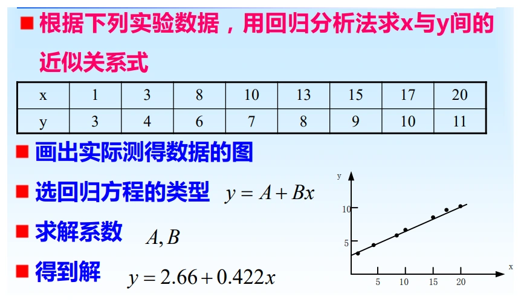

# 第二章（二）　数据处理、误差传递与测量方案

[课程目录](../index.md) · [误差与系统修正](02-errors.md) · [原笔记，第 25—36 页](../resources/measurement-notes.pdf#page=25)

计算题应完整写出“测量模型—误差类型—灵敏系数—合成方式—结果表达”。同一个功率公式，已知有符号偏差、只知道各项限差，以及已知标准不确定度时，会得到三种不同的合成式。先选对模型，比背一个总公式更重要。

## 1. 有效数字与舍入

有效数字从首个非零数字计起，末尾零是否有效应由写法表达清楚。$0.00340\,\mathrm V$ 有三位有效数字，$3.40\,\mathrm{mV}$ 也有三位；单位换算不能凭空增加信息。整数“1000”含义不够明确，宜写为 $1.0\times10^3$ 或 $1.000\times10^3$。

课程采用的偶数舍入规则是：舍去部分小于半个末位单位时舍，大于时进，**恰好等于一半且后面没有非零数字**时使保留末位成为偶数。保留三位有效数字：

| 原数 | 结果 | 说明 |
| --- | --- | --- |
| $57.7500$ | $57.8$ | 正好一半，原保留末位 7 为奇数 |
| $57.6500$ | $57.6$ | 正好一半，原保留末位 6 为偶数 |
| $57.6501$ | $57.7$ | 大于一半，不能按偶数直接舍去 |
| $12355$ | $1.24\times10^4$ | 保留到百位，后续部分大于 50 |

中间步骤保留保护位，只在最终结果统一舍入。对多个乘除或差分，若每步都按最终位数截断，会积累明显误差。加减主要受绝对分辨力限制，乘除主要受相对精度限制；这些规则是简化表达，正式不确定度预算应由测量模型决定，而不是机械比较小数位数。

## 2. 一阶误差传递的来源

设 $y=f(x_1,\ldots,x_m)$。在小扰动条件下对参考点展开：

$$
\Delta y\simeq\sum_i c_i\Delta x_i,\qquad
c_i=\frac{\partial f}{\partial x_i}.
$$

$c_i$ 称为灵敏系数，它把各输入误差转换成输出的同一单位。该式保留误差的符号；只有在计算未知符号的最坏限差时才取绝对值。

例如 $y=x_1+x_2$ 时，$\Delta y=\Delta x_1+\Delta x_2$，但

$$
\frac{\Delta y}{y}
=\frac{x_1}{y}\frac{\Delta x_1}{x_1}
+\frac{x_2}{y}\frac{\Delta x_2}{x_2}.
$$

因此“和差的相对误差直接相加”通常错误。只有积、商、乘幂关系在取对数微分后，才得到简洁的相对误差式。

若 $y=K\prod_i x_i^{a_i}$，且 $K$ 视为无误差常数，则

$$
\frac{\Delta y}{y}\simeq\sum_i a_i\frac{\Delta x_i}{x_i}.
$$

对于 $P=U^2/R$，有 $\gamma_P\simeq2\gamma_U-\gamma_R$；对于 $P=I^2R$，有 $\gamma_P\simeq2\gamma_I+\gamma_R$。负号表明给定偏差的作用方向，不表示可以随意把误差限相减。

## 3. 三种合成方式分别在什么条件下使用

### 3.1 已知有符号的系统偏差

若各项偏差及符号已知，按代数形式传递并修正。例如电压示值偏高 $1\%$，电阻示值也偏高 $1\%$，用 $P=U^2/R$ 计算时一阶相对偏差约为 $+1\%$。

### 3.2 只知道误差上限

若 $|\Delta x_i|\le a_i$，计算一阶最坏情况：

$$
|\Delta y|\lesssim\sum_i|c_i|a_i.
$$

这是考试题“绝对值合成”的含义。实际误差不一定同时到达最不利符号，因此它通常比统计合成保守。误差较大或模型强非线性时，需直接在允许输入区间上计算极值，而不是继续使用线性近似。

### 3.3 已知标准不确定度

若输入互不相关：

$$
u_c^2(y)=\sum_i c_i^2u^2(x_i).
$$

若存在相关性，必须增加

$$
2\sum_{i<j}c_ic_j\,u(x_i,x_j).
$$

两个读数共用一个基准源或同一仪表增益时，相关项可能显著。把“所有系统误差”一律做平方和开根号，或者把最大允许误差直接当成标准差，都缺少依据。若只有均匀分布半宽 $a$ 的合理假设，先换算 $u=a/\sqrt3$。

## 4. 功率测量三方案比较

设可测 $U,I,R$，分别有相对限差 $1\%,1.5\%,5\%$。采用最坏绝对值合成：

| 模型 | 一阶相对限差 | 结果 |
| --- | --- | --- |
| $P=UI$ | $a_U+a_I$ | $2.5\%$ |
| $P=U^2/R$ | $2a_U+a_R$ | $7.0\%$ |
| $P=I^2R$ | $2a_I+a_R$ | $8.0\%$ |

在该给定条件下，$UI$ 方案的限差最小。但这不意味着它在所有电路中都最好：电压表加载、串入电流表的压降、两表是否同步、交流相位差都会改变模型。对交流有功功率，$UI$ 通常是视在功率，只有纯电阻或已考虑功率因数时才等于有功功率。

**回忆卷对应题。** $I=10\,\mathrm A$、$R=10\,\Omega$，求功率及相对限差：

$$
P=I^2R=1000\,\mathrm W,\qquad
a_P=2\times1.5\%+5\%=8\%,
$$

故一阶最坏绝对误差为 $80\,\mathrm W$。若直接用极端值计算，上界为 $1000(1.015)^2(1.05)=1081.736\,\mathrm W$，说明 $8\%$ 是按题意采用的线性近似。[原卷第 1 页](../resources/exam-2025-2026.pdf#page=1)

## 5. 接近量相减为什么危险

设 $y=U_1-U_2$，$U_1=10.00\,\mathrm V$，$U_2=9.90\,\mathrm V$，两项均有 $0.01\,\mathrm V$ 的独立限差。则 $y=0.10\,\mathrm V$，最坏误差 $0.02\,\mathrm V$，相对限差达 $20\%$。

这并非减法本身“不准确”，而是小差值相对输入误差太小。可选择差分放大器、微差法或更高分辨率的直接差值测量。若两项共用同一增益偏差，相关误差可能在相减中部分抵消；因此也不能把所有实际方案都按独立误差处理。

## 6. 测量误差的分配

当输出误差限要求为 $a_y$ 时，分配的是各项经灵敏系数转换后的贡献。

最坏限差下的等作用分配为

$$
|c_i|a_i=\frac{a_y}{m}.
$$

若采用互不相关标准不确定度的平方和预算，则等贡献应为

$$
|c_i|u(x_i)=\frac{u_c(y)}{\sqrt m}.
$$

两个分母不同，不能混用。对 $P=I^2R$，要求相对限差不超过 $3\%$，等作用分配为 $2a_I=a_R=1.5\%$，故 $a_I=0.75\%$、$a_R=1.5\%$。如果某分量已接近总预算，应优先改善该项，继续提高一个已很小分量的精度通常收益有限。

## 7. 校准直线与最小二乘

对标准输入 $x_i$ 和仪表输出 $y_i$，采用 $y=a+bx$。若各输出误差独立同方差、输入不确定度可忽略，最小化

$$
S(a,b)=\sum_i(y_i-a-bx_i)^2.
$$

令偏导数为零，得到

$$
b=\frac{\sum_i(x_i-\bar x)(y_i-\bar y)}{\sum_i(x_i-\bar x)^2},
\qquad a=\bar y-b\bar x.
$$

**图 2-3　拟合用于描述测量关系。** 原笔记第 29 页。直线通过数据中心不表示每个点均被正确解释；应继续看残差是否随输入弯曲、随时间漂移或在高低量程间改变分散程度。

**例 2-4　简单校准。** 标准输入为 $0,1,2\,\mathrm V$，示值为 $0.02,1.03,2.04\,\mathrm V$。由公式得到 $a=0.02\,\mathrm V$、$b=1.01$。以后读到 $1.535\,\mathrm V$，修正输入为

$$
x=\frac{1.535-0.02}{1.01}=1.500\,\mathrm V.
$$

三点恰在一直线上只是本例构造，不能据此推断真实系统无噪声。斜率、截距和参考源的不确定度还需传入修正后的结果。若不同点方差不同，应考虑加权最小二乘；若输入误差不可忽略，普通最小二乘的前提也不再满足。

对指数关系 $y=Ae^{bx}$ 取对数可以线性化，但会改变误差模型：原来等幅加性噪声取对数后通常变成异方差。不能只为拟合直线方便而忽视这一点。

## 8. 不确定度预算完整算例

设测量模型 $y=ax+b$，估计值为 $a=2.00$、$x=1.50$、$b=0.10$，**给定标准不确定度** $u(a)=0.02$、$u(x)=0.01$、$u(b)=0.02$，各输入不相关。计算

$$
y=3.10,\quad c_a=x=1.50,\quad c_x=a=2.00,\quad c_b=1,
$$

$$
u_c(y)=\sqrt{(1.50\times0.02)^2+(2.00\times0.01)^2+0.02^2}
=0.04123.
$$

取题目指定的 $k=2$ 时 $U=0.08246$，可报告 $y=3.10\pm0.08$，并注明覆盖因子及输入单位。若题目中的“±0.02”其实是均匀限差，则必须先除以 $\sqrt3$，会得到不同结果。这里特意明确输入是标准不确定度，避免旧概览中“±”未说明含义造成歧义。

## 9. 应试检查顺序

写完题目后逐项核对：单位是否一致；百分数是否转成无量纲；加减关系是否保留权重；限差是否取绝对值；统计合成是否说明独立性；最终位数是否与不确定度相配。题目没有给分布时，优先依题意使用误差限，不自行假设所有误差都正态分布。
