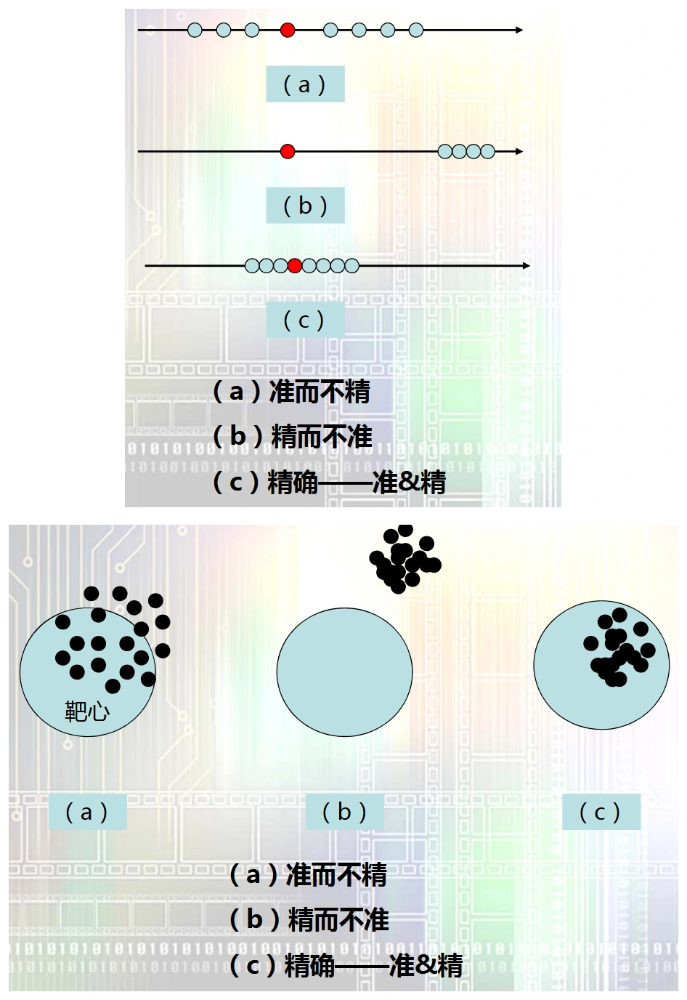
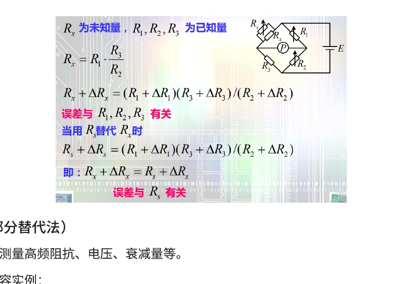

# 第二章（一）　误差、随机测量与系统修正

[课程目录](../index.md) · [数据处理与误差合成](02-data.md) · [本章原笔记，第 3—24 页](../resources/measurement-notes.pdf#page=3)

测量误差题往往不难算，难在分清正在计算哪一种误差：实际偏差、最坏情况下的允许偏差，还是重复测量的标准差。本章统一采用“测得值减参考值”的符号约定；引用仪器等级时计算限差，讨论重复性时计算统计量，两种结果不能混用。

## 1. 绝对误差、相对误差与修正值

设被测量的参考值为 $x_0$，测得值为 $x$。绝对误差与修正值分别为

$$
\Delta x=x-x_0,\qquad C=-\Delta x,\qquad x_{\mathrm{corr}}=x+C.
$$

“绝对误差”中的“绝对”表示它与被测量同量纲，**并不表示取绝对值**。示值偏高时误差为正，修正值为负。实际测量通常不能获得严格真值，因而使用有溯源依据的标准值或约定参考值；修正后仍存在不确定度，不能宣称获得了无误差真值。

相对误差与引用误差的分母不同：

$$
\gamma=\frac{\Delta x}{x_0},\qquad
\gamma_m=\frac{\Delta x}{x_m}.
$$

其中 $x_m$ 为量程上限或题目指定的引用值。上式写的是无量纲比值；换为百分数时再乘 $100\%$，避免把百分号计算两遍。若用示值 $x$ 代替未知的 $x_0$，属于小误差条件下的近似。

**例 2-1　修正曲线读数。** 电流表示值为 $10.00\,\mathrm{mA}$，校准表给出该点的示值误差为 $-0.04\,\mathrm{mA}$。修正值为 $+0.04\,\mathrm{mA}$，结果为 $10.04\,\mathrm{mA}$。若校准表写的已经是“修正值”，应直接相加，不再反号。

### 参考值、示值与分贝误差（原 2.1） {#reference-db}

真值是与被测量定义相符的理想值，通常不能完全知道。校准题给出的标准器值，是具有自身不确定度的参考值；题目把它视为真值，是为了计算示值误差的近似。重复测量得到的平均值只是在估计测量系统的期望值，不能在没有校准的情况下直接代替真值。

相对误差还须区分分母。以参考值为分母的是 $\Delta x/x_0$，以示值为分母的是 $\Delta x/x$。例如标准电压 $200\,\mathrm V$，仪表读 $202\,\mathrm V$，两者分别为 $1.000\%$ 与 $0.9901\%$。只有偏差足够小时才可近似替换。读 $201\,\mathrm V$ 对应参考值相对误差 $+0.5\%$；标准 $20\,\mathrm V$ 却读 $19.5\,\mathrm V$ 则为 $-2.5\%$。先判断正负，再计算百分数，能发现分母或符号抄错。

增益用分贝表达时，误差也要通过对数换算。若电压比的测量相对偏差为 $\gamma$，并且新旧电压比采用相同阻抗条件：

$$
\Delta G_{\mathrm{dB}}=20\log_{10}(1+\gamma)
\simeq\frac{20}{\ln10}\gamma=8.686\gamma.
$$

功率比则将系数 20 改为 10，小偏差近似为 $4.343\gamma$。式中 $\gamma$ 必须代入无量纲数，例如 $1\%=0.01$；电压比偏高 $1\%$ 对应约 $+0.0864\,\mathrm{dB}$，并不是 $+1\,\mathrm{dB}$。若给定对称的 $\pm10\%$ 比值限差，准确分贝边界为 $20\log_{10}1.1$ 与 $20\log_{10}0.9$，两侧并不对称。

[对应原笔记：第 3—7 页](../resources/measurement-notes.pdf#page=3)

## 2. 准确度等级与量程选择

指针式电压表标为 $s$ 级，若等级以满量程百分比规定，则

$$
|\Delta U|\le\frac{s}{100}U_m,\qquad
|\gamma_U|\le\frac{sU_m}{100|U|}.
$$

同一量程的允许绝对误差近似不随读数变化，因此读数越小，相对误差界越大。量程选择的目的，是在不过载的条件下充分利用刻度。原笔记中的“读数位于量程后段”是这类仪表的经验，不适用于非线性欧姆挡，也不能直接套用到按“读数百分比＋字数”规定误差的数字表。

**例 2-2　回忆卷原题，1.5 级、10 V 挡。**

$$
\Delta U_{\max}=10\times1.5\%=0.15\,\mathrm V.
$$

测量 $5\,\mathrm V$ 和 $8\,\mathrm V$ 时，最大绝对误差均为 $0.15\,\mathrm V$；相对误差限分别为 $3.0\%$、$1.875\%$。不能把等级乘在实际读数上得到 $0.075\,\mathrm V$ 和 $0.12\,\mathrm V$。[原卷第 2 页](../resources/exam-2025-2026.pdf#page=2)

## 3. 三类误差及其处理方法

对相同条件下的一次测量，可写成

$$
x_i=x_0+\varepsilon+\delta_i,
\qquad \varepsilon=E[X]-x_0,
\qquad \delta_i=x_i-E[X].
$$

系统误差 $\varepsilon$ 表示期望值偏离参考值，随机误差 $\delta_i$ 表示单次结果偏离其期望。粗大误差通常来自接错线、抄错数、量程错误或条件突变，不宜作为正常随机波动处理。

| 类型 | 从数据中可能看到什么 | 合理处理 |
| --- | --- | --- |
| 恒定系统偏差 | 多次读数集中，但整体偏离标准 | 校准、修正、替代或反向测量 |
| 缓慢漂移 | 读数随时间单调变化 | 预热、交叉次序测量、记录时间及环境 |
| 随机波动 | 无明显规律地分散 | 重复测量，评估标准差与均值标准差 |
| 异常数据 | 与测量条件或正常分布明显不符 | 保留原记录，查原因，按预先选定规则处理 |

{ target=_blank rel=noopener }

**图 2-1　准确性与重复性的区别。** 截取自原笔记第 9 页。数据集中只能说明重复性较好，不能证明没有恒定系统偏差。原笔记中的“准确度、精密度、精确度”按课程语境理解；正式报告宜分别给出偏差、重复性和不确定度，避免只用一个形容词评价结果。

平均值可以削弱零均值、近似独立的随机波动；若系统误差保持不变，平均一万次仍有相同偏差。温漂或低频噪声导致相邻数据相关时，也不能直接按 $1/\sqrt n$ 推断平均的收益。

### 从误差来源追到处理措施（原 2.1、2.3） {#error-origins}

“系统、随机、粗大”按误差表现分类；“工具、方法、环境、人为”按来源分类，两套分类不能一一对应。仪器温漂可能表现为缓慢系统漂移，接触不稳定可能表现为随机波动，读错量程可能形成粗大误差。答简答题时，应先描述来源，再说明其在本次测量中的表现，最后给措施。

| 来源 | 具体机制 | 处理时要记录的条件 |
| --- | --- | --- |
| 工具误差 | 零位、增益、刻度非线性、参考源偏差 | 校准日期、量程、预热、零点 |
| 方法误差 | 电压表分流、电流表压降、近似公式 | 仪表接入前后的等效电路 |
| 环境误差 | 温度、湿度、电磁场、机械振动 | 环境值、屏蔽和接地方式 |
| 人为影响 | 视差、读数时机、操作次序 | 读数规则、等待时间、原始记录 |

恒定系统误差会整体平移数据；累进误差随时间单调增减；周期误差随某一周期重复；复杂变化误差可能同时含漂移和周期分量。单看一个“标准差很小”的结果，不能排除后三者。应保留采样顺序，先画 $x_i$ 对时间或序号的图，再决定是否符合等精度、稳定测量的前提。

准确度描述接近参考值的程度，精密度描述重复测量的集中程度。原课使用“精确度”综合讨论两者，答题可以沿用课程术语，但实验报告最好分别列平均偏差和重复性标准差。后文的不确定度是对可合理赋予被测量之值的分散性描述，也不等于已经知道的实际误差。

## 4. 算术平均值、残差与贝塞尔公式

对 $n$ 次等精度测量，计算

$$
\bar x=\frac1n\sum_{i=1}^{n}x_i,\qquad
v_i=x_i-\bar x,\qquad
s=\sqrt{\frac{\sum v_i^2}{n-1}}.
$$

由平均值的定义，$\sum v_i=0$ 对任意有限样本都严格成立；实际计算中的微小不为零通常来自中间舍入。它不是“测量次数足够多才成立”的统计结论。残差也不等于真实随机误差，因为 $\bar x$ 只是未知期望值的估计。

若各次测量独立、同方差，平均值的实验标准差为

$$
s_{\bar x}=\frac{s}{\sqrt n}.
$$

分母 $n-1$ 来自使用样本自身估计均值所损失的一个自由度。报告 $s$ 是描述单次测量的离散性；报告 $s_{\bar x}$ 是描述该组平均值的统计不确定性。题目问“平均结果”时不能直接把 $s$ 当成均值标准差。

**例 2-3　五次电压测量。** 数据为 $9.98,10.01,10.00,10.02,9.99\,\mathrm V$。有

$$
\bar U=10.000\,\mathrm V,\quad
\sum v_i^2=0.0010\,\mathrm V^2,
$$

$$
s=0.01581\,\mathrm V,\qquad s_{\bar U}=0.007071\,\mathrm V.
$$

若课程题指定使用 $3s_{\bar U}$，相应半宽约 $0.0212\,\mathrm V$。这只是该规则下的随机分量表达；不能自动称为小样本下 $99.7\%$ 置信区间，也没有计入仪器限差。正态母体、方差未知时，均值置信区间应根据自由度使用 $t$ 分布。

## 5. 正态分布、均匀分布与量化误差

正态随机变量的标准差为 $\sigma$ 时，落在均值两侧 $\sigma,2\sigma,3\sigma$ 内的概率约为 $68.27\%,95.45\%,99.73\%$。**正态分布没有严格有限的误差边界**，“三倍标准差”是概率覆盖约定。

理想舍入量化器的量化步长为 $q$。若量化误差可按 $[-q/2,q/2]$ 上均匀分布近似，则

$$
E[e_q]=0,\quad
\operatorname{Var}(e_q)=\frac{q^2}{12},\quad
u_q=\frac q{\sqrt{12}}.
$$

当仪表最小间隔为 $5\,\mathrm{mV}$ 时，标准差为 $1.443\,\mathrm{mV}$，方差为 $2.083\,\mathrm{mV}^2$。标准差与方差的单位必须区分。若输入几乎不变、始终落在同一个码内，量化误差未必随机变化，此时不能认为重复读同一码便能不断降低量化误差。

### 从概率密度理解正态和均匀分布（原 2.2） {#error-distributions}

正态分布的概率密度为

$$
p(\delta)=\frac1{\sqrt{2\pi}\sigma}
\exp\left(-\frac{\delta^2}{2\sigma^2}\right).
$$

对称性给 $E[\delta]=0$；峰值在零附近表示小误差出现得更频繁；两侧尾部趋于零但不在有限位置截止。这三个事实分别对应“对称、单峰、有尾部”，不能由此推断任何实际测量都正态分布。若主要误差来自一个固定量化格或某个未知但有界的分量，均匀模型可能更合适。

对 $[-a,a]$ 上均匀分布，$p(e)=1/(2a)$，由积分得到

$$
\sigma^2=\int_{-a}^{a}\frac{e^2}{2a}\,de=\frac{a^2}{3}.
$$

量化步长 $q$ 对应 $a=q/2$，所以得到前文 $q^2/12$。若题目直接给“限差 $\pm5\,\mathrm{mV}$”，半宽是 $5\,\mathrm{mV}$，不是量化步长 $5\,\mathrm{mV}$，标准差应为 $5/\sqrt3\,\mathrm{mV}$。这是同一数字在不同题意下会产生不同答案的原因。

**均值估计的条件。** 对独立同方差随机变量，$\operatorname{Var}(\bar X)=\sigma^2/n$。若存在相关性，则应改为

$$
\operatorname{Var}(\bar X)=\frac1{n^2}
\left[\sum_i\operatorname{Var}(X_i)+2\sum_{i<j}\operatorname{Cov}(X_i,X_j)\right].
$$

这解释了为什么重复采得很密、却共同受慢温漂影响的数据，不能仅靠增加点数获得预计的精度。实际操作中应先让系统稳定，避免把预热过程与稳定测量混在一组。

## 6. 异常数据的判断边界

莱特准则常以 $|x_i-\bar x|>3s$ 作为正态大样本中的检查线索。它不适合不加条件地用于很小样本，也不适合反复删除数据直至结果“好看”。有效做法是先检查连接、量程、时间戳和环境记录，再按事先确定的统计准则判断。

对明显漂移的数列，不应把末端数据仅因偏离均值而剔除；漂移本身就是测量系统的重要信息。保留原始数据、说明排除原因和前后结果，是实验记录与应试简答都应具备的步骤。

### 系统趋势的判断与残差检验（原 2.3） {#system-tests}

原笔记列出理论分析、校准比对、改变条件、残差观察和判据检验五种路径。理论分析先找能使结果偏大的电路机制；校准比对用已知标准检查整体偏离；改变条件可通过换量程、换接法或反向激励检验结果是否跟着变化；残差观察则检查时间顺序中是否有连续同号、单调或周期结构。

课程提到的马利科夫判据，实质上比较按时间排列的前后两组残差和，寻找累进趋势。若前半组多负、后半组多正，即使总残差和为零，也可能存在漂移。不能把“残差和恒为零”用作没有系统误差的证据。

阿卑类判据关注相邻差。可定义统计量

$$
\eta=\frac{\sum_{i=1}^{n-1}(x_{i+1}-x_i)^2}
{2\sum_{i=1}^{n}(x_i-\bar x)^2}.
$$

对独立同分布、无趋势的正常随机数据，这个比值通常在 1 附近；慢漂移使相邻差相对整体离散性偏小，可能使比值下降。但正式拒绝阈值取决于样本数、显著性水平和所采用的统计量定义。原资料的简式不能脱离条件当成通用阈值；考试若指定判据，须沿用题目完整定义。

**可直接操作的检查。** 先按原采样顺序画残差，随后把数据分成前后两半，比较均值及环境记录；再尝试反向激励或交换接线。若偏差随激励反向而反号，更像被测量响应；若某固定电压不随激励反向，优先检查热电势、零点或共模转差模。统计检验发现的是可疑结构，最终还应回到物理原因。

## 7. 系统误差的削弱与补偿

### 7.1 零示法与替代法

零示法调节标准量，使比较器达到平衡。平衡附近比较器的增益误差对结果影响较小，但标准量的准确性、检零灵敏度、寄生参数和热电势仍需考虑。“指针为零”不意味着整个测量没有误差。

替代法让被测量与标准量依次接入同一测量链，调节标准量使示值相同。如果两次测量的响应、环境和连接不变，可削弱指示仪表的刻度误差。

{ target=_blank rel=noopener }

**图 2-2　替代测量的原资料示意。** 原笔记第 21 页。重点是“替换对象后恢复同一平衡条件”，而不是简单比较两次任意读数。

### 7.2 交换法与微差法

若交换桥臂前后得到 $R_x=kR_s$ 和 $R_x=R_s'/k$，两式相乘可消去桥臂比例系数：

$$
R_x=\sqrt{R_sR_s'}.
$$

微差法用接近被测量的标准量 $B$ 与小差值 $A$ 得到 $X=B+A$。差值仪表只测很小的 $A$，可降低其相对误差对总量的影响，但标准量 $B$ 的误差仍完整进入最终结果。

### 7.3 自动调零与两点校准

测量链为 $y=ax+b$ 时，短路输入得到的零点只校正 $b$，不能同时修正斜率 $a$。至少再引入一个已知标准输入，才能进行两点增益校准。增益随温度漂移、非线性和迟滞也不能只靠一次调零解决。

### 补偿、微差与交叉读数的具体条件（原 2.3） {#compensation-abba}

**补偿法。** 先把影响量引起的偏差通过电路或比较过程抵消，再读被测量。例如 LC 谐振测电容，若固定杂散电容为 $C_0$，则

$$
f_0=\frac1{2\pi\sqrt{L(C_x+C_0)}}.
$$

保持 $L$、连接位置和调谐条件不变，以标准电容 $C_s$ 替换 $C_x$，调到同一谐振频率，可得 $C_s+C_0=C_x+C_0$，从而 $C_x=C_s$。这里抵消的是两次共有且不变的 $C_0$；若移动引线后寄生电容变化，抵消条件就被破坏。

**微差法的误差权重。** $X=B+A$ 时，若只知限差 $a_B,a_A$，有 $a_X\le a_B+a_A$。例如标准量 $B=99.90\,\mathrm V$、限差 $0.01\,\mathrm V$，差值 $A=0.10\,\mathrm V$、限差 $0.002\,\mathrm V$，则 $X=100.00\,\mathrm V$、最坏限差 $0.012\,\mathrm V$。虽然差值表本身相对限差为 $2\%$，对总结果的贡献仅 $0.002\%$；标准量的误差仍占主要部分。

**ABBA 交叉次序。** 设仪器读数含缓慢线性零漂 $d(t)=d_0+kt$，按等间隔 $t=0,\tau,2\tau,3\tau$ 依次测 A、B、B、A。构造

$$
\hat\Delta=\frac{z_{A,0}+z_{A,3}}2
-\frac{z_{B,1}+z_{B,2}}2.
$$

两组平均时间都是 $1.5\tau$，因此线性漂移贡献相消，得到对 $A-B$ 的估计。非线性漂移、切换瞬态、两对象响应速度不同以及随对象变化的加载误差不会自动消失。只有等间隔、期间稳定、读数已建立时，这个次序才有预期作用。

**修正因数与两点校准。** 若仪器为纯比例模型 $z=kx$，校准标准 $x_s$ 得 $z_s$，修正因数为 $K=x_s/z_s$，以后取 $\hat x=Kz$。若还存在零位项 $b$，单一比例因数不能同时解决零点和增益，应按前文 $z=ax+b$ 做至少两点校准。反复自动调零只处理零位变化，不等同于重新校准所有量程。

[对应原笔记：第 18—24 页](../resources/measurement-notes.pdf#page=18)

## 8. 本章练习

1. 两台仪表测得同一参考电压，一台读数高度集中但平均偏高，另一台平均接近标准但分散较大。分别应改进什么？
2. 对同一组数据增加一个恒定修正值，$s$ 与 $s_{\bar x}$ 是否变化？
3. 原笔记的“$3\sigma$ 极限误差”和仪表说明书的“最大允许误差”是否相同？

**答题要点：** 第一题分别检查系统偏差和随机波动；第二题不变，因为各点和平均值一起平移；第三题不同，前者依赖分布与概率约定，后者是规定条件下的性能限值。下一专题将把这些区别用于功率误差合成和校准拟合。
