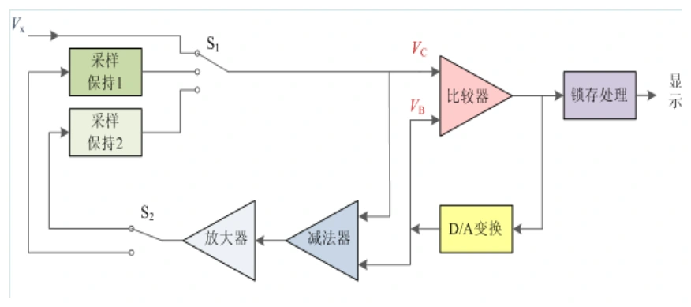
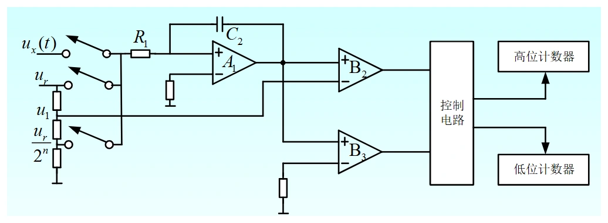
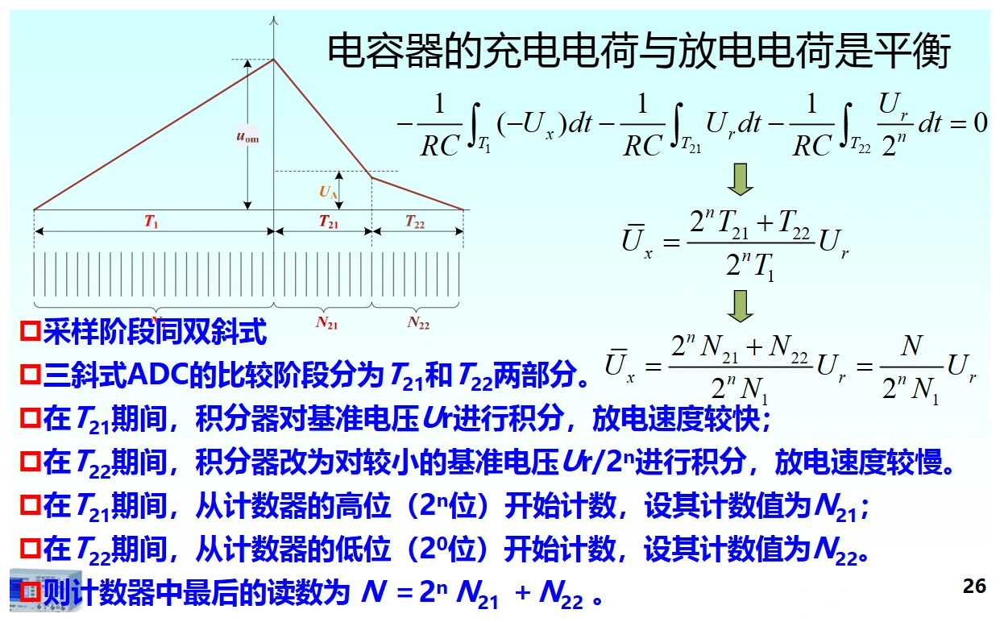
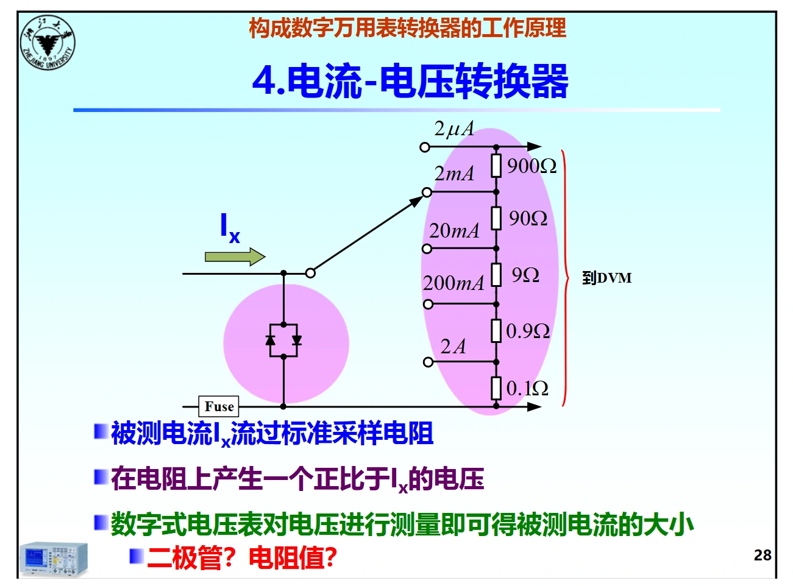
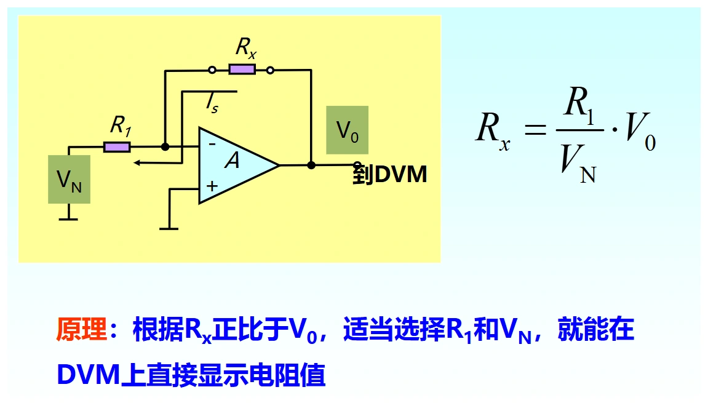
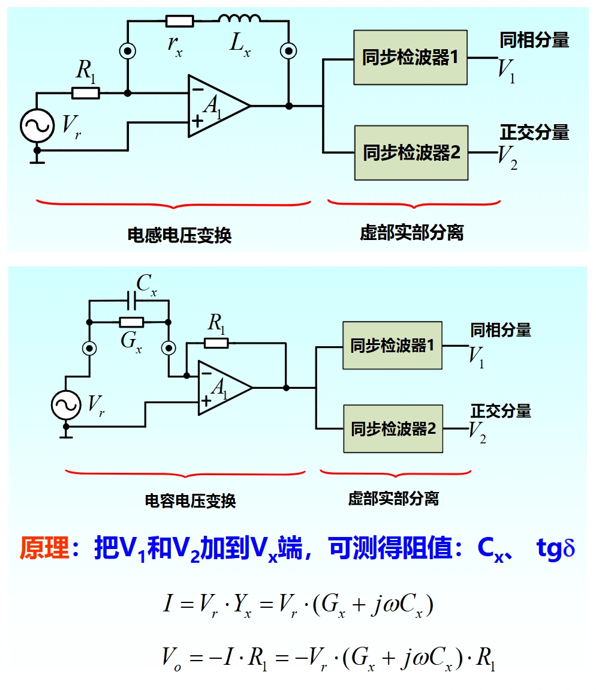

# 第三章（二）　数字电压表、A/D 转换与四线测量

[课程目录](../index.md) · [电压与检波](03-voltage.md) · [原笔记，第 50—64 页](../resources/measurement-notes.pdf#page=50)

数字仪表不是把表针换成数字那么简单。输入变换决定测量功能，A/D 架构决定速度与抑制干扰的方式，量程和显示位数决定末位分辨力，而误差规格决定读数可以相信到什么程度。理解这条链路，才能正确处理“几位表”“几个字”和积分时间等考题。

## 1. 数字多用表的功能链

直流电压通常经衰减、放大、缓冲送入 ADC；电流先通过分流电阻变成电压；电阻采用已知激励，把电阻压降转换成电压；交流还需要检波或数字 RMS 处理。显示读数经过量程换算、零点修正和标定，并非 ADC 原始码直接加小数点。

{ target=_blank rel=noopener }

*图 3-06　DVM 与 DMM 信号链，来源：原笔记 PDF 第 51 页。复用功能越多，越要分清前端变换与后端 ADC 的分工。*

高输入电阻可以减少直流加载，但输入电容仍限制高频阻抗；高位数可以减小显示步长，但不代表温漂、线性和参考误差自动减小。因此“数字表一定更准、更快或量程更低”都不是通用结论，应按型号和工作方式判断。

## 2. 逐次逼近 ADC：每一位都在比较什么

SAR ADC 使用比较器、DAC 和逐次逼近寄存器。在单极性范围 $[0,V_{ref})$ 内，理想 $B$ 位步长为 $q=V_{ref}/2^B$。从最高位开始先置 1，比较 DAC 电压与输入：若试探电压不大于输入，保留该位；反之清零，再试下一位。

{ target=_blank rel=noopener }

*图 3-07　SAR 的比较器—寄存器—DAC 闭环，来源：PDF 第 52 页。*

**例：8 位、$V_{ref}=10\,\mathrm V$，输入 $3.285\,\mathrm V$。** $q=0.0390625\,\mathrm V$。逐位比较如下：

| 位权 | 试探电压 / V | 决策 |
| --- | --- | --- |
| 128 | 5.000000 | 过高，清零 |
| 64 | 2.500000 | 保留 |
| 32 | 3.750000 | 过高，清零 |
| 16 | 3.125000 | 保留 |
| 8 | 3.437500 | 过高，清零 |
| 4 | 3.281250 | 保留 |
| 2 | 3.359375 | 过高，清零 |
| 1 | 3.320313 | 过高，清零 |

结果为 $01010100_2=84$，下边界重构值 $84q=3.28125\,\mathrm V$。若采用码区间中点重构，估计值会相差半个 LSB；必须说明量化器约定，不能把不同约定的误差界混用。

SAR 一次转换需要约 $B$ 次比较，但还受采样建立、DAC 稳定和比较时间约束。输入在转换过程中若变化明显，需要采样保持。增加名义位数也不意味着有效位数同步增加。

### 余数再循环：逐位取十进制数（原数字 3.4） {#recirculating-remainder}

{ target=_blank rel=noopener }

*图 3-16　PDF 第 53 页。沿余数反馈支路读图，注意它与 SAR 的逐位试探流程不同。*

这类变换把“取整数位—减去已取部分—余数放大十倍”循环进行。设输入先归一化为 $0\le z_0<10$，理想第 $j$ 次循环为

$$
d_j=\lfloor z_j\rfloor,\qquad z_{j+1}=10(z_j-d_j).
$$

原笔记输入 $3.285\,\mathrm V$ 的例子，先取整数 3，余数 $0.285$ 放大十倍得 $2.85$；再取 2，余数 $0.85$ 放大成 $8.5$；取 8 后得到 5。对应各位权重为 $1,0.1,0.01,0.001\,\mathrm V$，组合成 3.285 V。实际电路由比较、DAC 或基准减法、放大及控制开关完成，不是软件直接读出无限位。

前面一级减法偏差会进入后续余数，十倍放大器的增益误差也会累积；比较器噪声、参考不准和过载限制最终精度。因此循环更多位只增加名义分辨力，不能保证后面数字仍可信。与二进制 SAR 对比时，重点区分“每次试探一位二进制权重”和“余数重新放大后取下一十进制位”。

## 3. 双积分 ADC：为什么能消除 RC 的一阶影响

第一阶段用固定时间 $T_1$ 积分被测电压 $U_x$，积分器输出变化量为 $-U_xT_1/(RC)$；第二阶段接入极性相反的参考电压 $U_r$，使积分器回到零。理想条件下两阶段面积相等：

$$
|U_x|T_1=|U_r|T_2,\qquad
|U_x|=|U_r|\frac{T_2}{T_1}=|U_r|\frac{N_2}{N_1}.
$$

{ target=_blank rel=noopener }

*图 3-08　固定时间积分、参考反向积分、计数控制，来源：PDF 第 54 页。*

同一个 $RC$ 同时出现在两阶段，理想比值中相消。同一稳定时钟生成 $T_1$ 并测量 $T_2$ 时，其固定比例误差也可相消；但是两个阶段间的漂移、积分器漏电、参考误差、开关电荷和零点比较误差仍会影响结果。不能简写成“完全不受 RC 和时钟影响”。

**数值例。** $U_r=10.000\,\mathrm V$，$N_1=20000$，$N_2=2468$，则 $U_x=1.2340\,\mathrm V$。若时钟为 $1\,\mathrm{MHz}$，$T_1=20\,\mathrm{ms}$，$T_2=2.468\,\mathrm{ms}$。该算法用时间换精度，适合慢变化直流，不能据此捕获纳秒脉冲。

### 双斜开关次序与三斜反积分（原数字 3.4） {#triple-slope}

双斜转换不止两个斜坡，还包括归零/准备阶段。准备时将积分电容复位并检查零点；正积分阶段接入 $U_x$、计固定 $N_1$ 个时钟；反积分阶段选与积分方向相反的参考，计到零点比较器动作；最后锁存 $N_2$ 并准备下一次转换。输入有正负时要选相应参考极性，显示符号来自极性判定，不能仅把所有时间写成负数。

三斜式把反积分分为快、慢两段：大参考先迅速消去大部分积分量，小参考再精细消去余量。按原笔记使用粗参考 $U_r$、细参考 $U_r/2^n$，且各阶段共用同一时钟，若反积分两段分别计 $N_{21},N_{22}$，理想面积平衡为

$$
\begin{aligned}
U_xN_1&=U_rN_{21}+\frac{U_r}{2^n}N_{22},\\
U_x&=\frac{U_r}{N_1}\left(N_{21}+\frac{N_{22}}{2^n}\right).
\end{aligned}
$$

这个写法对应两段沿相同归零方向、末段清除剩余面积的理想方案；若实际电路采用越零后反向细积分，末项应按实际极性带符号。考试先核对图中参考端、切换阈值和计数权重，不能只背“三斜多一个加号”。

{ target=_blank rel=noopener }

*图 3-19　PDF 第 55 页。粗、细参考分别切入同一积分器；高、低位计数按不同权重组合。*

{ target=_blank rel=noopener }

*图 3-17　PDF 第 56 页。先确认 $T_{21}$、$T_{22}$ 的参考幅值，再读公式，不能按图号顺序替代电路分析。*

**例。** $N_1=1000$、$U_r=10\,\mathrm V$、$2^n=100$、$N_{21}=123$、$N_{22}=40$，得 $U_x=1.234\,\mathrm V$。细段一个时钟对应输入 $U_r/(100N_1)=0.1\,\mathrm{mV}$；若全程采用同样小参考，反积分会明显变长。三斜用粗计数缩短时间，但参考比例、切换误差和积分器特性成为额外误差来源。

[原笔记第 51—56 页](../resources/measurement-notes.pdf#page=51)

## 4. 积分时间与工频抑制

固定时间平均对频率 $f$ 的正弦干扰具有归一化幅频响应

$$
|H(f)|=\left|\frac{\sin(\pi fT_1)}{\pi fT_1}\right|.
$$

当 $fT_1$ 为非零整数时，干扰在积分窗口内净面积为零。$T_1=20\,\mathrm{ms}$ 能抑制理想 50 Hz；$100\,\mathrm{ms}$ 同时覆盖 50 Hz 的 5 周期和 60 Hz 的 6 周期。这里要求干扰频率与窗口条件匹配；电网频率漂移时抑制有限。

较长积分通常降低噪声、减慢读数更新，还可能把快速变化平均掉。选择 NPLC 时，应先判断被测量是否足够稳定；不能为了末位稳定，把真实变化也当成噪声滤去。

串模干扰与信号串联，共模干扰加在两个输入端相对于地的公共电位上。抑制比常用 $20\log_{10}(U_{interference}/U_{equivalent\ error})$ 表示。它必须连同频率、源阻抗平衡和接线条件一起使用。共模电压超出输入允许范围时，不能继续依赖标称 CMRR。

## 5. 显示位数、计数和超量程

典型 $3\frac12$ 位表最大显示 1999，$4\frac12$ 位为 19999，$5\frac12$ 位为 199999。所谓半位，是最高位只有有限状态的传统说法，不是 ADC 有半个二进制位。现代仪表常直接标明 6000、20000 等计数，应优先按实际规格理解。

量程为 $2\,\mathrm V$、最大显示 $1.9999\,\mathrm V$ 时，末位一个字为 $q=0.0001\,\mathrm V$。若称“1 V 标称量程”却能显示到 $1.9999\,\mathrm V$，则相对于 1 V 有超量程能力；若称“2 V 量程”最大显示 1.9999 V，不应再据同一显示上限宣称超过 2 V。

位数描述显示容量，分辨力是一个末位对应的物理单位，准确度则是误差限。把它们写成等号，是数字表题最常见的概念错误。

## 6. “读数百分比 + 量程百分比”怎样变成几个字

常见规格为

$$
|\Delta U|\le a\%\,|U_x|+b\%\,U_m.
$$

第一项随读数变化，第二项为该档位的固定项。若说明书改用“若干字”，即将第二项除以该档末位单位 $q$。不要把 $0.02\%$ 写成 $0.02$。

**回忆卷例。** $U_m=2\,\mathrm V$，最大显示 19999，$q=10^{-4}\,\mathrm V$：

$$
b\%U_m=0.02\%\times2=0.0004\,\mathrm V=4\text{ 字}.
$$

如果另假定 $a=0.2$，满量程附近的**总**误差约为 $0.22\%\times2=0.0044\,\mathrm V$，即 44 字。4 字是量程固定项，44 字是给定系数下满量程附近总限差，不能混称。原回忆卷注明读数项系数记不清，因此固定项答案可确定，总限差须保留假设。

测 $U_x=0.1000\,\mathrm V$，上述假定规格给 $|\Delta U|\le0.0006\,\mathrm V$，相对限差 $0.6\%$；小读数时固定项占比很高。这说明应在允许输入与加载条件下尽量选择合适的小量程。

## 7. 四线电阻：把电流路径与电压路径分开

二线法把测试线和接触电阻都算入结果。四线法用一对线供电流，另一对线直接在电阻两端测压。因电压输入电流很小，感测线的压降较小：$R_x\simeq U_{sense}/I$。

{ target=_blank rel=noopener }

*图 3-09　Force 与 Sense 分离的四线法，来源：PDF 第 57 页。Sense 应接在被测电阻的目标端面内侧。*

例如 $R_x=0.10\,\Omega$，两根测试线各 $0.05\,\Omega$，二线法会得到约 $0.20\,\Omega$，相对误差 100%。四线法主要去掉引线压降，但输入偏流、热电势、自热、接触点位置和激励准确度仍需检查。

用 $+I$、$-I$ 两种激励测量，在热电势近似不变时有 $R_x=[U(+I)-U(-I)]/(2I)$，可以消除固定热电势的一阶影响。若增大激励后阻值随时间升高，先考虑 $I^2R$ 自热，不能只把变化归因于仪器不稳定。

### 电流、电阻、电感、电容怎样转成电压（原数字 3.5） {#dmm-converters}

**I/V：标准分流电阻。** 被测电流经 $R_s$ 得 $U_s=I_xR_s$，DVM 读压后换算电流。量程切换改变分流值，必须兼顾压降、自热与保险保护。电流挡不是高阻输入，把它并在电压源两端会近似短路；测完电流后应把表笔移回电压插孔。前端二极管或保险丝用于过载保护，不能视为允许任意误接。

{ target=_blank rel=noopener }

*图 3-12　电流—电压转换，PDF 第 57 页。图中的不同电阻属于不同电流量程；读图时同时关注满量程压降。*

**R/V：小电阻与大电阻不同。** 小电阻用已知电流和四线感测，减小线阻占比。大电阻常用已知激励与放大器反馈/比值关系读压，图示模型给 $R_x=R_1V_o/V_N$，成立前提是运放工作在线性区、输入偏流相对被测电流足够小、表面漏电可忽略。测高阻需注意清洁、湿度、屏蔽和保护环，不能把小阻的引线问题原样套用。

{ target=_blank rel=noopener }

*图 3-13　高阻测量原图，PDF 第 57 页。参考电阻与基准电压决定换算比例。*

**L/V 与 C/V。** 施加已知频率的交流激励，利用 $Z_L=j\omega L$、$Z_C=1/(j\omega C)$ 的幅值和相位关系提取参数。同步检波把与参考同相、正交的分量分开，才能进一步区分理想电抗和损耗电阻。只测总电压幅值而忽略损耗，会得到依赖模型的“等效 L/C”。记录中应注明测试频率、电平以及串联/并联等效模式。

{ target=_blank rel=noopener }

*图 3-18　PDF 第 58 页。上图与下图分别对应电感和电容；实部与虚部决定不同等效参数。*

**AC/DC。** 均值、峰值或真 RMS 转换器把交流变成直流量后交给同一个 ADC，因此 DMM 的交流准确度可能受检波器、带宽和波峰因数限制，不能直接沿用直流挡准确度。

### 基本误差以外的附加误差（原数字 3.6、3.7） {#dvm-additional-errors}

| 分量 | 简化关系或现象 | 测量时的处理 |
| --- | --- | --- |
| 温度系数 | 超出规定温度区间后，每度增加一项限差 | 记录环境与预热，不只查基本误差表 |
| 输入电阻加载 | $\gamma\simeq-R_s/(R_s+R_{in})$ | 高阻源选高输入阻抗、缓冲或修正 |
| 输入偏流 | 附加压差约为 $I_bR_s$，符号视方向 | 高阻测量特别检查，降低漏电与热电势 |
| 输入电容与分布参数 | 频率升高时输入阻抗下降或出现振铃 | 缩短引线，按频率分析复阻抗 |
| 建立过程 | 换挡、极性反转、大阶跃后末位缓慢稳定 | 在规定稳定时间后读数 |
| 共模转差模 | 两端阻抗不平衡、接地回路使共模进入差值 | 平衡源阻抗、正确屏蔽，遵守共模范围 |

转换时间只表示 ADC 完成一次运算所需时间；实际读数周期还包括切换、建立、自动调零、处理与显示。说明书的“每秒读数”通常绑定特定位数和积分设置，不能把最快读速与最高精度直接拼在一起。

串模抑制可来自积分平均，共模抑制还依赖输入结构与接线。若给抑制比 $80\,\mathrm{dB}$，对应电压比 $10^4$，1 V 干扰折合输入可为 $100\,\mu\mathrm V$；这只是该频率和条件下的估算，超出共模额定范围后模型不再适用。

### 0—3 V ADC 测双极性交流的逐步计算（原数字 3.8） {#dsp-rms}

设 12 位 ADC 输入范围为 0—3 V，前端把原信号变为 $v_a=1.5+Gv_x$。首先检查全部瞬时值落在允许范围；理想量化步长为 $q=3/4096\,\mathrm V$。对原始码 $c_i$，按题目采用的重构约定估计 $v_{a,i}$，再计算

$$
v_{x,i}=\frac{v_{a,i}-1.5}{G},\qquad
V_{x,\mathrm{rms}}=\sqrt{\frac1N\sum_{i=1}^{N}v_{x,i}^2}.
$$

若要测交流 RMS，且原信号可能含直流，还应使用 $v_{x,i}-\bar v_x$；若要求 AC+DC，则保留原信号均值。不能把为适配 ADC 而加的 1.5 V 人工偏置算进被测信号 RMS。前端偏置有误差时，去偏置也会留下残余，因此实际程序应有零点标定。

例如 $G=1$、$v_x=\sin\omega t\,\mathrm V$，ADC 端为 0.5—2.5 V；充分采样整周期后，恢复的原信号 RMS 约为 $0.7071\,\mathrm V$，而 ADC 端总 RMS 为 $\sqrt{1.5^2+0.5}=1.6583\,\mathrm V$。两者对应不同对象，不能混答。

[原笔记第 57—64 页](../resources/measurement-notes.pdf#page=57)

## 8. 答题与实验记录

ADC 题先列输入范围、编码方式和步长；积分题先画两个斜率及归零时刻；数字表题先把显示写成带小数点的最大读数；误差题先把每个百分比换成伏特，再除以末位单位。实验中还应记录量程、NPLC、自动调零、接线方式和等待时间。这样的记录才能解释为什么同一只仪器在两次设置下给出不同末位。
