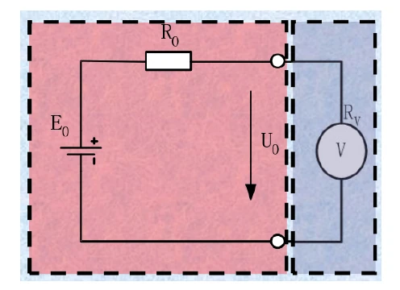
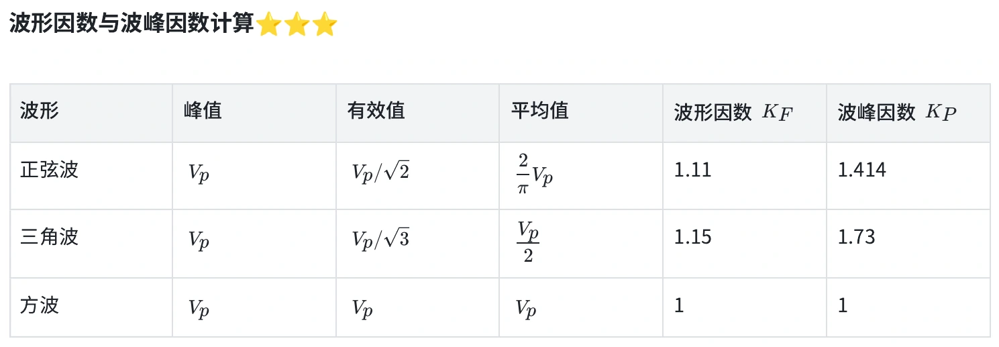
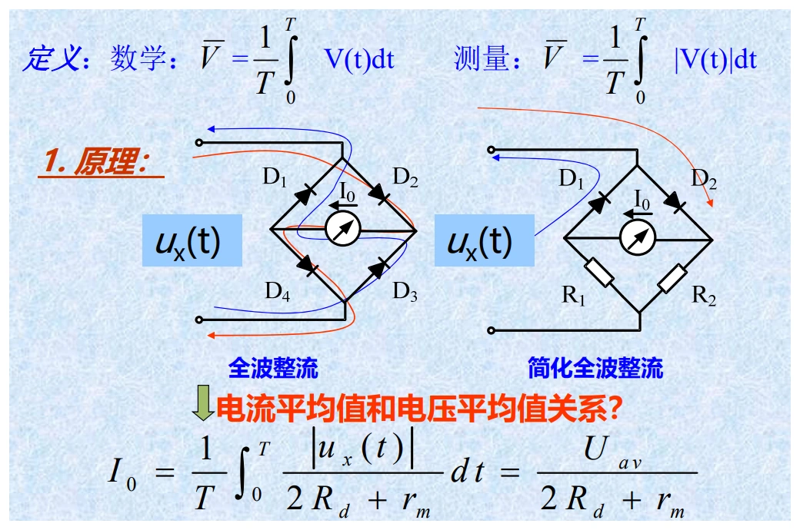
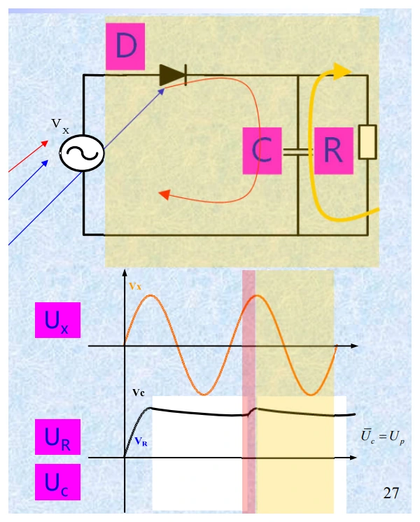
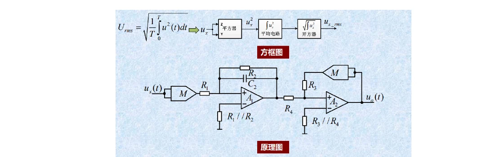

# 第三章（一）　电压测量、检波方式与波形换算

[课程目录](../index.md) · [数字电压表](03-digital.md) · [原笔记，第 36—50 页](../resources/measurement-notes.pdf#page=36)

电压测量题有两个独立问题：仪表接入后有没有改变被测电压，以及仪表究竟对波形的哪个量响应。前者由输入阻抗决定，后者由检波方式决定。屏幕或表盘写着“V”，并不能据此认定测到的就是真有效值。

## 1. 电压表为什么会把电压测低

把被测电源化成戴维南电源，开路电压为 $E$，内阻为 $R_0$。接入内阻为 $R_V$ 的电压表后，电表和内阻构成分压：

$$
U=E\frac{R_V}{R_0+R_V},\qquad
\gamma=\frac{U-E}{E}=-\frac{R_0}{R_0+R_V}.
$$

这里的参考量是未接表时的开路电压。负号表明接入仪表使结果偏低。这是可由模型预测的系统影响，重复读数取平均不能把它消除。

*图 3-01　电压表加载模型。来源：原笔记 PDF 第 39 页。虚线框分别表示被测源与电压表。*

若要求加载相对误差绝对值不超过 $\varepsilon$，由不等式得到

$$
R_V\ge\left(\frac1\varepsilon-1\right)R_0.
$$

例如 $R_0=100\,\mathrm{k\Omega}$，要求误差不超过 $1\%$，输入电阻至少应为 $9.9\,\mathrm{M\Omega}$。这也解释了为什么测高内阻电路时，即使量程和准确度合适，普通表仍可能不适用。

机械式直流电压表常给“灵敏度” $K$，单位为 $\Omega/\mathrm V$。它与满偏电流 $I_m$ 的关系为 $K=1/I_m$，在量程 $U_m$ 下有 $R_V=KU_m$。同一只表切换到较低量程，输入电阻反而下降，可能增大加载误差。数字表是否具有固定输入电阻，要看具体档位规格，不能一概照搬这一关系。

**回忆卷例题。** $R_0=2\,\Omega$，$R_V=2000\,\Omega$：

$$
\gamma=-\frac2{2002}=-9.9900\times10^{-4}\approx-0.09990\%.
$$

若只问“误差不超过多少”，给出绝对值；若问有符号相对误差，必须保留负号。高频时还应把输入电容纳入 $Z_V(\omega)$，不能继续只用直流电阻。

## 2. 峰值、平均值和有效值分别定义什么

对周期 $T$ 的电压 $u(t)$，定义直流平均值 $U_0$、整流平均值 $U_{av}$ 和有效值 $U$：

$$
U_0=\frac1T\int_0^Tu(t)\,dt,\quad
U_{av}=\frac1T\int_0^T|u(t)|\,dt,\quad
U=\sqrt{\frac1T\int_0^Tu^2(t)\,dt}.
$$

零均值交流波的 $U_0$ 可以为零，后两项却一般不为零。整流平均值中的绝对值不能漏掉。有效值对应电阻发热等效：同一电阻上，交流与直流产生相同平均功率时，两者电压有效值相等。

波形因数 $K_f=U/U_{av}$，峰值因数 $K_p=U_p/U$。下表只适用于**对称、无直流分量**的标准波形；单极性脉冲要重新积分。

| 波形，峰值为 $U_p$ | 整流平均值 | 有效值 | $K_f$ | $K_p$ |
| --- | --- | --- | --- | --- |
| 正弦 | $2U_p/\pi$ | $U_p/\sqrt2$ | $\pi/(2\sqrt2)$ | $\sqrt2$ |
| 对称三角波 | $U_p/2$ | $U_p/\sqrt3$ | $2/\sqrt3$ | $\sqrt3$ |
| 双极性方波 | $U_p$ | $U_p$ | $1$ | $1$ |

*图 3-02　原资料的常用波形表，来源：PDF 第 41 页。计算时以上表的精确值为准，避免重复使用四舍五入后的系数。*

以三角波为例，在四分之一周期内 $u=4U_pt/T$，因此 $U^2=(4/T)\int_0^{T/4}(4U_pt/T)^2dt=U_p^2/3$。会从积分推出一个波形的结果，比背三行数字更容易处理梯形波和脉冲波。

## 3. 均值检波表：响应平均值，刻度却可以是有效值

整流后用磁电式表头测平均电流，结果与 $U_{av}$ 成比例。厂家若按正弦有效值刻度，就在标度中乘入正弦波形因数：

$$
\alpha=K_{f,\sin}U_{av}
=\frac{\pi}{2\sqrt2}U_{av}\approx1.11072U_{av}.
$$

这里 $\alpha$ 是**示值**，不是任意输入波形的真有效值。对实际波形，$U=K_fU_{av}$，所以

$$
U=\alpha\frac{K_f}{K_{f,\sin}},\qquad
\gamma_{wave}=\frac{\alpha-U}{U}=\frac{K_{f,\sin}}{K_f}-1.
$$

*图 3-03　全波整流与平均电流表头，来源：PDF 第 42 页。仪器对整流平均值响应，正弦刻度是后续的标度转换。*

**例：三角波测得 1.000 V。** 真有效值应为 $1.000(2/\sqrt3)/(\pi/(2\sqrt2))=1.03960\,\mathrm V$。示值比真值低约 $3.81\%$。原笔记相关算例的最终数值不一致，不能沿用为 $0.94\,\mathrm V$。

换成双极方波，$K_f=1$，同样的表会高报约 $11.07\%$。考试时先写“仪表响应什么”，再做换算，避免把真有效值直接代入表的响应式。

## 4. 峰值检波表：电容需要快充、慢放

二极管导通时给电容充电，输入下降后二极管截止，电容通过负载缓慢放电。理想情况下电容维持在输入峰值附近。设计需要同时满足：充电时间常数远小于最短信号周期，放电时间常数远大于最长信号周期。

$$
\tau_{ch}\ll T_{min},\qquad \tau_{dis}\gg T_{max}.
$$

前一条件保证高频时仍能跟上峰值，后一条件减少低频时峰间下垂。不能只写“RC 越大越好”，因为充放电走的电阻不一样，输入源内阻和二极管正向电阻都会限制高频响应。

*图 3-04　串联峰值检波与电容保持，来源：PDF 第 42 页。真实示值还受二极管压降、漏电和输入加载影响。*

正弦有效值刻度的峰值表满足 $\alpha=U_p/\sqrt2$。同峰值的三角波、方波、正弦波会得到相同示值，但真有效值不同。串联检波结构没有天然的隔直能力，输入含直流时应按实际耦合电路判断。不能把并联结构的隔直特点移植到串联结构。

## 5. 真有效值测量与 AC、AC+DC

真有效值变换可以采用热电转换，也可实现“平方—平均—开方”。数字实现则对采样值平方取平均再开方。它减少了波形换算误差，但仍有带宽、峰值因数、动态范围和采样窗口限制。

*图 3-05　有效值转换，来源：PDF 第 44 页。均方运算必须在仪器允许的频带与输入范围内进行。*

设 $u(t)=U_0+u_{ac}(t)$，且交流分量平均值为零，则

$$
U_{AC+DC}=\sqrt{U_0^2+U_{AC}^2}.
$$

交流耦合档通常去掉直流，只报告 $U_{AC}$；AC+DC 模式才报告总有效值。例如直流 $3\,\mathrm V$ 上叠加有效值 $4\,\mathrm V$ 的正弦，总有效值为 $5\,\mathrm V$。看到仪器写“True RMS”仍要确认是哪一种模式。

对于整周期内互相正交的谐波，$U^2=U_0^2+\sum_nU_n^2$。但整流平均值含 $|u(t)|$，一般不能把各谐波的整流平均值直接相加。波形改变过零位置时，这种错误尤其明显。

## 6. 噪声测量中何时使用平方相减

假定输入固有噪声和注入标准噪声互不相关，仪器带宽与增益 $A$ 均不变，注入前后输出 RMS 分别为 $U_{o1}$、$U_{o2}$，标准噪声 RMS 为 $U_s$：

$$
U_{o1}=AU_i,\quad U_{o2}=A\sqrt{U_i^2+U_s^2},\quad
U_i=\frac{U_sU_{o1}}{\sqrt{U_{o2}^2-U_{o1}^2}}.
$$

这不是一般电压的代数相减。若两次读数很接近，分母很小，结果对读数误差很敏感；若存在相关干扰，也不能直接使用该模型。

## 7. 本章训练与检查

**题一。** 对称三角波、方波和正弦波均有 $U_{pp}=100\,\mathrm V$，用正弦刻度峰值表与均值表测量。先由对称性得到 $U_p=50\,\mathrm V$。峰值表示值全部为 $35.355\,\mathrm V$；均值表示值按三角、方波、正弦顺序为 $27.768$、$55.536$、$35.355\,\mathrm V$。真有效值分别为 $28.868$、$50$、$35.355\,\mathrm V$。六个示值的详细过程见[回忆卷解答](../exam-solutions.md)。

**题二。** 峰值 $10\,\mathrm V$、占空比 $D=0.1$ 的单极性矩形脉冲，$U_0=U_{av}=DU_p=1\,\mathrm V$，总有效值 $U=U_p\sqrt D=3.1623\,\mathrm V$。若去掉直流，只剩交流有效值 $U_{AC}=U_p\sqrt{D(1-D)}=3.000\,\mathrm V$。对称方波的公式不能用于此题。

做完一题至少检查：输入是否含直流、波形是否对称、仪表响应量、刻度约定、所求是真值还是示值、加载影响是否已忽略。将这些条件写在计算前，通常就能避免最常见的方向错误。
