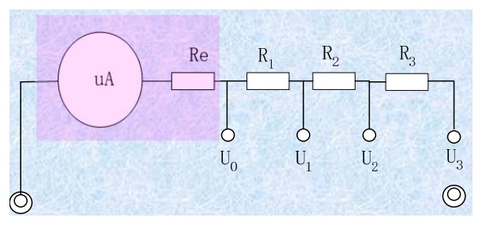
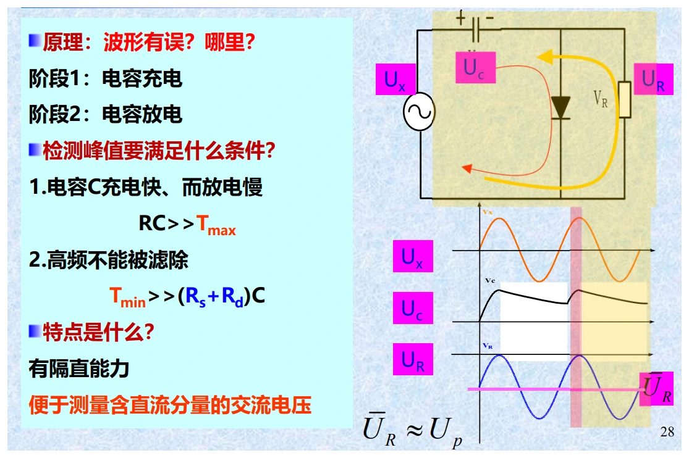
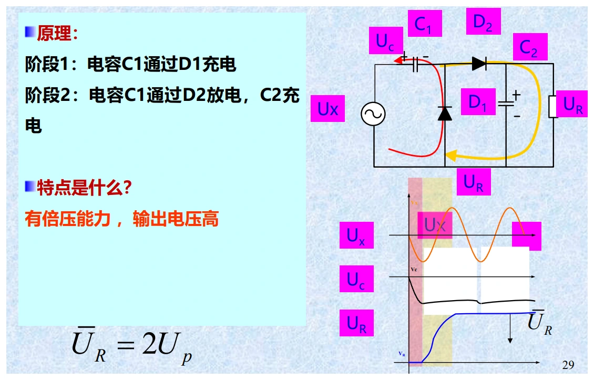
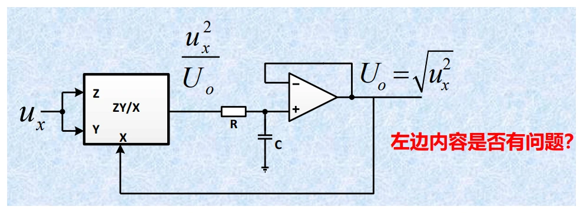

# 第三章（一）　电压测量、检波方式与波形换算

[课程目录](../index.md) · [数字电压表](03-digital.md) · [原笔记，第 36—50 页](../resources/measurement-notes.pdf#page=36)

电压测量题有两个独立问题：仪表接入后有没有改变被测电压，以及仪表究竟对波形的哪个量响应。前者由输入阻抗决定，后者由检波方式决定。屏幕或表盘写着“V”，并不能据此认定测到的就是真有效值。

## 本章的测量对象与方法（原 3.1） {#voltage-methods}

原笔记从六个特点切入：频率跨度大、幅值跨度大、波形多样、输入特性会改变被测电路、准确度与信号种类有关、需要抑制干扰。它们对应六个选型问题：信号的直流与最高有效频率是什么、幅值和共模范围多大、要测哪一种幅值、能容许多大加载、目标误差是多少、噪声通过什么路径进入。

| 方法 | 实际处理的量 | 适合的任务与限制 |
| --- | --- | --- |
| 模拟检波后读直流 | 整流平均、峰值或 RMS 对应的直流量 | 带宽与检波架构有关，不保留完整时序 |
| 直流 ADC 测量 | 经调理的直流电压 | 易扩展到电阻、电流等；受参考和前端影响 |
| AC/DC 后接 ADC | 先转换得到一个直流表征量 | 显示数字不代表已逐点采样交流波形 |
| 交流采样与计算 | 一串瞬时值 | 可算 RMS、峰值和频谱，但须满足采样与带宽条件 |
| 示波测量 | 电压随时间的记录 | 适合瞬态、边沿、时序；准确度应看具体规格 |

直流输入常近似为电阻，交流输入通常需要写成 $R_{in}\parallel C_{in}$，高频还会出现引线电感和传输线效应。不能把某一类仪器的典型频段、输入阻抗或精度写成所有仪表的固定上限。

[原笔记第 36—38 页](../resources/measurement-notes.pdf#page=36)

## 1. 电压表为什么会把电压测低

把被测电源化成戴维南电源，开路电压为 $E$，内阻为 $R_0$。接入内阻为 $R_V$ 的电压表后，电表和内阻构成分压：

$$
U=E\frac{R_V}{R_0+R_V},\qquad
\gamma=\frac{U-E}{E}=-\frac{R_0}{R_0+R_V}.
$$

这里的参考量是未接表时的开路电压。负号表明接入仪表使结果偏低。这是可由模型预测的系统影响，重复读数取平均不能把它消除。

{ target=_blank rel=noopener }

*图 3-01　电压表加载模型。来源：原笔记 PDF 第 39 页。虚线框分别表示被测源与电压表。*

若要求加载相对误差绝对值不超过 $\varepsilon$，由不等式得到

$$
R_V\ge\left(\frac1\varepsilon-1\right)R_0.
$$

例如 $R_0=100\,\mathrm{k\Omega}$，要求误差不超过 $1\%$，输入电阻至少应为 $9.9\,\mathrm{M\Omega}$。这也解释了为什么测高内阻电路时，即使量程和准确度合适，普通表仍可能不适用。

机械式直流电压表常给“灵敏度” $K$，单位为 $\Omega/\mathrm V$。它与满偏电流 $I_m$ 的关系为 $K=1/I_m$，在量程 $U_m$ 下有 $R_V=KU_m$。同一只表切换到较低量程，输入电阻反而下降，可能增大加载误差。数字表是否具有固定输入电阻，要看具体档位规格，不能一概照搬这一关系。

**回忆卷例题。** $R_0=2\,\Omega$，$R_V=2000\,\Omega$：

$$
\gamma=-\frac2{2002}=-9.9900\times10^{-4}\approx-0.09990\%.
$$

若只问“误差不超过多少”，给出绝对值；若问有符号相对误差，必须保留负号。高频时还应把输入电容纳入 $Z_V(\omega)$，不能继续只用直流电阻。

### 表头灵敏度与多量程电阻（原 3.2） {#moving-coil}

动圈表头满偏电流为 $I_m$、内阻为 $R_m$，扩展到满量程电压 $U_m$ 时串联电阻为 $R_s=U_m/I_m-R_m$。电压灵敏度常用 $K_v=R_v/U_m=1/I_m$，单位 $\Omega/\mathrm V$，所以同一表头的量程越高，总内阻 $R_v=K_vU_m$ 越大。

{ target=_blank rel=noopener }

*图 3-10　多量程电压表原图，PDF 第 39 页；直接提取内嵌图像，保留各电阻与开关标号。*

若共用分段电阻形成 $U_1<U_2<U_3$ 三挡，第一段 $R_1=U_1/I_m-R_m$，新增段分别为 $R_2=(U_2-U_1)/I_m$、$R_3=(U_3-U_2)/I_m$。不要把每个新增电阻都按整个高量程重新计算，否则重复计入已经串联的电阻。

**例。** $K_v=20\,\mathrm{k\Omega/V}$，5 V 挡内阻为 $100\,\mathrm{k\Omega}$，25 V 挡为 $500\,\mathrm{k\Omega}$。若被测源内阻为 $10\,\mathrm{k\Omega}$，加载相对偏差分别为 $-10/(100+10)=-9.09\%$ 与 $-10/(500+10)=-1.96\%$。但高量程的等级绝对限差又更大，故应把加载误差与仪表误差一起比较，不能只说“选最低挡”或“选最高挡”。

电子电压表在表头前加高输入阻抗缓冲器和放大器，可减少加载；直流放大器的零漂又会限制小信号测量。数字表把指针读出换为 ADC 与数字处理，前面的分压、缓冲和保护仍然存在。

## 2. 峰值、平均值和有效值分别定义什么

对周期 $T$ 的电压 $u(t)$，定义直流平均值 $U_0$、整流平均值 $U_{av}$ 和有效值 $U$：

$$
U_0=\frac1T\int_0^Tu(t)\,dt,\quad
U_{av}=\frac1T\int_0^T|u(t)|\,dt,\quad
U=\sqrt{\frac1T\int_0^Tu^2(t)\,dt}.
$$

零均值交流波的 $U_0$ 可以为零，后两项却一般不为零。整流平均值中的绝对值不能漏掉。有效值对应电阻发热等效：同一电阻上，交流与直流产生相同平均功率时，两者电压有效值相等。

波形因数 $K_f=U/U_{av}$，峰值因数 $K_p=U_p/U$。下表只适用于**对称、无直流分量**的标准波形；单极性脉冲要重新积分。

| 波形，峰值为 $U_p$ | 整流平均值 | 有效值 | $K_f$ | $K_p$ |
| --- | --- | --- | --- | --- |
| 正弦 | $2U_p/\pi$ | $U_p/\sqrt2$ | $\pi/(2\sqrt2)$ | $\sqrt2$ |
| 对称三角波 | $U_p/2$ | $U_p/\sqrt3$ | $2/\sqrt3$ | $\sqrt3$ |
| 双极性方波 | $U_p$ | $U_p$ | $1$ | $1$ |

{ target=_blank rel=noopener }

*图 3-02　原资料的常用波形表，来源：PDF 第 41 页。计算时以上表的精确值为准，避免重复使用四舍五入后的系数。*

以三角波为例，在四分之一周期内 $u=4U_pt/T$，因此 $U^2=(4/T)\int_0^{T/4}(4U_pt/T)^2dt=U_p^2/3$。会从积分推出一个波形的结果，比背三行数字更容易处理梯形波和脉冲波。

## 3. 均值检波表：响应平均值，刻度却可以是有效值

整流后用磁电式表头测平均电流，结果与 $U_{av}$ 成比例。厂家若按正弦有效值刻度，就在标度中乘入正弦波形因数：

$$
\alpha=K_{f,\sin}U_{av}
=\frac{\pi}{2\sqrt2}U_{av}\approx1.11072U_{av}.
$$

这里 $\alpha$ 是**示值**，不是任意输入波形的真有效值。对实际波形，$U=K_fU_{av}$，所以

$$
U=\alpha\frac{K_f}{K_{f,\sin}},\qquad
\gamma_{wave}=\frac{\alpha-U}{U}=\frac{K_{f,\sin}}{K_f}-1.
$$

{ target=_blank rel=noopener }

*图 3-03　全波整流与平均电流表头，来源：PDF 第 42 页。仪器对整流平均值响应，正弦刻度是后续的标度转换。*

**例：三角波测得 1.000 V。** 真有效值应为 $1.000(2/\sqrt3)/(\pi/(2\sqrt2))=1.03960\,\mathrm V$。示值比真值低约 $3.81\%$。原笔记相关算例的最终数值不一致，不能沿用为 $0.94\,\mathrm V$。

换成双极方波，$K_f=1$，同样的表会高报约 $11.07\%$。考试时先写“仪表响应什么”，再做换算，避免把真有效值直接代入表的响应式。

## 4. 峰值检波表：电容需要快充、慢放

二极管导通时给电容充电，输入下降后二极管截止，电容通过负载缓慢放电。理想情况下电容维持在输入峰值附近。设计需要同时满足：充电时间常数远小于最短信号周期，放电时间常数远大于最长信号周期。

$$
\tau_{ch}\ll T_{min},\qquad \tau_{dis}\gg T_{max}.
$$

前一条件保证高频时仍能跟上峰值，后一条件减少低频时峰间下垂。不能只写“RC 越大越好”，因为充放电走的电阻不一样，输入源内阻和二极管正向电阻都会限制高频响应。

{ target=_blank rel=noopener }

*图 3-04　串联峰值检波与电容保持，来源：PDF 第 42 页。真实示值还受二极管压降、漏电和输入加载影响。*

正弦有效值刻度的峰值表满足 $\alpha=U_p/\sqrt2$。同峰值的三角波、方波、正弦波会得到相同示值，但真有效值不同。串联检波结构没有天然的隔直能力，输入含直流时应按实际耦合电路判断。不能把并联结构的隔直特点移植到串联结构。

### 串联、并联与倍压检波的区别（原 3.3） {#peak-topologies}

**串联峰值检波。** 输入经二极管给保持电容充电，接近峰值时导通，越过峰值后截止，电容通过负载缓慢放电。充电时间常数近似为 $(R_s+r_d)C$，放电时间常数近似为 $R_LC$，需同时满足快充与慢放。二极管压降对小幅信号尤为显著，不能无条件令输出等于理想峰值。

{ target=_blank rel=noopener }

*图 3-14　PDF 第 43 页。保留电容、二极管方向和电压标号，按两个峰附近的导通状态核对直流隔离条件。*

**并联检波。** 原图中的耦合电容、二极管和负载形成钳位/检波网络。在稳定周期和适当时间常数条件下，可把输入峰值信息转换成直流输出；是否隔直、输出极性与幅值系数取决于接线和读出位置。分析时先画出正、负峰附近二极管的通断，再用电容电压连续性求节点电位。不能仅凭“并联”二字就断定任何电路都测峰峰值。

**倍压检波。** 两组二极管—电容分别在相应半周期充电，输出可形成接近两个峰值的电压叠加。对零均值、对称正弦，理想输出常为 $2U_p$；二极管压降、负载放电及输入不对称会改变结果。若仪器按有效值刻度，仍需包含内部 $2$ 倍关系和正弦的 $\sqrt2$ 标定，不可直接把电路直流输出当显示值。

{ target=_blank rel=noopener }

*图 3-15　PDF 第 43 页。图示 $2U_p$ 对应其理想对称输入；非对称或有偏置时应重新列各电容电压。*

**直流分量问题。** 对 $u(t)=U_0+A\sin\omega t$，上峰为 $U_0+A$，下峰为 $U_0-A$，峰峰值为 $2A$。单边检波可能随 $U_0$ 改变；隔直后检到的是交流部分的峰；双峰读出才能在规定条件下反映峰峰值。含偏置或非对称波形题，先标清“哪个峰、是否隔直、表的刻度”，再代换算公式。

**低频下垂近似。** 若两次充电峰之间相隔 $T$，电容放电为 $U_p e^{-t/(R_LC)}$。当 $T\ll R_LC$，平均下垂相对量近似 $-T/(2R_LC)=-1/(2fR_LC)$。原例 $R_L=30\,\mathrm{M\Omega}$、$C=0.01\,\mu\mathrm F$，时间常数 $0.3\,\mathrm s$：5 Hz 时该一阶估算达 33%，已经不满足“小下垂”前提，只能说明误差严重，不能当精确结果；20 Hz 时估算约 8.33%，仍需核实允许误差。

[原笔记第 42—48 页](../resources/measurement-notes.pdf#page=42)

## 5. 真有效值测量与 AC、AC+DC

真有效值变换可以采用热电转换，也可实现“平方—平均—开方”。数字实现则对采样值平方取平均再开方。它减少了波形换算误差，但仍有带宽、峰值因数、动态范围和采样窗口限制。

{ target=_blank rel=noopener }

*图 3-05　有效值转换，来源：PDF 第 44 页。均方运算必须在仪器允许的频带与输入范围内进行。*

设 $u(t)=U_0+u_{ac}(t)$，且交流分量平均值为零，则

$$
U_{AC+DC}=\sqrt{U_0^2+U_{AC}^2}.
$$

交流耦合档通常去掉直流，只报告 $U_{AC}$；AC+DC 模式才报告总有效值。例如直流 $3\,\mathrm V$ 上叠加有效值 $4\,\mathrm V$ 的正弦，总有效值为 $5\,\mathrm V$。看到仪器写“True RMS”仍要确认是哪一种模式。

对于整周期内互相正交的谐波，$U^2=U_0^2+\sum_nU_n^2$。但整流平均值含 $|u(t)|$，一般不能把各谐波的整流平均值直接相加。波形改变过零位置时，这种错误尤其明显。

### 三种真有效值实现和带宽截断（原 3.3） {#rms-implementations}

直接模拟运算依次完成平方、平均、开方。平方器对幅值范围、偏置与动态响应有要求，低通平均器又需要足够长时间抑制交流项，因此它适合的频率范围与读数更新时间必须同时看。

反馈式 RMS/DC 变换把开方运算隐含在闭环中：若平均后满足 $U_o=\langle u^2/U_o\rangle$，且 $U_o>0$，稳定时有 $U_o^2=\langle u^2\rangle$。不能将闭环关系简写成瞬时的 $U_o=u^2$，两边量纲也不一致。

{ target=_blank rel=noopener }

*图 3-11　间接型 RMS/DC 运算原图，PDF 第 44 页；沿除法、平均和反馈方向读图。*

热转换利用相同电阻中的发热效应比较交流与直流，依据是平均功率而非整流平均。它也有热时间常数、频率响应和环境温度影响。数字采样法则以 $N$ 个样本计算 $\sqrt{\sum u_i^2/N}$，必须覆盖有代表性的窗口，输入不削顶且带宽足以包含重要谐波。

**方波截带宽例。** 对零均值、幅值 $\pm A$ 的理想方波，真 RMS 为 $A$，奇次谐波峰值为 $4A/(\pi n)$。若理想低通只保留 $1,3,\ldots,m$ 次谐波，测得值为

$$
U_{\mathrm{rms,lim}}=\frac{4A}{\pi\sqrt2}
\sqrt{\sum_{\substack{n\le m\\n\text{ 为奇数}}}\frac1{n^2}}.
$$

保留至 9 次约得 $0.9796A$，只保留基波则为 $0.9003A$。真实仪器在截止附近连续衰减，不是理想砖墙；这两个数用于说明“真有效值原理仍会受带宽影响”，不能作为所有 10 MHz 仪表的固定误差。

## 6. 噪声测量中何时使用平方相减

假定输入固有噪声和注入标准噪声互不相关，仪器带宽与增益 $A$ 均不变，注入前后输出 RMS 分别为 $U_{o1}$、$U_{o2}$，标准噪声 RMS 为 $U_s$：

$$
U_{o1}=AU_i,\quad U_{o2}=A\sqrt{U_i^2+U_s^2},\quad
U_i=\frac{U_sU_{o1}}{\sqrt{U_{o2}^2-U_{o1}^2}}.
$$

这不是一般电压的代数相减。若两次读数很接近，分母很小，结果对读数误差很敏感；若存在相关干扰，也不能直接使用该模型。

### 正弦注入、标准噪声与低通滤波（原 3.4） {#noise-methods}

**正弦注入法。** 先在待测频带内用已知正弦测幅度增益 $A=U_{so}/U_{si}$，确认放大器未削顶；再在相同源阻抗条件下终接输入，测输出噪声 RMS $U_{no}$，可估输入等效噪声 $U_{ni}=U_{no}/|A|$。这要求该带内增益可代表噪声传输，且读数仪自身噪声可忽略或已修正。不能用一个频点的增益解释任意宽带噪声。

**标准噪声法。** 设同一带宽中，输入终接时输出为 $U_{no1}$，接入已知且不相关的标准噪声 $U_{ns}$ 后输出为 $U_{no2}$。若源阻抗不变、增益不变，则

$$
U_{no1}^2=A^2U_{ni}^2,\qquad
U_{no2}^2=A^2(U_{ni}^2+U_{ns}^2),
$$

$$
A^2=\frac{U_{no2}^2-U_{no1}^2}{U_{ns}^2},\qquad
U_{ni}=\frac{U_{no1}U_{ns}}{\sqrt{U_{no2}^2-U_{no1}^2}}.
$$

例如两次输出分别为 $3\,\mathrm{mV}$、$5\,\mathrm{mV}$，标准输入噪声 $1\,\mu\mathrm V$，得到 $A=4000$、$U_{ni}=0.75\,\mu\mathrm V$。若两次结果过于接近，平方差很小，对读数误差非常敏感，应改善测试条件，不能硬算出大量有效数字。

热噪声、散粒噪声和低频闪烁噪声的频谱并不相同。“白噪声”是在指定频带内功率谱密度近似平坦的模型，不表示所有噪声在所有频率上都均匀。比较噪声读数必须统一测量带宽及检波方式。

**滤波算例。** 欲保留 10 kHz 信号、抑制 10 MHz 干扰，可先试一阶 RC 低通 $f_c=100\,\mathrm{kHz}$。幅频响应为 $|H|=1/\sqrt{1+(f/f_c)^2}$：10 kHz 处幅值约 $0.995$，约损失 $0.5\%$；10 MHz 处约为 $0.0100$，约衰减 40 dB。如果目标测量误差低于 $0.5\%$，需要补偿通带衰减或换更合适的滤波器；若信号包含重要快速边沿，还要考虑其高频分量，不能只按基波保留。

[原笔记第 48—49 页](../resources/measurement-notes.pdf#page=48)

## 7. 本章训练与检查

**题一。** 对称三角波、方波和正弦波均有 $U_{pp}=100\,\mathrm V$，用正弦刻度峰值表与均值表测量。先由对称性得到 $U_p=50\,\mathrm V$。峰值表示值全部为 $35.355\,\mathrm V$；均值表示值按三角、方波、正弦顺序为 $27.768$、$55.536$、$35.355\,\mathrm V$。真有效值分别为 $28.868$、$50$、$35.355\,\mathrm V$。六个示值的详细过程见[回忆卷解答](../exam-solutions.md)。

**题二。** 峰值 $10\,\mathrm V$、占空比 $D=0.1$ 的单极性矩形脉冲，$U_0=U_{av}=DU_p=1\,\mathrm V$，总有效值 $U=U_p\sqrt D=3.1623\,\mathrm V$。若去掉直流，只剩交流有效值 $U_{AC}=U_p\sqrt{D(1-D)}=3.000\,\mathrm V$。对称方波的公式不能用于此题。

做完一题至少检查：输入是否含直流、波形是否对称、仪表响应量、刻度约定、所求是真值还是示值、加载影响是否已忽略。将这些条件写在计算前，通常就能避免最常见的方向错误。
