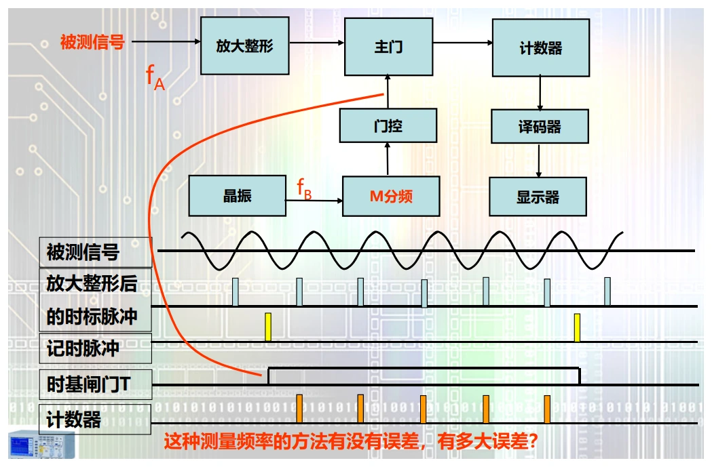
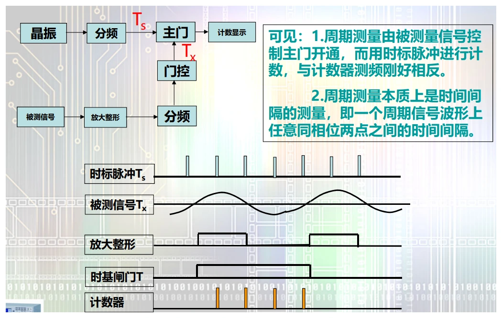
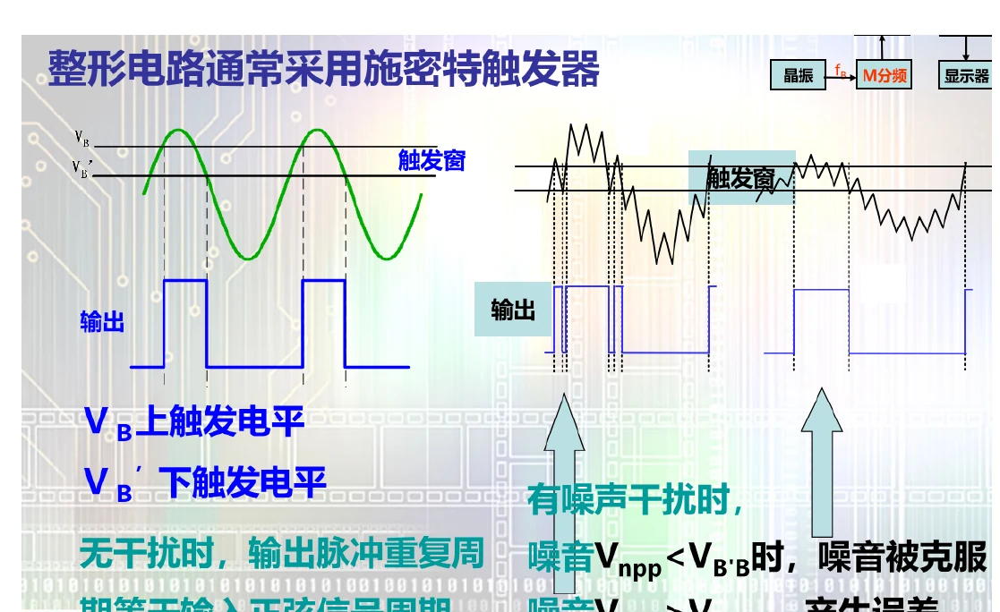
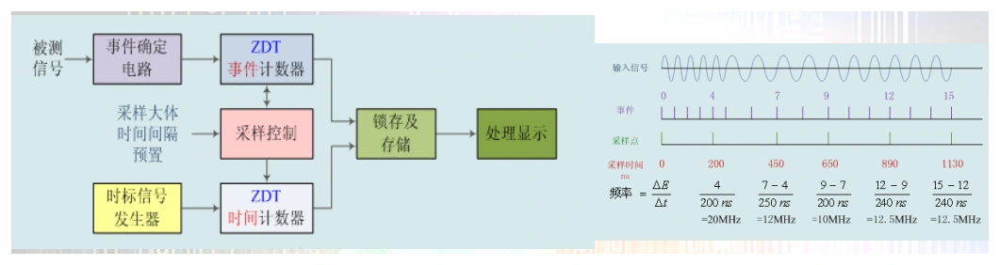

# 第四章　频率、周期、时间间隔与调制域

[课程目录](../index.md) · [原笔记，第 64—76 页](../resources/measurement-notes.pdf#page=64) · [回忆卷解答](../exam-solutions.md)

电子计数器把时间和频率测量统一为计数问题：用已知时间数被测周期，或者用被测时间数标准时钟。两种方法的硬件很相似，量化误差随被测频率变化的方向却相反。作答时应先写清“门由谁控制、门内数谁”。

## 1. 直接测频：已知闸门时间内数输入脉冲

被测信号经放大、整形后，每周期产生一个计数脉冲。由标准时钟分频得到闸门时间 $T_g$，计数值 $N$ 对应

$$
\hat f_x=\frac N{T_g}.
$$

*图 4-01　直接测频原理，来源：原笔记 PDF 第 65 页。闸门独立于被测边沿，首尾可能各截取不完整的周期。*

闸门与被测脉冲通常不同步，因此整数计数带来约 $\pm1$ 计数量化不确定性。若标准时钟相对限差为 $\varepsilon_c$，忽略整形触发异常时，一阶最坏相对限差为

$$
\varepsilon_f\lesssim\frac1N+\varepsilon_c
\simeq\frac1{f_xT_g}+\varepsilon_c.
$$

符号 $\pm$ 应加在整个允许范围外，不能把两个未知误差项强行相减。若各项是独立标准不确定度，才改用方和根合成。延长闸门时间可以减小计数项，但减慢更新速度；被测频率本身变化时，读数是窗口内的平均频率。

**例。** $f_x=10\,\mathrm{kHz}$，$T_g=0.1\,\mathrm s$，约计 1000 个周期。量化相对限差约 $0.1\%$；标准时钟若为 $10^{-6}$，总限差约 $0.1001\%$。将闸门增至 1 s 后，量化项降为 $0.01\%$，此时不是时钟更准了，而是计数值更多。

## 2. 测周期：在被测时间内数标准时钟

用被测信号的两个同向边沿开、关门，门内数频率为 $f_c$ 的标准脉冲。一个被测周期内数得 $N$：

$$
\hat T_x=\frac N{f_c},\qquad
\hat f_x=\frac{f_c}{N}.
$$

*图 4-02　测周期方式，来源：PDF 第 67 页。与直接测频相比，闸门与计数脉冲的来源互换。*

只计一个周期时，计数相对项为 $1/N\simeq f_x/f_c$。频率越低，周期越长，标准时钟计数越多，因此这一路线特别适合低频。

若测量 $M$ 个周期，$N$ 为整个时间内标准计数：

$$
T_x=\frac{N}{Mf_c},\quad
f_x=\frac{Mf_c}{N},\quad
\varepsilon_{q}\simeq\frac{f_x}{Mf_c}.
$$

这里 $M$ 是被测周期数，不能与计得的标准脉冲数 $N$ 对调。对于 $f_c=10\,\mathrm{MHz}$、$f_x=100\,\mathrm{Hz}$，单周期约有 $10^5$ 个时钟，计数项仅 $10^{-5}$；若用 0.1 s 直接测频，仅计约10个周期，量化项达10%。

测高频前置分频 $k$ 时，测得的是 $kT_x$，换算回原信号必须除以 $k$。频率公式、计数误差式和触发次数也应随电路一起重写，不能只在最后乘一个系数。

## 3. 中界频率怎样推出来

在相同参考时钟、忽略触发误差，并将直接测频闸门 $T_g$ 与单周期测量比较时，令两者量化项相等：

$$
\frac1{f_mT_g}=\frac{f_m}{f_c}
\quad\Longrightarrow\quad
f_m=\sqrt{\frac{f_c}{T_g}}.
$$

低于 $f_m$ 采用测周期更有利，高于 $f_m$ 采用直接测频更有利。$f_c=10\,\mathrm{MHz}$、$T_g=1\,\mathrm s$ 时，$f_m\approx3.162\,\mathrm{kHz}$。这条结论比较的是给定条件下的计数项，不包含带宽、触发噪声和更新时间限制。

现代倒数计数器可测量较长时间内的多个被测周期，并同步测量实际门宽。它不必机械分成传统的两个档位，但仍受时钟稳定度和边沿时间判定误差限制。

## 4. 触发噪声如何变成时间误差

比较器把模拟信号的阈值交点变为数字边沿。阈值附近叠加小电压扰动 $\delta v$ 时，局部线性化给

$$
\delta t\simeq\frac{\delta v}{|du/dt|}.
$$

*图 4-03　阈值和噪声造成的时间抖动，来源：PDF 第 70 页。滞回可以避免同一边沿附近反复翻转，但阈值也会改变触发时刻。*

对正弦 $u=U_p\sin\omega t$，零点处斜率最大，为 $\omega U_p$，所以一般在零交叉附近计时较稳；接近峰顶时斜率小，同样的电压噪声会产生更大的时间扰动。增大信号幅度有助于改善信噪比，但不能超过输入范围或使前端削顶。

**例。** $f=1\,\mathrm{kHz}$、$U_p=1\,\mathrm V$，零点附近电压噪声标准差为 $1\,\mathrm{mV}$，则单边沿时间标准差约为 $159\,\mathrm{ns}$。若起止边沿噪声独立且相同，时间间隔标准差约为 $\sqrt2\times159=225\,\mathrm{ns}$，相对于1 ms周期约为 $2.25\times10^{-4}$。若给的是确定性上限，应按最坏情况叠加两个边沿，不能无条件乘 $\sqrt2$。

周期平均能减小部分独立随机项，但对于周期性干扰或相关抖动未必按 $1/\sqrt M$ 下降。完整误差预算要区分量化、时基、触发和信号自身不稳定性。

## 5. 时间间隔与相位测量

两个事件之间的时间由开始、停止通道分别触发。输入幅度、触发斜率、阈值和通道延迟不一致，都会产生时间偏差。短间隔测量中，通道延迟匹配甚至比时基长期准确度更重要。

同频信号相位差可由 $\varphi=360^\circ\Delta t/T$ 换算。应明确从哪个信号的哪个同向交点量到另一个交点。若 $v_2$ 的上升零点晚于 $v_1$，则 $v_2$ 滞后；只写 $60^\circ$ 而不写超前或滞后是不完整的。

例如 50 Hz 信号 $T=20\,\mathrm{ms}$，同向零点相差 $3.333\,\mathrm{ms}$，得到约 $60^\circ$。频率略有差异时，相位差会随时间变化，此时不能把一次截图上的差值当成固定相位。

## 6. 调制域：记录频率随时间变化

时域常画幅度—时间，频域常画幅度或功率—频率，调制域关心频率—时间。扫频、跳频或锁相环捕获过程，用单个长窗口频谱看不到完整变化顺序，调制域则能给出不同时间段的频率轨迹。

*图 4-04　调制域计时与计算，来源：PDF 第 74 页。*

对于展开相位 $\phi(t)$，瞬时频率定义为 $f(t)=(1/2\pi)d\phi/dt$。实际计数器只能在有限窗口内估计，所以它给的是局部平均值；缩短窗口提升时间分辨力，却可能增加计数噪声。观察跳频时应同时报告更新间隔、测量窗宽和死区，否则一条平滑曲线可能只是过度平均的结果。

## 7. 自测与答案

**题一。** 用 1 s 闸门测 2 Hz 信号，计数约为2，计数相对项约50%；若 $10\,\mathrm{MHz}$ 时钟测其0.5 s周期，约计 $5\times10^6$，计数项 $2\times10^{-7}$。实际准确度还需加入时基和触发误差。

**题二。** $f_c=1\,\mathrm{MHz}$，在 $M=100$ 个被测周期内数得 $N=200000$，则 $T_x=2\,\mathrm{ms}$，$f_x=500\,\mathrm{Hz}$。不能把200000当作被测信号脉冲数再除以100。

**题三。** 输入频率低于中界频率，选择测周期；若波形边沿很慢且噪声大，须先处理触发抖动，不能据量化公式宣布任意高精度。答题末尾写清忽略了哪些误差项，结论才有使用边界。
