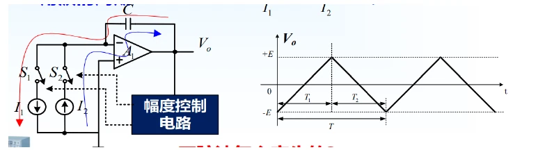
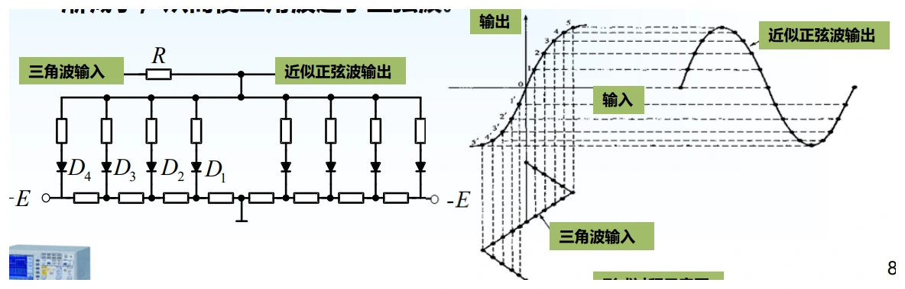
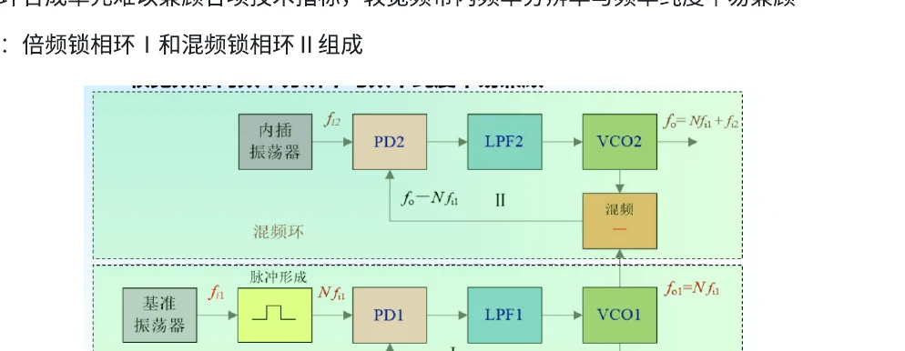
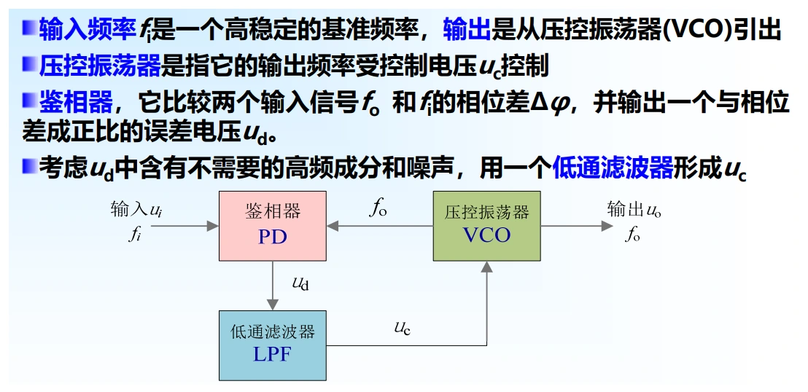

# 第五章　信号发生器、频率合成与输出设置

[课程目录](../index.md) · [原笔记，第 76—82 页](../resources/measurement-notes.pdf#page=76)

信号发生器的任务不只是“产生某种波”。频率准确度、频谱纯度、幅值、输出阻抗和负载约定共同决定送到电路端的真实激励。复习时将内部产生原理与外部使用设置分开，能避免“旋钮设置正确，测得却差一倍”的问题。

## 1. 建立一张输出规格清单

周期信号至少说明波形、频率、幅值表示法、直流偏置和输出负载。幅值可以是 $V_p$、$V_{pp}$、RMS 或 dBm，不能只写“1 V”。正弦波的 $V_{pp}=2\sqrt2V_{RMS}$，方波一般没有这一换算系数。

频率准确度是平均频率相对于标称值的偏差；相位噪声描述载波附近随机相位起伏；谐波和杂散则描述离散的非目标频谱成分。高频率分辨率不等于低相位噪声，也不等于频率基准准确。选择仪器要看当前实验主要受哪一项限制。

### 激励源、仿真源和校准源的不同要求（原 5.1、5.2） {#generator-roles}

作为激励源，发生器给待测电路施加幅值、频率和波形已知的输入，观察输出增益、失真或暂态；作为仿真源，还要描述调制、干扰、突发、阻抗及时间关系；作为校准源，则必须有足够准确、稳定且有依据的输出，不能只因为面板能设置很多小数位就当作标准。

正弦发生器通常包含主振级、缓冲/放大、衰减与输出级。主振级决定基本频率和波形，缓冲级降低负载对振荡条件的牵动，输出级提供所需幅值与阻抗。改变输出衰减不应明显拉动频率；若接入负载后频率和幅值都显著改变，应检查隔离、过载或连接，而不只调整面板读数。

原资料把模拟发生器和数字发生器作了概括比较。实际不能用“数字一定更纯、模拟一定更差”代替规格判断：低失真正弦振荡器可能在某频段优于普通 DDS 的杂散表现；数字合成的主要优势是频率步进、可编程和波形灵活性。应分别比较准确度、相噪、谐波、杂散、切换时间和输出能力。

## 2. 50 Ω 与高阻设置为何相差一倍

将发生器等效为理想电压源 $E$ 串联输出电阻 $R_s$。端口电压为 $U_L=ER_L/(R_s+R_L)$。当 $R_s=R_L=50\,\Omega$ 时，负载电压为开路电压的一半。

若屏幕按“接 50 Ω 负载”显示 $1\,\mathrm{V_{pp}}$，实际接入高阻示波器，端口可能接近 $2\,\mathrm{V_{pp}}$。把负载菜单改为 High-Z 通常是改变显示与幅值设定约定，不一定是把输出串联电阻物理移除，应查具体仪器说明。

**例。** 屏幕标称50 Ω负载下 $2\,\mathrm{V_{pp}}$，内部开路约 $4\,\mathrm{V_{pp}}$。接 $100\,\Omega$ 的电阻负载，实际约 $4\times100/150=2.667\,\mathrm{V_{pp}}$。低频、短连线时主要是电阻分压；长传输线和快边沿下还要考虑阻抗不匹配造成的反射，不能把两种现象都叫“反射”。

直流偏置与交流峰值相加后必须落在允许输出范围内。例如设置 $4\,\mathrm{V_{pp}}$、偏置 $+4\,\mathrm V$，理想输出需要覆盖2至6 V；若输出级达不到6 V就可能削顶。

## 3. RC 正弦振荡器：选频与稳幅是两项任务

振荡器在目标频率处需要合适的环路相位和幅值条件。以等值元件的文氏桥为例：

$$
f_0=\frac1{2\pi RC}.
$$

此频率处选频网络衰减为1/3，放大器增益在稳态附近约为3；启动时需留出使振幅增长的条件，随后依靠非线性稳幅使环路增益回到1。只满足频率公式并不能保证起振或低失真。

元件不完全相等时应重新分析选频网络，不能把等值条件下的幅值结论直接用于任意 $R_1,R_2,C_1,C_2$。元件温漂和调节跟踪误差影响频率稳定性，因此宽频调节与高稳定度常需借助频率合成。

## 4. 函数发生器：恒流积分产生三角波

电容由 $-E$ 充到 $+E$，恒流为 $I_1$，需要 $T_1=2EC/I_1$；再以 $I_2$ 放回 $-E$，需要 $T_2=2EC/I_2$。所以

$$
T=2EC\left(\frac1{I_1}+\frac1{I_2}\right).
$$

{ target=_blank rel=noopener }

*图 5-01　电流源切换、电容积分和上下阈值控制，来源：PDF 第 77 页。*

当 $I_1=I_2=I$ 时，$f=I/(4EC)$。改变电流或电容可调频，改变两电流的比例可改变上升、下降时间。比较器状态切换给出方波，非线性整形网络可把三角波近似变成正弦，但转换残差会形成谐波。

**例。** $E=1\,\mathrm V$，$C=10\,\mathrm{nF}$，$I_1=I_2=40\,\mathrm{\mu A}$，得到 $T_1=T_2=0.5\,\mathrm{ms}$、$f=1\,\mathrm{kHz}$。若仅将 $I_2$ 加倍，则下降时间缩短为0.25 ms，周期0.75 ms，频率约1.333 kHz，并不会保持1 kHz只改变占空比。

### 二极管网络如何把三角波变为正弦（原 5.3） {#triangle-sine}

{ target=_blank rel=noopener }

*图 5-03　PDF 第 78 页。逐个开启的支路使传输曲线增量斜率减小，形成近似正弦。*

三角波在半周期内斜率恒定，而正弦波在过零附近较陡、接近峰顶时逐渐变平。整形网络的目标是：小幅输入保持较大增益，输入幅值越大，增量增益越低。

原笔记采用带偏置的多组二极管—电阻支路。输入由零上升时，低阈值支路先导通；再超过更高阈值，后续支路依次导通，等效分流逐步增加，输出对输入的斜率逐段减小。负半周用对称支路处理，最终形成分段线性的近似正弦。它不是简单削平峰顶，后者会产生较明显的高次谐波。

分析一段时，先按阈值判断各二极管导通或截止，再在该等效线性电路中求输出；到阈值处检查电压连续。支路参数误差、二极管温漂和正负不对称会造成失真，因此输出仍需频谱或失真度测试。方波则可直接由上下阈值比较器的状态取得，和三角波是同一充放电过程的两种观测量。

[原笔记第 77—78 页](../resources/measurement-notes.pdf#page=77)

## 5. 锁相频率合成：分频器位置决定公式

PLL 由鉴相/鉴频、环路滤波器、压控振荡器和分频反馈组成。若参考先除以 $R$，输出反馈除以 $N$，锁定时比较器两端频率相等：

$$
\frac{f_{ref}}R=\frac{f_o}N,\qquad f_o=\frac NRf_{ref}.
$$

不要只背“输出等于 $N$ 倍输入”，应先在图上标出每个分频器。若 $f_{ref}=10\,\mathrm{MHz}$，$R=100$、$N=1234$，则 $f_o=123.4\,\mathrm{MHz}$，整数 $N$ 的调节步进为100 kHz。

{ target=_blank rel=noopener }

*图 5-02　频率合成结构示例，来源：PDF 第 81 页。不同结构的分频、混频位置不同，应逐级列出频率关系。*

PLL 可以将输出长期频率关联到基准，但参考噪声、VCO噪声和环路带宽共同决定输出相位噪声；不能据“锁相”推出任意频偏处都具有基准的纯度。改变分频比后还存在捕获和稳定时间。

### 锁定判据、混频环、倍频环与分频环（原 5.4、5.5） {#pll-units}

{ target=_blank rel=noopener }

*图 5-04　PDF 第 79 页。鉴相输出并不直接等于最终控制电压，中间还有环路滤波。*

在锁定状态下，鉴相器两输入的平均频率相等，相位差维持为常数，环路控制电压在平均意义上稳定。相位差可以不是零；“输出控制电压是直流”也不表示绝无纹波。锁定范围是锁定后能保持的输入变化范围，捕获过程则还涉及初始频差、滤波和环路动态，不应混为一项指标。

**混频式。** 若 VCO 输出与固定频率 $f_1$ 混频，选差频送鉴相器，与参考 $f_2$ 比较，则锁定条件为 $|f_o-f_1|=f_2$。原例选 $f_o>f_1$ 的支路，得到 $f_o=f_1+f_2$；若结构选择另一边带，则有不同结果。混频产生的和频、镜像与其他杂散须由滤波和环路选择抑制。

**倍频式。** 在输出反馈支路除以 $N$，锁定 $f_o/N=f_i$，所以 $f_o=Nf_i$。分频值变化可选择频率；参考的相位噪声经倍频及环路传递后不再是原幅度。

**分频式。** 若参考输入先除以 $R$、反馈不分频，锁定 $f_o=f_i/R$；若两边都有分频，回到本节开头的 $f_o=(N/R)f_{ref}$。原资料把某处分频环也写成 $Nf_i$，本网页按比较器两侧实际频率求式，避免名称与公式矛盾。

**多环合成。** 用一个高稳定参考和倍频环提供粗频率，另一路细调后混频，可形成 $f_o=N_1f_{i1}+f_{i2}$ 等组合。目标是在覆盖范围、步进和频谱纯度之间折中，而不是环数越多就一定越好；每条支路的绝对频差与噪声都应计入输出预算。

## 6. DDS：相位累加器决定频率栅格

DDS 每个时钟将频率控制字 $K$ 加到 $B$ 位相位累加器，经波形查表和 DAC 产生波形，重建滤波器去除镜像。理想输出频率与最小步进为

$$
f_o=\frac K{2^B}f_c,\qquad \Delta f=\frac{f_c}{2^B}.
$$

若 $B=32$、$f_c=100\,\mathrm{MHz}$，频率步进约0.023283 Hz。要输出1 MHz，取 $K=\operatorname{round}(0.01\times2^{32})=42949673$，实现约 $1000000.00093\,\mathrm{Hz}$。控制字舍入误差很小，不表示基准误差消失：100 MHz时钟若偏1 ppm，输出也有约1 ppm的比例偏差。

DAC 位数、相位截断、采样镜像和时钟抖动限制频谱纯度；输出频率不能无限接近时钟而不考虑滤波。任意波形发生器还受记录点数和采样率限制，同样的波形表点数在高频下可能不够描述尖锐边沿。

## 7. 混频输出的频率误差怎样传递

相加或相减前先把相对误差换成 Hz。若两频率相加 $f=f_1+f_2$，最坏绝对限差为 $\Delta f_{max}=f_1\varepsilon_1+f_2\varepsilon_2$，再除以总输出得到相对限差。

原资料例子：$f_1=2340\,\mathrm{kHz}$、$\varepsilon_1=10^{-6}$，$f_2=70\,\mathrm{kHz}$、$\varepsilon_2=10^{-4}$。绝对项分别为2.34 Hz与7 Hz，因此总输出2410 kHz、最坏绝对限差9.34 Hz，相对约 $3.876\times10^{-6}$。较低频支路在这里反而主导限差；不能只看频率较高就断言由它主导。

差频测量尤其敏感：两个大频率相减后剩下小差值，绝对误差未同比缩小，相对误差可能显著放大。若两路共用同一个基准，误差存在相关性，正式合成还应保留相关项。

### DDS 的相位连续与频谱边界（原 5.6、5.7） {#dds-limits}

每个时钟更新相位 $\Phi_{n+1}=(\Phi_n+K)\bmod2^B$，查表将相位映射为幅值。改变 $K$ 而不清零累加器，可以保持切换瞬间的相位连续；若同时复位相位或改变波形表，连续性仍取决于控制方式。频率切换快也不代表模拟重建滤波器没有过渡过程。

相位字可能只取高若干位查表，形成相位截断杂散；幅值字有限形成量化误差；DAC 的非线性产生谐波；时钟抖动引起相位起伏；采样输出在时钟附近产生镜像。频率分辨率、幅度分辨率、相位分辨率和无杂散动态范围因此是不同指标。

**选型例。** 要在 1 MHz 附近细调 0.1 Hz，先查累加器频率栅格是否足够小；要测 ADC 的高动态范围失真，则还需查源的谐波与相噪是否低于待测指标。若源自身三次谐波已高于目标，增加频率设置的小数位数不会改善测量。

[原笔记第 78—82 页](../resources/measurement-notes.pdf#page=78)

## 8. 实验操作与复习题

连接前先确认输出负载、幅值单位和偏置；用示波器校核真实端口电压；再改变频率，检查幅度平坦度。调频或脉冲测试需记录占空比、边沿、突发个数及触发方式，不能只保存一个频率值。

**自测一：** 50 Ω标定输出1 Vpp接高阻端，读数接近2 Vpp，首先检查负载约定，不要立即改探头倍率。**自测二：** DDS增加相位累加位数会减小频率栅格，但不能自动提高时钟准确度。**自测三：** PLL输出频率变化后，等待锁定再测，短时间内的瞬态不是稳态频率误差。
