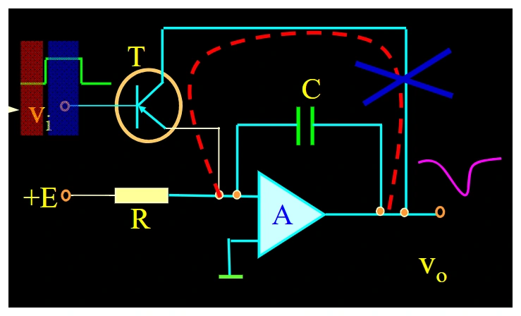
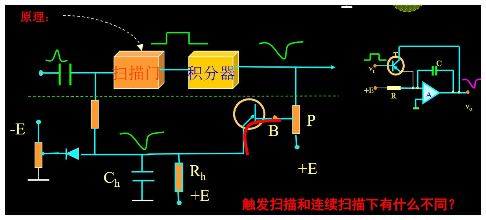
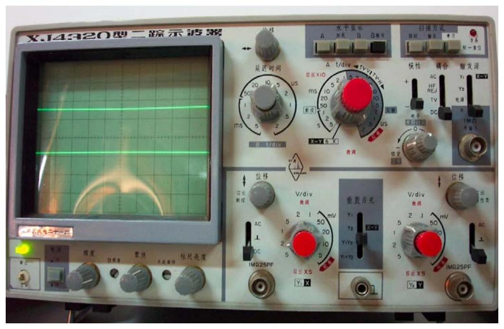

# 第六章（一）　模拟示波器、扫描与触发

[课程目录](../index.md) · [多踪显示](06-multi-trigger.md) · [原笔记，第 84—103 页](../resources/measurement-notes.pdf#page=84)

模拟示波器将输入电压变成荧光屏上的垂直位移，将扫描电压变成水平位移。稳定波形需要两条链路配合：幅度通道忠实地传递输入，时基与触发让相邻扫描从相同相位开始。看到波形在左右漂移，首先应考虑触发条件，而不是先改垂直增益。

## 1. 示波管与偏转系统

阴极射线示波管主要由电子枪、偏转系统和荧光屏组成。电子枪产生、加速和聚焦电子束；偏转板上的电场改变电子运动方向；荧光屏把落点变成可见光。亮度、聚焦和位置不是同一个控制量。

{ target=_blank rel=noopener }

*图 6-01　阴极射线示波管，来源：原笔记 PDF 第 87 页。图中电极电压只用于说明该结构，不是所有仪器的通用参数。*

从简单模型看，偏转电压越大、偏转板越长，位移越大；加速电压越高，电子通过偏转板越快，同样偏转电压造成的位移越小。提高亮度与提高偏转灵敏度之间存在设计权衡。后加速结构可在偏转后再提高电子能量。

“偏转灵敏度”和“偏转因数”的中文叫法在资料中有混用。本页明确以单位区分：$S_y$ 用 div/V，$D_y$ 用 V/div，二者理想互为倒数。面板上的2 V/div应理解为每一格代表2 V，不能当成每伏偏转2格。

### 电子枪各电极、静电聚焦与余辉（原原理 6.5—6.7） {#crt-details}

灯丝 F 加热阴极 K，使其发射电子；控制栅极 G1 改变通过的电子束流，主要影响辉度；前加速极 G2 与阳极 A1、A2 建立加速和聚焦电场。电子沿不同路径穿越非均匀电场后会发生会聚，形成静电透镜作用。聚焦是让落点变细，不等同于把电子束整体移到另一个位置。

对平行偏转板的简化模型，板长 $l$、板距 $d$，板中心到屏幕距离 $L$，加速电压 $V_a$，垂直板电压 $V_y$，忽略边缘场并采用小偏角，可得

$$
\begin{aligned}
v_x^2&\simeq\frac{2eV_a}{m},\\
y&\simeq\frac{lL}{2dV_a}V_y,\\
S_y^{\mathrm{(length)}}&=\frac{y}{V_y}=\frac{lL}{2dV_a}.
\end{aligned}
$$

推导先由板间加速度 $a_y=eV_y/(md)$ 求离开偏转板时的横向速度，再计算漂移到屏幕的位移。板长和到屏幕距离增大使偏转增大；板距和加速电压增大使偏转减小。式中 $L$ 的几何定义必须与原图一致，若从板出口计距离，需要另外加板内位移项。

PDA 是后偏转加速：偏转区使用相对较低速度以维持灵敏度，之后再加速提高撞屏能量和亮度。原笔记有一处把“减小加速电压使灵敏度提高”的方向混写，按上式可直接判定。偏转灵敏度 div/V 与面板偏转因数 V/div 不要混用。

荧光屏把电子能量转成光并有余辉。原课分为极短（低于约 10 μs）、短（约 10 μs—1 ms）、中（1 ms—0.1 s）、长（0.1—1 s）、极长（高于约 1 s）。余辉长可缓解低重复率显示的闪烁，却可能让快速变化相互叠加；普通余辉不能替代单次波形的长期数字存储。

[原笔记第 85—89 页](../resources/measurement-notes.pdf#page=85)

## 2. 垂直通道与延迟线

输入经耦合选择、衰减器和前置放大，再送到垂直输出放大器。触发信号通常从垂直链路中分支，经过比较和时基启动后，水平扫描才开始。若垂直信号未经延迟，波形前沿可能已经到屏幕，而水平扫描尚未建立。

{ target=_blank rel=noopener }

*图 6-02　垂直、触发、时基及消隐通道，来源：PDF 第 92 页。*

垂直延迟线将被测信号延迟一小段时间，补偿触发通道和扫描启动的传播时间，从而让触发附近的边沿可见。它不是把信号周期变长，也不是用于任意保存波形。模拟仪器仍不能像数字存储示波器那样保留长时间的触发前记录。

### 放大、移位和基准不是一项调节（原通道 6.1、6.2） {#vertical-details}

Y 前置放大器需要高输入阻抗、足够带宽与稳定增益；输出级向偏转板提供所需幅度，常采用对称输出结构。负反馈有助稳定增益，补偿设计维持频响，直流偏置用于移动垂直位置。位置旋钮改变基线位置，V/div 改变电压到格数的比例，二者在读数题中不能互换。

若高频信号幅值变小，可能来自输入电容、探头、补偿网络或放大器带宽；若所有频率都同比缩小，则先查探头倍率、衰减挡和微调是否在校准位；若只在大幅度时变形，则检查削顶或转换速率。沿信号链定位，比直接笼统写“放大器坏了”更有根据。

## 3. 补偿衰减器为何需要两个时间常数相等

宽带分压器用阻容并联支路构成上下臂，记为 $(R_1\parallel C_1)$ 和 $(R_2\parallel C_2)$。若

$$
R_1C_1=R_2C_2,
$$

则理想分压比与频率无关，低频电阻分压与高频电容分压一致。只用电阻时，下臂寄生电容会使高频增益下降，方波边沿变钝；补偿过度则可能出现尖峰。

{ target=_blank rel=noopener }

*图 6-03　宽带补偿分压，来源：PDF 第 92 页。等时间常数只保证该理想网络的平坦性，实际还受寄生参数和放大器带宽限制。*

例如 $R_1=9\,\mathrm{M\Omega}$、$R_2=1\,\mathrm{M\Omega}$，电阻衰减为10倍；若下臂等效电容20 pF，则上臂应约为 $C_1=R_2C_2/R_1=2.222\,\mathrm{pF}$。计算时不要把“上臂电容是下臂9倍”写反。

## 4. 时基：扫描、回扫和释抑

横轴需要近似线性锯齿电压。理想积分器在恒定输入 $E$ 下斜率为 $du_x/dt=-E/(RC)$，使光点在有效扫描段匀速移动。扫描结束后快速回到起点，同时用消隐避免看到回扫线。

{ target=_blank rel=noopener }

*图 6-04　扫描门、积分与比较释抑，来源：PDF 第 95 页。*

扫描门决定有效扫描的持续区间，比较与释抑电路使积分器复位，并在恢复期间阻止重新触发。没有释抑，复杂波形中的多个边沿可能让每次扫描从不同事件启动。

有效显示时间为格数乘时间/格，完整扫描周期还包括回扫和释抑。因而“显示宽度一定等于信号周期的整数倍”并不成立。周期波形稳定只要求相邻扫描从相同的合格事件出发；中间可以跳过若干周期。

### 米勒积分器、扫描门与释抑的完整时序（原通道 6.3） {#timebase-sequence}

{ target=_blank rel=noopener }

*图 6-14　PDF 第 95 页。先辨认恒定驱动、积分电容、复位开关，再判断扫描段斜率；原电路的负斜坡可由后级反相对应屏幕向右扫描。*

1. **待命。** 积分电容恢复至初始状态，扫描门处于待触发状态，回扫及恢复过程已经完成。
2. **合格事件到达。** 触发电路产生脉冲，使具有滞回的扫描门翻转。扫描门输出保持在驱动积分所需的电平，而非只给一个无限窄脉冲。
3. **有效扫描。** 积分器在恒定驱动下线性变化，X 放大器把它映射为匀速水平移动，同时增辉/消隐支路开放有效扫迹。中途其他边沿不应重新启动这一条扫描。
4. **终点判定。** 比较电路在锯齿达到规定幅度时改变反馈状态，使扫描门终止正程。扫描幅度和起始电平重复，横坐标比例才稳定。
5. **回扫和复位。** 积分电容快速恢复，束流消隐，避免把返回轨迹画在屏幕上。
6. **释抑后重新待命。** 释抑网络恢复较慢，在积分器尚未准备好时禁止新触发；其后才接收下一合格事件。

{ target=_blank rel=noopener }

*图 6-20　PDF 第 97 页。释抑支路的恢复与积分电容复位不是同一时间常数，须在准备完成后才允许新触发。*

施密特门有上、下两个翻转阈值，输入落在中间时保留先前状态，因而能形成一个持续扫描门。原课的“稳定度”调节改变门的预置电平：某些位置允许自激连续扫描，某些位置等待触发，外接 X 模式则由外部信号控制水平位移。具体阈值和正负极性随电路不同，答题依给定图判断，不能把一台旧仪器的旋钮区域当作所有示波器的模式定义。

**连续扫描和触发扫描。** 自由连续扫描可无输入也产生锯齿，若被测周期与扫描重复关系不稳定会漂移；触发扫描在准备好以后等待规定事件，稳定重复波形不要求“显示窗口恰为整数个周期”。原笔记中 $T_s=nT_y$ 指重复扫描与信号的同步关系，不能误当任意时基挡必须满足的恒等式。

## 5. 边沿触发由电平和斜率共同定义

正极性触发指上升斜率，负极性触发指下降斜率；正电平、负电平则是阈值相对于零线的位置。它们是两套独立设置。负电平上升触发完全可能，不能看到“负”就判断是下降沿。

{ target=_blank rel=noopener }

*图 6-05　阈值交点与触发斜率，来源：PDF 第 99 页。复习时在交点处同时标出电压和导数符号。*

设 $u=10\sin\omega t$，阈值 $-5\,\mathrm V$，则 $\sin\omega t=-1/2$，每周期两次交叉分别为 $210^\circ$ 与 $330^\circ$。$\cos210^\circ<0$ 对应下降触发，$\cos330^\circ>0$ 对应上升触发。做触发作图题，应先求交点，再确定斜率，不要凭波形左端高低猜。

若幅度减小后阈值落在波形范围外，将不再出现合格交叉，应调触发电平或确认触发源。时基改变波形横向宽度，但不能使一个根本不存在的阈值交叉出现。

## 6. AC、DC、GND 耦合的使用边界

DC耦合传递直流和频带内交流，用于观察绝对电平、偏置和慢变化。AC耦合串入隔直网络，便于在较大直流上放大观察小纹波，但会衰减低频并改变长脉冲平台。GND档用于确定零线位置，并不等于把被测电路随意短路到地。

100 V直流上叠加1 kHz、0.5 Vpp纹波，若目标只看纹波形状，通常选择AC耦合并缩小垂直档位。**输入端、探头和耦合电容仍承受原始电压**，AC档不提高耐压。涉及非隔离电源时，还必须采用合适的差分或隔离测量方案，不能将接地夹接到任意高电位节点。

### 输入耦合与触发耦合分开设置（原通道 6.3） {#trigger-coupling}

输入 AC/DC/GND 改变送往垂直显示通道的信号；触发耦合改变送往触发比较器的信号。显示波形含不含直流，与比较器用哪一种频率成分判定触发，可能由两处不同菜单控制。

触发 DC 耦合保留慢变化和直流电平，阈值与信号绝对电平直接对应；触发 AC 耦合先隔直，阈值对应滤波后的信号，低频与长脉冲也可能变形。HF/LF Rej 等名称因型号不同：HF Rej 通常是抑制高频噪声，而不是“高频耦合更适合高频”。原课面板的 HF 档应按该型号电路理解，不能与现代仪器的高频抑制菜单混称。

{ target=_blank rel=noopener }

*图 6-15　原笔记第 99 页完整面板图。左侧通道耦合与右侧触发区分别控制两条路径；具体标注以原仪器为准。*

内触发取自某个被观察通道；外触发来自单独接入的同步事件；电源触发关联工频。内信号太小、结构复杂或需比较多个通道时可考虑外触发，但外触发必须与被测事件有稳定关系。任意外接一条信号不会自动让波形稳定，也不能靠外触发恢复已经被输入带宽滤掉的边沿。

### X 通道、校准器与电源（原通道 6.3—6.5） {#x-calibration}

普通时间扫描时 X 放大器放大内部锯齿；XY 模式改接外部 X 输入，与 Y 输入共同决定光点位置，内部时基不再代表横轴时间。X 增益决定横向比例，X 位移改变横向中心。测李萨如图形前须确认两个轴的量纲与中心位置。

校准输出提供已知频率和幅值的方波，用于检查比例与探头补偿。原课举 1 kHz、1 Vpp，是该例的参数，并非所有仪器固定输出；校准端也不是任意精度的计量标准。灯丝电源负责加热、低压电源供放大与控制、高压系统供 CRT 加速及辉度聚焦，各支路故障可能对应不同现象。

## 7. 带宽和上升时间不能互相替代

带宽 $B$ 通常以正弦幅频响应下降3 dB定义，此处幅值已降到约0.707倍，不能称为“无失真上限”。对单极点低通，$t_r\approx0.35/B$；许多近似高斯系统也用相近系数，但实际示波器要查具体规格。

若被测边沿与仪器响应可用近似高斯展宽描述：

$$
t_{r,obs}^2\simeq t_{r,signal}^2+t_{r,scope}^2+t_{r,probe}^2.
$$

测得边沿与仪器自身上升时间很接近时，反算差平方会放大误差，不能盲目“校正”出一个很小的真实上升时间。更完整的选型例题见[示波测量](06-measurements.md)。

### 六项指标及异常波形定位（原原理 6.6、通道 6.6） {#scope-diagnostics}

原课六项指标为频带、瞬态响应、垂直偏转比例、输入阻抗、扫描时间比例与屏幕有效面积。前两项限制信号保真度，中间两项影响幅值和加载，时间比例影响时间读数，屏幕面积影响能舒适显示的范围。屏幕更大并不使放大器带宽自动增加。

| 看到的现象 | 先排查 | 再检查的机制 |
| --- | --- | --- |
| 左右漂移、重影 | 触发源、阈值、斜率、耦合 | 信号不同步或多个合格事件 |
| 只有水平线 | GND 档、输入接线、Y 挡位 | Y 放大链或被测信号本身 |
| 只有竖线或亮点 | 是否误进 XY，X 外接是否有信号 | 扫描发生器、X 放大链 |
| 回程斜线也可见 | 消隐/增辉设置 | 消隐门与回扫时序 |
| 峰值压平或振铃 | 过载、探头倍率和补偿 | 放大器响应、接地环路 |
| 各周期宽度不均 | 先确认信号实际变化 | 扫描线性与时基稳定性 |

**原课作图例。** 输入周期 20 ms，时基 5 ms/div、8 格屏宽，有效显示为 40 ms，即两周期；若指定上升沿、5 V 阈值、A 通道触发，先在 A 上找该上升交点，再以同一时间原点画另一通道。扫描复位和等待时间未给出，不能把有效 40 ms 自动等同于完整扫描周期。

[原笔记第 92—103 页](../resources/measurement-notes.pdf#page=92)

## 8. 作图题的固定检查顺序

先画零线与刻度，再在触发源上找满足电平和斜率的第一个合格事件，将该时刻映射为扫描起点；接着按相同绝对时间画全部通道，最后标出有效扫描窗、回扫和释抑。双通道共同触发必须保留相位差，不能分别把每个通道移到各自的零交点。

本章自测：CRT三部分为电子枪、偏转系统、荧光屏；扫描发生器环通常包括米勒积分器、扫描门与比较释抑；补偿分压的条件为 $R_1C_1=R_2C_2$；负极性与负电平不能互相替代。将这些定义联系到信号链上，比孤立背填空更容易完成简答题。
