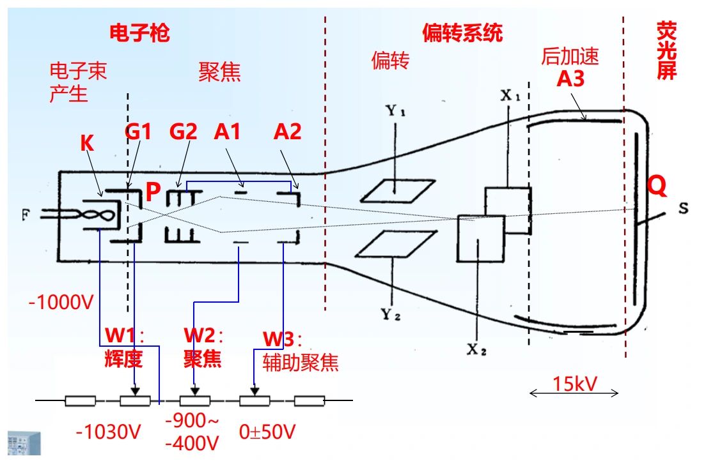
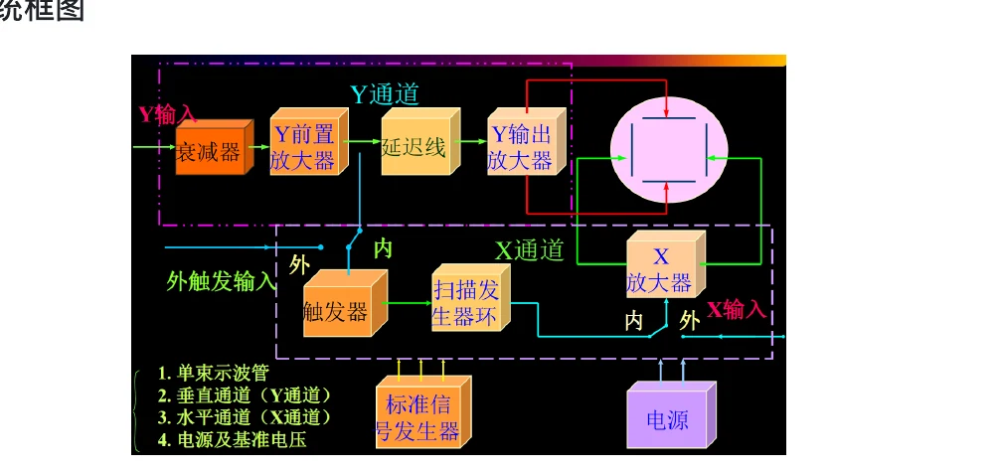
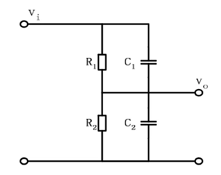
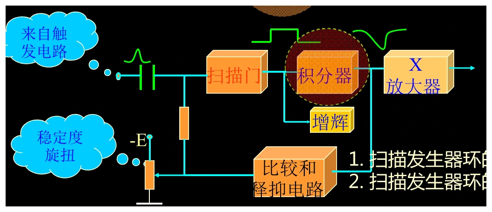
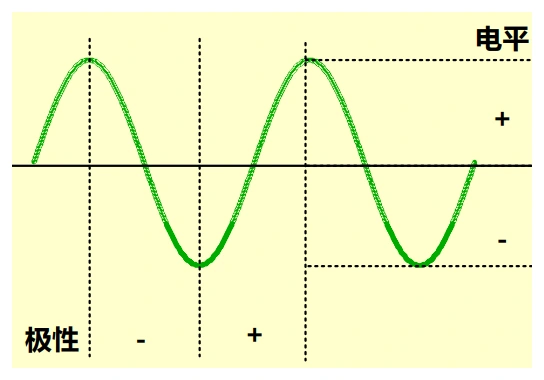

# 第六章（一）　模拟示波器、扫描与触发

[课程目录](../index.md) · [多踪显示](06-multi-trigger.md) · [原笔记，第 84—103 页](../resources/measurement-notes.pdf#page=84)

模拟示波器将输入电压变成荧光屏上的垂直位移，将扫描电压变成水平位移。稳定波形需要两条链路配合：幅度通道忠实地传递输入，时基与触发让相邻扫描从相同相位开始。看到波形在左右漂移，首先应考虑触发条件，而不是先改垂直增益。

## 1. 示波管与偏转系统

阴极射线示波管主要由电子枪、偏转系统和荧光屏组成。电子枪产生、加速和聚焦电子束；偏转板上的电场改变电子运动方向；荧光屏把落点变成可见光。亮度、聚焦和位置不是同一个控制量。

*图 6-01　阴极射线示波管，来源：原笔记 PDF 第 87 页。图中电极电压只用于说明该结构，不是所有仪器的通用参数。*

从简单模型看，偏转电压越大、偏转板越长，位移越大；加速电压越高，电子通过偏转板越快，同样偏转电压造成的位移越小。提高亮度与提高偏转灵敏度之间存在设计权衡。后加速结构可在偏转后再提高电子能量。

“偏转灵敏度”和“偏转因数”的中文叫法在资料中有混用。本页明确以单位区分：$S_y$ 用 div/V，$D_y$ 用 V/div，二者理想互为倒数。面板上的2 V/div应理解为每一格代表2 V，不能当成每伏偏转2格。

## 2. 垂直通道与延迟线

输入经耦合选择、衰减器和前置放大，再送到垂直输出放大器。触发信号通常从垂直链路中分支，经过比较和时基启动后，水平扫描才开始。若垂直信号未经延迟，波形前沿可能已经到屏幕，而水平扫描尚未建立。

*图 6-02　垂直、触发、时基及消隐通道，来源：PDF 第 92 页。*

垂直延迟线将被测信号延迟一小段时间，补偿触发通道和扫描启动的传播时间，从而让触发附近的边沿可见。它不是把信号周期变长，也不是用于任意保存波形。模拟仪器仍不能像数字存储示波器那样保留长时间的触发前记录。

## 3. 补偿衰减器为何需要两个时间常数相等

宽带分压器用阻容并联支路构成上下臂，记为 $(R_1\parallel C_1)$ 和 $(R_2\parallel C_2)$。若

$$
R_1C_1=R_2C_2,
$$

则理想分压比与频率无关，低频电阻分压与高频电容分压一致。只用电阻时，下臂寄生电容会使高频增益下降，方波边沿变钝；补偿过度则可能出现尖峰。

*图 6-03　宽带补偿分压，来源：PDF 第 92 页。等时间常数只保证该理想网络的平坦性，实际还受寄生参数和放大器带宽限制。*

例如 $R_1=9\,\mathrm{M\Omega}$、$R_2=1\,\mathrm{M\Omega}$，电阻衰减为10倍；若下臂等效电容20 pF，则上臂应约为 $C_1=R_2C_2/R_1=2.222\,\mathrm{pF}$。计算时不要把“上臂电容是下臂9倍”写反。

## 4. 时基：扫描、回扫和释抑

横轴需要近似线性锯齿电压。理想积分器在恒定输入 $E$ 下斜率为 $du_x/dt=-E/(RC)$，使光点在有效扫描段匀速移动。扫描结束后快速回到起点，同时用消隐避免看到回扫线。

*图 6-04　扫描门、积分与比较释抑，来源：PDF 第 95 页。*

扫描门决定有效扫描的持续区间，比较与释抑电路使积分器复位，并在恢复期间阻止重新触发。没有释抑，复杂波形中的多个边沿可能让每次扫描从不同事件启动。

有效显示时间为格数乘时间/格，完整扫描周期还包括回扫和释抑。因而“显示宽度一定等于信号周期的整数倍”并不成立。周期波形稳定只要求相邻扫描从相同的合格事件出发；中间可以跳过若干周期。

## 5. 边沿触发由电平和斜率共同定义

正极性触发指上升斜率，负极性触发指下降斜率；正电平、负电平则是阈值相对于零线的位置。它们是两套独立设置。负电平上升触发完全可能，不能看到“负”就判断是下降沿。

*图 6-05　阈值交点与触发斜率，来源：PDF 第 99 页。复习时在交点处同时标出电压和导数符号。*

设 $u=10\sin\omega t$，阈值 $-5\,\mathrm V$，则 $\sin\omega t=-1/2$，每周期两次交叉分别为 $210^\circ$ 与 $330^\circ$。$\cos210^\circ<0$ 对应下降触发，$\cos330^\circ>0$ 对应上升触发。做触发作图题，应先求交点，再确定斜率，不要凭波形左端高低猜。

若幅度减小后阈值落在波形范围外，将不再出现合格交叉，应调触发电平或确认触发源。时基改变波形横向宽度，但不能使一个根本不存在的阈值交叉出现。

## 6. AC、DC、GND 耦合的使用边界

DC耦合传递直流和频带内交流，用于观察绝对电平、偏置和慢变化。AC耦合串入隔直网络，便于在较大直流上放大观察小纹波，但会衰减低频并改变长脉冲平台。GND档用于确定零线位置，并不等于把被测电路随意短路到地。

100 V直流上叠加1 kHz、0.5 Vpp纹波，若目标只看纹波形状，通常选择AC耦合并缩小垂直档位。**输入端、探头和耦合电容仍承受原始电压**，AC档不提高耐压。涉及非隔离电源时，还必须采用合适的差分或隔离测量方案，不能将接地夹接到任意高电位节点。

## 7. 带宽和上升时间不能互相替代

带宽 $B$ 通常以正弦幅频响应下降3 dB定义，此处幅值已降到约0.707倍，不能称为“无失真上限”。对单极点低通，$t_r\approx0.35/B$；许多近似高斯系统也用相近系数，但实际示波器要查具体规格。

若被测边沿与仪器响应可用近似高斯展宽描述：

$$
t_{r,obs}^2\simeq t_{r,signal}^2+t_{r,scope}^2+t_{r,probe}^2.
$$

测得边沿与仪器自身上升时间很接近时，反算差平方会放大误差，不能盲目“校正”出一个很小的真实上升时间。更完整的选型例题见[示波测量](06-measurements.md)。

## 8. 作图题的固定检查顺序

先画零线与刻度，再在触发源上找满足电平和斜率的第一个合格事件，将该时刻映射为扫描起点；接着按相同绝对时间画全部通道，最后标出有效扫描窗、回扫和释抑。双通道共同触发必须保留相位差，不能分别把每个通道移到各自的零交点。

本章自测：CRT三部分为电子枪、偏转系统、荧光屏；扫描发生器环通常包括米勒积分器、扫描门与比较释抑；补偿分压的条件为 $R_1C_1=R_2C_2$；负极性与负电平不能互相替代。将这些定义联系到信号链上，比孤立背填空更容易完成简答题。
