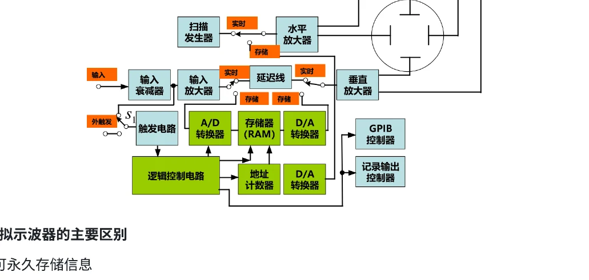
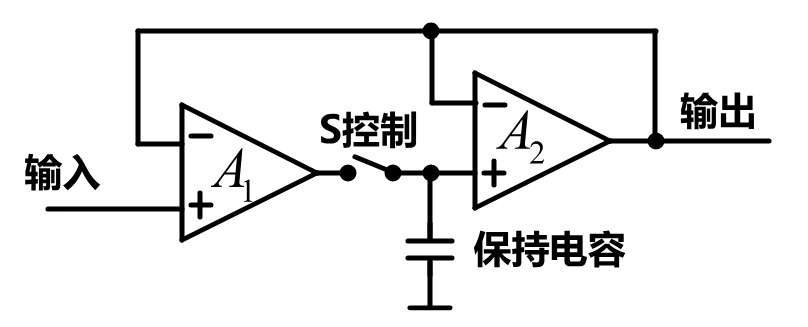
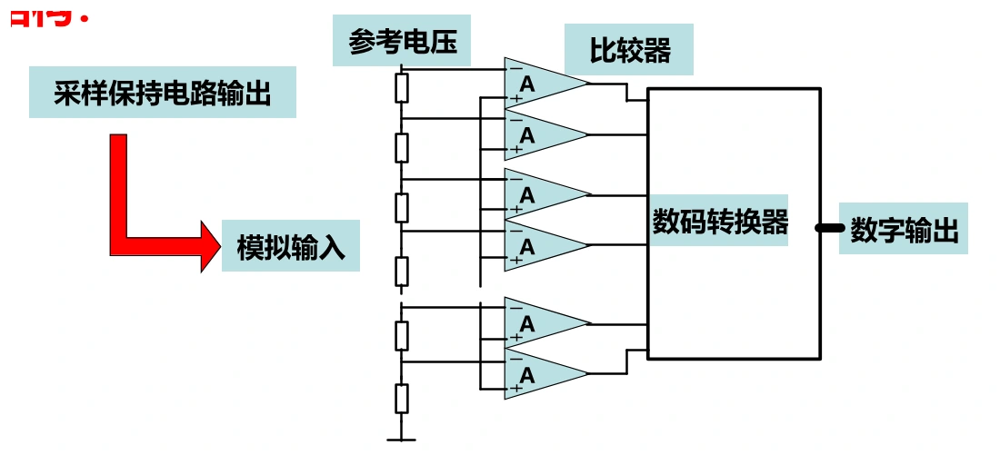
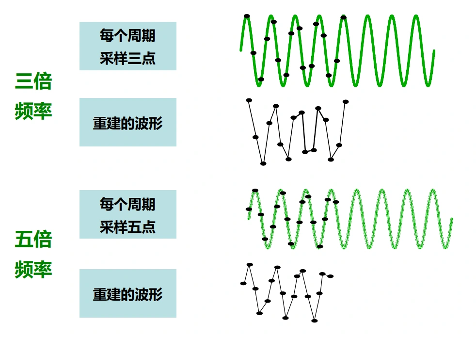
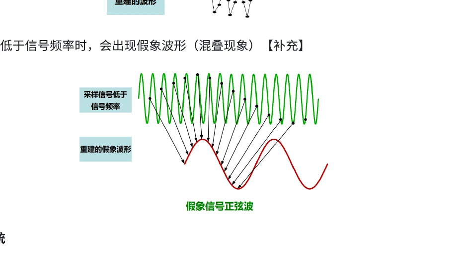
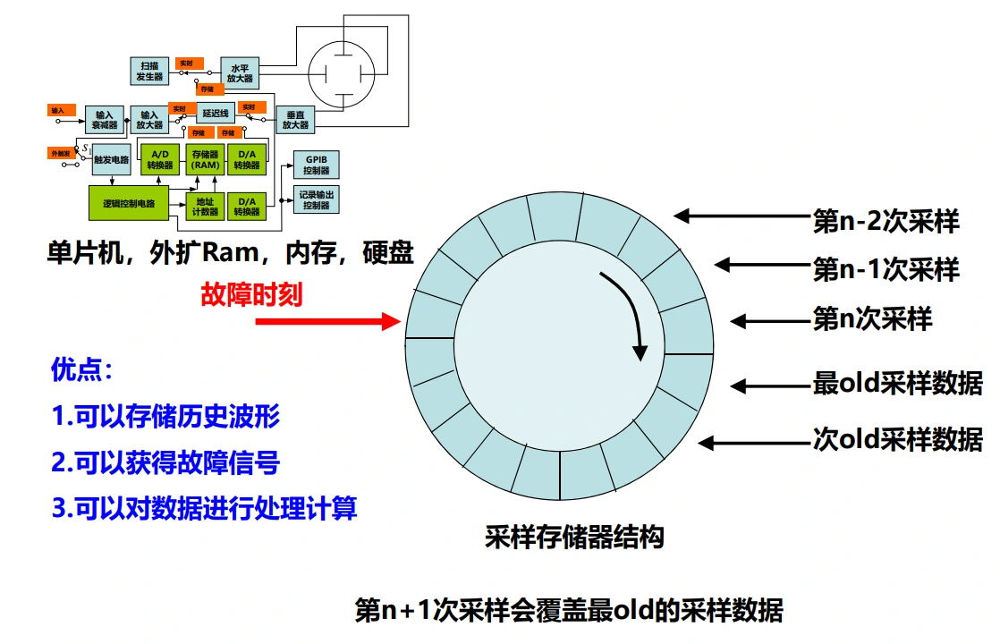

# 第六章（三）　数字示波器、采样、存储与事件捕获

[课程目录](../index.md) · [示波测量](06-measurements.md) · [原笔记，第 108—119 页](../resources/measurement-notes.pdf#page=108)

数字示波器先采样存储，再在屏幕上重建波形。它可以查看触发前记录、保存单次事件和做数学运算，但显示出一条连续曲线，并不保证输入信息被完整采到。带宽、采样率、存储深度和波形更新率必须分别检查。

## 1. 信号从输入走到屏幕的过程

输入衰减和放大将电压调到ADC范围，采样保持确定采样瞬间，ADC量化为数字，缓存保存有限长度记录，处理器再完成缩放、测量与绘图。触发模块确定记录中哪个位置对应目标事件。

{ target=_blank rel=noopener }

*图 6-08　模拟前端、ADC、存储和显示，来源：原笔记 PDF 第 108 页。*

屏幕只有几百或几千个横向像素，内存却可能有数百万点。缩略显示通常需要抽取或包络；若只显示每段中的某一个点，窄毛刺可能消失。因此查找异常时要了解峰值检测、包络、插值和抽取的实际设置。

### 采样保持与高速 ADC（原数字示波 6.1—6.3） {#sample-hold-adc}

{ target=_blank rel=noopener }

*图 6-21　PDF 第 109 页。闭合时跟踪输入，断开后由电容保持，实际仍有建立、下垂与开关误差。*

采样保持电路在跟踪阶段闭合开关，让保持电容追随输入；在保持阶段断开，供 ADC 在转换期间读取近似恒定电压。跟踪建立不足会造成采样值未追到输入，保持漏电会造成下垂，开关电荷注入和孔径抖动也会引入误差。高速变化信号对采样时刻特别敏感，电压误差近似 $\delta v=(dv/dt)\delta t$。

{ target=_blank rel=noopener }

*图 6-22　PDF 第 109 页。各比较器同时判断不同阈值，再编码为一个样点的数值。*

原资料给出的并行比较结构可理解为 Flash ADC：对 $B$ 位理想转换，需要 $2^B-1$ 个阈值比较器，并经编码输出数字。8 位有 255 个阈值，能并行快速比较，但功耗、面积和阈值一致性有代价。实际示波器还可用流水线或交织等架构，不能将所有 ADC 都按逐次逼近所需 $B$ 次比较理解。

数字示波器可长期保存记录、比较历史与当前波形、查看预触发信息并输出原始数据；这些功能建立在采样记录上。自动测量减少人工读格，但仍受阈值算法、窗口、噪声和带宽限制，不能写成“不受人为设置影响、一定更准确”。

## 2. 四个指标各自限制什么

| 指标 | 主要含义 | 不足时的表现 |
| --- | --- | --- |
| 模拟带宽 | 前端能传递的频谱范围 | 幅值衰减、快边沿展宽 |
| 实时采样率 $f_s$ | 每秒取得的真实样点数 | 混叠、漏掉短事件、插值失真 |
| 记录长度 $N$ | 一次采集存多少点 | 长时间窗中被迫降低实际采样率 |
| 波形更新率 | 每秒完成多少次记录与显示 | 两次记录之间的死区可能漏掉偶发事件 |

采样间隔为 $1/f_s$，记录时长约为 $T_{rec}=N/f_s$；严格说首末样点间隔为 $(N-1)/f_s$。若10格横轴每格20 μs，观察窗200 μs，要在每格存1000点，则采样率为 $1000/(20\,\mathrm{\mu s})=50\,\mathrm{MSa/s}$，总计约10000点。

宣传中的最大采样率可能只在少量通道、特定存储模式下成立。打开更多通道或拉长时基后，应看屏幕当前实际值，不能继续用包装上的最大值计算分辨力。

## 3. 实时采样与等效时间采样

实时采样在一次事件内取得整段记录，适用于单次和非重复信号。等效时间采样从重复波形的多次出现中取得不同位置样点，再拼成一周期；其成立条件是波形足够重复、触发与时间定位可靠。

等效采样可以显示很细的周期结构，但不能据其“等效采样率”宣称能捕获同样快的单次瞬态。波形周期抖动、幅度变化或非重复毛刺会被拼接成不真实的形状。

### 顺序与随机等效采样（原数字示波 6.3—6.6） {#equivalent-interpolation}

顺序等效采样在每次重复触发后，按预定的小延迟取样；下次把延迟增加一点，再逐步拼成记录。随机等效采样则让采样时钟与信号重复不同步，同时精确测量采样点相对触发的时间，把各次样点放回对应位置。两者都依赖重复信号的一致性，不能还原从未重复的单次毛刺。

点显示要求足够多样点直接勾出形状，原课的每周期 20—25 点是便于辨认波形的经验；线性插值连接相邻点，正弦或 $\sin x/x$ 插值依据更强的带限假设。插值只改变如何画出已有样点，不会知道两个样点之间真实发生过的窄脉冲。

{ target=_blank rel=noopener }

*图 6-18　原笔记第 112 页。三点、五点示意用于观察点位对重建曲线的影响，不能据平滑连线判断峰值已被准确采到。*

奈奎斯特条件是针对带限信号、完整采样序列与理想重建的理论条件，不能等同于“每周期两个点就能可靠读出任何波形”。在恰好两点且固定采样相位时，正弦甚至可能总采在零点附近。实际波形测量需留余量，并关注最高有意义谐波。

## 4. 混叠怎样把高频画成低频

对低通信号，理想采样要求 $f_s>2f_{max}$，实际还要给抗混叠滤波器留过渡带。输入正弦在采样后可能与 $|f-kf_s|$ 的低频分量不可区分，折叠到 $0$ 至 $f_s/2$ 内的频率才会显示出来。

{ target=_blank rel=noopener }

*图 6-10　采样与混叠示意，来源：PDF 第 112 页。图上的平滑低频曲线不一定是输入真实频率。*

例如 $f_s=100\,\mathrm{kSa/s}$，输入70 kHz正弦可折叠为30 kHz。改变时基使实际采样率变化时，假频率可能明显改变，这是排查混叠的线索；但仅凭“曲线变了”不能唯一识别真实频率。

抗混叠需在ADC之前限制带外内容。已经折叠到带内的两个成分，通常不能靠事后低通滤波重新分开。对方波而言，应以需要保留的谐波或边沿细节确定采样要求，不能只拿基频代入两倍条件。

## 5. 环形存储与预触发

在待命阶段，采样点不断写入循环缓冲，写满后覆盖最早数据。触发到来后，再按设定比例采集后续点，最后停止。这使触发前发生的信号也能保留。

{ target=_blank rel=noopener }

*图 6-09　循环写入和触发位置，来源：PDF 第 111 页。*

若总记录1 ms、预触发30%，则约保存事件前0.3 ms、后0.7 ms。屏幕左端不一定是触发时刻，通常有触发标记指示 $t=0$。从图上读延时要先找该标记，不能默认所有事件都从最左侧开始。

保存上电过程时，先设置合适输入量程、单次触发和预触发，按待命后再给系统上电。若先上电后按Single，事件可能已经过去；示波器不能恢复未采到的历史。

### 深存储与实际时基的数值关系（原数字示波 6.4、6.8、6.9） {#memory-depth}

原课写“每格 100 点、10 μs/div”，实际采样率为 $100/(10\,\mu\mathrm s)=10\,\mathrm{MSa/s}$。若共有 10.24 格、1024 点，则对应每格 100 点。这里“10 位存储器”应理解为 10 位地址可寻址 $2^{10}$ 个位置，而不是每个波形幅值只有 10 位或时间轴天然 10 位。

100 ns/div 且仍为每格 100 点时，算得 $1\,\mathrm{GSa/s}$。这个推导依赖每格点数不变；若仪器自动改变记录长度，就必须用当前参数重新计算。模拟带宽由前端决定，实时带宽受真实采样与重建能力限制，等效带宽则绑定重复采样条件，这三者不可互相替代。

250 M点在 1 GSa/s 下记录约 250 ms；1 M点同速只约 1 ms。若要记录 112 ms 并保持 1 GSa/s，需要约 112 M点，10 ns 脉冲宽度约占 10 个采样间隔。它提供基本细分，不表示边沿和尖峰已经无失真，仍需足够模拟带宽、探头和合理触发。

预触发比例改变的是同一总记录中触发前后数据的分配，不能扩大总内存。长启动过程同时有很短异常脉冲时，可考虑深存储、分段采集或专用事件触发，先明确需要完整连续记录还是只要各次事件片段。

## 6. Auto、Normal、Single 有何区别

Normal等待满足触发条件的事件，没有合格事件时通常不刷新；Auto在等待一段时间仍无触发时也会扫描，便于找信号，但不保证显示与目标事件同步；Single在待命后捕获一次满足条件的记录并停止。

Single抓到的是**待命后首次满足所设条件的事件**，不保证是物理过程中的首次事件。阈值设得不合适，可能在噪声、振铃或后续边沿上触发。电源启动应把阈值设在合理范围，考虑触发迟滞与信号斜率，并使用足够长记录覆盖全部过程。

复杂故障可用脉宽、欠幅、超时或逻辑触发；正常周期波形上的罕见窄脉冲，不应只依赖普通上升沿触发反复碰运气。

## 7. 分辨力、量化与平均

理想 $B$ 位ADC在输入范围 $V_{FS}$ 下步长 $q=V_{FS}/2^B$。若8位、全范围8 V，步长31.25 mV；小信号只占0.5 V时，用掉的码数很少，细节可能淹没在量化中。因此应在不削顶的前提下让信号占据合理的垂直范围。

名义位数不等于有效位数。噪声、时钟抖动和非线性都会降低实际性能。对重复且同步的波形平均，可减小部分不相关噪声，但会抹去不重复细节；平均模式下看不到毛刺，不意味着毛刺不存在。高分辨率模式也可能通过时间平均获得更平滑读数，同时降低有效带宽。

### 采集模式与触发模式各管一件事（原数字示波 6.10、6.11） {#acquisition-modes}

| 采集/显示方式 | 保存或处理什么 | 适合什么，可能损失什么 |
| --- | --- | --- |
| 普通采样 | 每个输出区间取代表样点 | 一般波形；长时窗抽点可能漏窄毛刺 |
| 峰值检测 | 每区间保留高速样点中的最大最小值 | 查尖峰；不能据包络精确恢复所有细节 |
| 平均 | 多次已对齐记录逐点平均 | 减少不相关噪声；偶发事件会被冲淡 |
| 高分辨率 | 一次记录内相邻样点组合/平均 | 改善低频分辨；有效带宽可能降低 |
| 包络/余辉 | 多次记录的范围或出现密度 | 看漂移与稀有形状；不是单次完整时序 |

Auto、Normal、Single 决定何时获得记录及是否继续等待；上表决定采得后如何取点和处理。使用 Single 时仍可选择普通或峰值检测，不能把“单次”和“峰检”视作互斥模式。

原笔记写“Single 是第一个、Auto 是最后一个波形”，这里补全条件：Single 保存待命后第一个满足触发条件的记录；Auto 连续更新，屏幕上看到的是最近完成并显示的记录，不一定是输入序列物理意义上的最后一个。若输入已结束、仍自由扫描，显示还可能变成无同步记录。

## 8. 采集死区与稀有事件

一次采集时长 $T_{acq}$ 之外，还需要处理、传输和重新待命，若死区为 $T_{dead}$，简单模型的更新率为 $1/(T_{acq}+T_{dead})$。较深记录保留更多上下文，但未必同时获得最高更新率。

检查偶发异常时，应根据任务取舍：需要完整一次故障前后过程，用深存储和单次触发；需要提高偶发事件被碰到的概率，关注波形更新率、分段存储和合适的异常触发。屏幕动画流畅不等于采集中间没有死区。

### 四项实验应如何留记录（原原理 6.1、6.2；数字示波 6.12—6.14） {#scope-lab-plan}

**实验一：DMM、LCR 与直流电源。** 用参考或交叉比对评估电阻、电压和电流读数，分别记录各表的量程与误差规格；电源设置电压和电流限值，观察 CV/CC 转换。进入 CC 不代表电源坏了，可能是负载达到电流限制。电流测完恢复电压插孔，避免后续误并接。

**实验二：探头校准与边沿比较。** 在 10× 状态接校准方波，记录欠补、合适、过补三种波形；再令发生器输出 1 MHz、1 Vpp、1 V 偏置方波，注明负载菜单和示波器端真实值。比较 20 MHz 与 200 MHz 探头、1× 与 10× 档时，保持信号和示波器设置一致，并记录各组合的实际带宽。不能把探头标签上的最大带宽用于所有档位。

**实验三：线性与开关电源输出。** DC 耦合记录平均输出，AC 耦合放大纹波；比较 DMM 的 DC、AC 及 AC+DC 读数含义。纹波测试固定接地方式和带宽限制，否则两张图的噪声不能直接比较。若电源含非隔离高压侧，依实验指导采用合适探头及测点。

**实验四：上电单次捕获。** 先选输出电压或稳压器输入为触发源，设置上升阈值、预触发和足够长时窗；待命后上电，记录上升时间、过冲与进入指定误差带的稳定时间。若想比较两个节点，使用共同触发和同步记录，不能把不同次启动各自的截图当同一事件。

每组至少保留：接线示意、配置、原始波形、计算过程和对差异的解释。报告结论应写“在何种设置下观察到什么”，避免只写“高档仪器更好”而没有证据。

[原笔记第 82—84 页](../resources/measurement-notes.pdf#page=82) · [第 108—119 页](../resources/measurement-notes.pdf#page=108)

## 9. 从接线到保存的一次完整操作

先用校准方波检查探头倍率和补偿；选择输入耦合、垂直范围和带宽；设置记录时长并确认实际采样率；选触发源、斜率、阈值及预触发比例；待命后施加事件。保存时同时导出截图、原始波形和配置。只保存一张没有时基、量程与触发标记的图片，后续很难判断其可信程度。

**训练题。** 1 M点、100 MSa/s约可记录10 ms；若想记录1 s且点数不变，平均采样率只能约1 MSa/s，高频细节可能丢失。8位ADC在4 V范围步长15.625 mV。以上是结构性估算，不能替代真实仪器的内存管理、分段存储和过采样规格。
