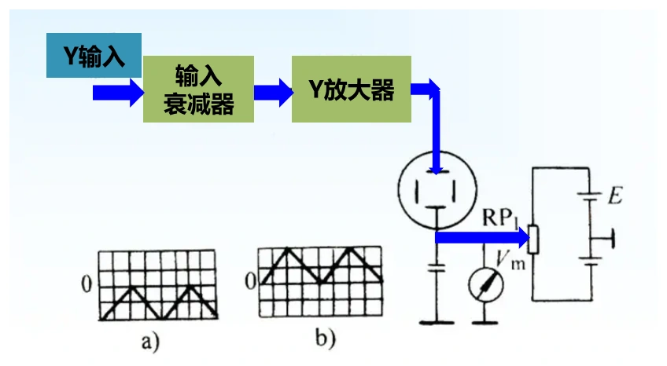

# 第六章（四）　电压、脉冲、相位与探头测量

[课程目录](../index.md) · [数字示波器](06-digital-scope.md) · [原笔记，第 118—127 页](../resources/measurement-notes.pdf#page=118)

示波测量先确认零点、档位和探头倍率，再读格数。对快速信号，还要区分真实波形、探头加载和仪器响应。以下计算以已校准档位为前提；若使用连续可变增益或时基，必须确认仍处于校准位置。

## 1. 电压与时间读数

波形峰峰高度 $n_y$ 格、垂直档位 $D_y$ V/div，若显示尚未包含探头倍率 $K$，则 $U_{pp}=n_yD_yK$。周期宽度 $n_x$ 格、时基 $D_x$ s/div，则 $T=n_xD_x$、$f=1/T$。现代仪器若已设置10×探头，屏幕读数常已乘10，不能再次乘。

**例。** 3.2格峰峰值，200 mV/div，外接10×探头且菜单仍为1×，实际为6.4 Vpp；若菜单已设10×且屏幕显示2 V/div，直接读3.2×2=6.4 Vpp即可。探头倍率应在记录中明确，而不是在最后凭经验补乘。

原回忆卷方波标注显示高度5 cm、横向10 cm约覆盖两个周期，按1 V/cm、1 ms/cm估算：$U_{pp}=5\,\mathrm V$、$T=5\,\mathrm{ms}$、$f=200\,\mathrm{Hz}$。但是原图未明确零线，因此“峰值”不能只凭高度认定为2.5 V：若对称居中为2.5 V，若单极0—5 V则为5 V。解答需把这一缺失条件写出来。

### 直接、比较与位移测量（原使用方法·电压） {#voltage-comparison}

直接法把格数乘以已校准的偏转因数；比较法则在相同增益与探头条件下，把待测波形高度 $h_x$ 与标准高度 $h_s$ 比较：$U_x=(h_x/h_s)U_s$。标准是 RMS 还是 Vpp 必须与所比较的高度对应；不能把正弦的 RMS 直接当峰峰高度参考。

**比较法例。** 标准正弦为 $2.00\,\mathrm{V_{pp}}$，屏上高 4.00 格；待测波形在相同设置下高 5.50 格，得到 $2.75\,\mathrm{V_{pp}}$。若标准幅度限差 0.5%，两高度相对读数限差分别 0.5% 与 0.4%，一阶最坏输出限差约 1.4%。两次比较期间改变增益或探头，公共比例因子就不再可消去。

测压位移法通过可校准的直流位移量，把上峰、下峰先后移到同一参考位置，由位移差求幅值。普通 POSITION 旋钮若没有标定电压读数，不能仅数旋钮转了多少角度就宣称测得电压。

{ target=_blank rel=noopener }

*图 6-19　PDF 第 122 页。两次位移必须采用同一基准与已知位移换算关系。*

时间直接法同样用格数乘 s/div；时标法把已知周期的时标加到显示，按间隔数计时；测时位移法利用可校准的水平延迟差。现代数字游标读数来自样点和插值，方便但不消除时基误差、采样间隔及阈值不确定性。

## 2. 脉冲参数的定义

上升时间通常指幅度从10%到90%的时间，下降时间为90%到10%；脉宽常按50%幅度交点间隔定义。这些百分比相对于脉冲低、高稳态电平之差，不是相对于屏幕最底部。

{ target=_blank rel=noopener }

*图 6-12　脉冲参数定义，来源：原笔记 PDF 第 122 页。稳定时间还必须给出最终允许误差带，不能只说“看起来稳定”。*

过冲相对于稳态幅度评估；振铃频率与衰减也应单独记录。对有明显过冲的脉冲，不能直接拿最大尖峰作为100%电平，否则会改变10%与90%阈值并误估上升时间。

### 非零基线的阈值、过冲与稳定时间（原使用方法·时间） {#pulse-thresholds}

设脉冲低电平 $V_L=1\,\mathrm V$、高稳态 $V_H=5\,\mathrm V$，幅度差为 4 V，10%、50%、90% 阈值分别为 1.4、3.0、4.6 V。若直接用 0.5 V 和 4.5 V 作 10% 与 90%，所测参数已不是同一定义。

过冲若峰顶为 5.6 V，按稳态跃变量定义为 $(5.6-5)/(5-1)=15\%$。稳定时间须给允许带，例如最终稳态 $5\,\mathrm V\pm0.1\,\mathrm V$，从事件起点量到之后始终留在该带内的最早时刻。一次暂时穿过允许带后又振出，不算已经稳定。

脉宽通常用上、下降两个 50% 交点之差；占空比为 $D=\tau/T$。如 $\tau=12\,\mu\mathrm s$、$T=40\,\mu\mathrm s$，则 $D=30\%$、$f=25\,\mathrm{kHz}$。沿不同阈值测宽，得到的宽度可能不同，题目与实验报告均应注明。

## 3. 带宽选型与35 ns考题

在适用的单极点或近似高斯响应模型下，$t_{r,scope}\approx0.35/B$，组合边沿近似满足平方和关系。若忽略探头、被测上升时间35 ns：

| 示波器带宽 | 自身上升时间 | 估计观察值 | 展宽 |
| --- | --- | --- | --- |
| 30 MHz | 11.67 ns | 36.89 ns | 约5.41% |
| 100 MHz | 3.50 ns | 35.17 ns | 约0.50% |

若题目明确允许5%展宽，则要求

$$
t_{r,scope}\le t_{r,signal}\sqrt{1.05^2-1}
\approx0.32016t_{r,signal},
$$

所以 $B\gtrsim31.24\,\mathrm{MHz}$。30 MHz略不满足这一假定标准，100 MHz余量较大。原卷其他选项和允许误差没有完整回忆，不能据此补造唯一选择字母。

500 kHz基波保留到五次谐波，最高关注频率为2.5 MHz。这只是频谱覆盖下限，带宽等于2.5 MHz时最高谐波在−3 dB处，显然仍有明显失真。若按课堂“三倍最高频率”的经验，可估7.5 MHz；若要求更低幅相误差，要按具体响应和容差继续提高带宽，不能把经验倍数当作严格无失真定理。

## 4. 探头补偿与加载

10×无源探头一般由探头电阻、电容与示波器输入阻容构成补偿分压。调节补偿电容，使上下臂时间常数匹配。连接校准方波后，补偿不足时边沿圆钝、平台恢复较慢；补偿过度时出现尖峰；正确补偿时平台较平直且没有人为尖峰。

{ target=_blank rel=noopener }

*图 6-11　探头方波校准及不同补偿状态，来源：PDF 第 118 页。实际仪器信号和探头需配套检查。*

10×探头通常提高等效输入电阻、降低等效输入电容，减少电路加载，但把信号衰减后可能降低小信号可见度。所谓“低电容探头”强调减小电容负载，不等于输入电阻低。

接地线的寄生电感与节点电容可形成谐振，长地线在快边沿下产生的振铃不一定来自被测电路。优先用短接地弹簧并减小环路面积，比较接线改变前后波形。不能通过补偿电容把所有振铃都“调没”，因为补偿错误可能掩盖真实高频内容。

普通台式示波器地夹通常与保护地相连。测非隔离电源、高侧节点或功率回路时，应使用符合电压及共模额定值的差分探头或合适方案。AC耦合不隔离保护地，两个通道做数学相减也不改变输入端耐压。

### 探头类型、负载与方波校准次序（原使用方法·注意事项） {#probe-types}

| 类型 | 主要特点 | 选用时必须核对 |
| --- | --- | --- |
| 直连/同轴连接 | 适合阻抗明确的信号源与端口 | 终接、反射、输入耐压；不能一概称无失真 |
| 10× 无源补偿探头 | 较高电阻、较低电容，带宽通常高于 1× | 与输入电容配套，倍率与补偿正确 |
| 有源低电容探头 | 减少小节点的电容负载 | 输入范围、供电、偏置与差分/单端规格 |
| 高压/差分探头 | 扩大量程或允许合适共模测量 | 差模、共模、频率降额与额定类别 |
| 电流探头 | 把电流变为仪器可读信号 | 传感原理、是否可测 DC、带宽、消磁与零点 |

电流互感式探头通常不能测直流，霍尔或复合结构可在规定条件下测 DC 与 AC。夹入时辨认电流方向，闭合磁芯并调零，避免把钳口未闭合造成的偏差当成被测电流变化。

**探头补偿四步。** 选择 10× 并同步设置菜单倍率；接仪器推荐的校准方波和短地线；使屏上显示一两周期并有适当高度；只调补偿件至平台平直，再换快时基检查边沿。原图三列从左到右为“补偿、过补偿、欠补偿”，不要按常见教材的列顺序猜。低频补偿合适并不证明探头所有高频性能都已校准。

探头电容与源电阻形成极点。例如源阻 $10\,\mathrm{k\Omega}$、总输入电容 $10\,\mathrm{pF}$，单极点估计 $f_c\approx1.59\,\mathrm{MHz}$；即使探头标 200 MHz，此节点也可能被明显加载。源阻高的小电容振荡节点，应优先看负载而非探头标称最高频率。

## 5. 同频相位差：时差法

共同触发、相同频率下，在两信号的同向特征点间读取 $\Delta t$，得到 $|\varphi|=360^\circ\Delta t/T$。选择上升零点比峰顶通常更容易定位，但要避免噪声和直流偏置改变交点。

例：$T=10$格，两信号上升零点相差1.5格，则相位差54°。若CH2的点在右边，则CH2滞后CH1。误把上升沿与下降沿配对会额外引入半周期，必须写清比较的同名点。

频率不同则相位随时间变化；触发源分别取各通道时，也不能直接比较截图的横向位置。先检查[共同触发条件](06-multi-trigger.md)，再做相位运算。

## 6. XY椭圆法能给出哪些信息

设 $x=A\sin\omega t$，$y=B\sin(\omega t+\varphi)$。在 $x=0$ 处，$|y_0|=B|\sin\varphi|$，因此

$$
|\sin\varphi|=\frac{|y_0|}{B}
=\frac{\text{椭圆在 }y\text{ 轴的两交点间距}}{\text{椭圆全高度}}.
$$

{ target=_blank rel=noopener }

*图 6-13　椭圆截距法，来源：PDF 第 124 页。分子分母应同时用半幅或同时用全幅。*

比值1/2只给出 $|\sin\varphi|=1/2$，对应30°、150°等候选，需结合椭圆倾斜方向确定锐钝角；静态轨迹一般仍不能唯一识别超前或滞后，需要扫描方向或时域信息。90°时仅当屏幕两方向显示幅度相等才是圆，幅度不同则仍是椭圆。

不同频率的李萨如图形可通过极值处接触数判断整数频率比。原卷图在左右各一组x极值，顶底各三组y极值，对应 $f_y=3f_x$；$f_x=4\,\mathrm{kHz}$ 时得到 $f_y=12\,\mathrm{kHz}$。不能仅按图中“有三个圈”就套通用公式，应确认哪个轴对应哪个信号。

### 截距法与李萨如频率比的推导（原使用方法·相位） {#phase-intercepts}

两同频正弦若相位为 $\varphi$，在参考信号的上升零点时，另一通道电压为 $B\sin\varphi$。若显示中心与零线一致，量该时刻的纵向截距并除以另一通道自身峰幅 B，可估 $|\sin\varphi|$。原课“幅度相同”的条件方便作图，但真正关键是分子、分母属于同一通道，并且已去除直流偏置；两幅度不同也可在正确归一化后求正弦绝对值。

XY 椭圆将时间参数消去。对 $x=A\sin\omega t$、$y=B\sin(\omega t+\varphi)$，可得

$$
\left(\frac{x}{A}\right)^2+
\left(\frac{y}{B}\right)^2-
2\frac{xy}{AB}\cos\varphi=\sin^2\varphi.
$$

所以同一静态轨迹不能分辨 $\varphi$ 与 $-\varphi$ 的旋转方向；椭圆倾向可以帮助判断 $\cos\varphi$ 的符号，却仍需额外时间信息判断超前/滞后。$0^\circ$ 为正斜直线，$180^\circ$ 为负斜直线，$90^\circ$ 为轴对齐椭圆，只有 A、B 的屏幕幅度相同才为圆。

整数频率比时，设 $x=A\sin(m\omega_0t)$、$y=B\sin(n\omega_0t+\varphi)$，应结合各轴达到极值或与适当非切线参考线相交的次数判比，避免重复计交叉点及切点。最可靠的复核是先提出频率比，再用参数方程画一周期看拓扑是否一致；“数几个圈”对复杂相位或重合轨迹不够可靠。

### 捕捉窄毛刺的操作与原课读图题 {#glitch-procedure}

先用普通采样确认幅值、基线和正常周期，再估计可疑脉冲宽度；选择小于某宽度的正/负脉宽触发，设置阈值、足够的真实采样率及预触发，待命后捕获。峰值检测适合先发现长时窗里有异常包络，发现后仍要用足够细的样点和针对性触发查看形状。时间窗太长导致自动降采样时，不能继续依据最大采样率判断毛刺不会漏掉。

原课第 127 页例子若已从图中确认高 6 cm、偏转因数 0.2 V/cm，峰峰值才为 1.2 V。若要让 10 个周期占满 $L$ 格横轴，需设 $D_x=10T/L$；原图高度或屏宽没有清晰标注时，应保留这些变量，不能用“假设 6 cm”冒充原图唯一答案。

[原笔记第 120—127 页](../resources/measurement-notes.pdf#page=120)

## 7. 一份可复现的测量记录

记录信号连接点、探头及倍率、耦合方式、带宽限制、V/div、s/div、触发源与条件、采样率和记录长度。对边沿给出10%—90%定义，对相位给出超前/滞后，对RMS注明AC或AC+DC。最后保存原始数据并标注所用游标位置。只给一张波形图和一个最终数值，很难区分测量结果与显示设置造成的差别。
