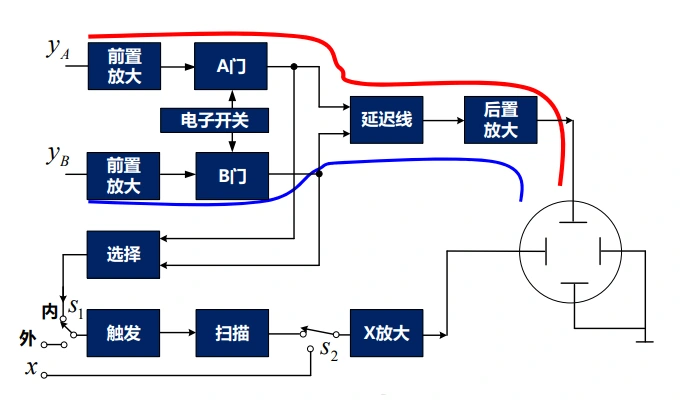
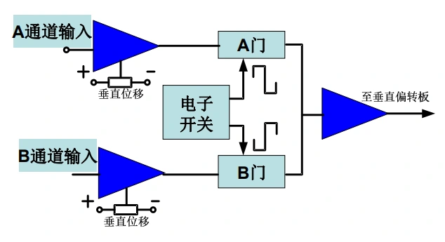
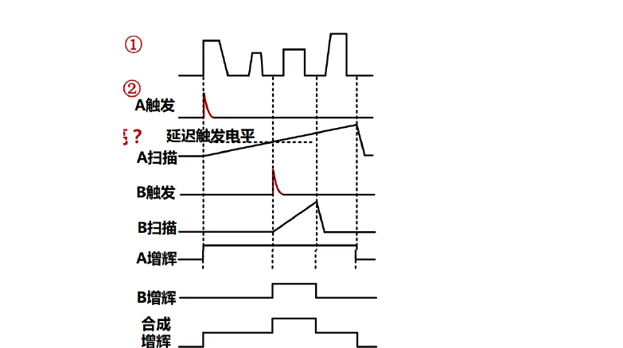

# 第六章（二）　双踪显示、共同触发与延迟扫描

[课程目录](../index.md) · [扫描与触发基础](06-analog-scope.md) · [原笔记，第 98—107 页](../resources/measurement-notes.pdf#page=98)

双通道并不意味着两个通道一定共享时间原点。显示切换方式回答“何时显示哪个通道”，触发源回答“何时启动这次扫描”。交替显示和交替触发虽然名字相近，却不能混为一项设置。这是回忆卷作图题的主要辨析点。

## 1. 双束与双踪的结构区别

双束示波器具有两束电子束，可在各自偏转系统中独立显示。双踪示波器常用一套电子束，通过电子开关交替接入两个垂直输入。屏上同时看到两条线，既可能来自真正的双束，也可能来自快速切换及荧光余辉。

{ target=_blank rel=noopener }

*图 6-06　双踪的通道选择与电子开关，来源：原笔记 PDF 第 105 页。*

交替显示 ALT 在一次完整扫描显示一个通道，下一次显示另一个，适合较快扫描；断续显示 CHOP 在一次扫描内多次快速切换两通道，适合较慢扫描。切换过慢可能留下断点，切换频率与输入关系不当还会产生显示伪影。数字仪器可能同时采样后再绘图，其机制与模拟电子开关不同，应按仪器架构理解。

### 五种显示方式与适用时间尺度（原多波形 6.1—6.3） {#five-displays}

多波形显示有三个目的：比较相关信号的幅值与相位；观察故障前后的多路关系；同时看整体过程与局部细节。最后一个目的可由双时基实现，不等于一定要增加输入通道。

{ target=_blank rel=noopener }

*图 6-16　原笔记第 105 页。单独选通、相加、逐扫描交替和扫描内断续，是对同一垂直链路的不同控制。*

| 显示模式 | 信号怎样到垂直放大器 | 使用时要确认 |
| --- | --- | --- |
| A 单踪 | 只选 A | 触发源是否与 A 相关 |
| B 单踪 | 只选 B | 触发可能仍选 A，不要按显示名猜 |
| A+B | 两路代数相加 | 零线、增益、倍率一致才有可比较的物理含义 |
| ALT | 一次扫 A、下次扫 B | 扫描过慢会闪烁，不能证明两路同一次事件均被捕获 |
| CHOP | 单次扫描内高速切换 A/B | 切换需消隐，过快时基可能显示断裂或切换伪影 |

原资料提到 25 Hz 的视觉经验与 200 kHz 的开关频率，它们依赖具体仪器和显示条件，不是所有 ALT/CHOP 模式的通用分界。双束采用空间上独立的电子束，传统双踪采用时间分割；现代数字示波器是否真正同步采样，还要看 ADC 和采样时钟架构。

若用反相 B 后再 A+B 实现 A−B，两路探头倍率、带宽和时延匹配决定差分误差；这也不把普通接地输入变成可测任意高共模的差分探头。先满足输入对地额定值，再讨论数学相减。

## 2. 共同触发保留什么信息

两通道都用 CH1 的同一类事件启动扫描，每条曲线的横坐标都表示“相对 CH1 触发时刻的时间”。因此真实相位差得以保留。切换显示通道并不应重定义时间原点。

例如 $v_1=10\sin\omega t$，$v_2=10\sin(\omega t-60^\circ)$。在共同触发下，$v_2$ 的对应特征仍比 $v_1$ 晚 $T/6$。若各通道探头或内部延迟不同，显示相位还叠加了通道时延，应先用同源信号校核。

交替触发则使显示CH1时由CH1触发，显示CH2时由CH2触发。如果两个波形形状、幅度和触发条件相同，它们各自的触发交点被映射到同一屏幕位置，原有时间差就可能被“对齐”掉。曲线重叠不等于物理信号同相。

## 3. 回忆卷：50 Hz、滞后60°、−5 V下降触发

已知峰值10 V、频率50 Hz，所以 $T=20\,\mathrm{ms}$。对 $v_1$，下降到 $-5\,\mathrm V$ 的相位为 $210^\circ$；对 $v_2$，内部相位也需达到 $210^\circ$，但其全局相位为 $270^\circ$。两次对应触发相差

$$
\Delta t=\frac{60^\circ}{360^\circ}T=3.333\,\mathrm{ms}.
$$

**共同以 $v_1$ 触发。** 令屏幕横坐标 $\tau=0$ 为 $v_1$ 的触发时刻，则

$$
v_{1,screen}(\tau)=10\sin(\omega\tau+210^\circ),\quad
v_{2,screen}(\tau)=10\sin(\omega\tau+150^\circ).
$$

左端应为 $v_1=-5\,\mathrm V$、$v_2=+5\,\mathrm V$，且两者在该时刻都下降。之后 $v_2$ 比 $v_1$ 晚3.333 ms达到相同下降触发点。

**交替触发。** 每条曲线分别以自身下降到−5 V的时刻作为原点，两条显示曲线都变为 $10\sin(\omega\tau+210^\circ)$，因而重合。若题目要求画扫描锯齿，需把不同通道各自的触发时刻标到同一个绝对时间轴上；有效扫描和释抑长度未给时，不应自造唯一的扫描周期。

作图与独立绘制的教学示意见[分步解答](../exam-solutions.md)。原卷的空白答题网格仍保留在[第5—6页](../resources/exam-2025-2026.pdf#page=5)，不能把其中预先给定的输入正弦图当成官方解答。

## 4. 复杂脉冲为何会从不同边沿触发

若一个周期含有多个相同高度的上升沿，单纯“电平+斜率”可能无法区分目标事件。每次扫描结束后的重新待命时刻不同，就会捕获不同边沿，造成叠影或横向跳动。

释抑是在扫描后暂时忽略触发事件。适当延长释抑可使下一次有效触发落到同一个脉冲组位置；但过长会漏掉更多事件。数字示波器还可使用脉宽、欠幅、逻辑或超时触发，直接限定目标特征。仅调亮度或聚焦不能解决事件选择错误。

对回忆卷10格屏幕的脉冲题，10、20、40 μs/div分别对应100、200、400 μs的有效观察窗。应先找触发时刻 $t_0$，再把所有边沿变换为 $t-t_0$，截取观察窗内部分。改变时基不会改变真实脉宽，只改变其占据格数。

## 5. 延迟扫描：先定位，再放大局部

主时基A显示较长事件过程，在其中选择延迟位置；延迟时基B用更快扫描显示局部细节。这样不必仅靠横向位置旋钮在高速时基下盲找事件。

{ target=_blank rel=noopener }

*图 6-07　A、B时基和延迟关系，来源：PDF 第 107 页。*

设主扫描为1 ms/div，在第4格附近的脉冲上观察边沿，可设置约4 ms延迟，再用10 μs/div的B时基。A时基回答“事件出现在整段过程的哪里”，B时基回答“这个局部边沿长什么样”。双时基与双踪是独立概念：前者是两个时间尺度，后者是两个输入通道。

某些仪器可选择B时基在延迟结束后立即启动，或等待随后某个合格触发事件。两种模式的时标含义不同，答题应依给定结构；不能把某一型号的外触发路由当成所有仪器的限制。

### 延迟扫描的时间账本与读图步骤（原多波形 6.4—6.7） {#delayed-sweep-reading}

设主时基从 $t_A$ 启动，延迟量为 $t_d$，局部时基从 $t_B=t_A+t_d$ 启动。某边沿在局部图上距原点 $n_B$ 格，B 时基为 $D_B$，则该边沿相对 A 起点的时间为 $t_d+n_BD_B$。如果 B 是“延迟后等待触发”模式，还要增加等待至合格触发的时间，不能沿用立即启动公式。

读原图时先看第一行输入，找到 A 触发；再看延迟触发电平与 A 锯齿交点，定位 B 启动；随后看 B 扫描宽度对应输入中的哪一段；最后核对 A、B 增辉脉冲与有效正程一致。增辉只是标识/开放有效光迹，既不改变被测信号，也不把不存在的细节补出来。

原课第 107 页另有两路 100 ms 周期、90° 相位差、20 ms/div 与 8 格屏幕的思考题，观察窗为 160 ms，相位时差为 25 ms。未说明幅值是峰值还是峰峰值时，不能直接确定 2.5 V 阈值处的交点；应先根据原图或补充条件确认。这个检查能避免算出一张看似整齐却与题设不符的图。

[原笔记第 104—107 页](../resources/measurement-notes.pdf#page=104)

## 6. 如何检查一张双通道图

先确认两条曲线是否共用触发源，再看时基、通道耦合、探头倍率和垂直零线。如果两信号频率不同，普通共同触发可能只能稳定其中一路；这不是示波器故障。若频率相同而相位缓慢漂移，还应考虑信号源不同步。

相位测量必须在共同时间原点下进行。不能分别截图各自稳定的波形，再把两张图拼起来判断相位。两个通道测量同一个信号时，若仍有固定偏移，应记录并补偿通道与探头延迟。

## 7. 训练与答案

**题一。** ALT显示是否意味着ALT触发？不意味着。ALT是垂直通道切换方式，触发源可以共同选CH1。**题二。** 两个同形同频但相位不同的正弦用各自相同电平、斜率触发后是否可能重叠？可能，因屏幕时间原点已分别平移。**题三。** 100 μs宽脉冲用20 μs/div显示，占5格；改40 μs/div，占2.5格。输入实际脉宽没有改变。

作图题末尾检查三件事：左端是否满足指定触发条件；非触发通道是否仍与触发通道使用相同时间平移；横向格数是否对应正确观察时长。这三个检查比重复描一条漂亮曲线更有用。
