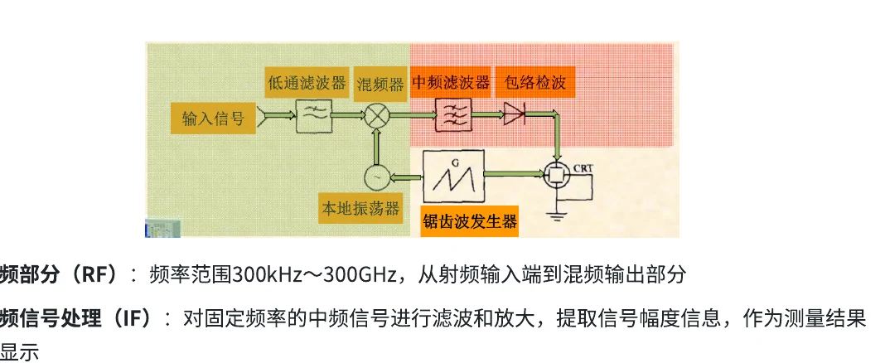
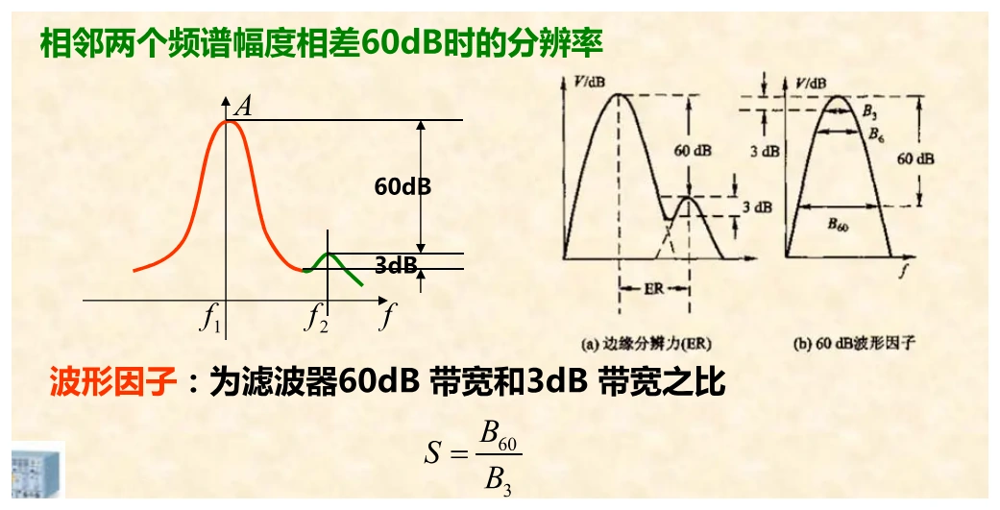
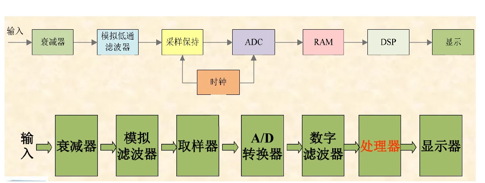

# 第七章　频谱分析、FFT与仪器参数

[课程目录](../index.md) · [原笔记，第 128—135 页](../resources/measurement-notes.pdf#page=128)

频谱测量应先确认纵轴是什么：电压幅度、功率、功率谱密度或对数电平。接着看中心频率、跨度、分辨率带宽和输入阻抗。一张看起来峰很尖、底噪很低的频谱，可能只是设置不同，并不代表信号质量更好。

## 1. 时域与频域提供不同视角

时域适合定位边沿、启动、突变和事件先后；频域适合观察基波、谐波、杂散、噪声和带宽。周期波形中的尖锐细节通常依靠高次谐波构成，只保留基波后看起来会更像正弦。

幅度谱若不保留相位，通常不足以唯一恢复时域波形。普通标量频谱仪不能直接测任意两个频率分量的相位；矢量信号分析仪、网络分析仪等具有不同的相位参考和校准条件，不能混为同一类仪器。

### 傅里叶级数、测量任务与仪器选择（原 7.1—7.9） {#fourier-tasks}

本页统一把直流项记为 $a_0$，采用

$$
x(t)=a_0+\sum_{n=1}^{\infty}
[a_n\cos(n\omega_0t)+b_n\sin(n\omega_0t)],
$$

$$
\begin{aligned}
a_0&=\frac1T\int_0^Tx(t)dt,\\
a_n&=\frac2T\int_0^Tx(t)\cos(n\omega_0t)dt,\\
b_n&=\frac2T\int_0^Tx(t)\sin(n\omega_0t)dt.
\end{aligned}
$$

有的教材将常数项写成 $a_0/2$，其 $a_0$ 定义相应多一倍，不能把两个约定拼在一起。第 n 次正弦分量峰幅为 $\sqrt{a_n^2+b_n^2}$，有效值为该量除以 $\sqrt2$。利用正交性，周期信号满足 $U_{rms}^2=a_0^2+\tfrac12\sum(a_n^2+b_n^2)$，这也是谐波 RMS 方和根的基础。

周期信号对应离散谐波，孤立脉冲等非周期信号通常使用连续频谱描述。频谱幅度和能量谱密度单位不同，不应把所有纵轴都标成电压。原课的控制稳定性、整流谐波、非线性失真分别需要频率响应、信号谱和失真指标；它们相关，却是不同测试任务。

| 想回答的问题 | 合适的测量与前提 |
| --- | --- |
| 放大器产生了多少谐波 | 频谱与 THD，先确保激励源更纯、仪器未过载 |
| ADC 的噪声与失真多大 | 相干或合适加窗采样，区分 SNR、SINAD、SFDR |
| 滤波器增益、相位如何随频率变 | 受控扫频并比较输入输出，保留相位参考 |
| 强载波旁有无微弱杂散 | RBW、滤波器裙边、本振相噪及动态范围同时满足 |
| 端口反射和传输如何 | 网络分析仪及端口校准，而非仅一张未知激励下的幅度谱 |

普通标量频谱仪主要显示幅度或功率，不能据其屏上两峰的位置恢复相对相位；网络分析仪利用受控源和参考通道测复数比值，矢量信号分析则还涉及相干下变频等结构。先选对仪器再讨论参数。

## 2. 扫频超外差频谱仪

通过本振扫频，将输入不同频率逐次变换到固定中频，再用中频滤波、检波和显示形成频谱。理想关系为 $f_{IF}=|f_{LO}-f_x|$；若选高侧本振，目标支路满足 $f_x=f_{LO}-f_{IF}$。

{ target=_blank rel=noopener }

*图 7-01　预选、混频、本振与中频链路，来源：原笔记 PDF 第 130 页。*

同一本振下，$f_{LO}+f_{IF}$ 也可产生相同中频，这是镜像响应。预选滤波用于抑制镜像和带外大信号。实际仪器可多次变频，不能把一级变频的简式直接用于每一个内部节点。

例如中频3.6 GHz、输入1 MHz，采用高侧本振时需3.601 GHz；镜像候选为7.201 GHz。计算前统一GHz、MHz单位。零中频和多级中频架构要按给定方框图重新列式。

### 调谐方程逐项代入与镜像（原 7.11） {#tuning-image}

原例采用 $f_{IF}=3.6\,\mathrm{GHz}$ 和高侧本振，因此 $f_{LO}=f_s+f_{IF}$。输入 1 kHz 时，本振为 3.600001 GHz；1.5 GHz 时为 5.1 GHz；2.9 GHz 时为 6.5 GHz。特别注意 1 kHz 是 $0.000001\,\mathrm{GHz}$，不是 0.001 GHz。

同一次本振下，$f_{image}=f_{LO}+f_{IF}=f_s+2f_{IF}$ 也能产生同一差频。预选低通或带通先拒绝这些输入，后级固定中频滤波器只能挑中频，无法判断它由目标还是镜像变来。强带外信号还可能在混频器中产生互调，所以预选同时承担保护动态范围的作用。

屏幕横轴由本振扫动与调谐关系标定，纵轴来自被选中频的检波幅值。扫过某频率时，中频滤波器需时间建立；RBW 越窄，响应越慢，扫描时间通常也需增加。不能只缩小 RBW、维持过快扫描，再把偏低峰值当作信号真的变弱。

## 3. RBW、VBW与滤波器形状因数

RBW是分辨率带宽，决定频率轴上邻近谱线能否分开，也影响测得噪声功率。VBW是检波后的平滑滤波带宽，主要影响显示起伏和响应时间，不能替代RBW把两个已混在一起的峰重新分开。

{ target=_blank rel=noopener }

*图 7-03　滤波器3 dB、60 dB宽度及邻近谱线，来源：PDF 第 133 页。*

窄RBW有助于分辨邻近信号、降低每个分辨带宽内的噪声，但通常需要更长扫描或稳定时间。滤波器尚未稳定就扫过去，会使幅值与频率位置失真。对于白噪声，功率随等效噪声带宽变化，RBW从10 kHz降到1 kHz时，理想带内噪声功率约降10 dB；信号线谱的幅值行为并不相同。

滤波器形状因数常写 $K=B_{60\,dB}/B_{3\,dB}$，越接近1说明裙边越陡。它不是电压波形的峰值因数，也不是只用3 dB宽度就能描述的全部性能。小信号紧邻大信号时，滤波器裙边和动态范围都重要。

### 频率分辨率、边缘分辨率与剩余调频（原 7.11 指标） {#edge-resolution}

频率分辨率常用两个近似等幅正弦能否分开描述，主要受 RBW、滤波器形状和显示判据影响。原课说“间隔不小于 3 dB 带宽可以区分”是该课堂模型的经验，不能据此保证任意幅度差都分开。

边缘分辨率 ER 针对强弱不等的邻近信号。原资料采用相差 60 dB、弱峰与强峰裙边之间有指定下凹的判据，比较的是这种条件下最小频率间隔。换幅度差或下凹标准，ER 的数值也会变，因此它不是单独一个通用的滤波器带宽。

形状因数 $S=B_{60}/B_3$ 描述滤波器裙边。若 $B_3=1\,\mathrm{kHz}$、$S=10$，则 $B_{60}=10\,\mathrm{kHz}$；对近似对称滤波器，单侧到 −60 dB 约为 5 kHz。一个低于强峰 60 dB、离强峰仅 2 kHz 的弱信号，可能被裙边淹没，哪怕 2 kHz 已大于 RBW。这里只是裙边尺度估计，实际还受相噪和仪器噪声影响。

本振剩余调频使理想窄谱线在频率轴上抖动或展宽；相位噪声在强载波附近形成噪声裙边。把 RBW 缩到比源或本振自身频率起伏还小，不一定继续改善有效分辨力。强载波旁看不到弱信号时，应同时比较滤波器尾部、本振相噪和噪声底。

## 4. FFT分析的完整信号链

模拟抗混叠滤波器限制带外内容，ADC采样，有限长度记录加窗，再做FFT及幅值标度。抗混叠滤波必须发生在采样前；数字FFT后再低通无法一般性撤销已折叠的频率。

{ target=_blank rel=noopener }

*图 7-02　采样前滤波、缓存、加窗及FFT，来源：PDF 第 132 页。*

对 $N$ 点、采样率 $f_s$，频点间隔为 $\Delta f=f_s/N=1/T_{rec}$。这描述DFT栅格，不等于任意窗下两个正弦一定能以该间隔分开；真实分辨能力还取决于窗主瓣、旁瓣、幅度差与噪声。

**例。** $f_s=100\,\mathrm{kSa/s}$，$N=10000$，记录0.1 s，频点间隔10 Hz。补零到100000点后显示间隔变为1 Hz，但原记录信息并未增加，不能声称真实频率分辨力提高了10倍。要真正缩窄主瓣，一般需要更长有效记录。

FFT将DFT计算复杂度从 $O(N^2)$ 降到 $O(N\log N)$。具体乘加数与算法、实数/复数输入有关；原资料把8192点固定写成16384次运算的说法不能作为通用答案。

## 5. 泄漏、窗函数与幅值修正

有限时间截取等价于乘窗，频域中对应与窗谱卷积。当信号频率不落在DFT栅格或记录首尾不连续时，能量可能分散到多点。矩形窗主瓣窄但旁瓣较高，Hann窗降低旁瓣却加宽主瓣；不同窗服务不同测量目标。

计算幅值时需考虑窗的相干增益，单边谱与双边谱还存在尺度差别。噪声谱要考虑等效噪声带宽；不能对线谱幅值和噪声密度使用同一套简单乘2规则。直流点和奈奎斯特点也不应按普通正频率点重复翻倍。

多次平均可减少随机起伏，却不能补偿窗标度错误。比较两张频谱前，先统一窗函数、记录长度、平均方式、单位及纵轴参考。

### 频点、主瓣、单边幅值和噪声带宽 {#fft-scaling}

设原始 DFT 为 $X_k=\sum_{n=0}^{N-1}x_n e^{-j2\pi kn/N}$。对矩形窗、整周期、频率恰落在内部正频点的实正弦，其峰幅可由 $A=2|X_k|/N$ 得到；直流及偶数 N 的奈奎斯特点不翻倍。若加窗 $w_n$，相干线谱标度改用 $2|X_k|/\sum w_n$，仍须满足所述相干与频点条件。频率落在两点之间还会有栅栏损失，不能只读最大单点就保证幅值准确。

窗的等效噪声带宽可写为

$$
B_{ENBW}=f_s\frac{\sum w_n^2}{(\sum w_n)^2}.
$$

它用于把每个分析通道内噪声与噪声密度联系起来，与线谱用的相干增益不是同一个系数。补零让频谱曲线取样更密，不改变 $w_n$ 所对应的实际时间长度与主瓣宽度。复习时把“采样率定观察带宽、记录时长定基本频率尺度、窗定主瓣旁瓣、标度定幅值单位”分开记忆。

## 6. dB、dBm与电压换算

功率比用 $10\log_{10}(P_2/P_1)$；在相同电阻下电压比可用 $20\log_{10}(U_2/U_1)$。dBm是相对于1 mW的功率绝对电平：

$$
L_{dBm}=10\log_{10}\frac P{1\,\mathrm{mW}},\quad
P=\frac{U_{RMS}^2}R.
$$

50 Ω上0 dBm对应 $U_{RMS}=\sqrt{0.001\times50}=0.22361\,\mathrm V$，正弦峰峰值约0.63246 V；−20 dBm对应功率10 μW、电压22.361 mV RMS。没有输入阻抗就不能唯一把dBm换成电压。

总谐波失真按有效值定义为

$$
\mathrm{THD}=\frac{\sqrt{U_2^2+U_3^2+\cdots}}{U_1}.
$$

例如基波1 V RMS，二次0.03 V、三次0.04 V，则THD为5%，对应20log比值约−26.02 dB。不要把二、三次幅值直接相加成7%，也不要将以dB表示的幅值直接平方相加。

## 7. 测量动态范围与输入设置

强输入会使混频器或ADC过载，产生仪器自身失真，表现为并不存在的谐波或互调。增加衰减后，若某些杂散变化异常，应怀疑内部过载；但衰减增加也会抬高等效输入噪声底。前置放大器能改善弱信号可见度，也更容易被大信号压缩。

实际操作先设置安全衰减和参考电平，再减小跨度定位，选择合适RBW与扫描时间，最后核对幅值。峰值保持适合捕捉漂移频率，但它不是平均频谱；平均适合看噪声趋势，但可能淡化偶发信号。

### SNR、SINAD、SFDR 与一份频谱记录（原 7.8、7.11） {#spectrum-metrics}

SNR 比较基波功率与规定带宽中噪声功率，通常排除直流与谐波；SINAD 将噪声与失真一起计入分母；SFDR 比较基波与最大杂散。三者排除频点、积分带宽、窗和单位需明示，不能把同一张图上的一个“底噪点”直接当总噪声。

若基波 $1\,\mathrm{V_{rms}}$、带内噪声 $1\,\mathrm{mV_{rms}}$、总谐波 $2\,\mathrm{mV_{rms}}$，在这些定义下 SNR 为 60 dB，SINAD 约为 $20\log_{10}[1/\sqrt{0.001^2+0.002^2}]=53.01\,\mathrm{dB}$。SFDR 还需知道最大单个杂散，不能从“总谐波 2 mV”唯一推出。

一次可比较的频谱记录应包含输入连接与阻抗、衰减/前放、参考电平、中心与跨度、RBW/VBW 或 FFT 采样率/点数/窗、检波和平均方式、各谱峰频率与电平。改变输入衰减后复测，可帮助发现仪器内部非线性：真实外部谱线与内部混频失真对设置变化的响应往往不同，但应按仪器校准后的读数比较。

[原笔记第 128—134 页](../resources/measurement-notes.pdf#page=128)

## 8. 自测

1. 将FFT补零10倍能否等效延长采样10倍？不能，它改善频谱插值，不增加真实时间信息。
2. RBW不变，仅缩小VBW能否分开两条未分辨的近邻线谱？通常不能。
3. −3 dB处是否可以理解为电压减半？不能，功率减半、同阻抗电压约为0.707倍。
4. 一个标量幅度谱能否唯一给出原波形？一般不能，相位信息缺失。

复习时应能把每个参数放回信号链的具体位置，而不是只背缩写。这样的理解才能解释“频谱变好看了，测量结果却不一定更可靠”的情况。
