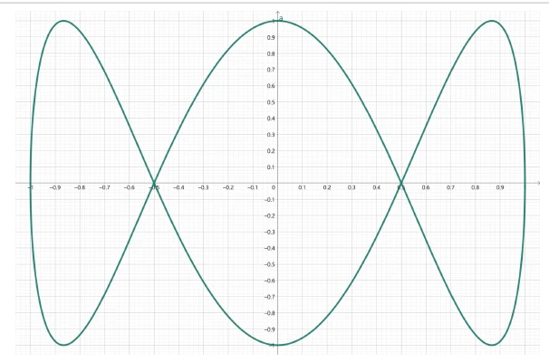
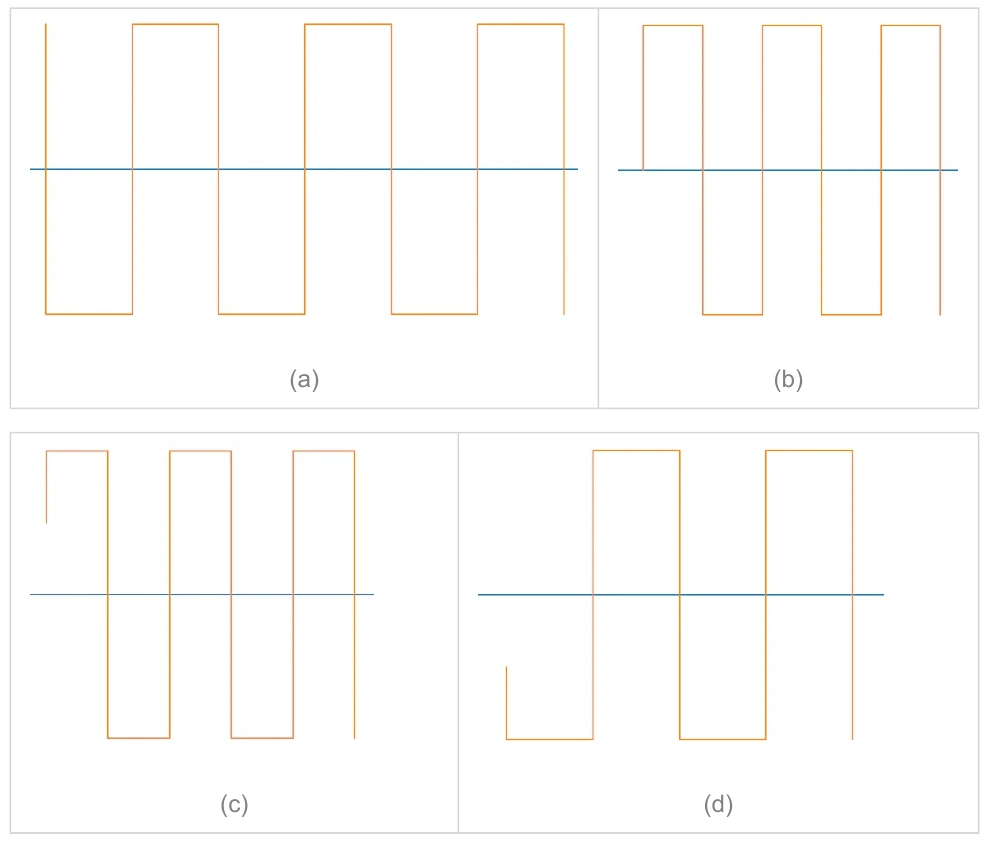
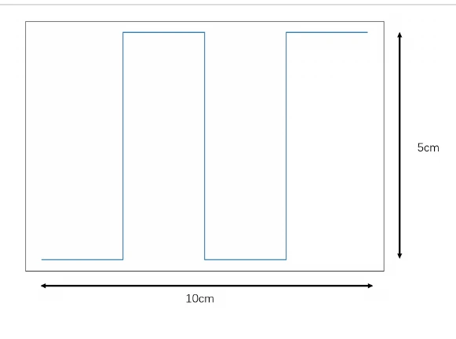
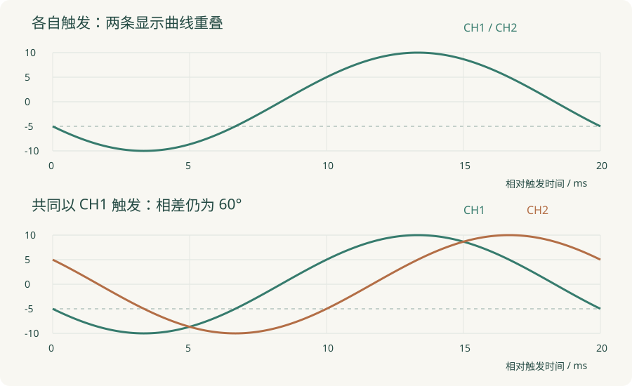
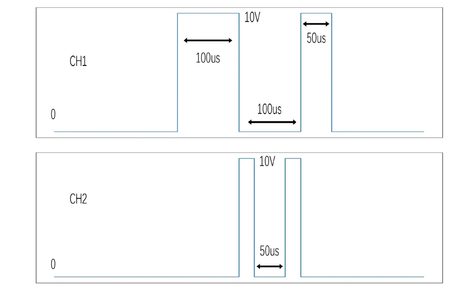

# 2025—2026 秋回忆卷：分步解答与作图说明

[课程目录](index.md) · [原卷与逐页阅读](past-exams.md) · [资料校勘](corrections.md)

以下是依据现有回忆卷和课程笔记整理的参考解答，并非官方答案。原卷明确注明部分数值、选项及触发设置回忆不完整。能够确定的结果直接给出；缺少条件的题目写出判定方法和假设，不补造原题。

## 一、填空题逐项核对

### 1. 示波管组成

电子枪、偏转系统、荧光屏。电子枪负责发射、加速与聚焦；偏转系统控制落点；荧光屏将电子轰击转为光。不要把整机的垂直放大器、扫描发生器填入“示波管”的组成。

### 2. 三位有效数字

原卷的三个原数未完整保留，因此没有唯一的一组三个数值答案。按课程偶数舍入规则，$57.7500\to57.8$，$57.6500\to57.6$，$57.6501\to57.7$；$12355$ 保留三位有效数字为 $1.24\times10^4$。其中末位5之后若还有非零数字，应进位，不能继续按恰好一半处理。

### 3. 100 V直流上的0.5 Vpp纹波

为放大观察1 kHz纹波，选择AC耦合，先校准零线并设置合适档位。但100 V仍实际加到探头和输入前端，应核查耐压、接地与共模条件。AC耦合仅隔去显示中的直流分量，不提供输入隔离或更高耐压。

### 4. 功率误差

$P=I^2R=1000\,\mathrm W$。按一阶绝对值限差合成：

$$
\varepsilon_P\simeq2\varepsilon_I+\varepsilon_R
=2\times1.5\%+5\%=8\%.
$$

绝对限差约80 W。如果题目要求直接计算允许区间极值而非一阶传递，则上限因子 $(1.015)^2(1.05)=1.08173625$，上偏约8.174%，与8%一阶近似应区分。

### 5. 500 kHz、保留五次谐波的带宽

最高关注谐波为2.5 MHz。要“无明显失真”还需给出允许衰减、相位误差或课堂约定。若用三倍最高谐波的经验，选至少约7.5 MHz；只答2.5 MHz表示覆盖到该频率，但此频率若刚好位于−3 dB点，谐波已有明显衰减。原题“正弦波含五次谐波”的说法也宜理解为500 kHz基波的非理想周期波形。

### 6. XY图形判频率

*原卷第1页图的裁图，保留原坐标方向。*

图形顶、底各出现三个纵向极值接触位置，左、右边各一组横向极值，对应 $f_y/f_x=3$。$f_x=4\,\mathrm{kHz}$，所以 $f_y=12\,\mathrm{kHz}$。判断时依据沿两个轴的极值接触数，不能把“圈数”脱离坐标方向单独套用。

### 7. 最大显示1999的表

传统记法为 $3\frac12$ 位。若标称1 V量程实际可显示到1.999 V，则相对于1 V有超量程能力；末位单位为0.001 V。位数不直接等于准确度。

### 8. 1.5级、10 V量程

准确度等级按满量程计：$|\Delta U|\le1.5\%\times10=0.15\,\mathrm V$。测5 V和8 V时绝对限差均为0.15 V，相对限差分别为3%和1.875%。不能把等级直接乘在当前读数上。

### 9. 触发极性与电平

*原卷第2页。蓝线是零电平，横向起点应结合交叉处看。*

b从零线上升交叉开始，对应正极性、零电平；c的左端短线从正电平继续上升，对应正极性、正电平；d的左端短线从负电平继续下降，对应负极性、负电平。图是回忆绘图，具体阈值数值未标，不能从绘图像素推定一个精确电压。

### 10. 电压表加载

把未接表电压记为 $E$，$U=ER_V/(R_0+R_V)$。所以

$$
\gamma=\frac{U-E}{E}=-\frac2{2002}\approx-0.09990\%.
$$

负号表示加载后读数低于开路电压；若题目只要求误差大小，写0.09990%。

### 11. 绝对误差与随机误差

绝对误差为测得值与参考值之差，有正负；随机误差在经典模型下为测得值与其重复测量期望之差。后者不能简单改成“测得值减真值”，因为那还包含系统偏差。有限样本中通常用残差 $x_i-\bar x$ 估计随机离散，残差与不可直接知晓的真实随机误差也要区分。

### 12. 探头校准

调节补偿电容，使上下臂时间常数匹配，方波显示不过补偿也不欠补偿。探头倍率和示波器菜单应一致。补偿不是把所有过冲都手工调平，实际信号的过冲可能是真实的。

### 13. 测频法相对误差

在理想整形且只计入计数和时基限差时：

$$
\varepsilon_f\lesssim\frac1N+\left|\frac{\delta f_c}{f_c}\right|.
$$

其中 $N\simeq f_xT_g$。若要有符号表达，单次结果可写成相应限差区间；两项独立标准不确定度时另用方和根。漏计、噪声误触发不包含在这个简式内。

### 14. 交替显示

一次完整扫描显示一个通道，下次扫描显示另一个通道；并非同一次扫描内高速来回切换，后者是断续显示。交替显示也不自动意味着交替触发。

### 15. 方波峰值与频率

*原卷第3页。图给出整体高5 cm、横向10 cm，没有明确标出零线。*

按图示比例，横向10 cm约含2个周期，$T=5\,\mathrm{ms}$，$f=200\,\mathrm{Hz}$。高度5 cm对应 $U_{pp}=5\,\mathrm V$。若题意为零均值对称方波，峰值为2.5 V；若低电平为0 V的单极性方波，则峰值为5 V。原回忆图没有明确零线，不能把两种解释之一当成无条件答案。

### 16—20. 其余仪器设置

扫描发生器环：米勒积分器、扫描门、比较释抑。每格1000样点、20 μs/div，$f_s=1000/(20\,\mathrm{\mu s})=50\,\mathrm{MSa/s}$。幅度变小导致不稳定时先调触发电平，使阈值仍落在信号范围内。低于中界频率时采用测周期。上电瞬态使用Single单次触发，先待命再上电。原卷还说明有一项曾遗漏，以上按现存条目整理，不额外编造缺失题。

## 二、选择题

### 1. 35 ns边沿的示波器选择

若使用 $t_r\approx0.35/B$ 和平方和模型，30 MHz示波器自身上升时间11.67 ns，观察值约36.89 ns；100 MHz自身3.5 ns，观察值约35.17 ns。前者展宽约5.41%，后者约0.50%。若限定5%误差，最低估计带宽约31.24 MHz。100 MHz较稳妥，但其他选项缺失，原题也未保留明确容差，因此不补一个唯一字母。

### 2. 峰值检波的错误说法

现存选项中“串联检波有隔直能力”错误，对应原卷第4项。快充慢放、高频充电路径要足够快、常见结构包括串联/并联/倍压，均需结合电路理解。直流偏置是否影响输出由具体耦合结构决定。

### 3. 5½位表的超量程显示

若标称1 V量程、最大显示1.99999 V，输入1.01125 V可直接显示1.01125 V，对应现存第3项。原卷输入数值也注明“大概”，这里仅对已写出的1.01125 V作答，不能据此宣称恢复了原试题精确数值。

### 4. 调制域

调制域常画频率—时间，时域画幅度—时间，频域画幅度或功率—频率。按现存选项表述，前三项可成立，因此“前三中有错误”的第4项为错误说法。若题目另规定不同轴变量，则以完整定义为准。

## 三、简答题一：两路正弦与交替触发

设 $v_1=10\sin\omega t$、$v_2=10\sin(\omega t-\pi/3)$，$\omega=100\pi\,\mathrm{rad/s}$。周期20 ms，两信号对应相位相差3.333 ms。

下降到−5 V时，局部正弦相位为210°。所以 $v_1$ 的触发时刻可取 $t_1=(210/360)T=11.667\,\mathrm{ms}$；$v_2$ 在全局270°触发，$t_2=15\,\mathrm{ms}$。

**交替触发：** 显示各通道时各由自身触发。屏幕时间 $\tau$ 都相对于自身触发时刻：

$$
v_{1s}(\tau)=v_{2s}(\tau)=10\sin(\omega\tau+210^\circ).
$$

两条显示曲线重叠，但输入仍然相差60°。扫描锯齿应分别在全局 $t_1+kT$ 与 $t_2+kT$ 的合格触发事件处启动；实际采用哪些事件还取决于扫描与释抑时长，原卷未给足以唯一确定的参数。

**共同以 $v_1$ 触发：** 所有扫描使用相同 $t_1$，因此

$$
v_{1s}=10\sin(\omega\tau+210^\circ),\qquad
v_{2s}=10\sin(\omega\tau+150^\circ).
$$

在 $\tau=0$ 处，CH1为−5 V，CH2为+5 V，均处于下降段。CH2相对CH1仍滞后3.333 ms。画图时将同一个时间平移作用于两路，不能分别重新选零点。

*依上述方程绘制的参考图，横轴为相对触发时间，不是原卷标准答案。虚线表示−5 V触发电平。*

## 四、简答题二：脉冲与观察窗

*题干设置在原卷第6页，输入波形接在第7页，阅读时应合在一起。*

可明确读出的信息：CH1两次高电平分别100 μs、50 μs，中间低电平100 μs；CH2两次脉冲之间低电平50 μs。原图没有完整标出CH2两次脉宽及所有跨通道绝对时刻，回忆者也注明四组设置不保证准确，不能仅用像素比例补成精确条件。

4 V阈值位于0—10 V两电平之间，正极性选择上升沿，负极性选择下降沿。10格横向的观察窗如下：

| 设置 | 确定触发点的方法 | 有效显示时间 |
| --- | --- | --- |
| CH1、下降、10 μs/div | 从待命后第一个CH1合格下降沿起算 | 100 μs |
| CH2、上升、20 μs/div | 从待命后第一个CH2合格上升沿起算 | 200 μs |
| CH1、上升、40 μs/div | 从待命后第一个CH1合格上升沿起算 | 400 μs |
| CH1、Auto、10 μs/div | 仍需电平、斜率及等待条件；无事件时可能自由扫描 | 100 μs |

若为便于训练，另假定CH1首个上升沿在0，CH2脉冲分别在100—125 μs和175—200 μs，则第一组可取 $t_0=100\,\mathrm{\mu s}$：CH1在整个100 μs窗中为低电平，到最右端出现下一次上升；CH2在屏幕0—25 μs和75—100 μs为高。第二组若取CH2第一次上升触发，同样以100 μs为原点，显示200 μs窗，CH1在屏幕100—150 μs为高。第三组取CH1第一次上升，显示0—400 μs的完整两组事件。

这些CH2脉宽是**额外的教学假设**，不是从回忆卷恢复的精确数值。实际作图应把完整题目给出的边沿时刻全部写成 $t_i-t_0$，再除以时基得到格数。Auto模式本身未规定触发斜率和自由扫描起点，第四组无法唯一作图。

## 五、计算题一：三种波形与两种表

已知对称、无直流、$U_{pp}=100\,\mathrm V$，故 $U_p=50\,\mathrm V$。

### 1. 正弦刻度峰值检波表

表按 $\alpha_p=U_p/\sqrt2$ 显示，所以三角、方波、正弦全部为 $50/\sqrt2=35.355\,\mathrm V$。表只响应峰值，不能因输入波形不同就自动换成各自的RMS。

### 2. 正弦刻度均值检波表

表按 $\alpha_{av}=\pi U_{av}/(2\sqrt2)$ 显示。三角波 $U_{av}=25\,\mathrm V$，示值27.768 V；方波 $U_{av}=50\,\mathrm V$，示值55.536 V；正弦 $U_{av}=100/\pi\,\mathrm V$，示值35.355 V。

| 输入 | 真有效值 / V | 峰值表示值 / V | 均值表示值 / V |
| --- | --- | --- | --- |
| 三角 | 28.868 | 35.355 | 27.768 |
| 方波 | 50.000 | 35.355 | 55.536 |
| 正弦 | 35.355 | 35.355 | 35.355 |

表中最后一行两种表均正确，正是“正弦刻度”的定义；前两行展示了波形误差。完整原理见[第三章电压测量](chapters/03-voltage.md)。

## 六、计算题二：满度项为几个字

量程2 V、最大显示19999，对应末位 $q=0.0001\,\mathrm V$。误差规格中的固定量程项为

$$
0.02\%V_m=0.0002\times2=0.0004\,\mathrm V,
\qquad \frac{0.0004}{0.0001}=4\text{ 字}.
$$

若“满度误差”指这个固定项，答4字。若问在满量程读数附近的总误差，且另假定读数系数确为0.2%，则约为44字；原回忆卷明确注明读数系数不确定，不能无条件给44字。把两种问法区别写出，比只选一个数字更符合现有资料的证据范围。

## 七、复盘顺序

先独立完成原卷，再按本页查错。计算错时回到量纲、响应量与误差模型；作图错时回到触发时间原点；数字表错时先写完整显示格式和一个字的单位。最后回到对应章节重做一题改变参数的训练，确认自己理解了方法，而不只是记住这份回忆卷的数值。
