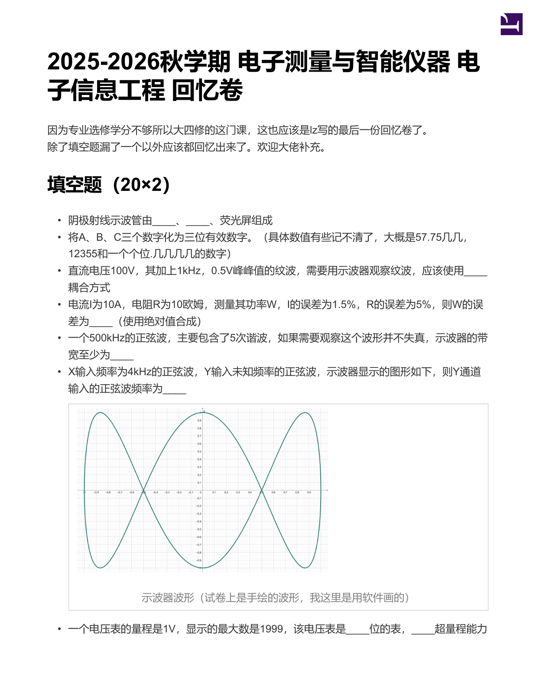
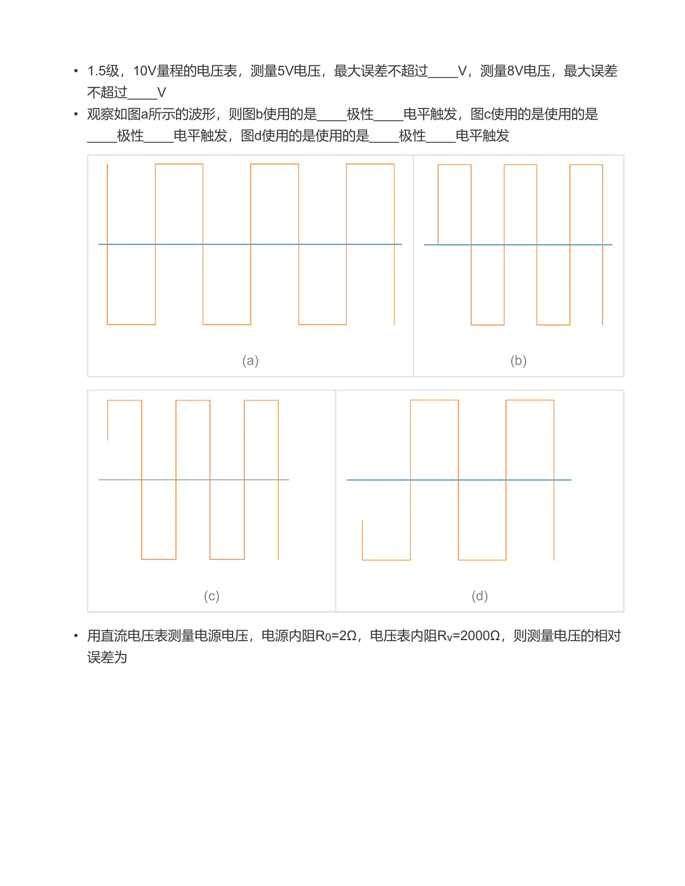
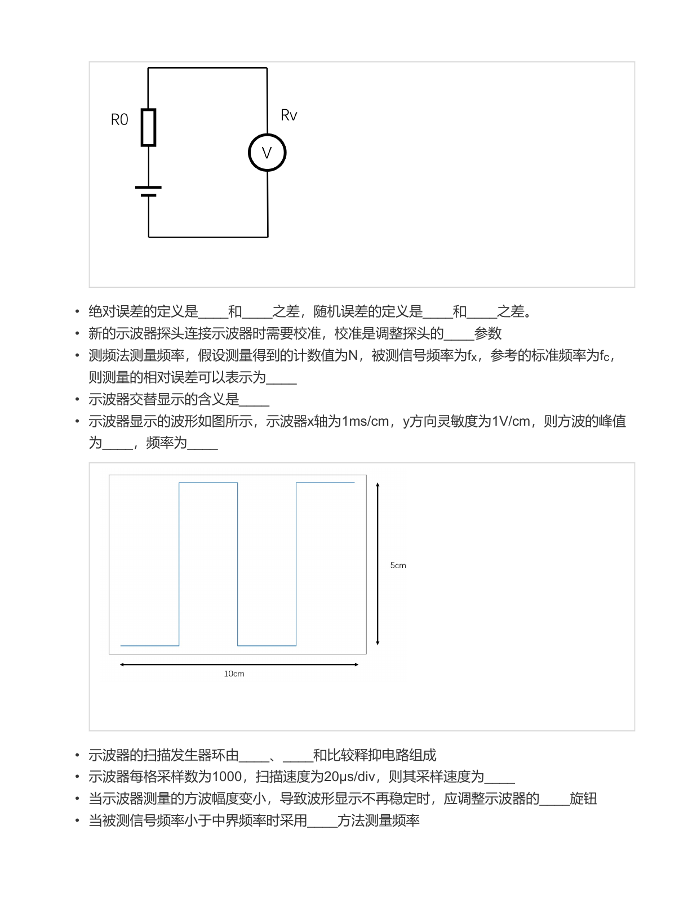
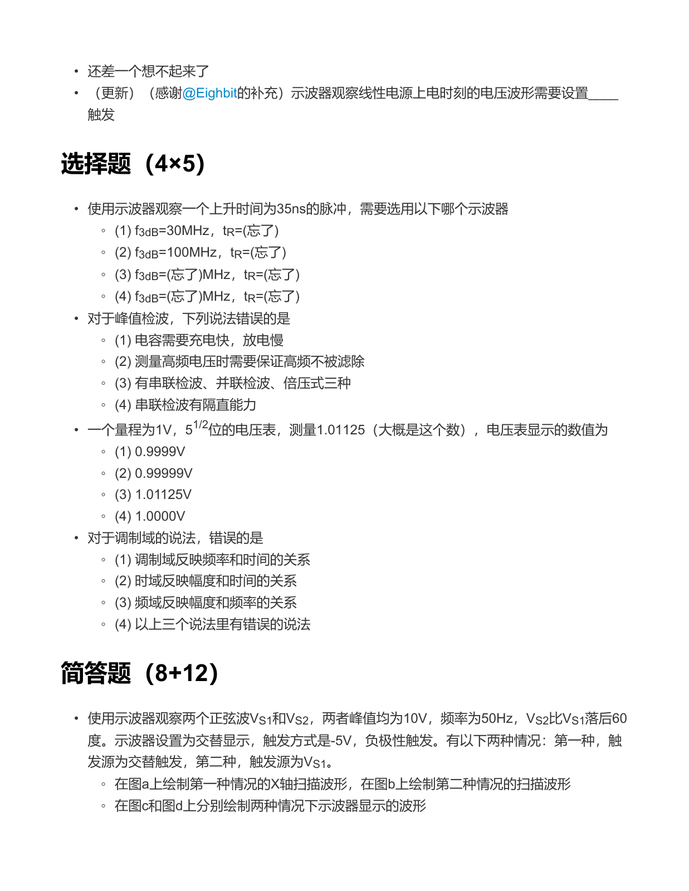
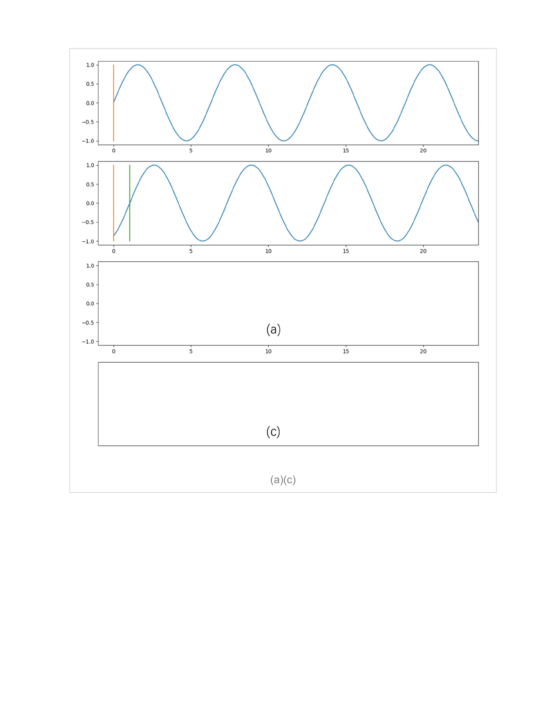
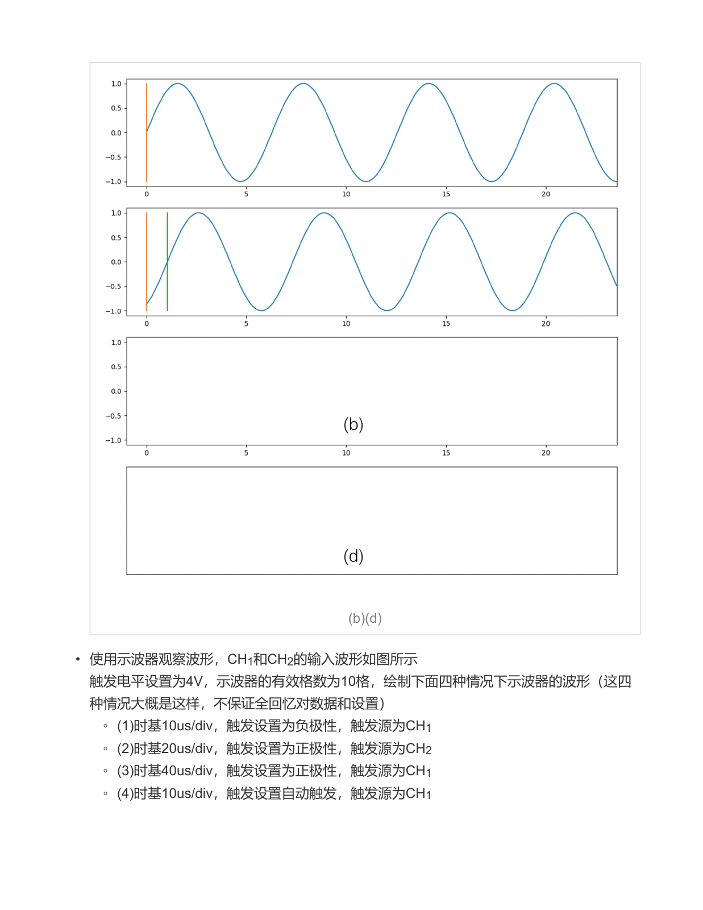
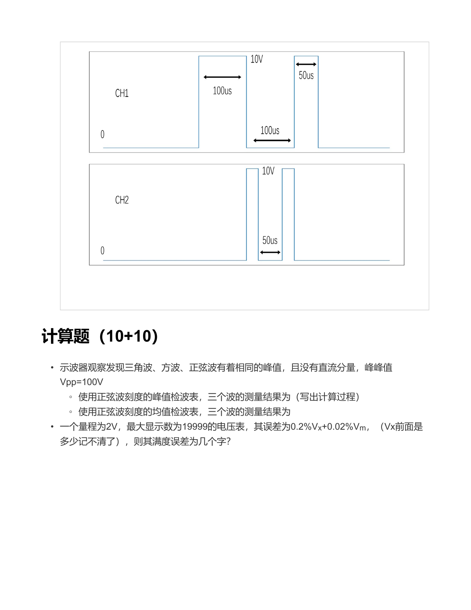

# 历年试题：2025—2026 秋回忆卷

[课程目录](index.md) · [分步解答](exam-solutions.md) · [可调 PDF 阅读器](resources-guide.md)

目前资料中可确认的一份是 **2025—2026秋学期回忆卷，共7页**。它是回忆整理，部分数值、选项与触发设置不完整，保留原作者的备注。下方逐页显示原卷，包含输入图、空白答题网格与计算题，不以网页重排代替原页。

[打开完整试卷 PDF](resources/exam-2025-2026.pdf){ .md-button .md-button--primary }
[对照参考解答](exam-solutions.md){ .md-button }

## 按题型回到章节

| 原卷位置 | 内容 | 对应讲义 |
| --- | --- | --- |
| 第1—3页 | 有效数字、误差合成、加载、量程与位数 | [误差](chapters/02-errors.md) · [数据处理](chapters/02-data.md) · [数字表](chapters/03-digital.md) |
| 第1—3页 | 波形读数、XY、探头、触发、采样率 | [扫描与触发](chapters/06-analog-scope.md) · [数字示波器](chapters/06-digital-scope.md) · [示波测量](chapters/06-measurements.md) |
| 第3—4页 | 测频误差、中界频率、调制域 | [第四章](chapters/04-frequency.md) |
| 第4页 | 带宽选择、峰值检波、超量程 | [电压测量](chapters/03-voltage.md) · [数字表](chapters/03-digital.md) · [示波测量](chapters/06-measurements.md) |
| 第4—6页 | 两路正弦、交替与共同触发、作图网格 | [双踪与延迟扫描](chapters/06-multi-trigger.md) |
| 第6—7页 | 双通道脉冲与四种设置 | [作图参考与缺失条件](exam-solutions.md) |
| 第7页 | 三波形、两检波表；误差为几个字 | [检波换算](chapters/03-voltage.md) · [数字表误差](chapters/03-digital.md) |

题目覆盖情况不等于本学期考试范围。频谱分析、信号发生器等章节仍应按教学安排复习，不因这份回忆卷题少就略过。

## 原卷逐页阅读

点击任意页可放大，查看器支持翻页与缩放。手机可点图阅读，也可在新标签页打开PDF。图片按需加载。

<figure><figcaption>第1页 · 填空：误差、带宽、XY与位数</figcaption></figure>
<figure><figcaption>第2页 · 填空：触发波形与加载</figcaption></figure>
<figure><figcaption>第3页 · 填空：方波、计数、采样与扫描</figcaption></figure>
<figure><figcaption>第4页 · 选择与双正弦触发题</figcaption></figure>
<figure><figcaption>第5页 · 双正弦输入与答题网格（一）</figcaption></figure>
<figure><figcaption>第6页 · 答题网格（二）与脉冲题设置</figcaption></figure>
<figure><figcaption>第7页 · 双通道输入与两道计算题</figcaption></figure>

## 一轮复习怎样使用

先不看解答，完成全部可确定的题；对缺失条件写出自己需要补充什么，再查[分步解答](exam-solutions.md)。把错题按“模型、公式、单位、显示设置、条件缺失”分类，而不是只按题号背答案。第二次练习改变量程、波形或触发源，检查方法能否迁移。
