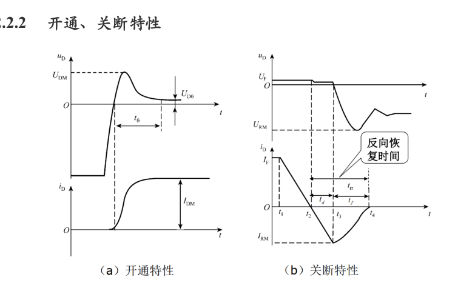
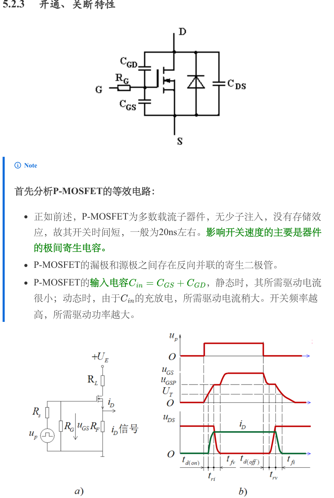

# 第一章　功率半导体器件：从开关模型到额定值

[课程目录](../index.md) · [第二章：驱动与保护](02-drive-protection.md) · [原笔记 PDF](../resources/cc98-notes-01.pdf)

本章对应原笔记第一章 31 页。器件题的重点不是罗列优缺点，而是把**导电机制、控制端、换流过程和使用限制**连成因果关系。后面整流桥中为什么用晶闸管、Buck 为什么必须有续流通路、IGBT 为什么有电流拖尾，都由这里解释。

## 1. 先建立功率开关的统一模型

### 1.1 理想开关与真实开关

理想导通时 $v_T=0$，理想关断时 $i_T=0$，开关瞬间耗时为零，所以任意时刻的 $p_T=v_Ti_T$ 均为零。这个模型可以求拓扑变比，却不能据此计算效率、器件温升和换流尖峰。真实开关至少有四项偏离：通态压降、漏电流、切换时间和寄生参数。

分析一张电路图时，先给器件电压、电流标参考方向。所谓“反向电流”是相对这个参考方向而言；MOSFET 沟道在导通状态下可双向载流，与关断时体二极管造成的反向导通不是同一个机制。用一个无方向的开关符号代替实际器件后，必须另行检查二极管路径。

| 分析任务 | 可采用的模型 | 必须另加的条件 |
| --- | --- | --- |
| 稳态变比、导通区间 | 理想开关/理想二极管 | 电流连续性、实际可行的电流方向 |
| 导通损耗 | 固定压降加微分电阻，或 $R_{\mathrm{DS(on)}}$ | 温度、实际电流波形 |
| 开关损耗 | 数据手册 $E_{on},E_{off}$，或分段波形积分 | 母线电压、负载电流、驱动条件 |
| 尖峰与振铃 | 寄生电感和器件电容 | 换流回路位置、探测带宽 |
| 温升与可靠性 | 热阻或瞬态热阻网络 | 环境温度、散热器、脉冲持续时间 |

### 1.2 三种分类不要交叉混淆

按可控性，不控型如二极管，由主电路决定开关；半控型如普通 SCR，门极能触发开通，正常情况下不能靠撤去门极电流关断；全控型如 MOSFET、IGBT、GTR、GTO，控制端可以完成开通和关断。

按驱动方式，SCR、GTR、GTO 需考虑控制电流；MOSFET、IGBT 主要由栅极电压控制。**电压控制不等于驱动功率为零**：充放栅极电荷仍需瞬时电流。

按载流子机制，功率 MOSFET 和肖特基二极管主要由多数载流子导电；硅 PN 功率二极管、SCR、GTR 涉及少数载流子注入；IGBT 兼有 MOS 栅极控制和双极导电。少数载流子可降低厚漂移区电阻，但也造成储存电荷和关断尾电流，这是速度与导通损耗之间的基本折中。[原笔记第 1—2 页](../resources/cc98-notes-01.pdf#page=1)

## 2. 功率二极管：续流不是瞬时结束的

### 2.1 PN 功率二极管与导电调制

高压器件通常设置较厚、较轻掺杂的漂移区承受关断电压。正向大电流时，注入的电子和空穴提高漂移区电导，称为电导调制。它有助于降低通态压降，但关断时必须抽走或复合这些电荷。原笔记用垂直结构说明大电流通道，适合建立直观认识；不能推广为“所有小功率二极管都采用横向结构”，具体结构要看器件工艺。

常用静态近似为

$$
v_F\simeq V_{F0}+r_Fi_F,\qquad
P_{F}=V_{F0}I_{F,av}+r_FI_{F,rms}^2.
$$

固定压降项用平均电流，电阻项用有效值电流。若题目只给固定 $V_F$，才简化为 $P_F\simeq V_FI_{F,av}$；不要把整个式子一律代成平均电流平方。

### 2.2 反向恢复的时间与电荷

从正向导通转到反向阻断时，电流先下降至零，再出现反向恢复电流，最后恢复到漏电流水平。反向恢复电荷是反向电流的面积：

$$
Q_{rr}=\int_{t_0}^{t_1}|i_R(t)|\,dt.
$$

若用三角形近似，$Q_{rr}\simeq I_{RRM}t_{rr}/2$。$t_{rr}$ 小并不必然表示尖峰小：很陡的恢复电流下降沿会经寄生电感产生 $L_\sigma di/dt$ 过电压。因此应同时观察 $Q_{rr}$、峰值、恢复软度和规定的测试条件。

图取自[第一章 PDF 第 4 页](../resources/cc98-notes-01.pdf#page=4)。反向电流存在时不能把二极管立刻视为开路。Buck 高侧管开通时，续流二极管反向恢复还可能增加高侧开关的峰值电流和开通损耗。

### 2.3 普通、快恢复、肖特基如何选

| 类型 | 主要特点 | 判断应用是否合适 |
| --- | --- | --- |
| 普通硅整流二极管 | 适合低频整流，关断储存电荷较明显 | 工频桥可用；高频硬换流要看恢复指标 |
| 快恢复/超快恢复 PN 二极管 | 降低恢复电荷和时间，正向压降存在折中 | 高频续流、逆变器配套，须对照电压电流等级 |
| 硅肖特基 | 多数载流子，低压降、无 PN 少子存储尾巴 | 低压大电流；漏电流和反向耐压须核对 |
| SiC 肖特基 | 高耐压，多数载流子导电 | PFC、高压高频；仍有结电容充放电电流 |

“肖特基完全没有恢复电流”不够准确：没有明显少子反向恢复，并不代表结电容电流为零。也不要把“硅肖特基常用于低压”误记成“所有肖特基器件都不能高压”。

## 3. 晶闸管 SCR：门极触发与主回路关断

### 3.1 两晶体管正反馈解释导通

PNPN 结构可等效成互相反馈的 PNP 与 NPN 晶体管。一个支路的集电极电流进入另一个支路的基极，形成再生正反馈。简化分析中，阳极电流含有 $1-(\alpha_1+\alpha_2)$ 这一分母；当再生作用足够强时，器件转入导通。

正常触发要同时满足：阳极相对阴极正偏、门极电流达到规定值、脉冲持续到阳极电流建立。这里有两个不同电流：

- **擎住电流 $I_L$**：撤去门极信号后，器件刚完成导通过程仍能保持导通所需的最低阳极电流。
- **维持电流 $I_H$**：已稳定导通后，维持通态所需的最低阳极电流，通常小于 $I_L$。

感性回路电流上升慢，门极脉冲太窄可能在阳极电流尚未达到 $I_L$ 时结束，导致触发失败。因而“只要给一个尖脉冲就必然导通”是错误的。[原笔记第 7—13 页](../resources/cc98-notes-01.pdf#page=7)

### 3.2 关断与恢复时间

撤掉门极电流不关断普通 SCR。必须由外电路使阳极电流降至维持条件以下，并留足恢复阻断能力的时间 $t_q$。交流换流时常利用反向电压完成电荷抽取；在有源逆变中，留给关断的裕角不能小于器件恢复与安全余量要求。

把电流强行降为零后立刻施加正向电压，残余载流子可能使器件重新导通。这就是后面计算换流重叠角和关断裕角的器件基础。GTO 可以靠较大的反向门极电流关断，不能把它的结论套给普通 SCR。

### 3.3 为什么要限制 $dv/dt$ 和 $di/dt$

关断 SCR 的结电容产生位移电流 $i_C=C_jdv/dt$。电压上升过快，可产生类似门极注入的作用，引起误导通，常用并联 RC 缓冲抑制。开通初期电流只在门极附近的小面积内建立；电流增长过快会局部过热，需串联适当电感或采取受控触发。

“并联电容抑制电压变化率、串联电感抑制电流变化率”是起点；完整答题还要交代电容在下次开通时如何限流放电、电感在关断时如何释放储能。详见[第二章](02-drive-protection.md)。

## 4. GTR：饱和程度影响导通与关断

GTR 以较小的基极电流控制较大的集电极电流，导通时需要足够驱动。但若进入很深的饱和，基区储存电荷增加，关断存储时间变长。驱动设计常希望在低压降和较短存储时间之间取得平衡，采用准饱和、反向基极抽取或贝克钳位等办法。

GTR 的安全工作区不仅受最高电压、最大电流和 $VI=P_{max}$ 限制，还受二次击穿限制。局部温度升高引起电流集中，进一步加热形成正反馈，可能在平均功耗尚未超限时损坏。这里的“二次击穿”是局部热电失稳，不能和可恢复的雪崩过程混为一谈。[原笔记第 17—21 页](../resources/cc98-notes-01.pdf#page=17)

## 5. 功率 MOSFET：电压驱动、栅极电荷与米勒平台

### 5.1 先校准名称和工作区

原笔记里的 P-MOSFET 是 **Power MOSFET** 的缩写，并不表示 P 沟道。图示以 N 沟道增强型为主。栅源电压超过阈值后形成反型沟道，但阈值电压的测试电流很小，**达到阈值并不表示器件已低阻充分导通**。应按数据手册中规定栅压的 $R_{\mathrm{DS(on)}}$ 设计。

MOSFET 用作低损耗开关时通常工作在低 $V_{DS}$ 的欧姆区；GTR/IGBT 的“饱和导通”不能直接替换为 MOSFET 模电意义的饱和区。高耐压硅 MOSFET 需要较厚且较轻掺杂的漂移区，漂移电阻增大，故耐压与通态电阻存在折中。超结和 SiC 等技术会改变这个折中，不能简单断言 MOSFET 不能做大功率。

### 5.2 栅极为什么需要很大的瞬时电流

栅极等效电容有 $C_{GS}$、$C_{GD}$，漏源间有 $C_{DS}$。常用输入电容 $C_{iss}=C_{GS}+C_{GD}$，反向传输电容 $C_{rss}=C_{GD}$；这些电容随电压变化，精确开关时间通常应看栅极电荷曲线。

图取自[第一章 PDF 第 24 页](../resources/cc98-notes-01.pdf#page=24)，上部为寄生电容，下部为开关过程。以感性负载开通为例：先充栅到阈值，漏极电流上升；随后栅极处于米勒平台，栅极电流主要改变 $C_{GD}$ 电荷，漏源电压下降；最后栅压上升到驱动电压。关断过程方向相反。

米勒区粗估

$$
t_M\simeq\frac{Q_{GD}}{I_G},\qquad
I_G\simeq\frac{V_{drv}-V_{plateau}}{R_{g,ext}+R_{g,int}+R_{drv}}.
$$

驱动损耗常按 $P_g\simeq Q_g\Delta V_g f_s$ 估计。它主要消耗在驱动回路，不应与主器件漏源通道的开关损耗混为一项。关断时还要考虑另一桥臂的高 $dv/dt$ 通过米勒电容抬升栅压，造成寄生开通。

### 5.3 体二极管和同步整流

N 沟道功率 MOSFET 一般具有源极指向漏极的体二极管。关断时它限制反向阻断能力；开通时沟道可以承载反向电流，构成同步整流。死区期间电流可能先走体二极管，再转到沟道，因此损耗与反向恢复仍需计算。MOSFET 导通电阻的正温度系数有利于稳态并联均流，却不能替代对动态栅极差异、布局和阈值温漂的分析；线性工作和热 SOA 也不能无条件忽略。

## 6. IGBT：低通态压降的收益与储存电荷的代价

IGBT 用绝缘栅控制沟道，引入少数载流子改善漂移区电导，因此在一定高压大电流范围内具有导通损耗优势。关断时沟道虽然关闭，漂移区的少数载流子仍需复合/抽取，产生电流拖尾；在较高 $V_{CE}$ 下与尾电流重叠，形成关断能量。

不能只用某个固定“开关时间”比较不同代际 MOSFET 和 IGBT：实际 $E_{on},E_{off}$ 与母线电压、电流、结温、栅阻及二极管恢复有关。IGBT 通常需要反并联二极管承担反向电流；普通型号不能直接当作双向理想开关。

寄生 PNPN 结构失控导通称为擎住，可能导致栅极失去控制。过流检测、退饱和检测、合适的关断速度和吸收回路必须协同设计。减小栅阻可降低部分开关损耗，却可能增大过冲和误导通；加大栅阻又会增加切换重叠，不能说某个方向始终更好。[原笔记第 27—30 页](../resources/cc98-notes-01.pdf#page=27)

## 7. 额定值与热计算：平均值和有效值各管什么

器件电流额定值是在规定波形、壳温、散热条件下给出的。SCR 常见的通态平均电流额定值以正弦半波为参考，不等于在任意波形下都可直接通过同样的平均电流。对峰值为 $I_m$ 的正弦半波，按整周期平均：

$$
I_{av}=\frac{I_m}{\pi},\qquad I_{rms}=\frac{I_m}{2},\qquad
K_f=\frac{I_{rms}}{I_{av}}=\frac\pi2.
$$

对幅值 $I$、占空比 $d$ 的矩形脉冲，$I_{av}=dI$、$I_{rms}=I\sqrt d$。换波形后，热负荷不能只按平均值比较。耐压则要核对稳态反压、重复峰值、浪涌、寄生尖峰，并留出题目规定的裕量。

稳态单支路热网络常写为

$$
T_j=T_a+P_{loss}(R_{\theta JC}+R_{\theta CS}+R_{\theta SA}).
$$

脉冲过程须改用瞬态热阻 $Z_\theta(t)$；多器件共用散热器时还需把共同温升和各结壳温升分开。数据手册的绝对最大值不是建议长期工作点。

## 8. 完整训练与解答

以下为本站训练题，参数不冒充历年卷原题。

### 例 1：矩形电流下的导通损耗

MOSFET 每周期以 20 A 导通 40%，其他时间电流为零；热态 $R_{DS(on)}=80\,\mathrm{m\Omega}$。求平均电流、有效值和导通损耗。

$$
I_{av}=20\times0.4=8\,\mathrm A,\quad
I_{rms}=20\sqrt{0.4}=12.65\,\mathrm A,
$$

$$
P_{cond}=I_{rms}^2R=160\times0.08=12.8\,\mathrm W.
$$

若误用 $I_{av}^2R$，只得到 5.12 W，明显低估温升。这里采用给定热态电阻，未包含开关、体二极管和栅极驱动损耗。

### 例 2：恢复电荷与寄生过电压

反向恢复电流近似三角形，峰值 8 A、持续 60 ns；恢复下降段为 20 ns，回路寄生电感 30 nH。求 $Q_{rr}$ 和下降段电感电压幅值。

$$
Q_{rr}=\tfrac12\times8\times60\,\mathrm{ns}=240\,\mathrm{nC},
$$

$$
|v_\sigma|=L_\sigma\left|\frac{di}{dt}\right|
=30\,\mathrm{nH}\times\frac{8\,\mathrm A}{20\,\mathrm{ns}}=12\,\mathrm V.
$$

电压的实际极性由电流参考方向和回路决定。电容振铃可能进一步改变峰值，12 V 只是这段线性下降的电感估算。

### 例 3：损耗与散热器选择

假设线性重叠模型下 $V=400\,\mathrm V$、$I=10\,\mathrm A$，两次切换的重叠时间之和 100 ns，$f_s=20\,\mathrm{kHz}$。则

$$
P_{sw}\simeq\tfrac12VI(t_{ov,on}+t_{ov,off})f_s=4\,\mathrm W.
$$

若另有导通损耗 16 W，总损耗 20 W，环境 40°C，目标结温不超过 125°C，$R_{\theta JC}=1.0$、$R_{\theta CS}=0.5\,\mathrm{K/W}$，则

$$
R_{\theta SA}\le\frac{125-40}{20}-1.0-0.5=2.75\,\mathrm{K/W}.
$$

实际选择还应为参数公差、风道和老化留余量；数据手册有实测开关能量时优先使用能量法，而不是强行使用线性三角形近似。

## 9. 自检与简答题写法

1. 为什么 SCR 能脉冲触发，却不能靠撤掉脉冲关断？——导通后内部再生维持，主回路电流和恢复时间决定关断。
2. 为什么高耐压硅 MOSFET 往往有较大导通电阻？——漂移区需更厚、更轻掺杂；说明材料和工艺前提，不写成所有器件的绝对规律。
3. 为什么 IGBT 比同类高频 MOSFET 更受关断损耗制约？——电导调制伴随少数载流子储存，关断存在尾电流。
4. 如何回答器件“主要特点”？——按控制方式、载流子、驱动、静态损耗、动态损耗、限制和场合展开，每个优缺点尽量说明原因。
5. 能否仅凭额定电流大就认为器件不会过热？——不能；还需波形、壳温、热阻、频率和 SOA。

[下一章：功率器件的驱动与保护](02-drive-protection.md)
