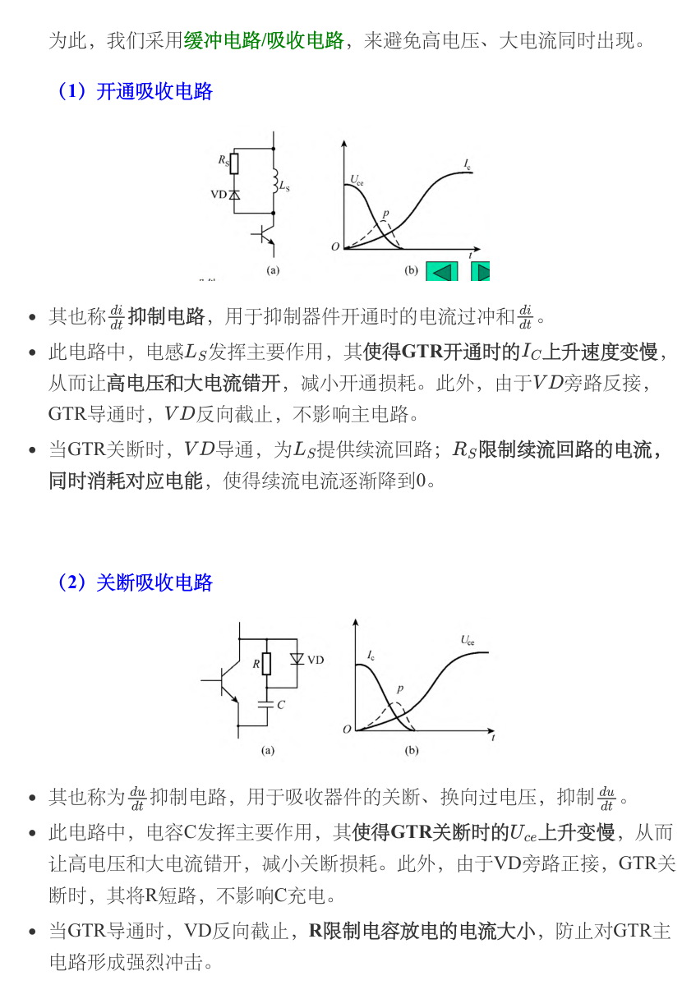

# 第二章　驱动与保护：让开关按指令可靠工作

[课程目录](../index.md) · [第一章：器件](01-devices.md) · [第三章：整流](03-rectifiers.md) · [原笔记 PDF](../resources/cc98-notes-02.pdf)

驱动电路位于控制信号与主功率回路之间。控制器给出的逻辑电平还不能直接决定一个功率器件如何开关：必须提供足够的电流、正确的电位基准、可靠的隔离，并在故障时及时关断。本章以原笔记 32 页为线索，把“触发、驱动、均压均流、过压过流和热保护”分开处理。

## 1. 驱动任务与信号链

一条完整链路是：同步或 PWM 指令 → 隔离/电平移位 → 功率放大 → 门极回路 → 主器件；故障检测再通过锁存和封锁回到驱动级。分析题应区分四种速度：控制周期、正常开关速度、故障检测延时和保护关断速度。软件采样很快，并不代表能够覆盖器件的短路耐受时间。

| 要求 | 解决的问题 | 常见代价 |
| --- | --- | --- |
| 足够驱动幅值与峰值电流 | 快速完成开通/关断 | 峰值电流、振铃和 EMI |
| 同步与精确时序 | 确定触发角，防止桥臂直通 | 延时偏差、死区引入失真 |
| 隔离与共模抗扰 | 控制侧与浮动主回路分离 | 传播延时、隔离电源、寄生电容 |
| 故障锁存和软关断 | 避免故障期间重复开通 | 关断过慢/过快均可能有风险 |
| 欠压锁定 | 防止驱动不足造成高损耗 | 启停阈值与自举电源须配合 |

电气隔离是拓扑与安全要求决定的，不是所有低侧单管都必须隔离；高侧的浮地供电和电平移位也不能与真正的电气隔离混为一谈。

## 2. SCR 触发：幅值、脉宽、同步三项缺一不可

### 2.1 为什么采用强触发脉冲

门极只在开通过程需要提供触发作用，持续直流驱动会增加门极耗散，因此常采用脉冲。脉冲前沿宜陡，初始电流较强，有助于缩短延迟、减少串并联器件的导通离散；后段维持足够幅值和时间，使主电流超过擎住电流。幅值还必须处在门极安全工作区内，不能越大越好。

触发要求可写为：门极正向电流/电压达到触发指标；脉宽覆盖建立电流所需时间；与电网同步且移相范围满足控制；各路脉冲一致；有足够隔离和抗干扰能力。[原笔记第 2—3 页](../resources/cc98-notes-02.pdf#page=2)

### 2.2 从同步信号到触发角

锯齿波同步移相电路先检测交流相位，再在固定相位开始生成锯齿波；控制电压与锯齿波比较，确定交点时刻；脉冲形成、放大和隔离环节将其送往门极。调大某个控制电压究竟让触发提前还是滞后，取决于比较器输入极性，不能脱离电路背方向。

若同步零点到触发的时间为 $t_\alpha$，则

$$
\alpha=\omega t_\alpha=2\pi f t_\alpha.
$$

50 Hz 下，1 ms 对应 18°。三相桥的 $\alpha$ 以自然换相点为基准，不能直接把某一相电压零点当作所有管子的零度。六路触发按规定序列相差 60°；桥臂编号要与第三章的电路图一致。

### 2.3 双窄脉冲用于建立回路

三相全控桥启动或电流断续时，只有一只 SCR 收到脉冲仍不能保证形成完整电流通路，需保证应导通的上、下桥臂同时具备触发条件。宽脉冲、脉冲列或双窄脉冲均可实现相应要求。双窄脉冲中，每只器件收到相隔 60°的两个脉冲，用相邻通道的信号补触发。

分析时先写本时刻需要的两只器件，再在六路脉冲轴上检查是否覆盖；不要只画六条等间隔短线便结束。[原笔记第 9—10 页](../resources/cc98-notes-02.pdf#page=9)

## 3. 串联均压与并联均流

### 3.1 串联为什么需要静态、动态两套均压

串联器件流过相同电流，但阻断漏电流不同，静态电压分配不均；开关速度、结电容不同，动态电压也会不均。后开通的器件在其他器件已导通时承受更多电压，先关断的器件也可能最先承担母线电压。

并联均压电阻使阻断支路电流相对漏电离散更大，提高静态分配一致性；RC 网络主要改善瞬态电压分配。电阻不能过小，否则长期损耗上升；电容不能随意加大，否则开通放电电流和缓冲损耗增大。器件一致性、同步触发、结构对称也不能省略。

### 3.2 并联为什么不能只看额定电流相加

并联器件端电压相同，通态特性、温升、引线阻抗和开通时间不同，造成静态及动态不均流。先开通的支路抢先承载电流，后关断的支路可能在最后独自承载电流。小电阻可改善稳态均流，但损耗较大；均流电抗器限制电流变化，适合一定的大容量场合；同时需匹配器件、散热和驱动回路。

均压和均流分别对应“相同电流而电压分配不同”和“相同电压而电流分配不同”。这两句先写清楚，后续措施就不容易张冠李戴。[原笔记第 11—12 页](../resources/cc98-notes-02.pdf#page=11)

## 4. MOSFET/IGBT 栅极驱动

### 4.1 栅极电荷和驱动电阻

驱动电源平均取电流的规模约为 $Q_gf_s$，但开关瞬间的峰值电流可能远大于平均值。米勒阶段用 $t_M\simeq Q_{GD}/I_G$ 估算；所用 $Q_{GD}$ 应对应实际母线电压和电流。外部栅阻加上器件内部栅阻、驱动器输出阻抗共同决定电流。

减小栅阻会加快转换、降低部分重叠损耗，同时增大 $di/dt$、$dv/dt$ 和寄生振铃；增大栅阻则相反。常用二极管分离开通与关断电阻，分别调节两种过程。驱动器的源出电流、吸入电流及脉冲热限制应分别核对。

### 4.2 推挽、隔离驱动和高侧自举

推挽驱动用一条主动通路充电、另一条主动通路放电，避免单个上拉电阻造成慢开通。隔离驱动可使用脉冲变压器、光耦或数字隔离器；不能把“所有光隔离只能用于低压、所有磁隔离一定限于 50% 占空比”当作普遍结论。具体限制来自绝缘等级、复位方法、最小脉宽及电路实现。

脉冲变压器必须满足伏秒平衡，长脉冲或直流分量会造成磁通偏移；是否限制在 50%，应结合单端/双极性驱动和复位电路判断。光耦或数字隔离器能传递逻辑状态，但输出驱动能量通常来自隔离侧电源；传播延时和共模瞬变抗扰仍需检查。

自举电源利用低侧导通时给高侧供电电容充电。若高侧长时间保持导通，电容可能因栅极电荷、静态消耗和漏电而跌到欠压阈值。因此不能无条件支持高侧 100% 占空比。初估

$$
C_{boot}\ge\frac{Q_g+I_qt_{on}+Q_{leak}}{\Delta V_{boot}},
$$

再考虑电容偏压降容、二极管压降、充电时间和裕量。[原笔记第 22—26 页](../resources/cc98-notes-02.pdf#page=22)

### 4.3 米勒误导通、负压和布局

另一桥臂高速开关时，$i_M=C_{GD}dv_{DS}/dt$ 流入关断管栅极。若关断吸流阻抗较大，可能抬升 $V_{GS}$ 导致误导通。常见办法是减小关断回路阻抗、使用米勒钳位、适当负压关断、Kelvin 源极/发射极连接和缩短栅极回路。

负压并非越大越好，必须符合器件的正负栅压绝对最大值和驱动推荐值，SiC、GaN、硅 MOSFET、IGBT 的推荐值也不相同。原笔记中“负压可彻底杜绝误导通”的说法过于绝对；寄生电感引起的源极抬升、地弹和共模耦合仍需控制。

## 5. 过电压、缓冲与钳位

### 5.1 过电压从哪里来

电网浪涌、变压器操作、负载断开和半导体高速换流都可引起过压。器件关断时主电流变化，寄生电感产生

$$
v_\sigma=L_\sigma\frac{di}{dt},\qquad
E_\sigma=\frac12L_\sigma I^2.
$$

与其在器件上堆很大的吸收元件，不如先缩小高频换流回路面积、就近配置低电感母线电容。外部供电线很长时，板端去耦与大电解电容处理的频率范围不同，应按阻抗和回路而非仅按容量分工。

### 5.2 三类方法分别解决什么

| 方法 | 作用 | 必须核对 |
| --- | --- | --- |
| RC/RCD 缓冲 | 限制电压变化率、吸收部分换流能量、阻尼振铃 | 电容放电电流、电阻脉冲能量和平均功率 |
| TVS/MOV/有源钳位 | 把峰值限制在一定范围 | 钳位电压而非仅标称电压、浪涌能量和重复频率 |
| 串联电感/饱和电抗器 | 限制开通电流变化率 | 关断储能释放、压降、体积和磁复位 |

并联电容在器件关断时分流电流、减小电压上升率；开通时其储能必须被释放，所以常配限流电阻及定向二极管。串联电感减慢开通电流，却不能凭空消除能量。缓冲器把应力转移到可设计的网络中，不保证系统总损耗必然降低。

图取自[第二章 PDF 第 30 页](../resources/cc98-notes-02.pdf#page=30)。上图关注开通 $di/dt$，下图关注关断 $dv/dt$。按箭头逐段说明电感/电容如何储能和复位，比只记“加 RC”更完整。

### 5.3 一个电容初估式的边界

若粗略假设寄生电感储能全部转入电容，电压由 $V_0$ 上升到 $V_{max}$，则

$$
\frac12L_\sigma I^2\le\frac12C(V_{max}^2-V_0^2),\qquad
C\ge\frac{L_\sigma I^2}{V_{max}^2-V_0^2}.
$$

这只是能量下限估计，不是完整 RC 设计。实际还需电源供能、器件非线性电容、二极管反向恢复、寄生回路和阻尼。若按恒流充电限制初始斜率，则 $C\ge I/(dv/dt)_{max}$；两式约束不同，不应任取一个便声称设计完成。

## 6. 过流、短路与退饱和保护

熔断器、继电器和电子保护的时间尺度不同。工频整流桥可按故障能量配合快熔；高速晶体管发生桥臂直通时，必须在器件允许短路时间内检测并控制关断。判断快熔时需核对额定电压、持续电流、预弧/总分断 $I^2t$、预期故障电流及器件浪涌承受能力，不能只写“实际电流小于熔体额定电流”。

IGBT 正常导通时 $V_{CE}$ 较低，若驱动不足或电流异常，$V_{CE}$ 上升，可用退饱和（DESAT）检测。开通瞬间器件尚未降到低压，需消隐时间避免误报；消隐又不能长到错过短路保护窗口。检测后应封锁再开通、锁存故障，并用适当软关断控制 $Ldi/dt$ 过压。

霍尔传感器并不是一概不能用于保护：能否满足要求取决于带宽、延时、比较器路径和器件短路能力；快速本地 DESAT/分流器比较与较慢的系统电流监测往往分工协作。原笔记第 32 页把某些检测方式一概说成“来不及”时，应补上具体时序前提。

## 7. 死区、互锁和故障状态

同一电压源桥臂上下管不能同时导通，否则直通母线。死区必须覆盖关断延时、拖尾和驱动不一致，但过长会使负载电流转到二极管，增加损耗并造成输出电压误差。死区不是任意固定的“安全数字”，应在最不利温度、电流和驱动条件下核对。

驱动欠压、控制器复位、上电、掉电、PWM 悬空时的默认状态都应明确。故障后是否自动重试也不能随意决定：若是短路或桥臂异常，重复开通可能累积破坏。课程设计图至少应补上电流检测、驱动互锁和故障封锁三条路径。

## 8. 数值训练与完整解答

以下题目用于练习，不是原卷标准答案。

### 例 1：米勒电流与驱动功率

设 $Q_g=80\,\mathrm{nC}$，$Q_{GD}=20\,\mathrm{nC}$，驱动 12 V，米勒平台 5 V，总充电电阻 7 Ω，$f_s=100\,\mathrm{kHz}$。

$$
I_{G,M}\simeq(12-5)/7=1\,\mathrm A,\qquad
t_M\simeq20\,\mathrm{nC}/1\,\mathrm A=20\,\mathrm{ns},
$$

$$
I_{drv,av}=Q_gf_s=8\,\mathrm{mA},\qquad
P_g\simeq Q_gV_{drv}f_s=0.096\,\mathrm W.
$$

这里的平均值指驱动电源的平均取电流；稳态栅极净电荷一周期不变，带符号栅极电流的周期平均为零。初始栅压近零时，理想充电峰值约为 $12/7=1.71\,\mathrm A$，1 A 是米勒平台阶段的电流。平均取电流只有毫安级，并不意味着驱动器只需毫安峰值能力。该估计忽略电容非线性和回路电感；关断应使用吸流路径的电压与电阻另算。

### 例 2：均压电阻

两只器件串联承受 1000 V，各并相同电阻，漏电差最大 0.2 mA。若希望各器件偏离理想 500 V 不超过 25 V，由支路电流相等可得 $|V_1-V_2|=R|I_{l1}-I_{l2}|$，因此

$$
R\le\frac{2\times25}{0.2\,\mathrm{mA}}=250\,\mathrm{k\Omega}.
$$

选 200 kΩ 时电压偏差约 ±20 V。每个电阻在 500 V 附近耗散 $500^2/200000=1.25$ W，还需按最高分配电压选择功率、耐压和串联电阻数量。该计算只约束静态均压，不能替代 RC 动态均压。

### 例 3：关断过压与电容初估

$L_\sigma=100\,\mathrm{nH}$，电流 50 A 在 100 ns 内近似线性降至零，得

$$
|v_\sigma|=100\,\mathrm{nH}\times\frac{50\,\mathrm A}{100\,\mathrm{ns}}=50\,\mathrm V.
$$

若粗略将 $E_\sigma=125\,\mathrm{\mu J}$ 转入电容，400 V 母线允许上升至 450 V，则

$$
C\ge\frac{100\times10^{-9}\times50^2}{450^2-400^2}
=5.88\,\mathrm{nF}.
$$

这只是能量条件。若该能量每周期都耗散，20 kHz 下仅这一项就为 2.5 W，还未计电容本身每次充放电产生的损耗；不能据此直接选择一个 0.25 W 小电阻。

### 例 4：自举电容

栅极电荷 80 nC，高侧静态电流 0.2 mA，最长连续导通 50 μs，漏电等额外电荷估为 10 nC，允许电压下降 0.5 V。则

$$
Q_{tot}=80+0.2\,\mathrm{mA}\times50\,\mathrm{\mu s}+10=100\,\mathrm{nC},
\qquad C_{boot}\ge200\,\mathrm{nF}.
$$

实际需依据电容有效容量、欠压阈值及再充电能力增大裕量。增大电容本身并不能解决无限时长的高侧导通。

## 9. 考场自检

- 触发题：是否写清门极幅值、脉宽、同步基准、隔离和双脉冲目的？
- 串并联题：是否分别讨论稳态和动态，避免把均压与均流措施互换？
- 缓冲题：是否说明开通和关断各自的电流路径，以及储能元件如何复位？
- 保护题：是否给出故障检测、延时、关断应力和封锁再开通，而非只写“加保险丝”？
- 驱动题：是否把阈值电压当成充分导通电压，或把平均栅极电流当成峰值？

[上一章：功率器件](01-devices.md) · [下一章：AC–DC 整流](03-rectifiers.md)
