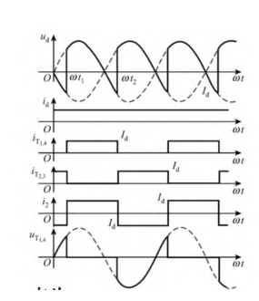
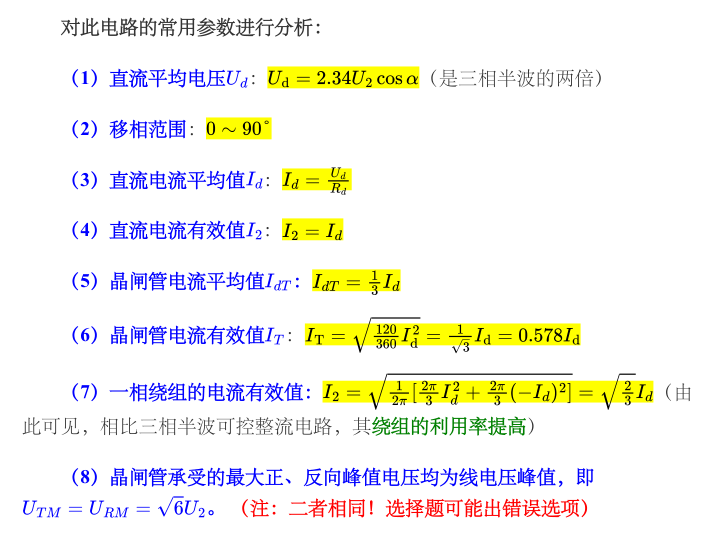

# 专题三：相控整流、换相与有源逆变

本章把交流变直流的题目统一成一套步骤：先认拓扑，再按开关状态分区间，最后用平均值、有效值、功率因数和器件应力检查结果。课程资料《第三章 交流—直流变换》把整流按电路形式、相数、控制方式、器件和工作象限分类；本页补成考试可直接使用的讲义。资料原页可从[CC98 第三章笔记](../resources/cc98-notes-03.pdf)打开，历年题型与符号见[分类详解讲义](../resources/cc98-exam-handout.pdf)。原有[整流课程 PDF](../resources/power-1-rectifiers.pdf)仍可交叉阅读。

## 1. 先统一符号和假设

令交流输入角频率为 $\omega=2\pi f$，电角度 $\theta=\omega t$。单相电源写成

$$
u_s=U_m\sin\theta,\qquad U_m=\sqrt2U_s,
$$

其中 $U_s$ 是输入正弦量的有效值，$U_m$ 是峰值。三相对称电源用相电压有效值 $U_{ph}$，线电压有效值 $U_{LL}=\sqrt3U_{ph}$。除非题面特别说明，理想器件分析采用：晶闸管导通压降为零、二极管反向恢复忽略、电源内阻和换相电感忽略。

出现“大电感、平波电抗器或 $L\to\infty$”时，直流电流按连续且近似恒定处理；出现“纯电阻”时，电流与输出电压同相，电流过零就是器件自然关断时刻。电容输入滤波则是另一类脉冲充电问题，不能套用相控桥的连续电流公式。

## 2. 单相半波可控整流

### 2.1 电阻负载：从导通区间积分

单个 SCR 的阳极接交流源，负载接在 SCR 后。正半周从 $\theta=0$ 开始承受正向电压，但门极在 $\theta=\alpha$ 触发；电阻电流立即建立，至 $\theta=\pi$ 电流过零，SCR 关断。因此

$$
u_d(\theta)=
\begin{cases}U_m\sin\theta,&\alpha\le\theta\le\pi,\\0,&\text{其余区间},\end{cases}
\quad i_d=u_d/R.
$$

平均值不是对完整正弦平均，而是对导通弧段积分：

$$
U_d=\frac1{2\pi}\int_\alpha^\pi U_m\sin\theta\,d\theta
=\frac{U_m}{2\pi}(1+\cos\alpha).
$$

电流有效值为

$$
I_d=\left[\frac1{2\pi R^2}\int_\alpha^\pi U_m^2\sin^2\theta\,d\theta\right]^{1/2},
$$

其中积分结果可写为

$$
I_d=\frac{U_m}{R}\sqrt{\frac{\pi-\alpha}{4\pi}+\frac{\sin2\alpha}{8\pi}}.
$$

移相范围通常取 $0\le\alpha\le\pi$。半波电路的脉动频率只有输入频率，变压器副边电流存在直流分量，会引起铁心偏磁；因此它主要用于理解相控整流的基本方法，实际大功率场合很少采用。

### 2.2 电感负载和续流二极管

电感使电流不能突变。无续流二极管时，SCR 在 $\alpha$ 触发后可能持续到熄灭角 $\beta>\pi$；负半周的电源电压会形成负面积，平均输出电压下降。用阻抗角 $\varphi=\arctan(\omega L/R)$ 描述时，$\alpha$、$\beta$、$\varphi$ 由负载微分方程共同决定，考试通常要求判断趋势：$L$ 越大，电流越平滑、熄灭越晚；$\alpha$ 越大，正半周储能越少，导通能力变差。

接入续流二极管后，电源电压转负时二极管给电感电流提供局部回路，SCR 很快承受反压而关断，负载端电压被钳在近似零值。大电感、连续电流时二极管续流区间使输出波形更平直；二极管最大反向峰值电压和 SCR 的阻断应力都要按电源峰值检查。

## 3. 单相桥式全控整流

### 3.1 电阻负载

正半周触发一对对角 SCR，负半周触发另一对，输出电压在两个半周都为正的负载方向。电阻负载中每对器件在 $\alpha$ 到 $\pi$（或相应负半周）导通，平均值为

$$
U_d=\frac{1}{\pi}\int_\alpha^\pi U_m\sin\theta\,d\theta
=\frac{U_m}{\pi}(1+\cos\alpha).
$$

当 $\alpha=0$ 时为全波二极管桥的平均值 $2U_m/\pi$；$\alpha$ 增大，导通区间缩短。桥式结构使变压器电流正负对称，平均值为零，不产生半波那样的直流磁化。

### 3.2 大电感连续电流：最常用考法

当直流侧有足够大的平波电抗器，电流近似为 $I_d$。一对 SCR 从 $\theta=\alpha$ 导通到 $\theta=\pi+\alpha$，输出电压可能出现负值，但电感电流方向不变。平均值为

$$
U_d=\frac1\pi\int_\alpha^{\pi+\alpha}U_m\sin\theta\,d\theta
=\frac{2U_m}{\pi}\cos\alpha
=0.9U_s\cos\alpha.
$$

这条公式的使用前提必须写出来：单相全控桥、理想电源、直流电流连续、无换相重叠。$\alpha<90^\circ$ 时 $U_d>0$，整流端向直流负载送功率；$\alpha>90^\circ$ 时 $U_d<0$，只有直流侧存在反电势或蓄电池并维持电流，才可能进入有源逆变，不能把“平均电压为负”直接等同于逆变。

交流输入电流为幅值 $I_d$ 的方波，输入电流有效值 $I_s=I_d$，基波有效值为

$$
I_1=\frac{2\sqrt2}{\pi}I_d.
$$

理想连续电流时输入功率因数为

$$
\mathrm{PF}=\frac{I_1}{I_s}\cos\alpha
=\frac{2\sqrt2}{\pi}\cos\alpha.
$$

其中 $2\sqrt2/\pi$ 是畸变因数，$\cos\alpha$ 是位移因数；该式不能用于电流断续或大电容输入滤波的二极管桥。

*原笔记 PDF 第 9 页局部：纵向依次比较负载电压、负载电流、两对器件电流、交流电流和管压。先辨认参考方向，再与本页的 $\alpha$ 对齐。原页下方平均值式的分子漏写了系数 2，但其 $0.9U_2\cos\alpha$ 数值形式正确；本页按积分得到 $2\sqrt2U_s/\pi$。*

### 3.3 单相全控桥原创例题（资料条件的演算）

**题目。** 单相全控桥接大电感负载，$U_s=220\,\mathrm V$、$R=10\,\Omega$，$\alpha=30^\circ$，忽略换相压降，求 $U_d,I_d$ 和输入功率因数。

**解。**

1. 连续电流平均值：$U_d=0.9\times220\times\cos30^\circ=171.47\,\mathrm V$。
2. 直流电阻电流：$I_d=U_d/R=17.15\,\mathrm A$。
3. 输入方波电流 $I_s=I_d$，故 $\mathrm{PF}=\frac{2\sqrt2}{\pi}\cos30^\circ=0.780$。
4. 画波形时标出 $u_d$ 从 $\alpha$ 到 $\pi+\alpha$ 取输入正弦，$i_s$ 在两个半周分别取 $+I_d$、$-I_d$。器件导通时管压近似为零，关断时承受相电压峰值级别的阻断电压。

## 4. 三相可控整流

### 4.1 三相半波：会判断，不必死背复杂图

三相半波共阴极结构在任一时刻由阳极电位最高且已触发的 SCR 导通。每个器件自然导通窗口为 $120^\circ$ 左右，输出波形是三相相电压正半周包络。大电感连续电流时平均值与相电压有效值成正比，可写为

$$
U_d\approx1.17U_{ph}\cos\alpha.
$$

它的缺点是变压器副边绕组有直流分量、利用率低、器件反向和正向耐压定义不同。三相半波适合作为三相桥的过渡模型。

### 4.2 三相桥式全控整流：六脉波

三相桥可视作共阴极组和共阳极组两个三相半波电路串联；每 $60^\circ$ 换相一次，每只 SCR 导通 $120^\circ$。触发脉冲按 $60^\circ$ 依次错开，同一组相邻器件相差 $120^\circ$；起动和断续电流时采用宽脉冲或双窄脉冲，确保同时需要导通的两只管子都拿到门极信号。

大电感连续电流时

$$
U_d=\frac{3\sqrt2}{\pi}U_{LL}\cos\alpha\approx1.35U_{LL}\cos\alpha.
$$

直流端电压是每 $60^\circ$ 一段的线电压片段。每相交流线电流是 $+I_d$、0、$-I_d$ 的 $120^\circ$ 方波；线电流有效值为

$$
I_{L}=\sqrt{\frac23}I_d.
$$

理想连续电流桥的有功功率因数常用近似为

$$
\mathrm{PF}\approx\frac{3}{\pi}\cos\alpha.
$$

实际换相重叠、器件压降和谐波会进一步降低功率因数。

*原笔记 PDF 第 21 页局部。图中 $U_2$ 为相电压有效值，故 $2.34U_2$ 与本页 $1.35U_{LL}$ 等价；不能把两者当成不同结论。*

### 4.3 换相重叠与平均值下降

电源侧漏感 $L_s$ 使电流不能瞬间从一只 SCR 转移到下一只，换相持续角记为 $\mu$。在重叠区间，两只器件同时导通，直流端电压出现换相缺口。简化模型下平均压降随 $\omega L_s I_d$ 增大而增大，考试若给换相电感，先写“平均值低于 $1.35U_{LL}\cos\alpha$”，再依据题面提供的换相公式计算；没有给出具体模型时不自行套常数。

## 5. 有源逆变和换相失败

三相全控桥的 $\alpha>90^\circ$ 时平均直流电压为负。若直流侧有电池或反电势提供电流，功率从直流侧返回交流侧，称有源逆变。定义逆变角 $\beta=180^\circ-\alpha$，实际还要留关断裕量 $\gamma$。换相失败的原因包括电网电压跌落、换相电感增大、直流电流过大和 SCR 关断时间不足，可用安全估算

$$
\gamma=\beta-\mu,\qquad
\gamma\ge\omega t_q+\delta,\qquad
\beta_{\min}\ge\mu+\omega t_q+\delta
$$

理解趋势，其中 $t_q$ 是关断时间，$\delta$ 是触发与电网误差裕量。注意分类详解原资料把含 $\mu$ 的式子写在 $\gamma_{\min}$ 下；若 $\gamma$ 已定义为重叠结束后的实际关断裕角，则不应再次加入 $\mu$，含重叠角的约束应写给触发引前角 $\beta$。

### 5.1 有源逆变原创例题

**题目。** 三相全控桥接蓄电池，$U_{LL}=380\,\mathrm V$，直流电流连续，电池电压取 $-200\,\mathrm V$，直流侧电阻 $r=0.001\,\Omega$，电池输出功率 $9\,\mathrm{kW}$。忽略换相压降，求 $I_d$、控制角和功率因数符号。

**解。** 电池输出电流 $I_d=9000/200=45\,\mathrm A$；电阻压降为 $0.045\,\mathrm V$，故桥平均电压约 $U_d=-200+0.045=-199.955\,\mathrm V$。由 $U_d=1.35\times380\cos\alpha$，得 $\cos\alpha=-0.3898$，$\alpha\approx113^\circ$，$\beta\approx67^\circ$。理想桥功率因数 $\mathrm{PF}\approx(3/\pi)\cos\alpha=-0.372$；负号只表示有功功率流向交流网，若题目只问大小写 $0.372$。

## 6. 半控桥、器件应力与电容输入整流

### 6.1 半控桥与全控桥的区别

单相半控桥通常使用两只 SCR 和两只二极管。大电感负载时，电源供电区间之外存在桥内续流通道，输出电压不会像全控桥那样长期出现负区间。理想连续电流下

$$
U_d=\frac{U_m}{\pi}(1+\cos\alpha).
$$

这个表达式在数值形式上与全控桥纯电阻负载相同，但物理过程不同：半控桥中的负载电流可在续流区间保持，输入电流则为零；全控桥纯电阻负载的负载电流也为零。由于半控桥平均输出电压不能变负，它不能独立实现有源逆变。识图时应看每条电流路径中的器件是否可控，不能把“使用半控型 SCR”误认为“半控桥”；全控桥本来也是由半控型 SCR 组成。

### 6.2 器件电流的平均值和有效值

设某只器件以恒定幅值 $I_d$ 导通占周期的比例 $d_T$。则

$$
I_{T,avg}=d_TI_d,\qquad I_{T,rms}=I_d\sqrt{d_T}.
$$

单相全控桥连续电流时每管导通半周期，故平均值为 $I_d/2$、有效值为 $I_d/\sqrt2$；三相全控桥每管导通三分之一周期，故平均值为 $I_d/3$、有效值为 $I_d/\sqrt3$。两类量不可混用：选额定电流和发热分析往往要结合器件数据表规定，而不是只看负载平均电流。电阻负载电流不是矩形，应重新积分，不能沿用占空比乘恒定幅值。

### 6.3 换相压降数值训练

**题目（原创）。** 三相六脉波全控桥每相电源串联电感为 $L_s=0.5\,\mathrm{mH}$，$f=50\,\mathrm{Hz}$、$I_d=20\,\mathrm A$，采用连续电流、每次只有一组换相的近似。求换相平均压降。

**解。** 当 $L_s$ 明确定义为每相电源电感时，标准六脉波关系为 $\Delta U_d=3\omega L_sI_d/\pi$，故 $\Delta U_d=3\times2\pi\times50\times0.0005\times20/\pi=3.0\,\mathrm V$。于是平均输出为 $1.35U_{LL}\cos\alpha-3.0\,\mathrm V$。若题目把 $L_k$ 定义成两相换相回路总电感，系数应相应改变；应先画回路、读电感定义，再代公式。

### 6.4 电容输入整流与 PFC

二极管桥后直接接大电容时，电容只在输入瞬时电压高于电容端电压时充电，输入电流呈尖峰脉冲。它的直流电压接近输入峰值，但导通角小、峰值电流大、功率因数低，不能用相控桥的 $U_d=1.35U_{LL}\cos\alpha$。

Boost PFC 在整流桥后加入电感、开关管、二极管和母线电容，外环调节母线电压，内环令输入电流跟随整流电压。设计题可按“EMI 滤波—整流桥—Boost PFC—母线—隔离 DC–DC”画框图，并说明电流与电压同相、功率因数接近 1 的控制目标。

## 7. 考场统一答题模板与自测

1. 先写输入是相电压还是线电压，明确 $U_m=\sqrt2U_s$。
2. 画门极脉冲和器件导通顺序，标 $\alpha$、换相点、续流区。
3. 判断负载：电阻电流随电压，电感电流连续，电容输入是脉冲充电。
4. 选平均值、有效值、伏秒平衡或功率守恒公式，写出适用条件。
5. 最后查器件耐压、电流平均值/有效值、PF 和功率流向。

**自测 1。** 为什么单相半波会使变压器直流磁化？答：副边电流只有一个方向的半波平均分量非零，磁动势存在直流分量；桥式正负半周对称后该分量抵消。

**自测 2。** 三相全控桥 $U_{LL}=380\,\mathrm V$、$\alpha=60^\circ$ 且电流连续，求平均值。答：$U_d=1.35\times380\times0.5=256.5\,\mathrm V$。

**自测 3。** 只有六只晶闸管且题目写“半控桥并要求有源逆变”怎么办？答：按图识别为三相全控桥；半控桥不能提供完整有源逆变，答题时注明题面器件数与文字矛盾，并按六管全控模型计算。

## 8. 资料页码索引

- 原课程讲义第 1 页：整流分类与负载。
- 第 2—10 页：单相半波、单相全控桥和反电势负载。
- 第 13—23 页：三相半波、三相桥、连续电流和触发脉冲。
- 分类详解讲义第 15—18 页：单相全控桥、PF、三相有源逆变和换相失败。
- 分类详解讲义第 28—29 页：交流—交流变换，见下一章。

[下一章：交流—交流变换](04-ac-ac.md)
