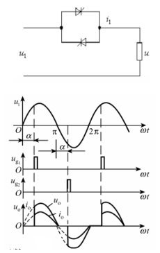
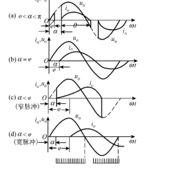

# 专题四：交流调压、交流调功与交—交变频

交流—交流变换有两条路线：直接变换不经过直流环节，典型是交流调压器、交流调功器和周波变换器；间接变换先整流成直流，再经逆变得到新的交流。自然换相周波变换器可利用电网换流，但输出频率受电网和换相约束；间接路线控制自由度大，适合精确变频和并网。原资料见[CC98 第四章笔记](../resources/cc98-notes-04.pdf)，另保留[交流—交流变换 PDF](../resources/power-6-ac-ac.pdf)；[分类讲义](../resources/cc98-exam-handout.pdf)第 28—29 页给出了交流调压、TCR、周波变换器和矩阵变换器的考试总结。

## 1. 交流调压的共同模型

单相交流调压器通常由两个反并联晶闸管组成，也可用双向可控硅。正半周由正向器件在 $\alpha$ 触发，负半周由反向器件在 $\pi+\alpha$ 触发。改变 $\alpha$ 就改变每半周的导通弧段；电阻负载在电流过零处自然关断，电感负载则要等电流降到零。

三种控制方式常作为简答题：

|方式|工作方法|优点|局限与场合|
|---|---|---|---|
|通断控制|整周接通、整周断开，用周波数比调平均功率|接通时波形接近正弦，低次谐波少|功率调节不连续，会有分数次谐波；适合电炉|
|相位控制|每半周改变触发角|连续无级调压，电路简单|低次谐波、功率因数下降；电机有转矩脉动|
|斩波控制|高频全控器件切片调压|可连续调节，谐波易移到高频|需要 MOSFET/IGBT、驱动和 EMI 设计|

## 2. 单相电阻负载：有效值从积分得到

令输入 $u_s=U_m\sin\theta$，正半周在 $\alpha\le\theta\le\pi$ 导通，负半周对称。输出有效值定义为

$$
U_o^2=\frac1{2\pi}\left(\int_\alpha^\pi U_m^2\sin^2\theta\,d\theta
+\int_{\pi+\alpha}^{2\pi}U_m^2\sin^2\theta\,d\theta\right).
$$

利用半周对称性并整理得

$$
U_o=U_s\sqrt{\frac1\pi\left[(\pi-\alpha)+\frac12\sin(2\alpha)\right]}.
$$

若负载为纯电阻 $R$，$I_o=U_o/R$，有功功率 $P=U_o^2/R$。正负半周对称，所以没有直流分量和偶次谐波，主要是奇次谐波；$\alpha$ 越大，波形缺口越长、低次谐波越明显。

*原笔记 PDF 第 3 页局部：同一负载串联反并联 SCR，正负半周各延迟 $\alpha$，输出波形具有半波反对称性。*

### 2.1 数值题：相位控制调光

**题目（原创练习）。** $U_s=220\,\mathrm V$ 的单相交流调压器接 $R=22\,\Omega$ 电热负载，$\alpha=60^\circ$。求输出有效值和平均功率。

**解。** 代入 $\sin120^\circ=0.8660$：

$$
U_o=220\sqrt{\frac1\pi\left(\frac{2\pi}{3}+\frac12\times0.8660\right)}
\approx197.3\,\mathrm V.
$$

故 $P=U_o^2/R\approx197.3^2/22=1.770\,\mathrm{kW}$。检查：$\alpha=0$ 时应回到 $220\,\mathrm V$，$\alpha\to\pi$ 时输出趋近 0。

## 3. 单相感性负载：熄灭角和触发可靠性

负载 $R-L$ 的阻抗角为 $\varphi=\arctan(\omega L/R)$。若正半周在 $\alpha$ 触发，导通电流可写成

$$
i(\theta)=\frac{U_m}{Z}\left[\sin(\theta-\varphi)-\sin(\alpha-\varphi)e^{-(\theta-\alpha)/\tan\varphi}\right],
$$

其中 $Z=\sqrt{R^2+(\omega L)^2}$。电流在熄灭角 $\beta$ 变为零，满足

$$
\sin(\beta-\varphi)=\sin(\alpha-\varphi)e^{-(\beta-\alpha)/\tan\varphi}.
$$

当 $\beta>\pi$，电流跨过电压过零点，下一只反并联 SCR 的触发必须满足晶闸管已恢复反向阻断且电流换向条件成立。通常用宽脉冲或脉冲列覆盖上一只器件电流过零后、下一只器件正向可触发的实际窗口，脉宽须按负载相角和熄灭角确定，不能对所有 RL 负载固定为大于 $60^\circ$；窄脉冲若落在上一只器件仍导通的区间，可能导致另一只无法开通。

判断四种情况：

1. $\alpha<\varphi$：电流可能连续跨半周，调压效果弱，输出接近完整正弦。
2. $\alpha=\varphi$：接近全程导通边界。
3. $\alpha>\varphi$ 且脉冲可靠：电流断续，输出出现缺块。
4. 触发过窄或两管不能换流：可能退化成单向半波，直流分量会损害电机和变压器。

### 3.1 熄灭角完整数值训练

**题目（原创）。** 单相交流调压器输入 $220\,\mathrm V/50\,\mathrm{Hz}$，负载 $R=20\,\Omega$、$L=36.76\,\mathrm{mH}$，正半周触发角 $\alpha=90^\circ$。忽略器件压降，求该正向电流脉冲的熄灭角。

**解。** 先算 $\omega L\approx11.55\,\Omega$，故阻抗角 $\varphi\approx30^\circ$。由于 $\alpha>\varphi$，采用断续电流模型，且触发瞬间 $i(\alpha)=0$。代入熄灭方程：

$$
\sin(\beta-30^\circ)=\sin60^\circ\,
e^{-(\beta-90^\circ)/\tan30^\circ}.
$$

指数中角度必须换成弧度；上式用角度标注只为读图方便。令 $F(\beta)$ 为左侧减右侧，选择 $180^\circ<\beta<240^\circ$ 的非平凡根，用二分法得 $\beta\approx208.63^\circ$。不能把触发时的平凡根 $\beta=\alpha$ 当成熄灭角。于是导通角为 $\beta-\alpha\approx118.63^\circ$，电流在电压过零后仍延续约 $28.63^\circ$。下一只器件的触发在 $270^\circ$，晚于前管熄灭，当前理想断续模型自洽。

这道题最值得练的是方程的使用条件：初始电流为零、负载参数不变、从触发点到熄灭点使用同一个电源正弦；若电流已连续，不能强制令每半周触发瞬间电流为零。

*原笔记 PDF 第 5 页局部。图中的导通角使用从触发时刻起算的符号，本页的 $\beta$ 是从电源正向过零点算起的绝对熄灭角，因此导通角为 $\beta-\alpha$，换符号时不能漏掉 $\alpha$。*

### 3.2 感性负载有效值如何继续求

当两半周导通脉冲对称且互不重叠，输出电压在 $[\alpha,\beta]$ 内等于电源正弦，其余时间为零。有效值应重新按该弧段积分，得到

$$
U_o^2=\frac{U_s^2}{\pi}\left[(\beta-\alpha)-\frac{\sin2\beta-\sin2\alpha}{2}\right].
$$

这里的 $\alpha,\beta$ 均用弧度。注意电压有效值不能直接除以 $Z$ 当成总电流有效值，因为截波电压含有多次谐波，各次谐波对应的阻抗不同。要算电流热效应，应对上节的完整 $i(\theta)$ 平方积分；要算有功功率，可用 $P=RI_{rms}^2$，电感的平均吸收功率为零。若题目只给基波相量，则只能求基波电流，不能冒充总 RMS。这也是交流调压题比普通正弦稳态电路更容易丢分的原因。

## 4. TCR 与无功调节

晶闸管控制电抗器（TCR）是反并联 SCR 串联电感。触发角通常取 $90^\circ\le\alpha\le180^\circ$：$90^\circ$ 时电感全导通，$180^\circ$ 时基本不导通。电抗器基波电纳大小可写成

$$
B_L(\alpha)=\frac{2(\pi-\alpha)+\sin2\alpha}{\pi X_L},
\qquad X_L=\omega L.
$$

工程中 TCR 常与固定电容器组成 SVC；TCR 吸收可控感性无功，电容器提供容性无功。答题要区分“改变电压有效值的交流调压”和“改变基波无功的 TCR”。

### 4.1 TCR 数值例题

**题目（原创）。** 电抗器 $X_L=20\,\Omega$，端电压有效值 $220\,\mathrm V$，$\alpha=120^\circ$，求吸收的基波无功。忽略损耗，且给定电纳公式适用。

**解。** 代 $\alpha=2\pi/3$ 得 $B_L=[2\pi/3-\sqrt3/2]/(20\pi)=0.01955\,\mathrm S$。基波电流有效值 $I_1=U_sB_L=4.301\,\mathrm A$；感性无功大小 $Q_1=U_s^2B_L\approx946.2\,\mathrm{var}$。此处 $I_1$ 是基波，调相截断产生的总电流有效值还含谐波，不能把 $I_1$ 当作总 RMS。

极限检查：$\alpha=90^\circ$ 时 $B_L=1/X_L=0.05\,\mathrm S$，回到完整电感；$\alpha=180^\circ$ 时 $B_L=0$，相当于切除电抗器。公式括号内应为非负，不应算出电抗器提供容性无功。

## 5. 三相交流调压

Y 接三相调压器每相使用反并联 SCR。三相三线负载必须至少两相同时导通才能形成回路；触发脉冲依次相差 $60^\circ$，同一相正、反两个器件相差 $180^\circ$。电阻负载下导通区间随 $\alpha$ 分段：小角度时可有三管同时导通，中间区间主要是两管导通，大角度时可能出现两管导通和无管导通交替。感性负载还要同时解电流熄灭角，考试通常要求画定性波形并说明触发脉冲采用双脉冲或宽脉冲。

## 6. 交流调功和无触点开关

交流调功器和交流调压器主电路相同，区别在控制方法。若连续 $m$ 个周波接通、$n$ 个周波断开，电阻负载平均功率近似为

$$
P_{avg}=\frac{m}{m+n}\frac{U_s^2}{R}.
$$

接通时负载电压和电流是完整正弦，因而整数倍电网频率的高次谐波较少；若以完整通断周期分析，会产生分数次谐波，且电网基频附近的低频调制分量不可忽略。交流无触点开关则只按控制命令接通或关断，不以固定调制周期调平均功率，适合频繁、长寿命的开关操作。

## 7. 周波变换器：直接拼接低频交流

三相输入—单相输出周波变换器由正、负两组反并联相控整流桥构成。正组整流时输出电压为正，负组整流时输出电压为负；交替选择两组，即可将输入电压片段拼接成较低频率的输出。普通自然换相周波变换器的输出频率应显著低于输入频率，环流工作方式常把最大输出频率取为输入频率的一半。例如 $50\,\mathrm{Hz}$ 输入时，常用上限约 $25\,\mathrm{Hz}$。

方波型控制角固定，输出波形低次谐波大；正弦波型在半个输出周期内使控制角从接近 $90^\circ$ 逐渐减小到 $0^\circ$ 再增大，令输出平均值包络近似正弦。环流型需要电抗器限制两组变流器之间的环流；无环流型需要严格封锁和换组时序。

## 8. 矩阵变换器与间接变换

矩阵变换器用双向开关把三相输入直接映射到三相输出，无直流大电容。它可以控制输入功率因数、实现四象限运行，输出频率和波形质量较好；代价是双向开关实现复杂、换流安全约束多，电压传输比受限。间接交—直—交结构先整流出直流母线，再由 PWM 逆变器产生交流，控制自由度更大，但需要中间储能器件。

| 比较项 | 自然换相周波变换 | 全控型矩阵变换 | 交—直—交 |
| --- | --- | --- | --- |
| 中间直流储能环节 | 无 | 无大直流储能电容 | 通常有直流母线 |
| 输出频率 | 受电网自然换相约束，通常远低于输入 | 由全控开关调制，可高于电网频率，仍受开关频率与性能限制 | 后级逆变器可在较宽范围调频 |
| 输入功率因数 | 相控方式通常较低且谐波明显 | 可通过调制控制，须考虑输入滤波 | 由前级整流或有源控制决定 |
| 主要难点 | 环流、换组、低频波形 | 输入不能短路、感性输出不能开路，需安全换流 | 母线、前后级协调和器件数量 |

## 9. 综合例题：选择变换路线

**题目（原创设计题）。** 50 Hz 三相电网要给一台低速交流电机提供 8 Hz、幅值可调的三相电压。比较周波变换器和交—直—交方案，并说明选择理由。

**解。** 周波变换器可直接从三相电网拼接 8 Hz 波形，效率高，但需要正、负变流组自然换相，输出谐波和低频转矩脉动明显，且必须处理环流或换组死区。交—直—交方案先用整流器形成直流母线，再用三相 PWM 逆变器按 8 Hz 参考波调制；若前端加 PFC，可改善输入功率因数，后端滤波和闭环电流控制也更容易。若题目强调极高效率、低频大功率和允许复杂滤波，可选周波变换器；若强调宽频调速、低谐波和成熟控制，选交—直—交。

## 10. 高频变换和安全边界

无论是调压还是变频，必须检查四个边界：

1. SCR 关断依赖电流过零；感性负载中触发角、熄灭角和下一管触发不能冲突。
2. 双向开关换流时不能出现输入短路或输出开路，需设置重叠、死区和电流路径。
3. 输入电流尖峰会造成 EMI 和器件峰值应力；滤波器不能只按输出电压选型。
4. 交流调压改变有效值但不改变频率，周波变换和矩阵变换才改变输出频率；回答简答题时先写清这一点。

## 11. 自测题与答案

**题 1。** 单相电阻交流调压器的 $\alpha$ 从 $0^\circ$ 增到 $90^\circ$，输出有效值和谐波怎样变化？

**答。** 有效值按积分式下降；导通缺口变长，奇次谐波含量增加，功率因数下降。正负半周对称，不产生直流和偶次谐波。

**题 2。** 为什么感性负载需要宽脉冲或脉冲列？

**答。** 反并联 SCR 的前一只可能因电感电流延续而尚未关断；窄脉冲若错过换流时刻，下一只没有门极信号，电流会断续或退化为半波。宽脉冲保证在整个可能的开通窗口内有触发。

**题 3。** 50 Hz 周波变换器为什么通常不把输出做成 50 Hz 以上？

**答。** 自然换相只能使用输入电压片段，正、负变流组需要足够的换相和封锁时间；输出频率过高会失去所需的正弦平均值包络，常用环流工作上限约为输入频率的一半。

**题 4。** TCR 与交流调压器都用反并联 SCR，功能区别是什么？

**答。** 交流调压器改变负载端电压有效值；TCR 串联电感，通过触发角改变基波电纳，主要调节无功电流。答题时不要把 $U_o$ 的调压公式套到 TCR 上。

## 12. 资料页码索引

- 原课程讲义第 1—9 页：交流调压、三相调压和控制方式。
- 第 8—9 页：交流调功、无触点开关。
- 第 10—11 页：三相输入—单相输出交—交变频、方波/正弦波控制。
- 分类详解讲义第 28—29 页：交流调压有效值、TCR、周波变换器和矩阵变换器。

[上一章：相控整流与有源逆变](03-rectifiers.md) · [返回课程总览](../index.md)
