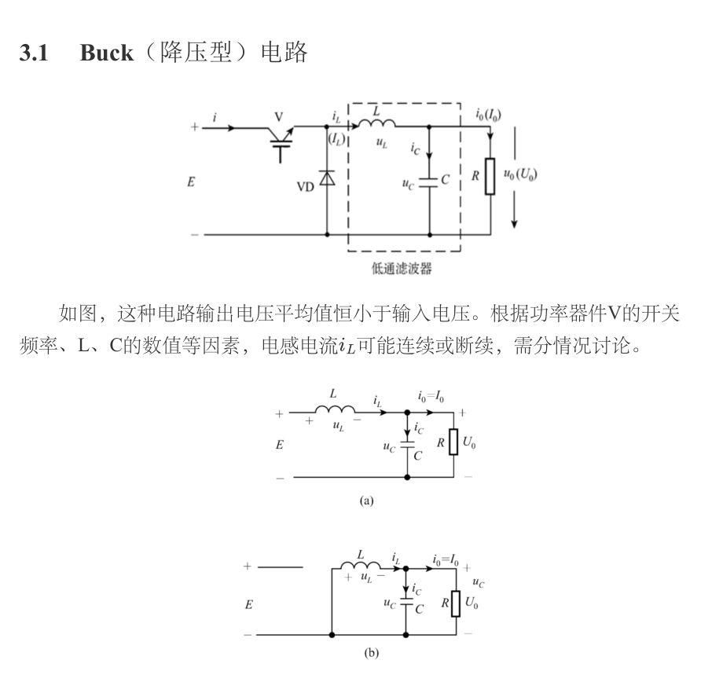
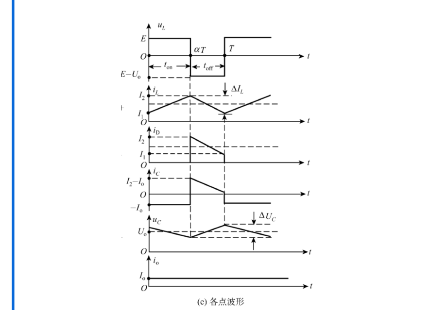

# 第五章：DC–DC 变换器与直流斩波

本章把固定直流电压变成可调直流电压，主线是“开关状态—电感电压—电感电流—输出电压”。课程资料将 DC–DC 分为无隔离的 Buck、Boost、Buck–Boost、Cuk，以及带高频变压器的正激、反激和桥式变换器。本页按应试顺序整理；原始讲义见[第五章资料 PDF](../resources/cc98-notes-05.pdf)，其中基础定义和 Buck/Boost 波形在第 1–12 页、Cuk 在第 13–16 页、隔离与多象限在第 17–24 页。以下页码按 PDF 从第一页计数；分类详解讲义的 DC–DC 专题在 PDF 第 21–24 页（印刷页码 15–18），不同文件不要混用页码。

## 1. 统一模型和两个平衡定律

设开关周期为 $T_s=1/f_s$，导通时间为 $T_{\mathrm{on}}=DT_s$，关断时间为 $(1-D)T_s$，$D$ 是占空比。理想分析先忽略开关压降、电感电阻、二极管正向压降和电容 ESR；题目问损耗或器件应力时再恢复这些非理想因素。

### 1.1 电感伏秒平衡

稳态周期平均电感电压为零：

$$
\frac1{T_s}\int_0^{T_s}v_L(t)\,\mathrm dt=0.
$$

它的物理含义是电感电流一个周期后回到原值。若在两个状态中电感电压分别为 $V_{L1}$、$V_{L2}$，则

$$
D V_{L1}+(1-D)V_{L2}=0.
$$

### 1.2 电容安秒平衡

稳态周期平均电容电流为零：

$$
\frac1{T_s}\int_0^{T_s}i_C(t)\,\mathrm dt=0.
$$

电容的平均电荷不再积累，但纹波电压仍存在。求纹波时应先画 $i_C$，再用

$$
\Delta v_C=\frac1C\int i_C(t)\,\mathrm dt.
$$

### 1.3 连续和断续的判别

CCM（连续电流模式）指电感电流谷值 $i_{L,min}>0$；临界状态为 $i_{L,min}=0$；DCM（断续电流模式）在一个周期中存在一段 $i_L=0$。先用 CCM 公式求平均值和纹波，再检查谷值；不能因为题目写“斩波器”就默认 CCM。

## 2. Buck 降压变换器

### 2.1 两个工作区间

*原资料《第五章：DC-DC变换》PDF 第 3 页。图中 $E$ 对应本文的 $V_d$，$U_0$ 对应 $V_o$。*

开关 $S$ 导通、二极管截止时，电感接在输入与输出之间：

$$
v_L=V_d-V_o,\qquad \frac{\mathrm di_L}{\mathrm dt}=\frac{V_d-V_o}{L}.
$$

开关关断、续流二极管导通时：

$$
v_L=-V_o,\qquad \frac{\mathrm di_L}{\mathrm dt}=-\frac{V_o}{L}.
$$

电感伏秒平衡给出

$$
D(V_d-V_o)+(1-D)(-V_o)=0,
\qquad \boxed{V_o=DV_d}.
$$

这只在理想、CCM、输出电压近似恒定时成立。它说明 Buck 是降压型“直流变压器”，$0<D<1$ 时 $0<V_o<V_d$。

### 2.2 电感纹波、临界电感与输出纹波

导通期间电流上升量为

$$
\Delta i_{L,pp}=\frac{(V_d-V_o)DT_s}{L}
=\frac{D(1-D)V_d}{Lf_s}.
$$

理想电阻负载下 $I_o=V_o/R=DV_d/R$。临界条件是 $\Delta i_{L,pp}=2I_o$，因此

$$
\boxed{L_{\mathrm{crit}}=\frac{(1-D)R}{2f_s}}.
$$

若电容电流近似为三角波，忽略 ESR：

$$
\Delta v_{o,pp}\approx\frac{\Delta i_{L,pp}}{8f_sC}.
$$

考虑电容 ESR 时还要加 $\Delta i_{L,pp}\,r_C$，高频设计中 ESR 可能成为主要纹波来源。

这里的 $\Delta$ 均指峰峰值；若原笔记用纹波幅值（峰峰值的一半），代入电容公式前必须换算。所谓“大电容”只是允许把输出电压在一个周期内视为常数，绝不意味着电感电流没有纹波。

### 2.3 Buck 的器件应力和波形

开关管导通时电流约为 $i_L$，关断时承受近似 $V_d$ 的电压；续流二极管导通时电流为 $i_L$，截止时反向电压约为 $V_d$。电感电流是平均值 $I_o$ 上叠加三角纹波，电容电流在导通、续流两个区间换向。作图时必须标出 $D T_s$ 和 $(1-D)T_s$，并把开关节点的高低电平写在纵轴上。

## 3. Boost 升压变换器

### 3.1 CCM 推导

*原资料第五章 PDF 第 8 页波形；按同一时间轴观察开通储能与关断传能。图中 $\Delta I_L$ 为峰峰值。*

开关导通时二极管截止，电感从输入端储能：

$$
v_L=V_d,\qquad \Delta i_{L,on}=\frac{V_dDT_s}{L}.
$$

开关关断时二极管导通，输入和电感共同向输出供能：

$$
v_L=V_d-V_o.
$$

伏秒平衡为

$$
D V_d+(1-D)(V_d-V_o)=0,
\qquad \boxed{V_o=\frac{V_d}{1-D}}.
$$

Boost 只能升压且输出极性不反向。理想功率守恒下 $I_L\simeq I_{in}=P_o/V_d=V_oI_o/V_d$，所以输入侧电感平均电流往往比输出电流大。

### 3.2 纹波、临界和应力

电感电流纹波为

$$
\Delta i_{L,pp}=\frac{V_dD}{Lf_s}.
$$

开关管导通时承担电感电流，关断时承受接近 $V_o$ 的电压；二极管导通时电流约为 $i_L$，截止时反向电压接近 $V_o$。输出电容在开关导通时主要向负载供电，故近似纹波

$$
\Delta v_{o,pp}\approx\frac{I_oD}{f_sC}
$$

（忽略 ESR）。Boost 的临界条件必须先把电感平均电流换算到输出侧，不能直接照搬 Buck 的 $I_o$。

### 3.3 Boost 的临界电感与电流额定值

由 $I_L=V_d/[R(1-D)^2]$ 和 $\Delta i_{L,pp}=2I_L$：

$$
\boxed{L_{\mathrm{crit}}=\frac{D(1-D)^2R}{2f_s}}.
$$

等价地，固定 $L,D,f_s$ 时，$I_{o,\mathrm{crit}}=V_dD(1-D)/(2Lf_s)$。注意这里是输出电流，电感边界平均电流则为 $V_dD/(2Lf_s)$，二者差 $(1-D)$。对三角纹波近似，电感 RMS 为 $\sqrt{I_L^2+\Delta i_L^2/12}$，开关 RMS 约为 $\sqrt{D(I_L^2+\Delta i_L^2/12)}$；二极管 RMS 将 $D$ 换成 $1-D$。用平均输出电流选 MOSFET，可能严重低估导通损耗。

## 4. Buck–Boost、Cuk 与隔离拓扑

### 4.1 反相 Buck–Boost：不要漏掉负号

反相 Buck–Boost 在 CCM 下的变比为

$$
\boxed{\frac{V_o}{V_d}=-\frac{D}{1-D}}.
$$

输出可升可降，但极性反向，输入电流和输出电流脉动较大。Cuk 通过串联能量传递电容工作，通常具有输入、输出电感，电流连续、EMI 较小；代价是元件数量多，传能电容承受较大纹波电流。

令 $V=|V_o|$，电感电流参考方向始终取储能方向。开通时 $v_L=V_d$，关断时 $v_L=-V$，所以 $DV_d-(1-D)V=0$。二极管只在关断期间向输出送电，由输出电容安秒平衡：

$$
I_o=(1-D)I_L,\qquad I_{in}=DI_L,\qquad
I_L=\frac{V}{R(1-D)}.
$$

因此不能像 Buck 一样把 $I_L$ 当成 $I_o$。纹波和临界电感为

$$
\Delta i_{L,pp}=\frac{V_dD}{Lf_s},\qquad
L_{\mathrm{crit}}=\frac{R(1-D)^2}{2f_s}.
$$

主开关和二极管的理想截止耐压均约为 $V_d+V$；输出电容在开通区间单独向负载供电，近似 $\Delta v_{o,pp}=I_oD/(Cf_s)$。这些关系指的是常见单开关反相拓扑，不能用于非反相四开关 Buck–Boost。

### 4.2 Cuk：变比相同，传能过程不同

课程笔记第 13 页把 Cuk 称为“即 Buck–Boost”，应理解为具有相同的升降压功能，不能当成同一个电路。Cuk 有输入电感 $L_1$、输出电感 $L_2$ 和能量传递电容 $C_1$。按常见反相拓扑，令 $V=|V_o|$：开通时 $L_1$ 从输入充能、$C_1$ 向输出侧送能；关断时输入与 $L_1$ 向 $C_1$ 补充能量。对 $L_1$ 写伏秒平衡：

$$
D V_d+(1-D)(V_d-V_{C1})=0
\quad\Rightarrow\quad V_{C1}=\frac{V_d}{1-D}.
$$

对 $L_2$ 写平衡为 $D(V_{C1}-V)+(1-D)(-V)=0$，于是 $V=DV_{C1}=DV_d/(1-D)$，输出仍为反相。输入、输出电感平滑各自端口电流，但传能电容电流并不小；选 $C_1$ 时要检查额定电压和 RMS 纹波电流，而不只看容量。

### 4.3 高频隔离：先分清传能和磁化

隔离型变换器的共同要求是变压器磁通复位：

- **正激**：开关导通时直接向副边传能，关断时依靠复位绕组或双管复位释放磁化能量；理想关系 $V_o\approx D(N_s/N_p)V_d$。复位绕组匝比 $N_r=N_p$ 时，磁芯伏秒平衡要求 $D\le 1/2$。
- **反激**：开通时磁化电感储能，关断时通过副边二极管向负载放能，适合小功率多输出；漏感会造成关断尖峰，需要 RCD 或有源钳位。
- **半桥/全桥**：变压器两端交替施加正负电压，适合中高功率；要防止直通和磁通不平衡。

对带复位绕组的单管正激，设原边 $N_p$、复位绕组 $N_r$。开通时原边电压为 $V_d$，复位期间原边反向电压幅值约为 $V_dN_p/N_r$；故所需复位时间 $t_r=D T_sN_r/N_p$。要求 $DT_s+t_r\le T_s$，得到

$$
\boxed{D\le\frac{N_p}{N_p+N_r}}.
$$

只有 $N_r=N_p$ 时才简化为 $D\le1/2$。主开关的理想关断电压约为 $V_d(1+N_p/N_r)$，实际还要留漏感尖峰裕量。复位绕组负责磁化能量回送，与副边输出滤波电感的续流不是一回事。

反激中取 $n=N_s/N_p$，把磁化电感电压折算至原边：开通时为 $V_d$，关断传能时为 $-V/n$。若磁化电流 CCM：

$$
D V_d-(1-D)\frac Vn=0,
\qquad \boxed{V=n\frac D{1-D}V_d}.
$$

若磁化电流 DCM 且每周期储能全部送出，则

$$
P_o\approx\eta\frac12 L_m I_{pk}^2f_s.
$$

这个能量式可以反求 $L_m$ 或峰值电流，但不能同时无条件套用 CCM 的占空比变比。真实反激的“变压器”本质上要储能，通常使用有气隙磁芯；漏感中的能量没有理想耦合到副边，需要钳位/吸收支路处理。

## 5. DCM 的统一分析方法

以 Buck 为例，DCM 有三个区间：开关导通电流上升、续流电流下降、二极管关断后电感电流为零。未知量通常是下降结束角 $D_2$ 和峰值电流 $I_{pk}$。按照以下顺序作答：

1. 写出三个区间的 $v_L$ 和 $\Delta i_L$；
2. 用电流起点和终点为零求 $I_{pk}$ 与 $D_2$；
3. 用输出电流等于电感电流平均值求变比；
4. 检查 $D+D_2<1$，否则假设退化为 CCM。

DCM 时变比不再只由 $D$ 决定，还与负载、电感和开关频率有关；这是考试中“为什么不能直接套 $V_o=DV_d$”的标准解释。

### 5.1 用无量纲参数写出 Buck 的 DCM 变比

定义 $M=V_o/V_d$、$K=2Lf_s/R$，三个区间长度为 $D T_s$、$D_2T_s$、$D_3T_s$，其中 $D_3=1-D-D_2>0$。电流从零上升到

$$
I_{pk}=\frac{V_d(1-M)D}{Lf_s},\qquad
D_2=\frac{D(1-M)}M.
$$

Buck 的输出电流等于三角形电流一周期面积：$V_o/R=I_{pk}(D+D_2)/2$。整理得 $KM^2=D^2(1-M)$，取物理解：

$$
\boxed{M=\frac{2}{1+\sqrt{1+4K/D^2}}}.
$$

使用后必须验证 $D+D_2=D/M<1$，即 $M>D$。这说明同一 $D$ 下轻载 DCM 的输出电压高于 CCM 的 $DV_d$。临界点 $K=1-D$ 时两式相接，输出没有物理跳变。

### 5.2 Boost 的 DCM：输出电流只来自下降段

开通时峰值 $I_{pk}=V_dD/(Lf_s)$，关断段 $v_L=V_d-V_o$，所以 $D_2=D/(M-1)$。输出侧二极管仅在这段导通，$V_o/R=I_{pk}D_2/2$。于是

$$
K M(M-1)=D^2,\qquad
\boxed{M=\frac{1+\sqrt{1+4D^2/K}}2}.
$$

检验 $D+D_2<1$，等价于 $M>1/(1-D)$；临界时 $K=D(1-D)^2$。若所得 $M$ 小于 CCM 变比，说明 DCM 假设不成立。记忆时只记“Boost 输出平均值来自下降段面积”，比硬背根式不容易混淆。

### 5.3 反相 Buck–Boost 的 DCM

仍用 $M=|V_o|/V_d$，开通峰值 $I_{pk}=V_dD/(Lf_s)$，关断持续 $D_2=D/M$；只有关断段向输出送能。因此

$$
\frac{|V_o|}R=\frac12 I_{pk}D_2,
\qquad \boxed{M=\frac D{\sqrt K}}.
$$

检查 $D+D/M<1$；临界 $K=(1-D)^2$。DCM 三类电路的根式不同，原因是 Buck 电感同时连接输出，而 Boost 与反相 Buck–Boost 的输出二极管只在部分区间导通。

## 6. 控制和设计检查

时间比控制包括固定频率 PWM、固定导通时间的变频控制和混合控制。PWM 便于设计滤波器，但高频会增加开关损耗；Bang–Bang 控制响应快，却可能产生可变频率。闭环设计应先给出功率级，再画误差放大器、PWM 比较器和反馈分压。实际设计还要检查最大占空比、启动过流、电感饱和、二极管反向恢复、MOSFET $V_{DS}$ 和热阻。

## 7. 例题与解答

### 例题 1：Buck 的占空比、临界电感和二极管波形（资料同型题）

已知 $V_d=400\ \mathrm V$、$R=10\ \Omega$、$f_s=50\ \mathrm{kHz}$，要求 $V_o=80\ \mathrm V$。求 $D$、$I_o$ 和 CCM 的临界电感。

$$
D=\frac{80}{400}=0.2,\qquad I_o=\frac{80}{10}=8\ \mathrm A,
$$

$$
L_{\mathrm{crit}}=\frac{(1-0.2)\times10}{2\times50\times10^3}=80\ \mu\mathrm H.
$$

因此选 $L>80\ \mu\mathrm H$ 才能保证该工作点 CCM。若二极管阳极接地、阴极接开关节点，开关导通时 $u_D\approx-400\ \mathrm V$，关断续流时 $u_D\approx0$。这组参数取自[历年分类讲义 PDF 第 21–22 页](../resources/cc98-exam-handout.pdf#page=21)，其中归为 25–26 回忆题；解答是整理推导，不是官方评分答案。

### 例题 2：Boost 的平均值和峰值电流（资料同型题）

$V_d=100\ \mathrm V$、$D=0.6$、$R=10\ \Omega$、$L=1\ \mathrm{mH}$、$f_s=50\ \mathrm{kHz}$。求 $V_o,I_o,I_L,\Delta i_L$，并判断 CCM。

$$
V_o=\frac{100}{0.4}=250\ \mathrm V,\quad I_o=25\ \mathrm A,
$$

$$
I_L=\frac{V_oI_o}{V_d}=62.5\ \mathrm A,
\qquad \Delta i_L=\frac{100\times0.6}{10^{-3}\times50\times10^3}=1.2\ \mathrm A.
$$

谷值为 $62.5-0.6=61.9\ \mathrm A>0$，所以 CCM 成立；开关管峰值电流约 $63.1\ \mathrm A$，关断耐压约 $250\ \mathrm V$。参数来自[分类讲义 PDF 第 23 页](../resources/cc98-exam-handout.pdf#page=23)，归为 2021–2022 回忆题。

### 例题 3：Buck 轻载 DCM（原创训练题）

输入 $24\ \mathrm V$，$D=0.25$，$L=100\ \mu\mathrm H$，$f_s=20\ \mathrm{kHz}$，$R=40\ \Omega$。先假设 CCM，$L_{crit}=0.75\times40/(2\times20000)=750\ \mu\mathrm H$，实际电感远小于临界值，应转 DCM。

$$
K=\frac{2Lf_s}R=0.1,\qquad
M=\frac2{1+\sqrt{1+4(0.1)/0.25^2}}=0.5376.
$$

故 $V_o=12.902\ \mathrm V$，$I_o=0.3226\ \mathrm A$，$D_2=D(1-M)/M=0.2150$，$D_3=0.5350>0$，DCM 自洽。峰值电流 $I_{pk}=24(1-0.5376)0.25/(100\times10^{-6}\times20000)=1.3873\ \mathrm A$，三角面积 $I_{pk}(D+D_2)/2=0.3226\ \mathrm A$，与负载电流一致。若误用 CCM 会得到 $6\ \mathrm V$，差异不是舍入误差，而是工作模式选错。

### 例题 4：Boost 的纹波与元件选值（原创训练题）

要求把 $24\ \mathrm V$ 升为 $48\ \mathrm V$，输出 $96\ \mathrm W$，$f_s=50\ \mathrm{kHz}$，电感纹波不超过平均值的 25%，输出电压纹波峰峰值不超过 $0.24\ \mathrm V$。理想 CCM 下：

$$
D=0.5,\quad I_o=2\ \mathrm A,\quad I_L=4\ \mathrm A,
\quad \Delta i_{L,pp}\le1\ \mathrm A.
$$

$$
L\ge\frac{24\times0.5}{50\times10^3\times1}=240\ \mu\mathrm H,
\qquad C\ge\frac{2\times0.5}{50\times10^3\times0.24}=83.3\ \mu\mathrm F.
$$

选 $L=270\ \mu\mathrm H$ 时纹波 $0.889\ \mathrm A$、谷值 $3.556\ \mathrm A>0$。输出电容若取 $100\ \mu\mathrm F$，理想容性纹波 $0.20\ \mathrm V$，剩余 $0.04\ \mathrm V$ 是 ESR 和其他误差的预算，不能简单认定任意 $100\ \mu\mathrm F$ 电容都合格。开关和二极管耐压至少覆盖 $48\ \mathrm V$ 加尖峰及设计余量，电感需满足约 $4.45\ \mathrm A$ 的峰值和温升要求。

### 资料校勘：Boost 二极管反压

第五章原笔记第 7 页“输出电压平均值恒小于输入”应改为**升压**；分类讲义 PDF 第 23 页某段把 $V_d=10\ \mathrm V$、$V_o=50\ \mathrm V$ 时二极管截止反压写成 $-40\ \mathrm V$，原因是把二极管阳极误认为始终接 $10\ \mathrm V$。常规 Boost 的阳极接在开关节点：开关导通时节点约为地电位，故定义 $u_D=u_A-u_K$ 得 $u_D\approx-50\ \mathrm V$。网页依拓扑修正，原 PDF 保留原样供核对。

## 8. 自测清单

1. 为什么 Buck 的 $L_{\mathrm{crit}}$ 含有 $(1-D)$，而 Boost 的临界式还要转换输入侧和输出侧电流？
2. 画出 Boost 开关导通和关断时的 $v_L$、$i_L$、二极管电压，并指出哪一段给电容充电。
3. 说明反激与正激在“储能位置”和“关断期间传能”上的差别。
4. 若题目给出 $D$、$L$、$R$、$f_s$，先判断 CCM 还是直接求输出电压？

**答案要点：** 1. 电感所在位置和负载平均电流定义不同；2. 导通时 $v_L=V_d$、电流上升且电容供负载，关断时 $v_L=V_d-V_o$、二极管导通给电容充电；3. 正激开通传能、反激先储能后放能；4. 先用假设求纹波和谷值，再决定模型。
