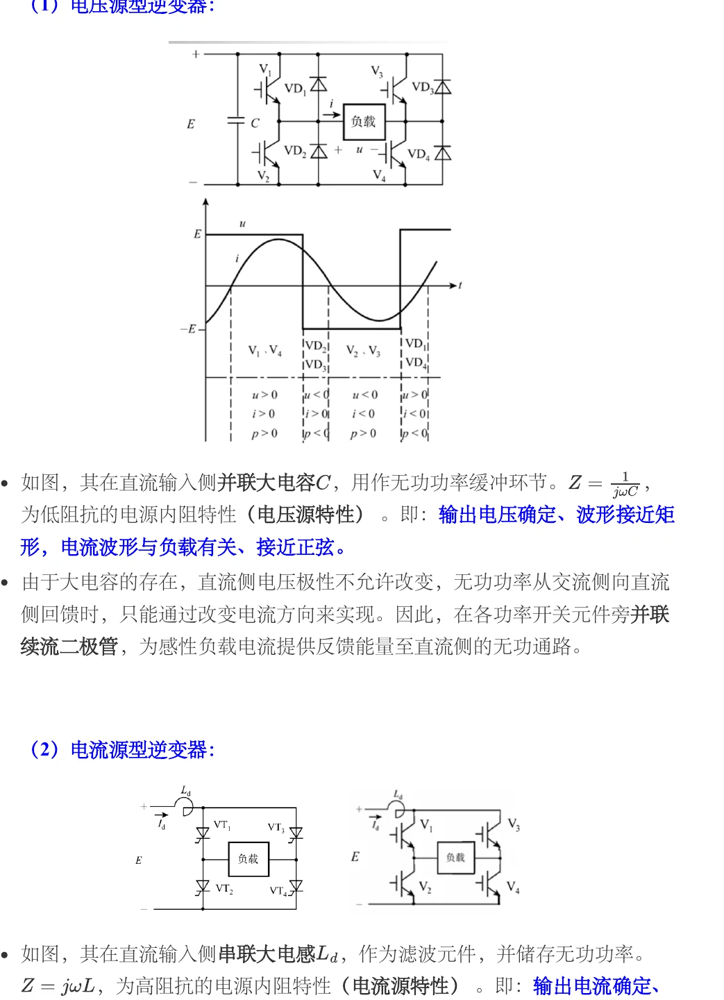
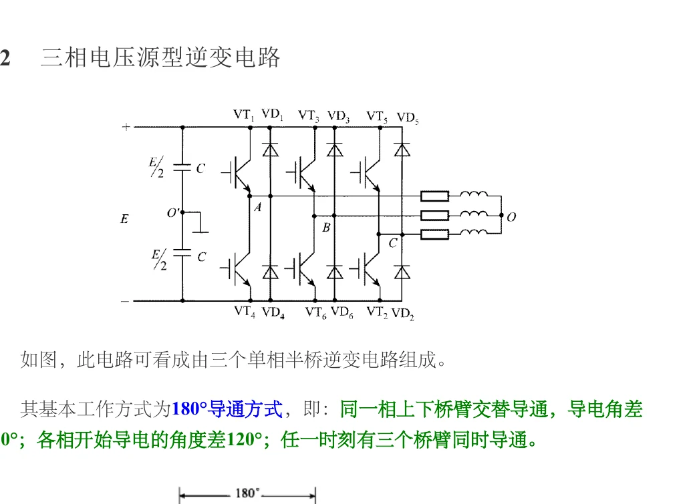
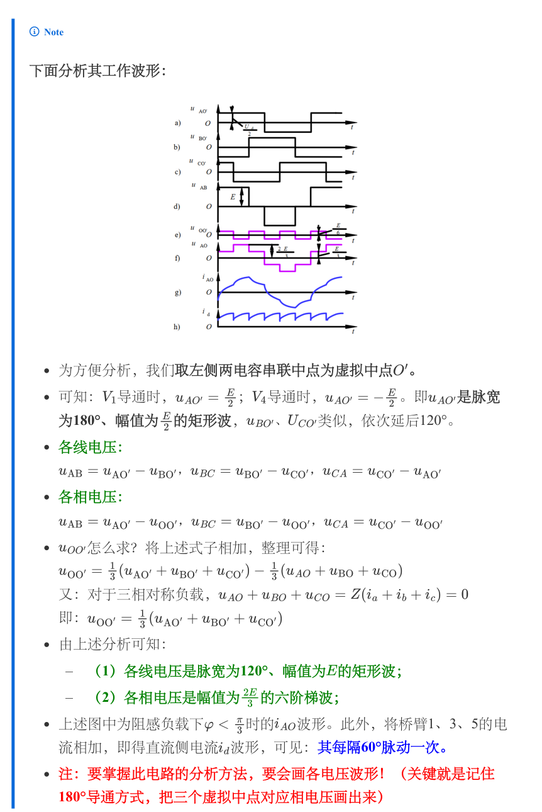
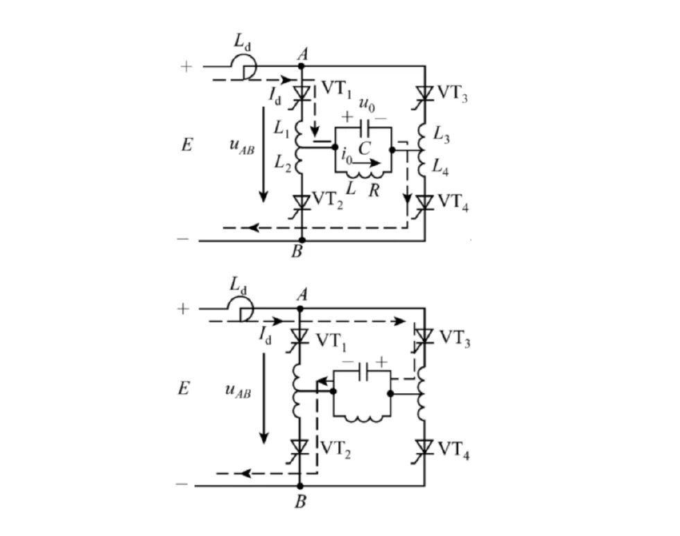
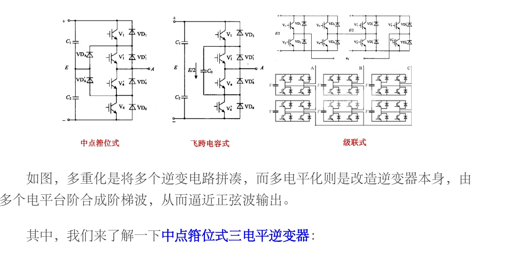

# 第六章　直流—交流变换：逆变器

本章回答一个核心问题：直流电源怎样通过开关器件合成为频率、幅值和波形可控的交流电。原资料把逆变器分成电压源型（VSI）和电流源型（CSI），并从单相半桥、单相全桥、三相桥、负载谐振式逆变和多电平化逐步展开。考试时应把“拓扑—开关状态—波形—平均值/有效值—器件应力”连成一条链，而不是只背一张电路图。

> 本页中的页码指 CC98 资料《电力电子技术笔记·第六章：DC-AC 变换》；若不同版本页码变化，以章节标题和图号为准。原资料 PDF 见[课程资料入口](../index.md)，站点整理版附件为 [第六章 PDF](../resources/cc98-notes-06.pdf)。

## 1. 逆变器的对象、分类与换流

逆变是把直流侧功率变成交流侧功率。交流侧接负载时是无源逆变；交流侧接电网、直流侧有能量源且功率反送电网时是有源逆变。交—直—交变频器的后半级也是逆变器。

### 1.1 四种换流方式

1. **器件换流**：IGBT、MOSFET、GTO 等全控器件撤去栅极信号即可关断，换流由器件本身完成。
2. **电网换流**：电网电压自然反向，在待关断晶闸管两端施加反压。它适合有稳定交流电网的场合，不适合孤立负载。
3. **负载换流**：利用负载的 L、C 谐振使电流自然过零。资料中的串联/并联谐振逆变属于这一类，要求负载电流相位给晶闸管留下关断恢复时间。
4. **强迫换流**：附加电容、电感和二极管构成换流支路，主动给晶闸管施加反压或反向电流。它可分直接耦合式和电感耦合式。

器件换流和强迫换流属于自换流；电网换流和负载换流属于外部换流。简答题应同时写出“谁提供反压/反向电流”和“是否需要全控器件”两个关键词。

### 1.2 VSI 与 CSI

电压源型逆变器直流侧并联大电容，直流电压近似恒定，输出电压由开关状态决定，输出电流由负载决定。感性负载电流不能突变，因此每个主开关旁必须有反并联续流二极管，使电流反向时能量回到直流母线。电压源型逆变器不能让直流母线电压极性随意反向。

电流源型逆变器直流侧串联大电感，直流电流近似恒定，输出电流接近矩形波，负载电压由负载决定；直流侧电流不能反向，能量回馈需通过改变直流电压极性完成，主开关通常不必并联续流二极管。比较题可按“直流储能元件、输出确定量、反馈路径、适用器件”作答。

## 2. 单相半桥电压源逆变

半桥由两个串联直流电容建立中点 $O$，开关 $S_1,S_2$ 互补导通，负载接在桥臂中点与 $O$ 之间。令直流母线总电压为 $U_d$，且两电容均衡为 $U_d/2$。

### 2.1 电阻负载

当 $S_1$ 导通时，$u_o=+U_d/2$；当 $S_2$ 导通时，$u_o=-U_d/2$。两只器件各导通半周期，输出为对称方波。其傅里叶展开为

$$
u_o(t)=\frac{2U_d}{\pi}\left(\sin\omega t+\frac{1}{3}\sin3\omega t+\frac{1}{5}\sin5\omega t+\cdots\right).
$$

因此基波峰值 $U_{1m}=2U_d/\pi$，基波有效值 $U_{1}=\sqrt2U_d/\pi$，方波总有效值为 $U_d/2$。半桥的缺点是输出电压幅值只有全桥的一半，而且两个电容电压需要均衡；适合小功率场景。

### 2.2 阻感负载与续流

在 $S_1$ 由通转断、$S_2$ 即将开通的瞬间，电感电流仍保持原方向。若没有死区，可能发生直通；实际先关断再等待死区，再开通另一器件。死区期间由反并联二极管续流，电流过零后才转移到相反方向的开关。答波形题时要分别画 $u_o$、$i_o$ 与二极管电流，不能把电流也画成方波。

## 3. 单相全桥逆变

全桥有四个开关，桥臂中点为 $A,B$，负载接在 $A-B$ 之间。采用 180° 导通的方波方式，$S_1,S_4$ 与 $S_2,S_3$ 两组交替导通：

| 电角度区间 | 导通器件 | 输出电压 $u_{AB}$ |
| --- | --- | --- |
| $0<\omega t<\pi$ | $S_1,S_4$ | $+U_d$ |
| $\pi<\omega t<2\pi$ | $S_2,S_3$ | $-U_d$ |

方波傅里叶级数为

$$
u_{AB}=\frac{4U_d}{\pi}\left(\sin\omega t+\frac{1}{3}\sin3\omega t+\frac{1}{5}\sin5\omega t+\cdots\right).
$$

基波峰值 $4U_d/\pi$，基波有效值 $4U_d/(\pi\sqrt2)$。由于半波对称，不含偶次谐波；低次 3、5、7 次谐波仍较大，通常需要 PWM 或滤波器。

*图 06-02　单相全桥在感性负载下的开关与续流。来源：[第06章原笔记，第3页](../resources/cc98-notes-06.pdf#page=3)。*

电压极性由桥臂开关状态决定，电流极性由负载储能决定。电压换向而电流未换向的区间，反并联二极管可将能量送回直流侧。逐区间列出 $u_o$、$i_o$ 的符号及导通器件，比只背对角管交替导通更能处理阻感负载。

### 3.1 移相调压

两桥臂分别工作在相同频率，但第二桥臂相对第一桥臂移相 $\delta$。输出电压在 $+U_d,0,-U_d$ 间形成阶梯波，改变 $\delta$ 即可改变基波幅值。移相题的关键是列出四个换相时刻，再判断负载电感使电流通过哪只二极管续流。不能把移相角 $\delta$ 当作 SPWM 调制度。

### 3.2 器件应力与保护

理想全桥每个开关关断时承受约 $U_d$ 的阻断电压（通常为正向 $V_{DS}$ 或 $V_{CE}$，反向负载电流由二极管或允许的沟道路径承担）；感性负载换流时还会有漏感尖峰。设计答案应补充：栅极驱动互锁、死区、RC 吸收或有源箝位、过流检测、母线欠压锁定。死区过长会使输出基波产生畸变，过短则有直通风险。

## 4. 三相电压源型逆变器

三相桥可看成三个半桥，直流侧有大电容。180° 导通方式下六个开关按 $60^\circ$ 间隔换相，每一相上、下管互补，三相桥臂的触发相差 $120^\circ$。任意时刻有三个开关导通。

*图 06-03　三相电压源逆变桥及180°、120°方式。来源：[第06章原笔记，第7页](../resources/cc98-notes-06.pdf#page=7)。*

先用上下桥臂互补约束确定桥臂极点电压，再由极点电压相减求线电压，最后按负载中性点关系求相电压。不能把桥臂对直流中点电压直接称为负载相电压。180°与120°方式的导通器件数、悬空相和相电压波形也不同。

### 4.1 波形构造

以虚拟直流中点 $O$ 为参考，先画三条桥臂电压 $u_{AO},u_{BO},u_{CO}$，每条为幅值约 $U_d/2$ 的 180° 方波，相差 $120^\circ$。星形无中性线的对称负载中性点电压为

$$
u_{NO}=\frac{u_{AO}+u_{BO}+u_{CO}}{3},\qquad u_{AN}=u_{AO}-u_{NO}.
$$

线电压直接相减，例如 $u_{AB}=u_{AO}-u_{BO}$，呈 120° 矩形波；相电压为六阶梯波。每 $60^\circ$ 重新判断导通器件，便能画出完整波形。不要把桥臂电压、相电压、线电压混为同一条曲线。

三相线电压基波与 $U_d$ 的关系要看采用的导通方式和定义。对 180° 方波，常用傅里叶结果是线电压基波峰值约 $2\sqrt3U_d/\pi$，有效值再除以 $\sqrt2$；答题时先写“本文 $U_d$ 为总直流母线电压”再代数值。

*原笔记第 8 页。看图顺序为：桥臂方波 → 相减得线电压 → 消去中性点电位得相电压。图上的原符号保持不变，本站统一用总母线电压 $U_d$。原图“各相电压”条目左侧误排为线电压下标，应分别读作相对负载中性点的 $u_{AO},u_{BO},u_{CO}$；正文使用 $N$ 表示负载中性点以免混淆。*

### 4.2 120° 导通方式

120° 导通时每个器件只导通 $120^\circ$，任意时刻通常只有两个主开关导通。对直流电流近似恒定的电流源型逆变器，忽略换流时间时线电流依次为 $+I_d,0,-I_d,0$，正、负各持续 $120^\circ$，零电流区间各 $60^\circ$。若讨论电压源型 120° 导通，则负载电流仍由负载和续流路径决定，不能强行画成恒幅方波。120° 与 180° 的触发顺序和波形不同，不能套用同一张图。

### 4.3 有效值、谐波与功率检查

180° 导通下，线电压在一个周期内有 $2/3$ 的时间取 $\pm U_d$，其余时间为零，因此总有效值由平方平均得到

$$
U_{LL}=\sqrt{\frac23}U_d\approx0.8165U_d,\qquad
U_{LL,1}=\frac{\sqrt6}{\pi}U_d\approx0.7797U_d.
$$

相电压总有效值为 $\sqrt2U_d/3\approx0.4714U_d$，基波有效值为 $\sqrt2U_d/\pi\approx0.4502U_d$。三相对称时，基波线电压为基波相电压的 $\sqrt3$ 倍；不要把任意畸变波形的各个瞬时值也按这一倍数换算。

三相线电压不含三次及三的倍数谐波，主要低次谐波为 $6k\pm1$。忽略器件压降且负载三相平衡时，基波有功功率为

$$
P_1=\sqrt3U_{LL,1}I_{L,1}\cos\varphi_1.
$$

总有功功率还可能含谐波功率；仅在负载谐波电流很小等条件下，才近似用基波功率代表全部有功。直流侧平均功率应满足 $U_dI_{d,avg}\approx P_{ac}$，适合检查数量级，但瞬时直流侧电流依然脉动。

### 4.4 方波加在 RL 负载上的电流

单相全桥不是给负载“注入方波电流”，而是施加方波电压。对串联 $R,L$，正电压区间的方程为

$$
L\frac{di}{dt}+Ri=U_d,\qquad
i(t)=\frac{U_d}{R}+\left[i(0)-\frac{U_d}{R}\right]e^{-tR/L}.
$$

负电压区间将右端改为 $-U_d$，并用上一段末值作本段初值。稳态半波反对称意味着 $i(T/2)=-i(0)$。令 $a=e^{-RT/(2L)}$，可解得方波换相前后的电流幅值

$$
i(0)=-\frac{U_d}{R}\frac{1-a}{1+a},\qquad
i(T/2)=+\frac{U_d}{R}\frac{1-a}{1+a}.
$$

电压刚转负时电流仍为正，所以先通过反馈二极管回馈，直到电流过零才由负半周主开关承担电流。电流过零点可把该区间解中的 $i(t)$ 置零求出。这个分段法同时给出二极管导通区间，不需靠记忆猜测。

## 5. 电流源与谐振逆变

负载谐振式逆变器用 L、C 的谐振让负载电流自然过零。资料第六章先分析并联谐振感应加热电路：电流接近矩形，电压接近正弦；换流阶段四只晶闸管可能短暂同时导通，换流电抗器限制 $di/dt$。晶闸管关断后还需保持反压时间 $t_q$，触发脉冲必须提前于理想换相点。

强迫换流式电流源逆变器常用串联二极管和换流电容，120° 导通，1、3、5 与 2、4、6 两组器件依次换流。答简答题要说明：电容先使原晶闸管承受反压，随后等效电容与绕组形成谐振，电流由旧支路转移到新支路；换流结束时电容极性为下一次换流预充电。

*图 06-04　电流源型逆变的直流电感与换流路径。来源：[第06章原笔记，第10页](../resources/cc98-notes-06.pdf#page=10)。*

直流侧大电感使输入电流近似连续，桥路将电流导向负载。电流源不能随意开路，电压源不能随意直通短路，两类约束恰好不同。判断换流过程时沿直流电感电流寻找连续路径，不能把电压源逆变的死区策略原样搬过来。

## 6. 多重化与多电平

多重化是把多个逆变器的输出在相位上错开后串联（电压叠加）或并联（电流叠加），利用相消抵掉低次谐波。资料给出的单相二重化通过两个全桥输出相差 $60^\circ$ 的矩形波，抵消 3 次谐波；三相二重化通过变压器联结补偿基波相位后，可形成 12 脉波输出。

三电平中点箝位型逆变器每个桥臂相电压有 $+U_d/2,0,-U_d/2$ 三种电平，线电压可出现五种电平。每个器件理想耐压约为母线电压一半，输出谐波降低、开关频率可下降，适合高压大容量；代价是钳位二极管多、直流电容电压平衡复杂。

*图 06-05　NPC、飞跨电容与级联多电平结构。来源：[第06章原笔记，第21页](../resources/cc98-notes-06.pdf#page=21)。*

多电平通过增加电压台阶降低单次跃变，代价是器件数、驱动隔离与均压控制增加。NPC图应先定位直流中点和钳位二极管，列出输出正、零、负电平对应状态，再检查中点电流会使哪只电容充放电。不能仅凭“电平更多”就断言所有负载下损耗更低。

## 7. 例题（原创训练，参数自设）

### 例题 1：单相全桥方波基波

直流母线 $U_d=300\,\mathrm V$，全桥采用 180° 方波，求输出方波有效值和基波有效值。

解：方波在 $\pm U_d$ 间切换，所以 $U_{o,rms}=U_d=300\,\mathrm V$。基波有效值

$$
U_{1,rms}=\frac{4U_d}{\pi\sqrt2}=\frac{4\times300}{\pi\sqrt2}\approx270.2\,\mathrm V.
$$

基波只占方波总有效值的一部分，其余为 3、5、7 次等谐波。

### 例题 2：三相六步波形的器件判断

在 180° 导通三相桥中，$U_d=600\,\mathrm V$，某 $60^\circ$ 区间的上桥臂开关状态为 $S_A=1,S_B=1,S_C=0$。说明线电压 $u_{AB},u_{BC},u_{CA}$ 的符号。

解：桥臂电压相对于虚拟中点可取 $u_{AO}=u_{BO}=+U_d/2$、$u_{CO}=-U_d/2$。因此

$$
u_{AB}=0,\quad u_{BC}=+U_d=600\,\mathrm V,\quad u_{CA}=-U_d=-600\,\mathrm V.
$$

若负载为星形无中性线，还要由中性点漂移求相电压；不能直接把线电压当相电压。

### 例题 3：谐振换流时间（原创）

换流支路等效为 $L_c=20\,\mu\mathrm H,C_c=2\,\mu\mathrm F$。按理想 LC 四分之一周期估算换流时间。

$$
t_c=\frac{\pi}{2}\sqrt{L_cC_c}=\frac{\pi}{2}\sqrt{20\times10^{-6}\times2\times10^{-6}}\approx9.93\,\mu\mathrm s.
$$

实际还需留出晶闸管关断恢复时间和参数偏差裕量。

### 例题 4：方波逆变 RL 负载换相电流

全桥母线 $U_d=100\,\mathrm V$，输出频率 $50\,\mathrm{Hz}$，串联负载 $R=10\,\Omega,L=50\,\mathrm{mH}$，求稳态正半周开始时电流。

解：$T/2=10\,\mathrm{ms}$，时间常数 $\tau=L/R=5\,\mathrm{ms}$，所以 $a=e^{-2}=0.1353$。由半波反对称解，

$$
i(0)=-\frac{100}{10}\frac{1-0.1353}{1+0.1353}
\approx-7.616\,\mathrm A.
$$

正半周施加 $+100\,\mathrm V$ 后，电流为 $i(t)=10-17.616e^{-t/(5\,\mathrm{ms})}$。电流过零时间为 $t_z=5\,\mathrm{ms}\ln(17.616/10)\approx2.831\,\mathrm{ms}$；这段时间电压为正、电流为负，负载电感向母线回馈能量，由二极管承担电流。随后主开关承担正电流。

## 8. 自测与答题模板

1. 为什么 VSI 感性负载必须配反并联二极管？答：电感电流不能突变，开关关断后仍需续流，二极管提供电流通道并允许能量回馈直流母线。
2. 半桥与全桥的主要差别？答：半桥输出幅值为 $U_d/2$ 且需分压电容；全桥输出幅值为 $U_d$，器件数和驱动复杂度更高。
3. 三电平 NPC 的优势？答：器件耐压减半、输出电平增多、谐波和滤波压力降低；代价是电容平衡和钳位回路复杂。
4. 简答题万能顺序：先写直流侧类型，再列导通顺序，画桥臂电压，再由相减得到线电压，最后补续流、死区和器件应力。

## 9. 易错点

- $U_d$、相电压有效值、线电压有效值必须在开头定义；
- 输出方波有效值与基波有效值不是一回事；
- 180° 导通和 120° 导通不能共用触发顺序；
- 感性负载的二极管电流不能省略；
- 同一桥臂上下管不能同时导通，必须“先断后通”；
- 电流源型逆变器输出电流近似恒定，电压却由负载和换流决定。

## 10. 原资料页码对照

| 阅读目的 | 第六章原 PDF |
| --- | --- |
| 四种换流方式、VSI 与 CSI | [第 1—4 页](../resources/cc98-notes-06.pdf#page=1) |
| 单相半桥、全桥及移相调压 | [第 5—7 页](../resources/cc98-notes-06.pdf#page=5) |
| 三相 180° 波形与傅里叶系数 | [第 7—9 页](../resources/cc98-notes-06.pdf#page=7) |
| 并联负载谐振换流 | [第 10—12 页](../resources/cc98-notes-06.pdf#page=10) |
| 强迫换流、120° 电流波形 | [第 13—15 页](../resources/cc98-notes-06.pdf#page=13) |
| 多重化、相位补偿和脉波数 | [第 16—20 页](../resources/cc98-notes-06.pdf#page=16) |
| 三电平 NPC 与器件耐压 | [第 21—23 页](../resources/cc98-notes-06.pdf#page=21) |

读完每组原页后，不看答案重画一遍波形，并在图旁写明：电压参考点、开关编号、导通角、负载电流假设。图形正确却没有标注幅值与角度，仍不足以支撑后续计算。
