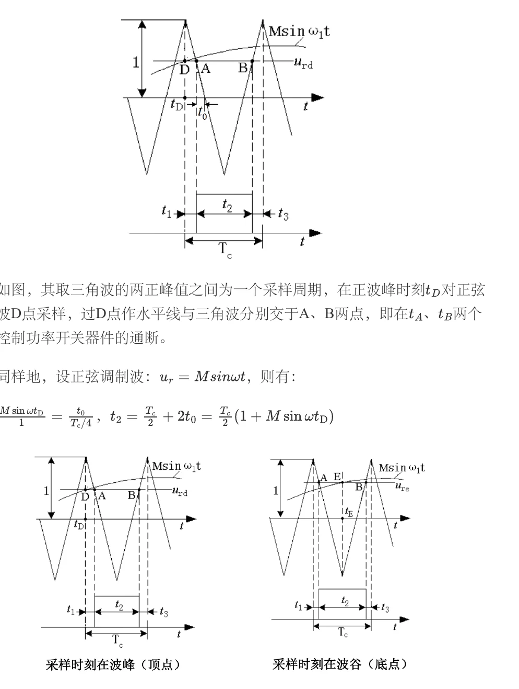
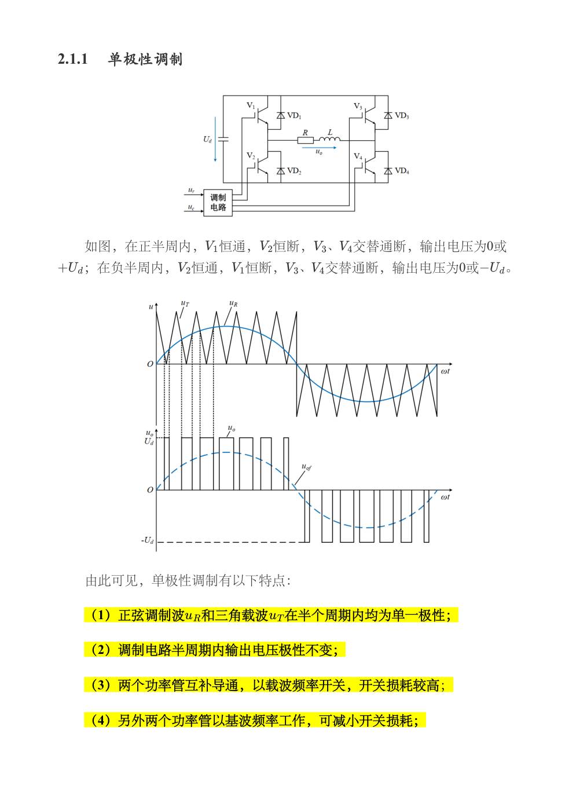
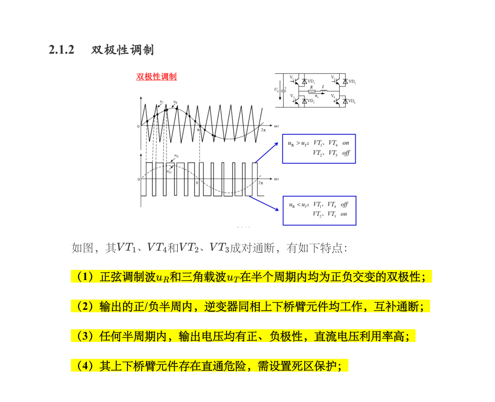
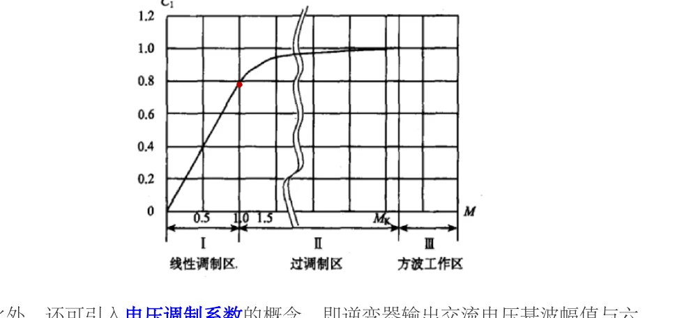
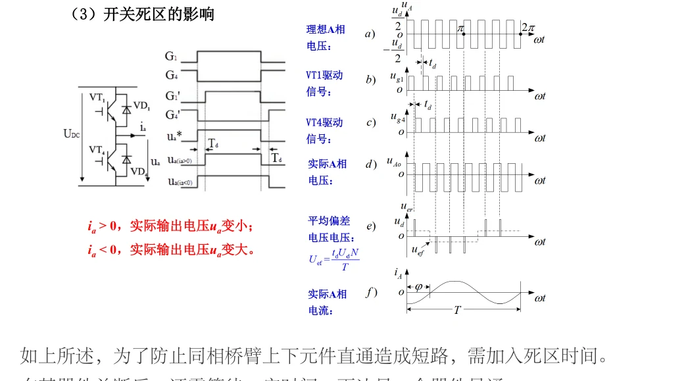
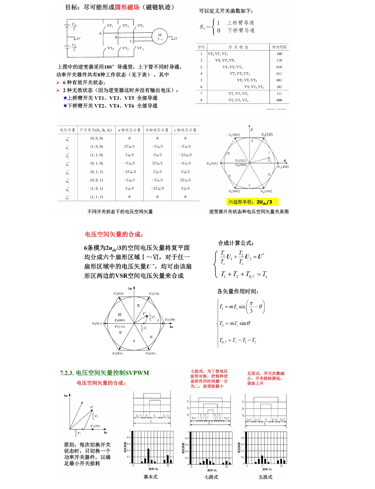

# 第七章　PWM 控制技术：从面积等效到 SPWM

PWM 的本质是用一串开关脉冲的面积，等效出目标波形在一个采样区间内的平均作用。原资料第七章从面积等效、单极性/双极性 SPWM、同步调制和三相 PWM 讲起，并提醒有效值、调制度、载波比和死区是最容易混淆的量。本页沿用这一主线，加入考试中的计算步骤。

> 资料入口：[第七章 PWM PDF](../resources/cc98-notes-07.pdf)。页码按 CC98 资料《电力电子技术笔记·第七章：PWM 控制技术》标注。

## 1. 面积等效原理

设目标正弦参考为 $u^*(t)=U_m\sin\omega t$，在短区间 $[t_k,t_k+T_c]$ 内，若用幅值为 $U_d$ 的矩形脉冲代替，要求

$$
U_d\,T_{on,k}\approx\int_{t_k}^{t_k+T_c}u^*(t)\,dt.
$$

当 $T_c$ 足够小时，$T_{on,k}/T_c$ 与参考波瞬时值成正比，于是脉冲宽度按正弦规律变化。PWM 波形可以是等幅不等宽，也可以是不等幅脉冲；直流母线逆变器主要使用等幅 PWM。

判断题若问“为什么负载端得到近似正弦”，应写出开关频率远高于基波频率、负载电感或输出滤波器抑制载波谐波、脉冲平均面积跟踪参考三个条件。

## 2. SPWM 的两个基本参数

正弦调制波峰值为 $U_m$，三角载波峰值为 $U_c$，定义幅值调制度

$$
m_a=\frac{U_m}{U_c}.
$$

调制波频率为 $f_1$，载波频率为 $f_c$，载波比

$$
m_f=\frac{f_c}{f_1}.
$$

同步调制要求 $m_f$ 为整数且载波与调制波相位锁定；这使开关波形可按基波周期重复，但“整数”本身还不足以保证半波对称。双极性 SPWM 常选奇数载波比并安排适当载波相位，使半周期移位时载波与正弦参考同时反号。三相系统还会结合三相对称性选载波比。异步调制不强制整数比，频谱可能出现边带漂移。线性区通常 $m_a\le1$，$m_a>1$ 进入过调制，脉冲被削顶，基波仍增大但不再与 $m_a$ 成正比。

*图 07-03　规则采样的脉冲宽度与面积等效。来源：[第07章原笔记，第8页](../resources/cc98-notes-07.pdf#page=8)。*

自然采样直接找正弦与载波交点，规则采样用离散时刻的参考值确定脉冲宽度，便于数字控制。图中应先分清载波周期与基波周期，再标出中心对齐或边沿对齐。脉冲面积近似等效主要针对低频效果，开关纹波与谐波仍需另外计算。

## 3. 单相双极性 SPWM

全桥两个桥臂成对互补：当正弦参考高于三角载波时，$S_1,S_4$ 导通，$u_{AB}=+U_d$；反之 $S_2,S_3$ 导通，$u_{AB}=-U_d$。线电压只有 $+U_d$ 和 $-U_d$ 两个电平，任何时刻都可能翻转极性。

在线性区，基波峰值近似 $U_{1m}=m_aU_d$，基波有效值

$$
U_{1,rms}=\frac{m_aU_d}{\sqrt2}.
$$

双极性调制的优点是控制结构直观；同样总母线电压下，全桥基波幅值是半桥的两倍。单相全桥采用同一幅值调制度时，理想线性区的单极性与双极性基波增益相同，不应只因电平形式不同就声称某一种基波利用率必然更高。双极性调制的缺点是两个桥臂都以载波频率动作，输出电压单次跳变可达 $2U_d$，EMI 和滤波压力较高。上下管必须互补并插入死区。

## 4. 单相单极性 SPWM

单极性调制的共同特征是正半周输出在 $0$ 与 $+U_d$ 间切换，负半周在 $0$ 与 $-U_d$ 间切换，线电压有三种电平 $+U_d,0,-U_d$。原笔记第 3 页采用半周钳位的一种实现：一桥臂在半周内保持状态，另一桥臂高频切换，以降低部分器件的开关损耗。另一种常见实现是两桥臂分别比较 $u_m$ 与 $u_c$、$-u_m$ 与同一载波；这种实现的两桥臂都可高频开关。两种门极策略不能混为同一个开关过程。

对后一种双参考、对称单极性实现，由于两桥臂纹波在输出相减，线电压等效纹波频率可接近 $2f_c$，滤波器可比双极性更小；不能把“倍频”无条件推广到所有半周钳位策略。该对称单极性实现下的工程估算可用

$$
L\gtrsim\frac{U_d}{8f_c\Delta i_{L,pp}},
$$

其中系数与调制方式和纹波定义有关，考试应按题目指定的波形推导，不要无条件套用。

*原笔记第 3 页：本图一桥臂按基波换向，另一桥臂高频开关。不要把它与两桥臂均采用同载波比较的对称单极性实现混用。*

*原笔记第 4 页：对角器件成对通断，线电压在正、负母线电压间切换。图中平滑虚线为参考或基波示意。*

## 5. 三相 SPWM

三相调制波为

$$
u_a^*=U_m\sin\omega t,\quad u_b^*=U_m\sin(\omega t-2\pi/3),\quad u_c^*=U_m\sin(\omega t+2\pi/3).
$$

三相共用同一三角载波。桥臂占空比随各相参考变化，线电压由两桥臂极点电压相减。三相三线系统的零序电压不会出现在理想线电压中，因此可以注入三次谐波或其他零序分量，使三相调制波的峰值被“压平”，在不进入过调制的前提下提高直流母线利用率。

当题目要求基波幅值时，先问清是桥臂极点电压、相电压还是线电压；线电压基波是两相基波相量之差，不能直接把相电压数值乘 3。

### 5.1 三相线性区的基波系数

取总直流母线为 $U_d$，极点电压相对虚拟中点在 $\pm U_d/2$ 之间切换。三相纯正弦 SPWM 在线性区的相电压基波峰值为 $m_aU_d/2$，因此

$$
U_{\mathrm{ph},1,rms}=\frac{m_aU_d}{2\sqrt2},\qquad
U_{LL,1,rms}=\frac{\sqrt3m_aU_d}{2\sqrt2}.
$$

例如 $U_d=600\,\mathrm V,m_a=0.9$ 时，相基波有效值为 $190.9\,\mathrm V$，线基波有效值为 $330.7\,\mathrm V$。不要套用单相全桥的 $m_aU_d/\sqrt2$，因为三相桥一相的极点基波只使用半个母线幅值。

纯 SPWM 在 $m_a=1$ 时，线基波最大有效值为 $0.6124U_d$。三次谐波注入和空间矢量调制利用共同零序量，可以把线性可用范围提高到 $U_d/\sqrt2\approx0.7071U_d$，约提高 $15.47\%$。这里“提高”比较的是相同母线电压、相同基波和线性调制条件，不是说每一个调制波的峰值都随意超过载波。

*图 07-04　三次谐波注入与直流电压利用率。来源：[第07章原笔记，第13页](../resources/cc98-notes-07.pdf#page=13)。*

向三相调制波加入相同零序分量，可以在不改变线电压基波的情况下提高可用调制范围。三次谐波在三相线电压相减时抵消，但相对母线或对地的共模电压仍会变化。图中的幅值利用率比较必须在相同直流母线定义与基波幅值口径下进行。

## 6. 死区及其补偿

同一桥臂上下开关若同时导通，会把直流母线短接。实际控制采用“先断后通”，插入死区 $t_d$。死区会使实际输出脉冲少一小段时间，平均误差与电流方向有关：电流为正时，续流二极管可能钳位输出；电流为负时，另一侧二极管钳位。死区造成低次电压畸变、过零点误差和电机转矩脉动。

补偿思路是根据相电流方向给门极脉冲提前或延后一个等效死区时间，或在调制器中加入电压补偿量。补偿过度会重新引入直通风险，所以应限制最小脉宽并配合硬件互锁。

*图 07-05　死区内二极管续流与桥臂电压误差。来源：[第07章原笔记，第14页](../resources/cc98-notes-07.pdf#page=14)。*

死区期间上下管都关断，桥臂电压由负载电流方向及二极管导通决定。因此同一驱动命令在正、负电流时产生相反符号的平均误差。计算电压误差前先固定电流参考方向，并核对一个载波周期内计入几次有效边沿；不能不看调制方式就机械乘2。

### 6.1 死区电压误差如何计算

为避免把相电压误差与全桥线电压误差混用，先分析**一个桥臂极点**。设实际减去理想的误差为 $\Delta u$，电流正方向由桥臂流向负载，每载波周期的有效缺失脉宽为 $t_d$，忽略器件压降和开关延迟差，则

$$
\overline{\Delta u}\approx-\operatorname{sgn}(i)\,U_d\frac{t_d}{T_s}.
$$

令 $A=U_dt_d/T_s$，当基波电流为正弦且开关频率远高于基波时，这个随电流方向变化的误差近似为幅值 $A$ 的反向方波。其基波**峰值**为 $4A/\pi$，基波**有效值**为 $2\sqrt2A/\pi$。原笔记第 14 页把 $2\sqrt2A/\pi$ 叫“基波幅值”，按本页统一约定应读为基波有效值；正文坚持把峰值和有效值分开。

例如 $U_d=400\,\mathrm V,t_d=1\,\mu\mathrm s,f_s=20\,\mathrm{kHz}$，有 $A=8\,\mathrm V$，误差基波峰值约 $10.19\,\mathrm V$、有效值约 $7.20\,\mathrm V$。这是单桥臂误差；全桥或三相线电压误差要先按两桥臂相减和电流相位关系计算，不能再不加说明地乘 2。电流过零附近、窄脉冲消失和器件压降会使这个简化模型失准。

## 7. 过调制、谐波与 SVPWM

在 $m_a\le1$ 的线性区，基波幅值近似正比于 $m_a$。过调制区由于参考超过载波峰值，脉冲被压扁，低次谐波增加，控制线性变差；极限情况下趋近方波。答题时应同时写出“提高电压利用率”和“增加低次谐波”这对利弊。

SVPWM 把三相参考电压表示为空间矢量，利用六个有功开关矢量和两个零矢量，在一个采样周期内按作用时间合成参考矢量。其优点是直流母线利用率高、开关序列可优化、容易实现数字控制；代价是扇区判断、作用时间计算和零矢量分配较复杂。若题目只考基本 SPWM，不要用 SVPWM 的线性范围公式替换课堂约定。

### 7.1 空间矢量的定义与作用时间

为避免不同教材中的比例系数混淆，本页定义幅值不变 Clarke 空间矢量为

$$
\boldsymbol u=\frac23\left(u_a+u_be^{j2\pi/3}+u_ce^{j4\pi/3}\right).
$$

对三相对称正弦，这个矢量的模就是相电压基波峰值。两电平三相桥的六个非零矢量幅值均为 $2U_d/3$，方向每隔 $60^\circ$ 一个；000 与 111 是零矢量。在第一扇区，参考矢量与第一个非零矢量夹角为 $0\le\theta\le\pi/3$，在采样周期 $T_s$ 内令

$$
\boldsymbol u^*T_s=\boldsymbol U_1T_1+\boldsymbol U_2T_2,\qquad
T_0=T_s-T_1-T_2.
$$

在上述幅值定义下，

$$
T_1=\frac{\sqrt3|\boldsymbol u^*|}{U_d}T_s\sin\left(\frac{\pi}{3}-\theta\right),\qquad
T_2=\frac{\sqrt3|\boldsymbol u^*|}{U_d}T_s\sin\theta.
$$

必须满足 $T_1,T_2,T_0\ge0$。将零矢量时间在周期两端对称分配，可形成 000→100→110→111→110→100→000 的七段序列，每次只改变一相开关状态，减少不必要的同时换相。旋转参考矢量始终位于六边形内切圆时，$|\boldsymbol u^*|\le U_d/\sqrt3$，对应线电压基波有效值上限正是 $U_d/\sqrt2$。

零矢量分配会影响共模电压、开关次数和电流纹波，因而不能仅说“两个矢量相加就是输出”；要交代作用时间、扇区及序列。此段为拓展，课程若只要求定性认识，先掌握“两个相邻非零矢量+零矢量平均合成”。

*图 07-06　空间矢量、开关状态与扇区合成。来源：[第07章原笔记，第15页](../resources/cc98-notes-07.pdf#page=15)。*

三相两电平桥有8种状态，其中6个非零矢量和2个零矢量。目标电压在扇区内由相邻有效矢量与零矢量按时间合成，先求作用时间，再安排开关序列。两零状态在理想线电压上等效，但共模电压、切换次数与采样窗口不同，序列设计仍有实际意义。

## 8. 例题（原创训练，参数自设）

### 例题 1：由额定输出求调制度

单相全桥双极性 SPWM，$U_d=400\,\mathrm V$，希望基波输出为 $220\,\mathrm V_{rms}$。求线性区所需 $m_a$。

解：先把有效值换成峰值 $U_{1m}=\sqrt2\times220=311.1\,\mathrm V$。双极性线性关系为 $U_{1m}=m_aU_d$，所以

$$
m_a=\frac{311.1}{400}=0.778.
$$

结果小于 1，在线性区。若误用 $220/400$，会漏掉有效值到峰值的 $\sqrt2$ 因子。

### 例题 2：载波比与脉冲数

基波频率 $f_1=50\,\mathrm{Hz}$，载波频率 $f_c=10\,\mathrm{kHz}$。求载波比，并说明每个基波周期约有多少个载波周期。

$$
m_f=\frac{10\,000}{50}=200.
$$

因此一个基波周期经历 200 个载波周期。这个频率比可以锁定成周期重复的同步调制，但不能仅凭 200 是整数就宣称波形半波对称。若双极性策略要求奇数载波比，可改取 $m_f=201$，对应 $f_c=10.05\,\mathrm{kHz}$，并匹配载波初相位。

### 例题 3：单极性滤波电感估算

$U_d=400\,\mathrm V$，$f_c=20\,\mathrm{kHz}$，允许电感电流峰峰值纹波 $\Delta i_{pp}=2\,\mathrm A$。用资料中的保守估算式求 $L$。

$$
L\gtrsim\frac{400}{8\times20\,000\times2}=1.25\,\mathrm{mH}.
$$

若采用不同的开关序列或双极性估算，系数会改变；设计题要说明采用的纹波模型。

### 例题 4：过调制判断

某控制器测得 $U_m=3.6\,\mathrm V$，载波峰值 $U_c=3.0\,\mathrm V$。$m_a=1.2>1$，已进入过调制。不能再用线性式直接预测基波，需查过调制曲线或按实际脉冲计算；同时应预期低次谐波增加。

## 9. 设计题答题框架

1. 写直流母线、基波频率、载波频率和调制方式；
2. 画正弦参考与三角载波，标明比较结果和互补门极；
3. 说明桥臂输出电平及线电压电平；
4. 写 $m_a,m_f$，分清峰值、有效值和基波；
5. 讨论死区、续流、滤波器、过流和过压保护；
6. 若问谐波，指出载波侧带、低次谐波和调制区间；
7. 用 $m_a\to0$、$m_a=1$ 和功率方向检查结果。

## 10. 自测题与答案

1. **问：** 单极性 SPWM 为什么通常比双极性滤波容易？**答：**输出有零电平，桥臂纹波相消，线电压等效开关频率提高，低频滤波压力下降。
2. **问：** $m_f$ 增大一定更好吗？**答：**不一定。谐波可移到更高频，但开关损耗、EMI 和控制采样压力增加。
3. **问：** 为什么死区会造成电压误差？**答：**死区内主开关都关断，负载电流通过方向相关的二极管续流，实际极点电压不能完全跟随理想调制命令。
4. **问：** 三次谐波注入为什么不直接出现在三相线电压？**答：**三相同相位的零序分量在线电压相减时抵消，但可以降低调制波峰值。

## 11. 易错点

- 220 V 交流通常指有效值，SPWM 基波公式常用峰值；
- $m_a$ 是调制波与载波的峰值比，$m_f$ 是频率比；
- 双极性线电压是两电平，单极性线电压是三电平；
- 过调制后不能继续使用线性基波公式；
- 忽略死区会把实际输出和仿真结果画得过于理想；
- 线电压、相电压、桥臂极点电压必须先标参考点；
- 资料中的电感纹波估算系数依调制方式而变，公式旁要写假设。

## 12. 原资料页码对照

| 阅读目的 | 第七章原 PDF |
| --- | --- |
| 面积等效与 SPWM 定义 | [第 1—2 页](../resources/cc98-notes-07.pdf#page=1) |
| 半周钳位单极性、双极性及同步调制 | [第 3—4 页](../resources/cc98-notes-07.pdf#page=3) |
| PWM 输出频谱及高频侧带 | [第 11—12 页](../resources/cc98-notes-07.pdf#page=11) |
| 三次谐波注入与利用率 | [第 12—13 页](../resources/cc98-notes-07.pdf#page=12) |
| 死区、误差电压及低速畸变 | [第 14 页](../resources/cc98-notes-07.pdf#page=14) |
| SVPWM、电流滞环与 PWM 整流课程提示 | [第 15—16 页](../resources/cc98-notes-07.pdf#page=15) |

原资料对某一学年的复习范围提示只反映当时课程安排，不等于每一年都不考。本站将 SVPWM 的作用时间列为拓展，PWM 整流不作为本章必背范围，实际仍以本学期教师要求为准。
