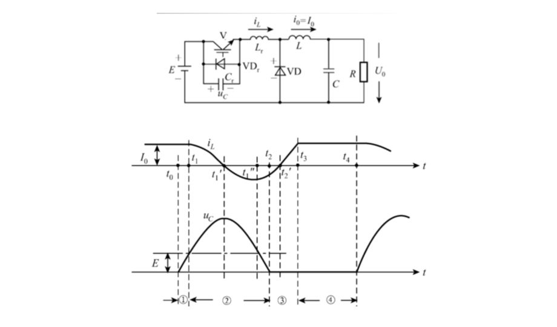
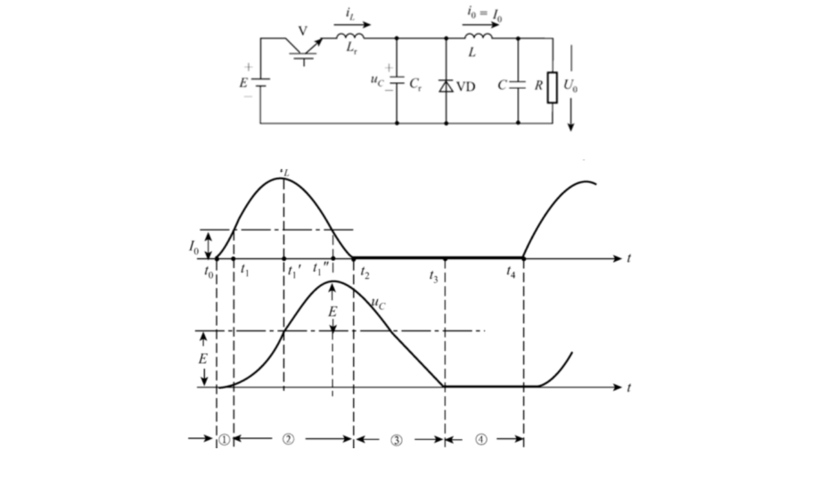

# 第八章：谐振软开关技术

软开关的目的不是改变变换器的基本能量变换关系，而是在开关转换瞬间让器件电压或电流接近零，减少电压、电流重叠造成的损耗和 EMI。课程原笔记见[第八章资料 PDF](../resources/cc98-notes-08.pdf)，重点在第 1–9 页；历年综合设计中还会把软开关与高频隔离电源、散热和保护放在一起考。

## 1. 从硬开关到软开关

理想硬开关的开通、关断是瞬时的；真实器件有有限的上升、下降时间。开通或关断期间若器件两端电压 $v_S$ 与电流 $i_S$ 同时不为零，近似开关能量为

$$
E_{sw}\approx\frac12 V_S I_S(t_r+t_f),\qquad
P_{sw}\approx E_{sw}f_s.
$$

因此提高 $f_s$ 会缩小磁性元件和滤波器，却线性增加开关损耗。寄生电感还会在 $di/dt$ 大时产生 $L_\sigma di/dt$ 尖峰，寄生电容会在 $dv/dt$ 大时产生位移电流和共模 EMI。

软开关利用谐振电感 $L_r$、谐振电容 $C_r$ 或辅助换流支路，安排开关动作发生在电压或电流过零附近：

- **ZVS（零电压开关）**：开通前先让 $v_S\to0$，主要避免 MOSFET 开通时的 $C_{oss}$ 放电损耗；
- **ZCS（零电流开关）**：关断前先让 $i_S\to0$，适合关断拖尾明显的 IGBT 或晶闸管类器件；
- 吸收电路的零电压关断、零电流开通可能只是把损耗转移到电阻或辅助器件，不能直接等同于真正的谐振软开关。

## 2. 谐振参数和判断方法

理想串联 $L_r-C_r$ 的特征阻抗和谐振角频率为

$$
Z_r=\sqrt{\frac{L_r}{C_r}},\qquad
\omega_r=\frac1{\sqrt{L_rC_r}},\qquad
f_r=\frac1{2\pi\sqrt{L_rC_r}}.
$$

若初始电流为零、初始电容电压为 $V_0$，串联谐振电流的峰值量级约为 $V_0/Z_r$；若初始电感电流为 $I_0$，电容电压摆幅量级约为 $I_0Z_r$。这两个估算可以在没有完整波形的题目中先判断器件峰值应力。

判断一个拓扑是否能实现 ZVS/ZCS，按四步检查：

1. 列出主开关关断前的电感电流方向和电容电压极性；
2. 关断或辅助开关触发后，判断谐振电流能否给 $C_{oss}$ 充放电；
3. 检查目标开通时刻是否满足 $v_S=0$ 或目标关断时刻是否满足 $i_S=0$；
4. 检查谐振电流峰值、器件反向耐压、最小负载和控制时序。

## 3. ZVS 准谐振 Buck 的四阶段

以资料中的 ZVSQRC 为例，负载电流在短暂谐振周期内近似恒定，主开关旁并联 $C_r$ 与反并联二极管，主回路串联小电感 $L_r$。

*原资料第八章 PDF 第 5 页。$L$ 是负载滤波电感，$L_r$ 是换流谐振电感，两者不能混用。*

### 阶段 1：主开关关断，电容充电

主开关电流转移到谐振支路，$C_r$ 上电压从零上升。电流变化被 $L_r$ 限制，所以关断不再是电流突变；开关电压上升沿变缓，关断损耗下降。

### 阶段 2：谐振反向并使开关电压回零

当 $C_r$ 充到输入电压附近，电感电流继续流动，使 $C_r$ 反向放电。若谐振能量足够，开关节点电压会过零并进入负值，反并联二极管导通，把开关两端钳位在近似零电压。

### 阶段 3：零电压时刻施加驱动

在二极管导通期间给主开关门极信号，器件先承受反向压降，直到谐振电流过零；随后主开关在 $v_S\simeq0$、$i_S\simeq0$ 的条件下接管负载电流，实现近似 ZVS。驱动时序不能只按固定延迟，必须考虑死区和负载电流。

### 阶段 4：主开关导通，准备下一次关断

负载电流全部经主开关，$C_r$ 被维持在近似零电压，为下一次关断准备。轻载时电感能量不足，可能无法把 $C_r$ 放到零，ZVS 失效；这就是准谐振拓扑的负载范围限制。

## 4. ZCS 准谐振 Buck 的工作过程

*原资料第八章 PDF 第 7 页。主开关电流在 $t_2$ 降到零，后续由电容放电、二极管续流接续。*

ZCS 图中 $L_r$ 与主开关串联，$C_r$ 接在谐振节点与回路负端之间，和续流二极管并联；不能把 $L_r,C_r$ 误画成始终串联在负载中的支路。开通初期，$L_r$ 使电流从零缓慢上升；随后谐振电流达到负载电流并分流，主开关电流按正弦形下降；当开关电流降到零时撤去驱动，完成零电流关断。与 ZVS 相比，ZCS 对关断拖尾器件更友好，但串联谐振电感会造成额外导通压降和电流应力；能否回到零电流，必须结合负载与谐振电流幅值判断。

### 4.1 为什么一定要分阶段画等效电路

第 7–8 页的 ZCS 电路中，负载近似恒流源 $I_o$。刚开通时续流二极管仍导通，将 $C_r$ 钳位在零，输入电压全部落到 $L_r$：

$$
\frac{\mathrm di_L}{\mathrm dt}=\frac{V_d}{L_r},
\qquad t_1-t_0=\frac{L_rI_o}{V_d}.
$$

当 $i_L$ 上升至 $I_o$，续流二极管电流降到零才开始谐振。若一开始就把 $L_r,C_r$ 画成自由谐振，会忽略二极管的钳位而写错初值。谐振段结束后，主开关电流被单向器件限制在零，电容继续向负载放电，电容电压近似线性下降；这时不能继续把正弦解外推到负电流区。

### 4.2 两类准谐振的状态方程与实现条件

以下是课程图所示理想单向准谐振支路在“续流二极管退出后的谐振段”的局部关系，时间原点统一移到该段开始；$\theta=\omega_rt$。它们不是适用于任意 LLC/移相全桥的通式。

**ZVS 图的谐振段**：初值 $v_C(0)=V_d$、$i_L(0)=I_o$，有 $L_r\,di_L/dt=V_d-v_C$、$C_r\,dv_C/dt=i_L$。求得

$$
v_C=V_d+I_oZ_r\sin\theta,\qquad
i_L=I_o\cos\theta.
$$

要让电容电压能回落至零，必须有 $I_oZ_r\ge V_d$。因此这类 ZVS 准谐振通常存在**最小负载电流**；谐振电压峰值可达 $V_d+I_oZ_r$，不能按仅 $V_d$ 选择开关耐压。若目标零电压点无法到达，延长死区也不能凭空补足谐振能量。

**ZCS 图的谐振段**：初值 $i_L(0)=I_o$、$v_C(0)=0$，此时 $L_r\,di_L/dt=V_d-v_C$、$C_r\,dv_C/dt=i_L-I_o$。求得

$$
i_L=I_o+\frac{V_d}{Z_r}\sin\theta,\qquad
v_C=V_d(1-\cos\theta).
$$

要使开关电流能下降至零，需 $V_d/Z_r\ge I_o$，因此这一理想 ZCS 支路存在**最大负载电流**；电流峰值为 $I_o+V_d/Z_r$，电容电压峰值为 $2V_d$。可见“所有软开关都在轻载失效”也不准确：ZVS 和 ZCS 的负载约束方向取决于具体拓扑。前文的轻载提醒主要针对依靠负载电流给结电容换流的 ZVS，应先写方程判断，不能只背口号。

### 4.3 比较题应写哪些差别

| 比较对象 | ZVS 准谐振 | ZCS 准谐振 |
| --- | --- | --- |
| 目标转换 | 电压回零后开通 | 电流回零后关断 |
| 主导应力 | 电容/开关电压峰值可能很高 | 开关谐振电流峰值可能很高 |
| 上述理想支路的条件 | $I_oZ_r\ge V_d$ | $I_o\le V_d/Z_r$ |
| 需要检查的控制窗口 | 钳位二极管导通期间可靠开通 | 电流降零后及时撤去驱动 |
| 器件非理想影响 | $C_{oss}$ 非线性、反并联二极管恢复 | 尾电流、二极管恢复、寄生振荡 |

表中的条件仅针对本页给出的准谐振电路，不能代替移相全桥、LLC 等其他拓扑的软开关边界。

等号是理想临界条件，过零窗口可能收缩为一个瞬间；实际参数需留出器件电容、传播延迟、温漂和负载波动裕量。图上看到波形“碰到零”只是必要的时序线索，还应检查电流方向是否能让反并联二极管继续钳位。

## 5. 准谐振、零开关 PWM 与零转换 PWM

- **准谐振（QRC）**：谐振贯穿较长时间，电压或电流呈正弦半波；软开关效果好，但谐振电压/电流峰值大，频率通常随负载变化，滤波器设计较难。
- **零开关 PWM**：用辅助开关只在主开关转换前后启动谐振，主功率波形仍近似方波，可保持固定频率 PWM，器件应力比 QRC 小。
- **零转换 PWM**：辅助谐振支路与主开关并联，使输入范围和负载范围内的转换条件更宽，额外无功交换也较小，但辅助器件、控制和成本更复杂。

软开关并非“没有代价”：谐振电流会增加 RMS 导通损耗，峰值电压可能超过母线电压，辅助开关会产生额外损耗；设计时要在总损耗而非单个开关损耗上比较。

## 6. 设计计算模板

### 6.1 由目标谐振频率选 $L_r,C_r$

若先选完整谐振周期 $T_r=T_s/4$，则 $f_r=4f_s$；实际换流只使用其中一段，具体时间还需由初值与过零点求出。以零初始电流、激励电压 $V_{\mathrm{comm}}$ 的理想串联 LC 为初估，可按允许谐振峰值电流 $I_{r,pk}$ 选特征阻抗：

$$
Z_r\approx\frac{V_{\mathrm{comm}}}{I_{r,pk}},\qquad
L_r=\frac{Z_r}{2\pi f_r},\qquad
C_r=\frac1{2\pi f_rZ_r}.
$$

这是初始估算；最终还要把 MOSFET 的 $C_{oss}$、二极管结电容、漏感和负载电流带入仿真或实验校准。

### 6.2 ZVS 的最小负载条件

在死区时间 $t_d$ 内，负载/谐振电流必须提供足够电荷给开关结电容完成换向。粗略条件为

$$
|I_r|t_d\ge Q_{oss},
$$

更准确时使用 $Q_{oss}(V)$ 的积分。由此可见，轻载时 $I_r$ 变小，ZVS 更容易丢失；可以增加磁化电流、引入辅助支路或采用变频控制改善。

### 6.3 能量条件和时间条件需要同时检查

在桥式换流中，仅满足 $I_rt_d\ge Q_{oss}$ 还不够。可用电感中的能量必须足以完成两个桥臂器件输出电容的充放电及其他寄生能量交换。常见初筛写法是

$$
\frac12L_{eq}I_{\mathrm{comm}}^2\gtrsim E_{\mathrm{comm}}.
$$

$E_{\mathrm{comm}}$ 应依据具体拓扑和器件数据求取，不能把某一器件的 $C_{oss}$ 常数直接乘 2 后当成所有桥式电路的精确条件。器件手册给出的 $E_{oss}(V)$ 是能量曲线，$Q_{oss}(V)$ 是电荷曲线；两者用途不同：前者检验能量，后者估计换流时间。$C_{oss}$ 随电压变化很强时，$E_{oss}\ne\tfrac12 C_{oss}(V)V^2$。

死区过短会在电压尚未回零时开通；过长则增加体二极管导通损耗，甚至使谐振电流反向、开关节点再次抬高。因此“加大死区总能改善 ZVS”不成立。应画出驱动、电压、电流三个时间轴，找到零电压窗口，再把驱动延迟、最小脉宽和器件传播延迟计入。

### 6.4 软开关与总损耗、温升

比较两方案时至少列出：导通损耗 $I_{rms}^2R_{DS(on)}$ 或 $V_{CE(sat)}I_{avg}$、开关损耗、栅极驱动损耗 $Q_gV_gf_s$、辅助支路损耗、磁性元件铜损/铁损。软开关可能把开关损耗从 $10\ \mathrm W$ 降到 $2\ \mathrm W$，却让循环电流使导通损耗增加 $5\ \mathrm W$；净收益只有 $3\ \mathrm W$，而非 $8\ \mathrm W$。

初步热校核可用 $T_j\approx T_a+P_{loss}(R_{\theta jc}+R_{\theta cs}+R_{\theta sa})$。注意器件手册的瞬态热阻、结壳热阻和板级热阻是不同条件，不能相加重复计算。考试设计题给出这一计算链即可说明散热依据，实际装置需要温升测试。

### 6.5 与驱动、吸收和保护的配合

软开关不能替代过流和过压保护。驱动应具备可靠关断电平、适当栅电阻、欠压锁定与桥臂互锁；大 $dv/dt$ 时还要考虑米勒误导通。IGBT 可使用退饱和检测配合软关断，兼顾短路耐受时间与寄生电感过压。RCD/RC 吸收用于限制漏感尖峰，过大电容虽然能抑制 $dv/dt$，也会增加每周期充放电能量；参数不能越大越好。

在课程答题中，若要求“画软开关电路并说明优点”，至少应补齐 $L_r,C_r$、主开关、反并联二极管、负载续流路径，以及哪一时刻发驱动。只写“加一个电容就实现 ZVS”缺少换流回路与能量来源，不能算完整说明。

## 7. 例题与解答

### 例题 1：由谐振频率和特征阻抗求元件（原创训练题）

要求 $f_r=200\ \mathrm{kHz}$，换流电压约 $400\ \mathrm V$，希望谐振峰值电流不超过 $10\ \mathrm A$。取 $Z_r=400/10=40\ \Omega$，则

$$
L_r=\frac{40}{2\pi\times200\times10^3}=31.8\ \mu\mathrm H,
$$

$$
C_r=\frac1{2\pi\times200\times10^3\times40}=19.9\ \mathrm{nF}.
$$

这只是理想串联谐振的初值；若 MOSFET 的 $C_{oss}$ 约 $1\ \mathrm{nF}$，它不能简单忽略，而应并入等效 $C_r$，并重新校核峰值电压和频率。

### 例题 2：检查轻载下的 ZVS 条件（原创训练题）

死区 $t_d=200\ \mathrm{ns}$，开关结电荷近似 $Q_{oss}=120\ \mathrm{nC}$。若换流期间可用电流为 $0.8\ \mathrm A$，则可提供电荷

$$
Q=I_rt_d=0.8\times200\ \mathrm{ns}=160\ \mathrm{nC}>120\ \mathrm{nC}.
$$

这只说明电荷与时间的必要条件通过，还需检查换流电流方向、可用能量和拓扑才能确认 ZVS。若轻载降至 $0.5\ \mathrm A$，$Q=100\ \mathrm{nC}<120\ \mathrm{nC}$，则连此项必要条件也不满足，电容无法在死区内完成换向。答题应写出已验证的条件，不能只凭一个不等式说“软开关一定成立”。

### 例题 3：准谐振条件与峰值应力（原创训练题）

取 $V_d=100\ \mathrm V$、$Z_r=20\ \Omega$、$f_r=100\ \mathrm{kHz}$，比较本页两种准谐振支路在 $I_o=4\ \mathrm A$、$6\ \mathrm A$ 时的条件。

ZVS 要求 $I_o\ge V_d/Z_r=5\ \mathrm A$。$4\ \mathrm A$ 时电容电压最低仍为 $100-4\times20=20\ \mathrm V$，不能达到 ZVS；$6\ \mathrm A$ 时可以回零，但峰值电压为 $100+6\times20=220\ \mathrm V$，所以不能只选 $100\ \mathrm V$ 耐压开关。

ZCS 要求 $I_o\le5\ \mathrm A$。$4\ \mathrm A$ 时开关电流可以降零，峰值电流却为 $4+100/20=9\ \mathrm A$；$6\ \mathrm A$ 时最小谐振电流为 $6-5=1\ \mathrm A$，不能自然零电流关断。两种结果反向，正好说明工作范围必须由各自方程判断。

### 例题 4：开关损耗减少后是否真的更高效（原创训练题）

硬开关工作点为 $400\ \mathrm V$、$5\ \mathrm A$，开通关断重叠时间和 $t_r+t_f=100\ \mathrm{ns}$，频率 $100\ \mathrm{kHz}$。估算

$$
P_{sw}\approx\frac12\times400\times5\times100\times10^{-9}\times100\times10^3=10\ \mathrm W.
$$

软开关后实际测得主开关转换损耗为 $2\ \mathrm W$，但谐振循环电流额外增加 $3\ \mathrm W$ 导通损耗、辅助器件耗散 $1\ \mathrm W$，总计为 $6\ \mathrm W$，净减少 $4\ \mathrm W$。若输出功率 $200\ \mathrm W$，其他不变损耗为 $8\ \mathrm W$，则硬开关效率约 $200/(200+18)=91.74\%$，软开关约 $200/(200+14)=93.46\%$。答题要计算系统效率，不能用“开关损耗降了 80%”代替总效率提高幅度。

## 8. 易错点与自测

- ZVS 关注**开通前**电压为零，ZCS 关注**关断前**电流为零；把时刻写反会失分。
- 吸收电路能降低器件应力，但若能量消耗在电阻上，总损耗未必降低。
- QRC 的谐振峰值不是越大越好；它必须同时满足换流电荷、器件耐压和 RMS 电流限制。
- 软开关不等于软启动，也不等于 PWM 调制策略；前者是换流电路与时序，后者是控制方法。

**自测：** 1. 为什么轻载时 ZVS 失效？2. 比较 ZVS 和 ZCS 对 MOSFET 与 IGBT 的适用性。3. 为什么准谐振变频会给滤波器设计带来困难？

**答案要点：** 1. 负载/谐振电流提供的换流电荷不足以给 $C_{oss}$ 完成充放电；2. MOSFET 适合利用 ZVS 减少 $C_{oss}$ 开通损耗，IGBT 关断拖尾明显时 ZCS 更有价值；3. 理想 LC 的固有 $f_r$ 由元件参数确定，但满足换流与调压所需的开关频率或控制周期会随输入、负载变化，EMI 滤波器需要覆盖较宽工作频段。
