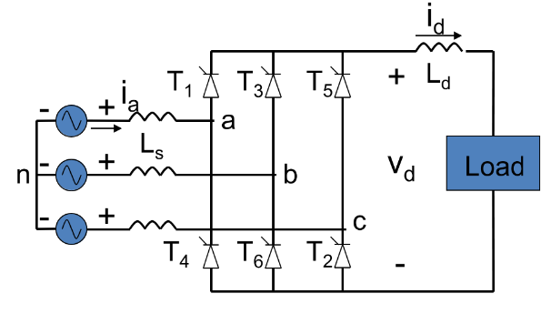
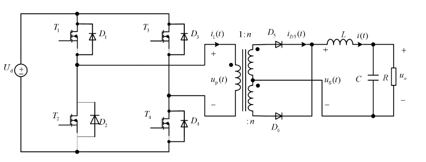
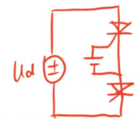

# 2026 秋回忆卷、A4 半开卷与专题解析

[课程目录](index.md) · [历年卷索引](past-exams.md) · [已有分步解答](exam-solutions.md) · [资料中心](resources-guide.md)

本页把本次新增的三组资料放在同一条复习路径中：先看原始回忆卷，按考试顺序做题；再用本页的“条件—模型—计算—检查”核对过程；最后打开 A4 半开卷合集和专题解析 PDF，把可以压缩到一张 A4 纸的公式、波形和易错点重新整理。

原始资料只做复制，PDF、TeX、Word 和图片没有在网站端改写。回忆卷有漏记题干、缺少参数和“按回忆补拟”的选择项；下文会明确标出这些边界。凡是“示例取值”均是为了演示计算流程，不能当成原题条件或教师标准答案。

## 一、三份资料的原件入口

### 1. 2026—2027 秋《电力电子技术Ⅰ》回忆卷

- [原卷 PDF（4 页）](resources/exam-2026-2027.pdf){ .md-button .md-button--primary }
- [可编辑 TeX 源码](resources/exam-2026-2027.tex)
- [原版 Word 文件](resources/exam-2026-2027.docx)
- [整理说明 README](resources/exam-2026-2027-README.txt)
- 原题插图：[三相全控整流](resources/exam-2026-2027-source/image1.png) · [全桥隔离 Buck](resources/exam-2026-2027-source/image2.png) · [器件判断题](resources/exam-2026-2027-source/image3.png)

{ loading=lazy }
*图 1：回忆卷第一题原图。管号以此图为准；若只从文字版回忆题面，不能重新猜测管号。*

{ loading=lazy }
*图 2：回忆卷第七题原图。波形题应先根据原图标出变压器极性、整流器件和输出电感参考方向。*

{ loading=lazy }
*图 3：回忆卷器件状态判断图。判断时先看阳极—阴极电压，再看门极信号，最后检查电流是否满足保持条件。*

### 2. A4 半开卷资料

- [A4 半开卷合集 PDF](resources/a4-half-open-book.pdf){ .md-button .md-button--primary }
- [jrc2.jpg](resources/a4-half-open-book/jrc2.jpg) · [rjc1.jpg](resources/a4-half-open-book/rjc1.jpg)
- [szy1.jpg](resources/a4-half-open-book/szy1.jpg) · [szy2.jpg](resources/a4-half-open-book/szy2.jpg)

这份 PDF 在本地工具中存在对象兼容性提示，因此网站保留原始二进制文件，不用脚本重写。浏览器内嵌阅读器若无法加载，直接点击下载或“新标签页打开”。四张 JPG 也作为原始图片单独提供，便于手机端放大查看。

### 3. 按专题整理与解析 PDF

- [《电力电子技术 I_按专题整理与解析》PDF（32 页）](resources/topic-analysis-2026.pdf){ .md-button .md-button--primary }

该文件覆盖器件、整流、DC–DC、逆变、SPWM、交流变换和隔离适配器。它适合做第二遍复习：先把本页推导写在草稿上，再对照 PDF 的专题顺序检查是否漏掉工作模式、器件应力和保护条件。

## 二、回忆卷的使用边界

| 题号 | 可以从原件确认的内容 | 需要保留的边界 |
| --- | --- | --- |
| 一 | 三相全桥全控整流、$\alpha=\pi/6$、电感近似无穷大 | 未给完整电源和负载参数，数值只能写成通式 |
| 二 | 周波变换器、直流电压利用率、SPWM、TCR、交流调压、矩阵变换器等知识点 | 选择项有按回忆补拟内容，不能视为逐字原题 |
| 三 | 固态变压器、三相四线制零线、高频 SPWM 与方波逆变比较 | 未限定具体拓扑，按控制与系统层面作答 |
| 四 | 单相单极性 SPWM，$f_c=50\ \mathrm{kHz}$、$V_{dc}=380\ \mathrm V$、$220\ \mathrm V/50\ \mathrm{Hz}$、纹波小于 5 A | 电感纹波系数取决于调制实现和纹波定义 |
| 五 | 多数载流子器件、MOSFET、SCR 关断与器件状态 | 状态判断必须以原图的电压极性和门极信号为准 |
| 六 | Boost：$V_\mathrm{in}=50\ \mathrm V$、$V_o=200\ \mathrm V$、$R=10\ \Omega$、电流纹波“20%” | 没有开关频率，电感不能得到唯一数值 |
| 七 | 全桥隔离 Buck、励磁电流和副边二极管电流波形 | 没有完整参数时画趋势和分段关系，不编造幅值 |
| 八 | $24\ \mathrm V$ 直流到 $220\ \mathrm V/50\ \mathrm{Hz}$、$100\ \mathrm W$、含直流隔离 | 允许多种设计，下面给出一组教学示例 |

## 三、逐题参考解析

### 第一题：三相全桥全控整流

电感近似无穷大意味着直流侧电流连续，六个晶闸管每隔 $60^\circ$ 换相；理想情况下同一只晶闸管导通 $120^\circ$。输出电压由六段线电压拼接：

$$
u_d\in\{u_{ab},u_{ac},u_{bc},u_{ba},u_{ca},u_{cb}\}.
$$

具体管号要以[原题图](resources/exam-2026-2027-source/image1.png)为准，不同教材桥臂编号不同。

令线电压有效值为 $U_{LL}$，忽略换相重叠时

$$
U_d=1.35U_{LL}\cos\alpha.
$$

本题 $\alpha=\pi/6$，所以 $U_d\approx1.169U_{LL}$。题面没有给 $U_{LL}$ 和负载参数，不能冒充唯一数值。若另给等效电阻 $R_d$，才可写 $I_d=U_d/R_d$。

每相输入电流是 $+I_d$、$0$、$-I_d$ 的 120° 矩形波。其有效值和基波有效值为

$$
I_s=\sqrt{\frac23}I_d,\qquad I_{s1}=\frac{\sqrt6}{\pi}I_d.
$$

因此畸变因数为 $3/\pi$，理想功率因数

$$
\mathrm{PF}=\frac3\pi\cos\alpha.
$$

当 $\alpha=30^\circ$ 时，$\mathrm{PF}\approx0.827$。画图要标出六个 $60^\circ$ 线电压区间、相电流的正/零/负区间和触发延迟。若题目给目标平均值 $U_d^\*$，调角通式为

$$
\alpha=\arccos\left(\frac{U_d^\*}{1.35U_{LL}}\right),
$$

并先检查 $|U_d^\*|\le1.35U_{LL}$。有换相电抗时还要减去换相压降项，题面未给时不主动加入。

### 第二题：选择题的条件化判断

| 知识点 | 参考判断 | 理由与边界 |
| --- | --- | --- |
| 无环流周波变换器 | B：两组变流器交替工作 | 正、反两组不同时触发；有环流方案才需电抗器限制环流 |
| 单相逆变器直流电压利用率 | 先看定义 | 要区分方波基波、SPWM 线性区和低谐波指标，不能只看“全桥” |
| 提高 SPWM 利用率 | 三次谐波/零序注入、适度过调制 | 过调制会牺牲线性和低次谐波性能 |
| PWM 优化 | 软开关、开关角预置、选择性消谐波、零序注入均可能有效 | 需先明确优化目标是损耗、频谱、利用率还是动态响应 |
| 单极性 SPWM | 通常低次谐波更少、等效开关频率更高 | 效率不必然更高，死区和器件压降会影响结果 |
| TCR 触发角 | 通常 $90^\circ\le\alpha\le180^\circ$ | 增大 $\alpha$ 会减小基波电流和无功吸收 |
| 交流调压应用 | 异步电机软启动、灯光调压、交流加热 | 同步电机变频需要改变频率，不能由单纯调压替代 |
| 矩阵变换器输入功率因数 | 可通过调制主动控制 | 负载阻抗角 $45^\circ$ 不能直接推出输入功率因数角 |

### 第三题：简答题

**固态变压器。** 需要协调输入整流、高频隔离 DC–DC 和输出级的多级功率流；同时调节输入功率因数、母线电压、输出电压/电流和有功/无功。双向潮流要求正反向换流都稳定，高频变压器要保持伏秒平衡，软开关要覆盖宽负载范围，还要处理短路、过流、过压、绝缘、共模 EMI、散热和快速故障切除。

**三相四线制中性线。** 不平衡负载的剩余电流必须流过中性线；整流器和开关电源产生的三次及三倍频零序电流在三相中同相叠加，不会像平衡基波那样抵消。因此零线不能只按平衡正弦电流经验减小，还要按谐波、电缆敷设和允许温升核算。

**高频 SPWM 对方波。** SPWM 可独立调节幅值和频率，低次谐波少，谐波集中到载波附近，滤波器更小，动态和并网控制更方便；代价是开关损耗、驱动、死区和 EMI 更复杂，高频不等于无条件更高效。

### 第四题：单相单极性 SPWM

已知 $V_{dc}=380\ \mathrm V$、$V_{o,\mathrm{rms}}=220\ \mathrm V$、$f_c=50\ \mathrm{kHz}$、$f_1=50\ \mathrm{Hz}$。线性区全桥单极性 SPWM 可取

$$
m_a=\frac{\sqrt2V_{o,\mathrm{rms}}}{V_{dc}}
\approx0.819,\qquad
m_f=\frac{f_c}{f_1}=1000.
$$

若按对称调制的保守峰峰值估算

$$
\Delta i_{L,\mathrm{pp}}\approx\frac{V_{dc}}{8f_cL},
$$

并要求 $\Delta i_{L,\mathrm{pp}}\le5\ \mathrm A$，则

$$
L\ge\frac{380}{8\times50\,000\times5}
\approx0.19\ \mathrm{mH}.
$$

不同开关序列、峰值/峰峰值定义会改变系数；规范答题要先写清纹波定义，工程选型还要留饱和、铜损和控制带宽余量。

### 第五题：功率器件基础

功率 MOSFET 和肖特基二极管主要依靠多数载流子导电。IGBT 虽有 MOS 栅控结构，但漂移区存在少数载流子调制，关断会有拖尾电流。

MOSFET 的得分点包括：栅极绝缘、稳态驱动电流小；多数载流子器件、开关快；导通损耗约为 $I_\mathrm{rms}^2R_{\mathrm{DS(on)}}$；栅极电荷、输入电容和米勒平台决定驱动及开关损耗；体二极管的反向恢复必须考虑；提高耐压时传统硅器件的 $R_{\mathrm{DS(on)}}$ 往往上升；选型要同时看耐压、电流、频率、SOA、热阻和栅极驱动。

SCR 触发后不能靠撤去门极脉冲关断。必须使阳极电流降到维持电流 $I_H$ 以下，并满足恢复时间 $t_q$ 的反向偏置或零电流间隔；交流中可自然换流，直流中需强迫换流。状态判断要按原图先看阳极—阴极电压、再看门极脉冲、最后看电流保持条件。

### 第六题：Boost 计算

$$
V_\mathrm{in}=50\ \mathrm V,\quad V_o=200\ \mathrm V,\quad R=10\ \Omega.
$$

理想 CCM 伏秒平衡给出

$$
D=1-\frac{V_\mathrm{in}}{V_o}=0.75.
$$

$$
I_o=\frac{V_o}{R}=20\ \mathrm A,\quad
P_o=\frac{V_o^2}{R}=4\,000\ \mathrm W,\quad
I_{L,\mathrm{avg}}\approx\frac{P_o}{V_\mathrm{in}}=80\ \mathrm A.
$$

若“峰峰值为平均电感电流的 20%”，则 $\Delta i_{L,\mathrm{pp}}=16\ \mathrm A$，从而

$$
L=\frac{V_\mathrm{in}D}{\Delta i_{L,\mathrm{pp}}f_s}
=\frac{2.34375}{f_s}\ \mathrm H.
$$

回忆题没有 $f_s$，不能给唯一电感。若另作教学假设 $f_s=50\ \mathrm{kHz}$，才有 $L\approx46.9\ \mu\mathrm H$。理想关断时 MOSFET 耐压约 $V_o=200\ \mathrm V$，峰值电流约 $I_{L,\mathrm{pk}}=88\ \mathrm A$；实际还要考虑尖峰、反向恢复、误差和热裕量。

### 第七题：全桥隔离 Buck

原图见[回忆卷插图](resources/exam-2026-2027-source/image2.png)。典型能量路径为“原边全桥—高频变压器—副边全波整流—输出 LC”。若 $n=N_s/N_p$，理想 CCM 可写

$$
V_o\approx nD_\mathrm{eff}V_\mathrm{in}.
$$

励磁电流满足

$$
\frac{\mathrm di_m}{\mathrm dt}=\frac{v_p}{L_m}.
$$

正向施压时线性上升，反向施压时线性下降；正负伏秒不平衡会造成磁通偏移和饱和。副边某一只二极管只在对应极性时导通，导通区电流近似等于输出电感电流，另一只反偏截止。没有原图参数时只画分段趋势，不伪造幅值。

### 第八题：24 V 直流到 220 V/50 Hz、100 W

一组自洽教学设计是

$$
24\ \mathrm V\rightarrow\text{高频全桥隔离 DC\!-\!DC}
\rightarrow400\ \mathrm V\text{ 母线}\rightarrow\text{单相全桥 SPWM}.
$$

输出电流 $I_{o,\mathrm{rms}}=100/220\approx0.455\ \mathrm A$，理想输入平均电流约 $100/24=4.17\ \mathrm A$。选隔离级 $f_s=100\ \mathrm{kHz}$、有效占空比 $D=0.8$，则

$$
\frac{N_s}{N_p}=\frac{400}{0.8\times24}\approx20.83,\qquad
m_a=\frac{\sqrt2\times220}{400}\approx0.778.
$$

答题还要补上原边互锁与死区、磁通伏秒平衡、整流器件耐压、母线预充和放电、LC 滤波、短路/过温/过压保护、EMI、绝缘距离和器件热设计。设计题允许多种拓扑，关键是“隔离拓扑—能量路径—参数—波形/保护”闭合。

## 四、把三份资料压缩成一张 A4

| 区域 | 应放内容 | 作用 |
| --- | --- | --- |
| 左上 | 器件选型、SCR 关断、MOSFET/IGBT 比较 | 概念与简答 |
| 右上 | 六脉波整流、PF、TCR、交流调压 | 波形与选择 |
| 左下 | Buck/Boost/隔离拓扑状态方程 | 计算题 |
| 右下 | SPWM、调制度、死区、逆变器设计清单 | 综合设计 |

每个公式旁只保留“适用模式、输入量定义、最容易错的系数”。例如 Boost 的 $V_o=V_\mathrm{in}/(1-D)$ 只适用于理想 CCM；SPWM 的 $m_a$ 必须写清是基波峰值与直流母线的比值。

## 五、建议复习顺序

1. 先做第一、四、六、八题，建立“状态—公式—参数边界”；
2. 再补第三、五、七题的简答和波形；
3. 回看[第一章器件](chapters/01-devices.md)、[第三章整流](chapters/03-rectifiers.md)、[第五章直流变换](chapters/05-dc-dc.md)和[第七章 PWM](chapters/07-pwm.md)；
4. 打开 32 页[专题解析 PDF](resources/topic-analysis-2026.pdf)查漏；
5. 最后用 A4 合集和[资料中心阅读器](resources-guide.md)限时复盘。

!!! note
    本页参考计算依据可确认的回忆条件独立推导，不是官方答案。遇到原图、课堂符号或参数与本页不同，应以原题和授课教师约定为准。
