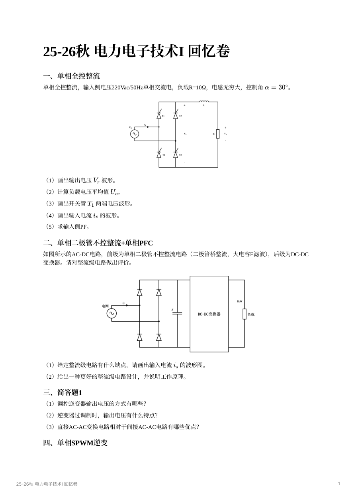
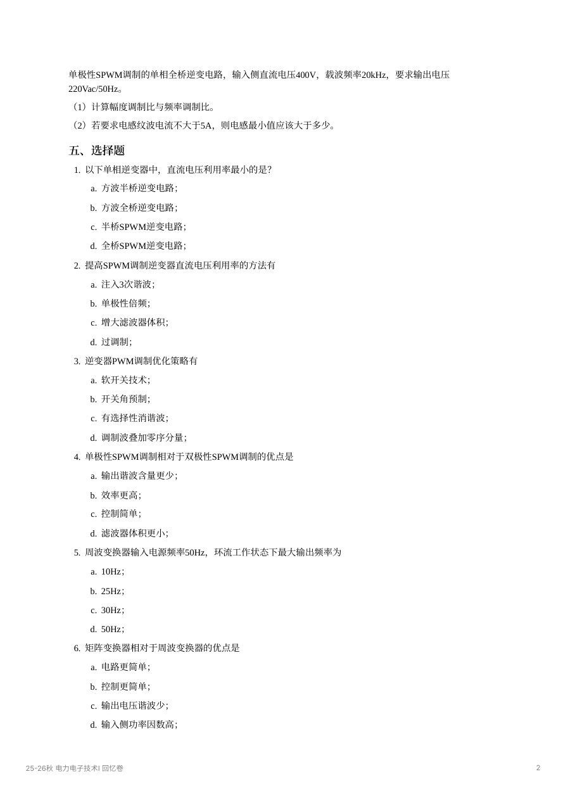
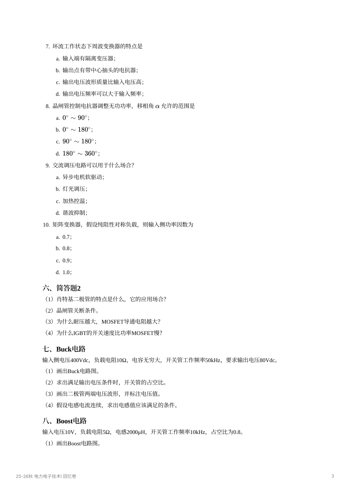
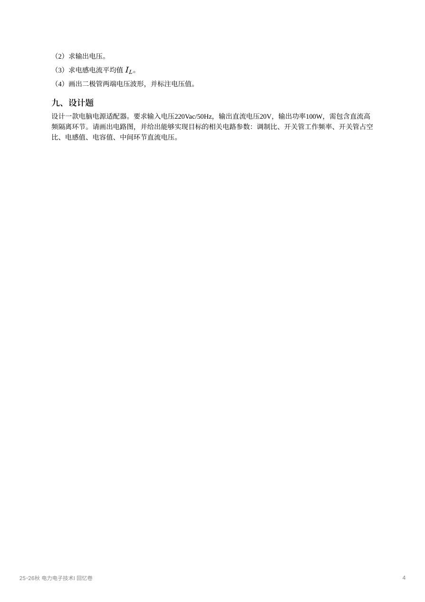

# 历年卷与专题练习索引

[课程目录](index.md) · [典型题分步解答](exam-solutions.md) · [资料阅读器](resources-guide.md) · [校勘](corrections.md)

这里保留原回忆卷，参考解答与原题分开。回忆卷可能缺少电路标号、参数和选项，也可能有文字与插图不一致；遇到这些情况先核对电路，不把缺失条件补写成事实。

## 按年份查找

| 年份/资料 | 原卷 | 主要可练内容与说明 |
| --- | --- | --- |
| 2014 春 | [1 页](resources/exam-2014-spring.pdf) | 概念、逆变与综合分析；较早课程范围，用于拓展对照 |
| 2019–2020 秋 | [1 页](resources/exam-2019-2020.pdf) | 整流波形与 PF、SPWM、隔离 DC–DC、适配器设计；部分题只保留提示 |
| 2020 秋 | [1 页](resources/exam-2020-autumn.pdf) | 高功因整流、调压、Buck/正激与变频电源设计；参数多未记全 |
| 2021–2022 | [3 页](resources/exam-2021-2022.pdf) | 三相有源逆变、SPWM、Boost、Cuk 比较及充电器设计；“半控”文字与全控桥图有冲突 |
| 2023 秋 | [1 页扫描卷](resources/exam-2023.pdf) | 以原图读取拓扑和条件，配合分类讲义核对 |
| 2025–2026 秋 | [4 页](resources/exam-2025-2026.pdf) | 单相全控、PFC、SPWM、器件简答、Buck、Boost和隔离适配器设计 |
| 春夏整合 | [13 页](resources/exams-spring-summer.pdf) | 多年份混合，适合补充训练 |
| 春夏分专题 | [11 页](resources/exams-by-topic.pdf) | 含手写解答和波形，适合按专题核对 |

## 按题型查讲义

| 题型 | 先补的知识 | 原卷定位 |
| --- | --- | --- |
| 器件分类、SCR 关断、MOSFET 耐压与电阻、IGBT 拖尾 | [第一章](chapters/01-devices.md)，再看[驱动保护](chapters/02-drive-protection.md) | [25–26 第 3 页](resources/exam-2025-2026.pdf#page=3)、[2021 第 1 页](resources/exam-2021-2022.pdf#page=1) |
| 单相全控平均值、开关管电压、输入电流与 PF | [第三章：导通区间与傅里叶](chapters/03-rectifiers.md) | [25–26 第 1 页](resources/exam-2025-2026.pdf#page=1) |
| 三相有源逆变、控制角、功率方向 | [第三章：三相桥与裕角](chapters/03-rectifiers.md) | [2021 第 1 页](resources/exam-2021-2022.pdf#page=1) |
| 二极管桥大电容的缺点、高 PF 整流 | [第三章：畸变因数与 PFC](chapters/03-rectifiers.md) | [25–26 第 1 页](resources/exam-2025-2026.pdf#page=1) |
| 交流调压、TCR、周波/矩阵变换 | [第四章](chapters/04-ac-ac.md) | [25–26 第 2—3 页](resources/exam-2025-2026.pdf#page=2)及 2020 回忆 |
| Buck 占空比、临界电感与二极管反压 | [第五章：Buck](chapters/05-dc-dc.md) | [25–26 第 3 页](resources/exam-2025-2026.pdf#page=3) |
| Boost 平均/峰值电流、开关与二极管耐压 | [第五章：Boost](chapters/05-dc-dc.md) | [25–26 第 3—4 页](resources/exam-2025-2026.pdf#page=3)、[2021 第 2 页](resources/exam-2021-2022.pdf#page=2) |
| 逆变导通模式与器件续流 | [第六章](chapters/06-inverters.md) | 2020 的三相感性负载提示 |
| 单极/双极 SPWM、$m_a,m_f$、纹波电感 | [第七章](chapters/07-pwm.md) | [25–26 第 2 页](resources/exam-2025-2026.pdf#page=2)、[2021 第 1—2 页](resources/exam-2021-2022.pdf#page=1) |
| 正激、隔离适配器与综合设计 | [第五章：隔离拓扑](chapters/05-dc-dc.md)，[设计题解答](exam-solutions.md#adapter-design) | [25–26 第 4 页](resources/exam-2025-2026.pdf#page=4)、[2021 第 3 页](resources/exam-2021-2022.pdf#page=3) |
| 谐振与软开关 | [第八章](chapters/08-soft-switching.md) | 用于完整课程复习与拓展，不从有限回忆推断必考或不考 |

## 25–26 秋原页阅读

[下载原 PDF](resources/exam-2025-2026.pdf) · [查看分步参考解答](exam-solutions.md)

点击原页可以放大、翻页和缩放。以下维持原卷版式，原卷中的笔误不在图中修改；网页解答会单独说明。

  <figure><figcaption>第 1 页：单相全控、PFC 与简答</figcaption></figure>
  <figure><figcaption>第 2 页：SPWM 与选择题</figcaption></figure>
  <figure><figcaption>第 3 页：选择、器件、Buck 与 Boost</figcaption></figure>
  <figure><figcaption>第 4 页：Boost 后续与适配器设计</figcaption></figure>

## 做卷的顺序

先用一套卷判断薄弱专题，错题旁记录“拓扑、工作模式、参考方向、漏掉的条件”。补完专题后重新做同一题，而非只看答案。第二套卷再限时完成，计算结果检查量纲与功率平衡，波形至少标清零点、触发/换流点、幅值与导通器件。

没有记全的数据题，练习的是通用推导和条件判断，不能靠回忆答案反推一个看似完整的题面。设计题允许多种拓扑，应说明目标、假设和选型依据。
