# 2026—2027 秋学期回忆卷 · 题目文字版

[原卷逐页阅读与参考解答](latest-recall.md) · [原 PDF](resources/exams/2026-recall/semiconductor-recall-2026-2027.pdf) · [八章讲义](chapter-notes.md)

本页将题干转换为可搜索、可复制的网页文字，配图取自原源码包。题号、分值和未回忆出的空缺保留，屏幕上的换行随设备变化，打印版式以原 PDF 为准。图片中的参考例题不等于本次考试原题。

## 第一部分　不定项选择（5 题，每题 2 分，共 10 分） {#choice}

### 第 1 题

关于半导体能带与载流子的说法，下列选项中正确的是（ ）。

- A. 半导体的能带一般分为允带和禁带。
- B. 本征半导体中的电子可以位于禁带的能级上。
- C. 对于电子来说，导带的电势能大于价带。
- D. 对于空穴来说，导带的电势能大于价带。
- E. 当热力学温度等于 $0\,\mathrm{K}$ 时，绝缘体、半导体、导体的导带均为空带。

### 第 2 题

以下晶体中，离子键代表有（ ），共价键代表有（ ），金属键代表有（ ），混合键代表有（ ）。

- A. Ge
- B. GaAs
- C. NaCl
- D. 金刚石
- E. Au

### 第 3 题

关于半导体的说法，下列选项中正确的是（ ）。

- A. 半导体的电阻率小于 $10^{-3}\,\Omega\cdot\mathrm{cm}$。
- B. Si、Ge 是第二代半导体。
- C. 金刚石是第三代半导体。
- D. 从第一代到第四代半导体，禁带宽度逐渐变大。
- E. 温度的升高可以显著地增加半导体的导电能力。

### 第 4 题

以下有关化学键的说法，正确的有（ ）。

- A. 金属键是电子的完全转移。
- B. 混合键是电子的部分共有和部分转移。
- C. 离子键是电子在所有原子的共有。
- D. 共价键是同种原子的共有。
- E. III 族、V 族元素化合产生共价键和离子键。

### 第 5 题

以下有关晶体结构与晶面的说法，正确的有（ ）。

- A. 金刚石结构的特点是在体对角线长度为$\sqrt{3}a$的范围内，共有 7 个相互平行的 $\{111\}$ 面。
- B. $\{110\}$ 是 Ge、Si 的解离面。
- C. 晶面指数是晶面与晶轴的截面截距的互质整数比。
- D. $\langle100\rangle$指代的是同类晶面。
- E. 在立方晶系中，晶列指数和晶面指数相同的晶向和晶面之间是相互垂直的。

## 第二部分　填空（10 题，分值待补充） {#fill}

### 第 1 题

N 型半导体和 P 型半导体中的多数载流子分别为
（待填写）  和
（待填写） 。

### 第 2 题

$\langle 100\rangle$ 晶列的 6 个同类晶向分别为
（待填写） ；

$\{110\}$ 晶簇的 8 个同类晶面分别为
（待填写） 。

### 第 3 题

载流子的两个产生机理分别为
（待填写）  和
（待填写） 。

请问在下面三个温度区间，主要由哪个产生机理占主导：

① 低温弱电离区：
（待填写） ；

② 强电离区：
（待填写） ；

③ 高温本征激发区：
（待填写） 。

### 第 4 题

PN 结二极管正向导通的电流机制为
（待填写） ；

肖特基结二极管正向导通的电流机制为
（待填写） 。

### 第 5 题

**【题目已遗忘，待补充】**

### 第 6 题

本征激发的机理为
（待填写） ；

杂质电离的机制为
（待填写） 。

### 第 7 题

半导体中载流子的两种散射机制分别为
（待填写）  和
（待填写） ；

在高掺杂条件下，迁移率随温度的变化规律为
（待填写） 。

### 第 8 题

（待填写） 
反映载流子在电场作用下运动的难易程度；

（待填写） 
反映存在浓度梯度时载流子运动的难易程度；

（待填写）  和
（待填写） 
是外力产生电流的源。

### 第 9 题

PN 结二极管的反向恢复电荷比肖特基二极管
（待填写） （多/少）。

请解释其中包含的机理：

（待填写） 

（待填写）

### 第 10 题

在分析半导体中的载流子浓度时，我们会使用
电中性条件，即正电荷数量等于负电荷数量。

请问在 N 型半导体中：

正电荷包括：
（待填写） ；

负电荷包括：
（待填写） 。

> 填空第 2 题的“$\{110\}$、8 个”按原样抄录。立方晶系完整 $\{110\}$ 族有 12 个成员，$\{111\}$ 族有 8 个；参见[第一章的计数](topics/01-crystal.md)。

## 第三部分　简答与画图（30 分） {#drawing}

### 1. GaAs 晶体结构与晶面（9 分）

参考 GaAs 的 $\langle110\rangle$ 晶向与 $\{110\}$ 晶面。

（1）画出图示五个面的原子排布；以黑框表示边界，Ga、As 原子分别用黑色和白色表示。（5 分）

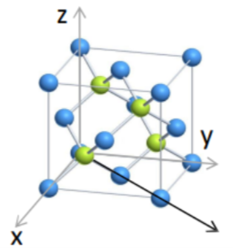

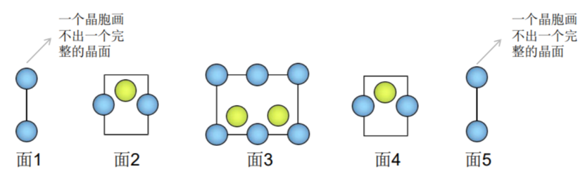

（2）直接写出原子线密度、面间距、原子面密度及共价键密度。（4 分）

### 2. 布里渊区与能带（6 分）

画出第一、第二、第三布里渊区及三个允带、禁带，并标明布里渊区。

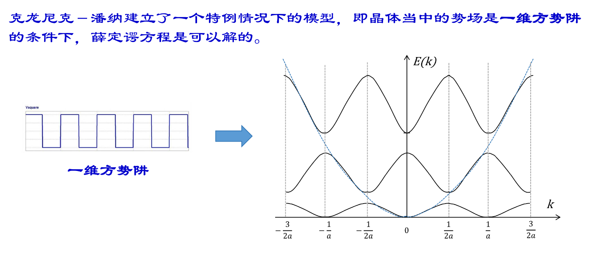

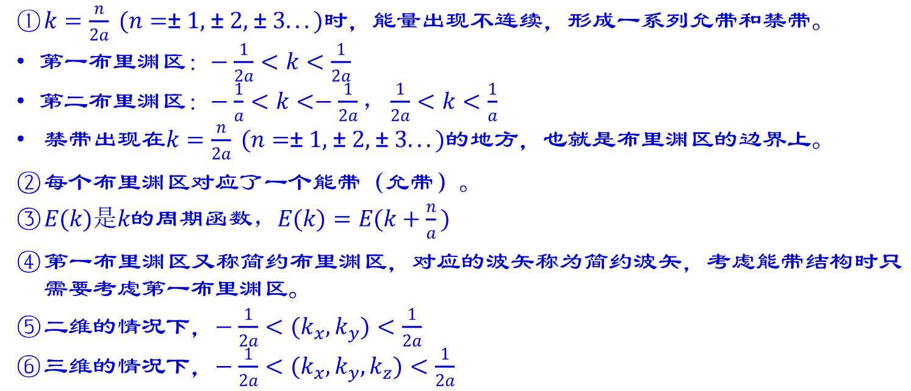

原图采用频率波数 $\kappa=1/\lambda$，第一边界为 $\pm1/(2a)$；若用角波矢 $k=2\pi/\lambda$，则为 $\pm\pi/a$。两者区别见[第二章](topics/02-bands.md)。

### 3. 不同掺杂的能带（5 分）

分别画出强 P 型、弱 P 型、本征、弱 N 型、强 N 型半导体的能带图，标注 $E_c,E_v,E_f,E_i,E_D,E_A$。

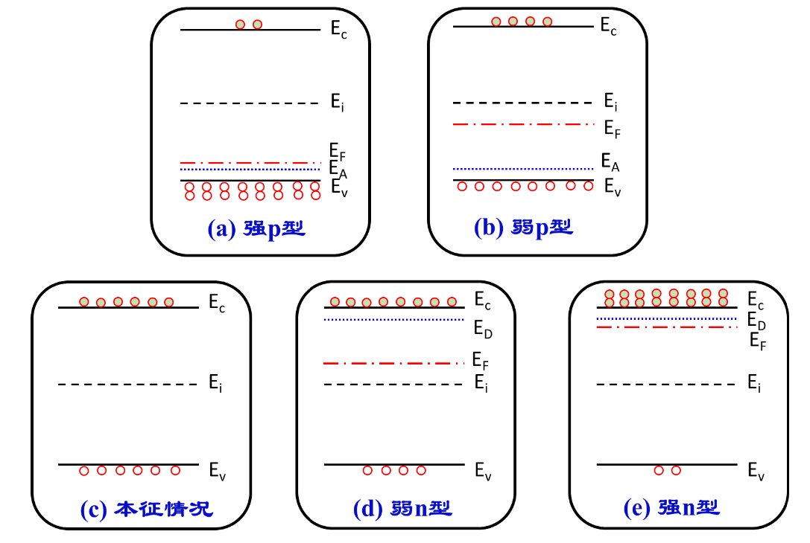

### 4. 零偏压 PN 结（3 分）

画出未加外加电压时 PN 结的能带示意图。

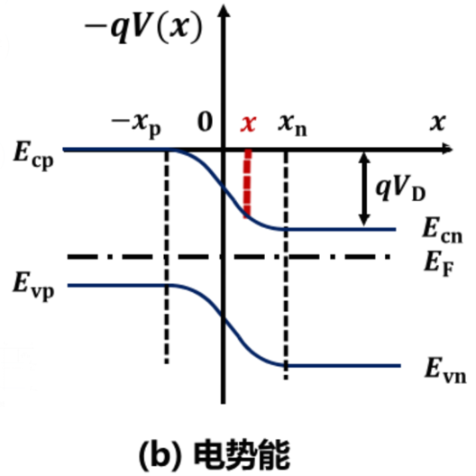

### 5. 零偏压金属—半导体接触（7 分）

画出未加外加电压时金属与半导体接触的能带图，标注 $qV_D,q\phi$，并说明功函数与电子亲和能的关系。

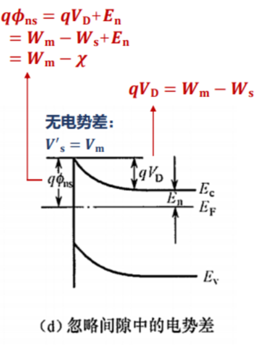

## 第四部分　计算与推导（50 分） {#calculation}

以下图为原回忆者选用的**参考例题**，部分考试参数未记全；截图题号与本卷题号不同。

### 1. 载流子浓度相关计算（15 分）

题型类似下图。回忆数据为 $2\times10^{16},5\times10^{17},2\times10^{18}$，具体物理量、单位和条件待核实。

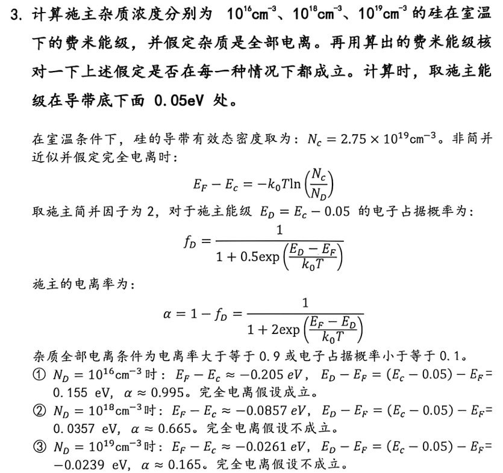

[第四章详细求解](topics/04-statistics.md#donor-ionization-check)逐行计算的是图中的 $10^{16},10^{18},10^{19}\,\mathrm{cm^{-3}}$，并给出完全电离假设失败后的自洽解。

### 2. 电阻率（10 分）

回忆数据为 $1.25\times10^{16},9.5\times10^{15}$，具体物理量、单位及其余条件待核实。

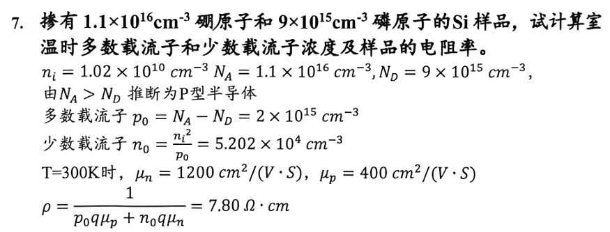

[第五章完整计算](topics/05-transport.md)先按图中已知条件求解，再在明确附加假设后讨论回忆数据变式。

### 3. 两小题合并（7 分 + 4 分，共 11 分）

原题由两小题合并，具体数据已遗忘，参考题涉及光照电导率和少数载流子扩散长度。

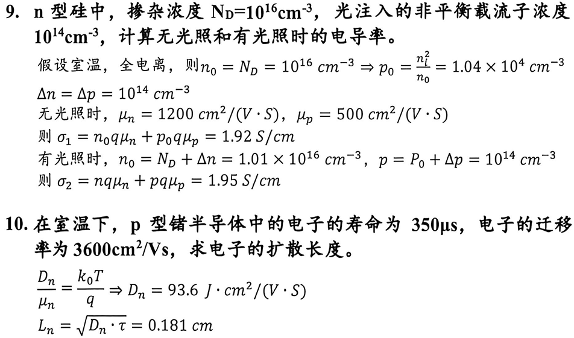

[第六章完整计算](topics/06-nonequilibrium.md)说明小注入条件、光照电导增量和单位换算。原图的扩散系数单位应改为 $\mathrm{cm^2/s}$。

### 4. PN 结势垒电容相关推导（14 分）

1. 推导 $N_A,N_D,x_n,x_p$ 之间的关系。（1 分）
2. 推导电场 $E(x)$ 与电压的关系，指出方向、最大场强位置和数值表达式。（6 分）
3. 求耗尽层宽度 $X_D$ 与 $N_A,N_D,V_D$ 的关系式。（7 分）

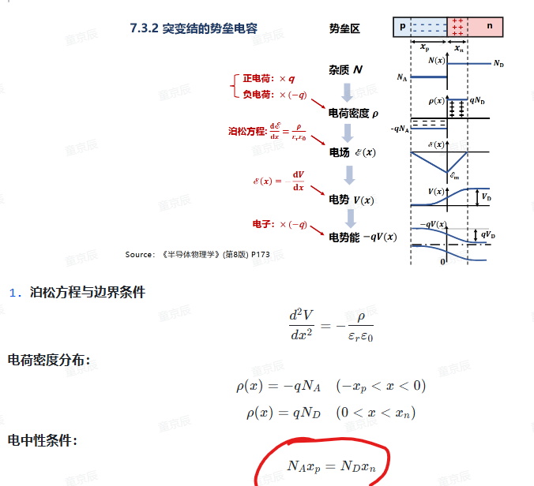

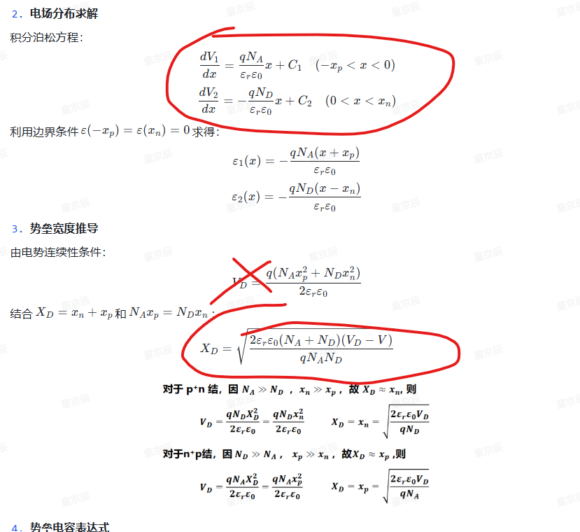

[第七章完整推导](topics/07-pn-junction.md)统一坐标和边界条件，并订正原图 n 侧电场额外的负号。原配图保持原貌。

---

[原页阅读与参考解答](latest-recall.md) · [逐章复习](review-mode.md) · [资料页码与校勘](resources-guide.md)
