# 2026—2027 秋学期回忆卷：逐页原卷与复习讲解

[半导体物理课程首页](index.md) · [历年卷索引](past-exams.md) · [复习模式](review-mode.md) · [分章讲义](chapter-notes.md)

这是一份最新整理的 **2026—2027 学年秋学期半导体物理回忆卷**。原卷由课程资料中的 PDF、LaTeX 源文件和配图组成；本页把原 PDF 原样保留，同时将每一页渲染成可放大查看的图片，方便在手机上核对题干、图示和页码。

> **资料性质。** 这是回忆卷，不是教师发布的正式试卷。题目中明确写有“题目已遗忘”“数据待核实”的部分，我会保留原样并在解题区标出不确定性；参考答案用于复习训练，不能代替教师的标准答案。

## 先看资料

<a class="md-button md-button--primary" href="resources/exams/2026-recall/semiconductor-recall-2026-2027.pdf" download>下载原 PDF</a>
<a class="md-button" href="resources/exams/2026-recall/semiconductor-recall-2026-2027.pdf" target="_blank" rel="noopener">新标签页打开 PDF</a>
<a class="md-button" href="resources/exams/2026-recall/source/semiconductor-recall-2026-2027.tex" download>下载 LaTeX 源文件</a>

| 部分 | 原卷结构 | 复习目标 |
| --- | --- | --- |
| 一、选择 | 5 题，10 分 | 能带、化学键、材料代际、晶体学定义；注意不定项要逐项判断 |
| 二、填空 | 10 题，分值待补充 | 载流子产生、PN/肖特基输运、散射、迁移率、扩散和电中性 |
| 三、简答与画图 | 5 题，30 分 | GaAs 晶面、布里渊区、五种掺杂能带、pn 结、金属—半导体接触 |
| 四、计算与推导 | 50 分 | 统计浓度、电阻率、输运参数、扩散长度、耗尽层电场和势垒电容 |

## PDF 原页预览（1:1 版式）

下面的图片由原 PDF 逐页渲染，保留了原页边距、题号、插图和页码。点击任意页面可打开大图；需要复制文字或打印时，优先使用上方原 PDF。

  <figure><a href="resources/exams/2026-recall/pages/page-01.png">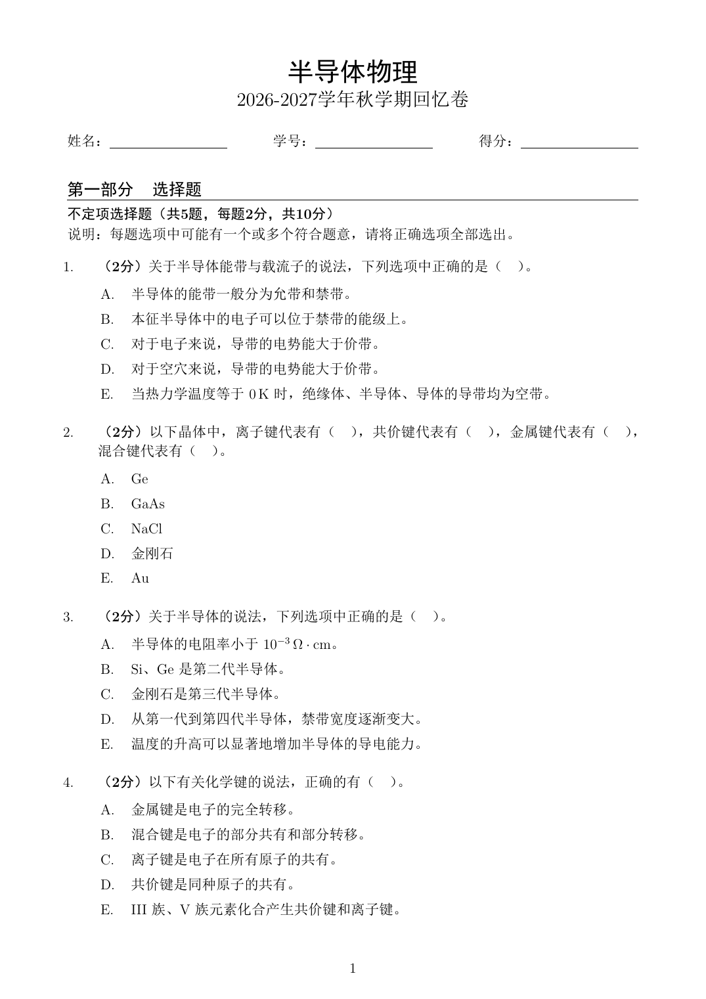</a><figcaption>第 1 页：选择题 1—4</figcaption></figure>
  <figure><a href="resources/exams/2026-recall/pages/page-02.png">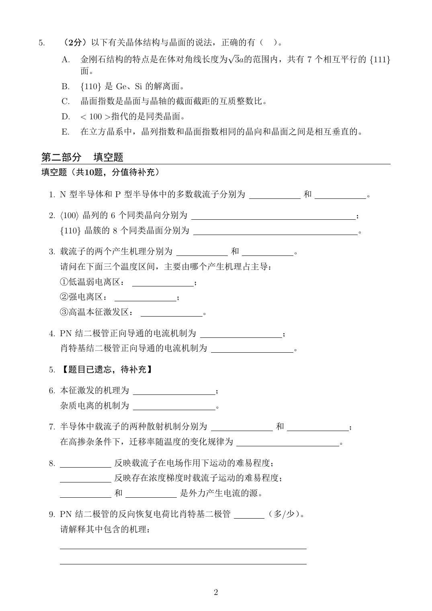</a><figcaption>第 2 页：选择题 5、填空题 1—10</figcaption></figure>
  <figure><a href="resources/exams/2026-recall/pages/page-03.png">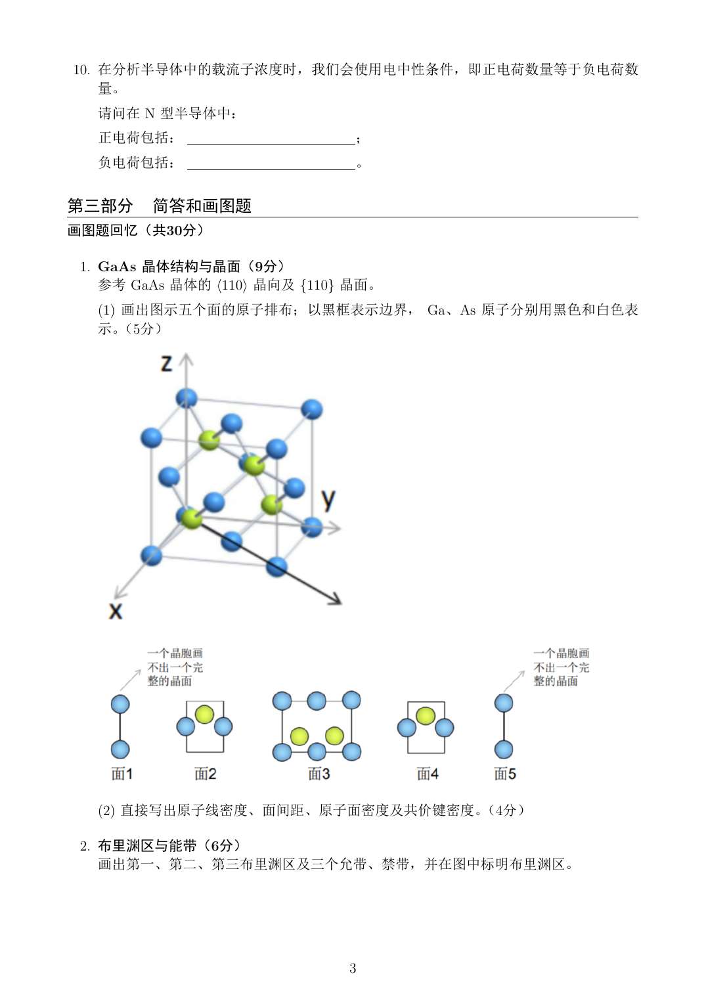</a><figcaption>第 3 页：填空题 10、GaAs 晶面与布里渊区</figcaption></figure>
  <figure><a href="resources/exams/2026-recall/pages/page-04.png">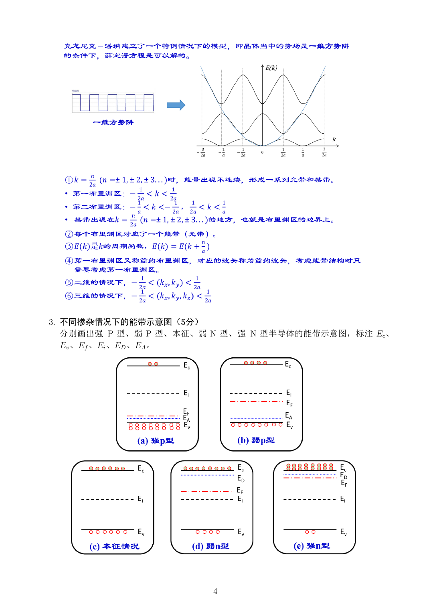</a><figcaption>第 4 页：不同掺杂的能带图</figcaption></figure>
  <figure><a href="resources/exams/2026-recall/pages/page-05.png">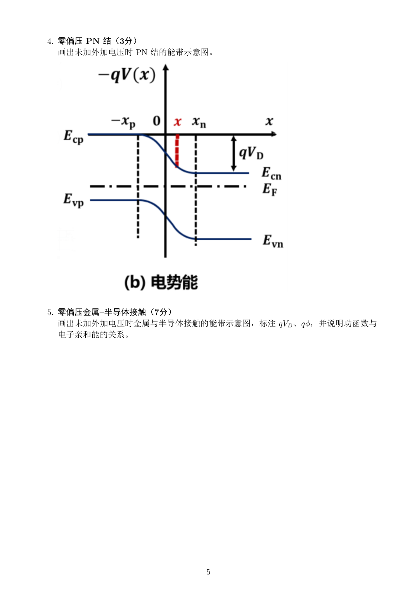</a><figcaption>第 5 页：零偏 pn 结、金属—半导体接触</figcaption></figure>
  <figure><a href="resources/exams/2026-recall/pages/page-06.png">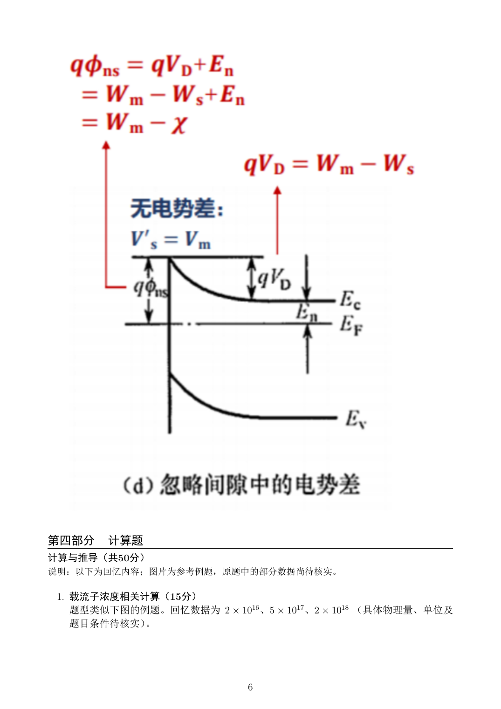</a><figcaption>第 6 页：载流子浓度题与参考例题</figcaption></figure>
  <figure><a href="resources/exams/2026-recall/pages/page-07.png">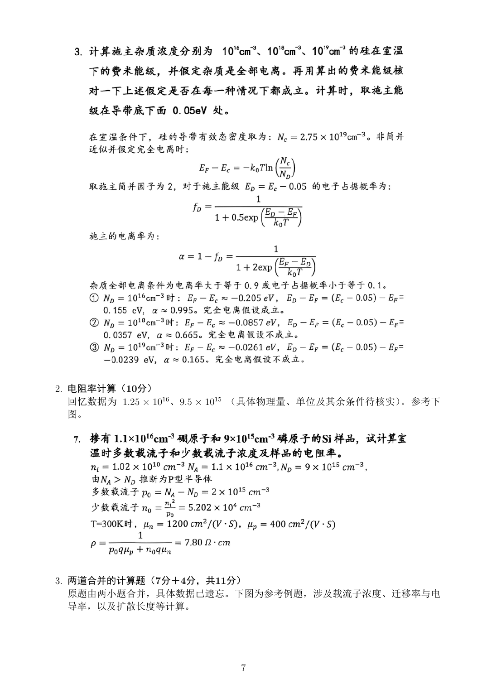</a><figcaption>第 7 页：施主电离、电阻率、输运综合题</figcaption></figure>
  <figure><a href="resources/exams/2026-recall/pages/page-08.png">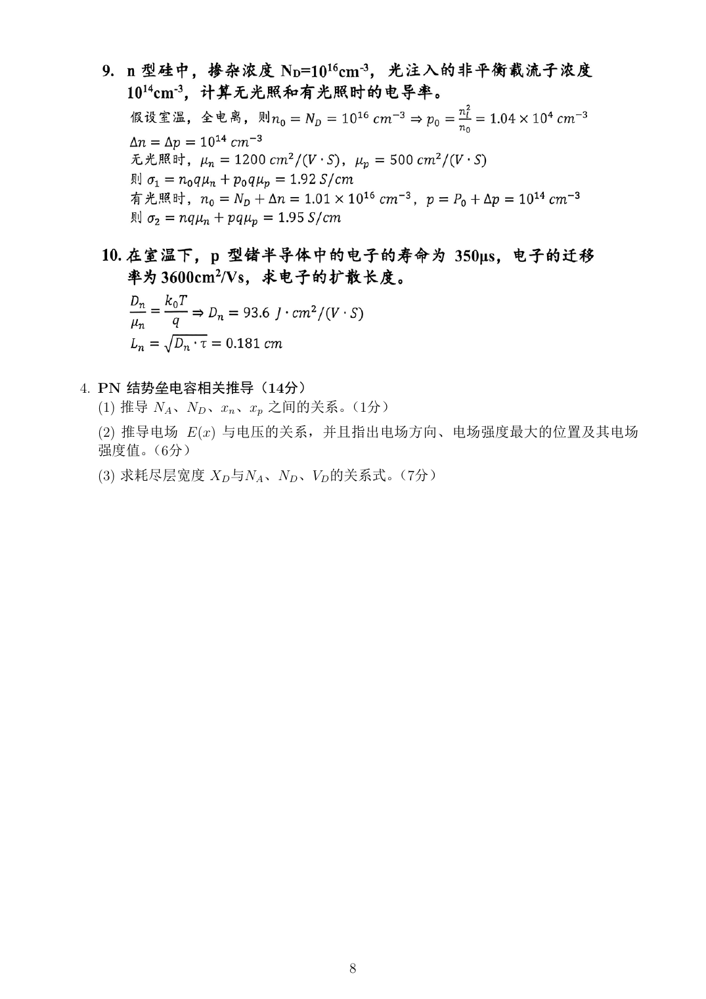</a><figcaption>第 8 页：光照电导率、扩散长度、pn 结推导</figcaption></figure>
  <figure><a href="resources/exams/2026-recall/pages/page-09.png">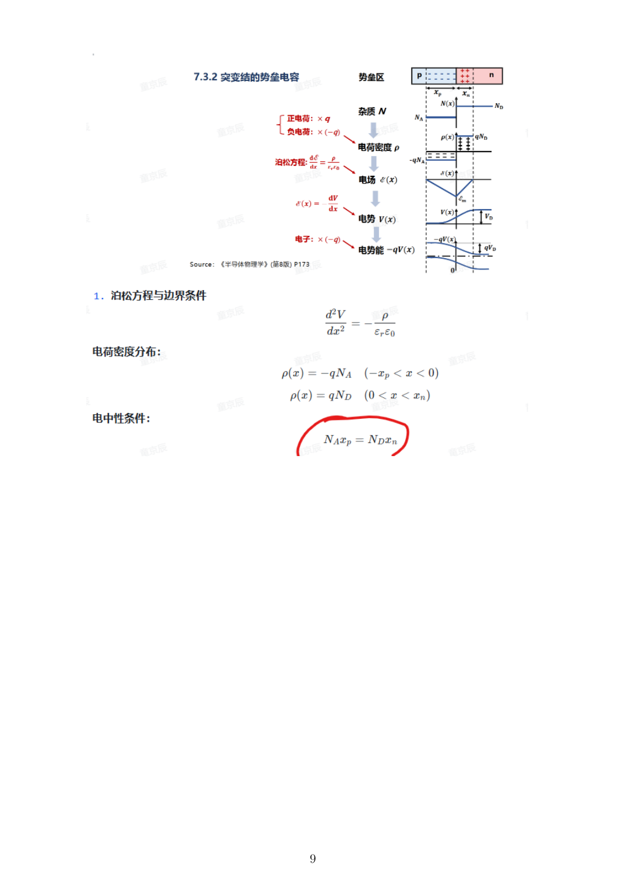</a><figcaption>第 9 页：原卷留白页</figcaption></figure>
  <figure><a href="resources/exams/2026-recall/pages/page-10.png">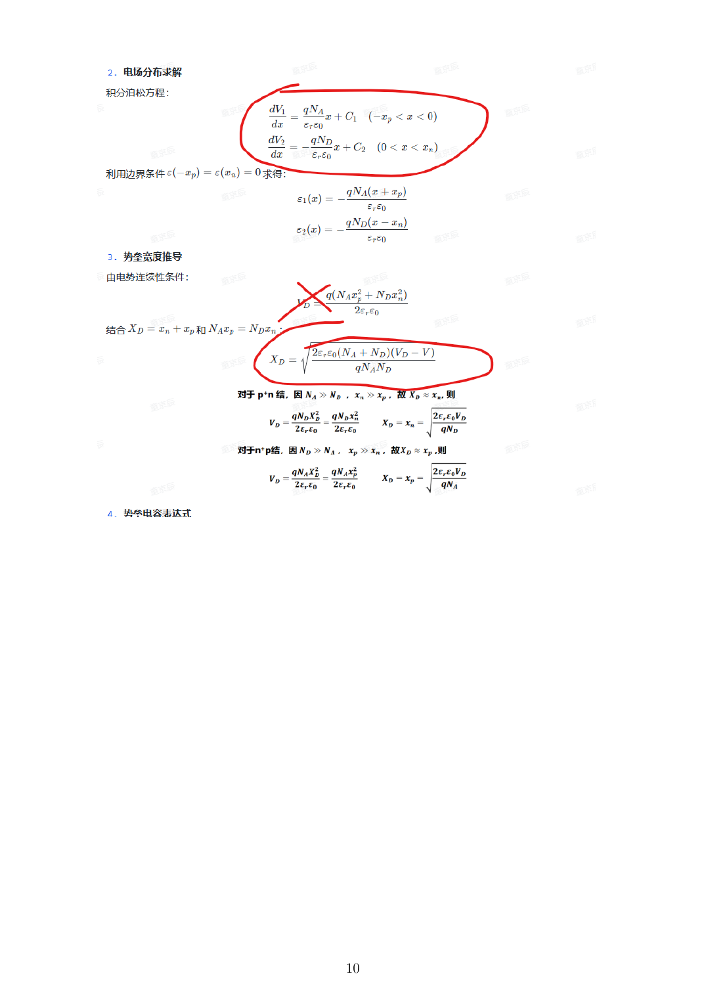</a><figcaption>第 10 页：原卷留白页</figcaption></figure>

## 一、选择题：把定义和方向分开判断

### 第 1 题：能带与载流子

按通常半导体物理定义，**A、C** 可以作为首选答案：能带由允带和禁带组成；对电子而言，导带电子能量高于价带电子。B 把“禁带中没有允许的本征电子态”说成电子可以处在禁带能级上，错误。E 把金属也说成 0 K 时导带为空，错误；金属的费米能级可以穿过部分填充能带。D 涉及空穴能量的约定，必须按照课堂对“空穴准粒子能量”的定义判断，不能把电子能量和空穴能量直接混用。

复习时要分清三件事：

1. 电子的能量用 $E_C,E_V$ 描述，电子从价带跃迁到导带才产生电子—空穴对。
2. 空穴是价带缺电子的等效准粒子，电荷为 $+q$，运动方向和价带电子相反。
3. 金属、半导体、绝缘体的区别首先是费米能级附近是否有可用态和带隙大小，不能只用“导带是否为空”一句话概括。

### 第 2—4 题：化学键与材料

按题面给出的五种材料，常用归类为：

| 类型 | 选项 | 判断依据 |
| --- | --- | --- |
| 离子键 | C：NaCl | 价电子转移后形成正、负离子晶格 |
| 共价键 | A：Ge、D：金刚石 | 相邻原子共享价电子，方向性强 |
| 金属键 | E：Au | 价电子离域，晶格中存在自由电子气特征 |
| 混合键 | B：GaAs | 共价性为主，同时具有离子性 |

第 3 题的材料代际说法属于课程语境下的概括。Si、Ge 属第一代，GaAs 等 III—V 族材料通常归入第二代，SiC、GaN、金刚石等宽禁带材料通常归入第三代；“代际越高禁带宽度必然逐一增大”不能作为严格材料学定律。温度升高时，本征载流子增加往往使电导提高，但迁移率会受晶格振动散射影响下降，判断时要看温区。

第 4 题中，**B、E** 是稳定答案：混合键兼有部分共有和部分转移；III—V 族化合物同时带有共价性和离子性。金属键不是电子完全转移，共价键也不限于“同种原子共有”。

### 第 5 题：晶体学表述的校勘

题面回忆中可确定的判断点是：

- $\langle100\rangle$ 表示晶向族，不是晶面族；晶面族使用 ${hkl}$。
- 立方晶系中，$[hkl]$ 晶向与 $(hkl)$ 晶面法向平行，因此“指数相同的晶向与晶面相互垂直”成立。
- 晶面指数不是“截距的互质整数比”，而是截距倒数化为最小整数比。
- Ge、Si（金刚石结构）的理想解理面通常写作 ${111}$；回忆卷把 ${110}$ 写成解理面时应在订正本中标注疑点。
- 题面关于体对角线范围内 ${111}$ 平面数量的说法，需要以课堂所用晶胞图和计数约定核对，不能脱离图直接背数字。

## 二、填空题：给出可直接套用的答题骨架

1. **多数载流子：** N 型为电子，P 型为空穴。
2. $\langle100\rangle$ 的六个方向是 $[100],[\bar100],[010],[0\bar10],[001],[00\bar1]$。注意：立方晶系完整的 ${110}$ 晶面族按排列和正负号计数通常有 12 个成员，题面写“8 个”很可能是回忆或排版错误；考试应以老师课堂约定为准。
3. 载流子产生机制是本征激发和杂质电离。低温弱电离区主要看杂质电离但电离率低；强电离区以杂质电离供给多数载流子；高温本征区由本征激发主导。
4. PN 结正向电流主要是少数载流子注入后的扩散与复合；肖特基结正向电流以多数载流子的热发射/越过势垒为主，重掺杂时还可能出现隧穿。
5. 题目在原卷中标注“已遗忘”，不补造答案。
6. 本征激发是价带电子获得 $E_g$ 附近能量跃迁到导带；杂质电离是施主电子进入导带或价带电子跃迁到受主能级。
7. 两类基本散射可写为晶格振动（声子）散射和电离杂质散射。高掺杂时电离杂质散射占比增加，常温附近迁移率对温度呈上升趋势，具体幂律取决于课程模型。
8. 迁移率反映电场下运动难易；扩散系数反映浓度梯度下运动难易；电场和浓度梯度是产生电流的外力来源。
9. PN 二极管反向恢复电荷通常比肖特基二极管多，因为 PN 结存在少数载流子存储，反向切换时需要先抽空存储电荷；肖特基器件是多数载流子器件，恢复过程主要由结电容决定。
10. 无补偿的 N 型半导体中，正电荷包括离化施主 $N_D^+$ 和少量空穴 $p$；负电荷包括自由电子 $n$。若有受主补偿，还必须把 $N_A^-$ 加入负电荷一侧，电中性式为 $p+N_D^+=n+N_A^-$。

## 三、画图题：按“坐标—边界—物理量—结论”作图

### 1. GaAs 的 $\langle110\rangle$ 晶向与 ${110}$ 晶面

先在立方晶胞中画出 $x,y,z$ 轴和 $[110]$ 方向，再标出 Ga、As 两套互相错开的面心立方子晶格。五个截面图不要只画小球，要在图旁写清楚“截面边界、原子种类、一个晶胞是否完整”。计算时先定义计数对象：

$$
d_{110}=\frac{a}{\sqrt2},\qquad
\mathrm{LD}_{[110]}=\frac{N_{\text{line}}}{L},\qquad
\mathrm{PD}_{(110)}=\frac{N_{\text{plane}}}{A}.
$$

对闪锌矿结构，常见的总原子线密度、单层/双层面密度会因“是否把 Ga—As 双层合并”而不同。答题第一行应写明计数约定，再用端点 $1/2$ 计数法计算；共价键密度则要说明是“穿过该面的键”还是“面内键”。这一步能避免把不同教材的数值混在一起。

### 2. 布里渊区与能带

若题图按一维 $k$ 轴作图，先画区边界 $k=\pm\pi/a,\pm2\pi/a,\pm3\pi/a$，再标第一、第二、第三布里渊区；允带和禁带交替出现，禁带通常在布拉格反射条件附近打开。作图评分点是：边界位置、区编号、允带/禁带名称和对称性都要写，不能只画三条随意的抛物线。

### 3. 五种掺杂能带图

横轴取位置、纵轴取能量，八条标注不能漏：$E_C,E_V,E_F,E_i,E_D,E_A$ 以及材料区域。弱 P 型时 $E_F$ 靠近 $E_V$，强 P 型进一步靠近价带甚至进入价带；本征时 $E_F\approx E_i$；弱 N 型时 $E_F$ 靠近 $E_C$，强 N 型进一步靠近导带甚至进入导带。$E_D$ 应靠近 $E_C$，$E_A$ 应靠近 $E_V$。若题目把“强”仅作为高浓度而未要求简并，仍要按老师的强弱定义作图。

### 4. 零偏压 PN 结

平衡时费米能级必须画成水平直线。能带在耗尽区发生弯曲，带弯曲对应内建电势：

$$
V_{bi}=\frac{kT}{q}\ln\frac{N_AN_D}{n_i^2},
$$

在突变结、完全电离、非简并近似下成立。图中要标出 p 区、n 区、$E_{cp},E_{cn},E_{vp},E_{vn}$ 和 $qV_{bi}$；不要把接触前两侧不同的费米能级直接画成平衡后的两条线。

### 5. 零偏压金属—半导体接触

以理想 n 型肖特基接触为例，接触前先标金属功函数 $W_m$、半导体功函数 $W_s$ 和电子亲和能 $\chi$；接触后费米能级对齐，半导体表面形成耗尽层和能带弯曲。理想模型下：

$$
q\phi_B=W_m-\chi,\qquad qV_D=q\phi_B-(E_C-E_F)_{\text{bulk}}.
$$

这里 $q\phi_B$ 是从金属费米能级到半导体导带底的势垒能，$qV_D$ 是半导体内部带弯曲对应的耗尽区势垒。界面态、像力和重掺杂会修正理想关系，题目若只要求基本图，先完成费米能级对齐、$q\phi$、$qV_D$ 和耗尽区四个评分点。

## 四、计算题：按考试顺序建立统一模板

### 1. 载流子浓度和施主电离

先写电中性条件，再决定是否使用完全电离近似：

$$
p+N_D^+=n+N_A^-.
$$

非简并时

$$
n=N_Ce^{-(E_C-E_F)/kT},\qquad
p=N_Ve^{-(E_F-E_V)/kT},\qquad np=n_i^2.
$$

施主占据概率可写成

$$
f_D=\frac{1}{1+g_D\exp[(E_D-E_F)/kT]},
$$

其中简并因子 $g_D$ 必须按课堂约定取值。先算 $E_F$ 与 $E_D$ 的相对位置，再判断“全部电离”是否成立；当掺杂从 $10^{16}$ 提高到 $10^{18}$ 或 $10^{19}\,\mathrm{cm^{-3}}$ 时，不能不检查非简并和完全电离假设。

### 2. 电阻率

统一使用

$$
\sigma=q(n\mu_n+p\mu_p),\qquad
\rho=\frac1\sigma.
$$

若题目给 $N_A>N_D$ 且假定完全电离，先取 $p_0\approx N_A-N_D$，再用 $n_0=n_i^2/p_0$ 求少数电子。单位必须统一到 $\mathrm{cm^{-3}}$、$\mathrm{cm^2/(V\cdot s)}$ 和 $q$ 的库仑值，最后电阻率单位为 $\Omega\cdot\mathrm{cm}$。

### 3. 电导率、光照和扩散长度

光照产生成对过剩载流子时，先写

$$
n=n_0+\Delta n,\qquad p=p_0+\Delta p,
$$

再算 $\sigma$。不要把非平衡状态继续套用 $np=n_i^2$。扩散长度的固定步骤是

$$
D_n=\mu_n\frac{kT}{q},\qquad L_n=\sqrt{D_n\tau_n},
$$

电子和空穴分别使用自己的迁移率、扩散系数与寿命；$\tau$ 若给的是微秒，要先换成秒。

### 4. PN 结势垒电容推导

取 p 区在左、n 区在右，耗尽区宽度为 $x_p$ 和 $x_n$。四步推导可直接写在答题纸上：

1. 电中性：$N_Ax_p=N_Dx_n$。
2. 泊松方程：$\mathrm dE/\mathrm dx=\rho/\varepsilon_s$，分区积分并用耗尽层边界 $E(-x_p)=E(x_n)=0$。
3. 最大电场位于冶金结 $x=0$，其绝对值为
   $$|E_{\max}|=\frac{qN_Ax_p}{\varepsilon_s}=\frac{qN_Dx_n}{\varepsilon_s}.$$ 
4. 电势降为电场面积，得到
   $$V_D=\frac{q}{2\varepsilon_s}(N_Ax_p^2+N_Dx_n^2),$$
   $$X_D=x_p+x_n=\sqrt{\frac{2\varepsilon_sV_D}{q}\left(\frac1{N_A}+\frac1{N_D}\right)}.$$

若要求势垒电容，再由 $Q_D=qAN_Ax_p=qAN_Dx_n$ 对电压求导；突变结近似下 $C_j\approx\varepsilon_sA/X_D$。画图时把电荷、$E(x)$、电势和能带四张图的横坐标方向保持一致，最容易拿到过程分。

## 这份卷对应的复习路线

1. **第一轮：** 先做选择、填空，错题按“定义、方向、单位、近似条件”四类归档。
2. **第二轮：** 只练五类图：GaAs 晶面、布里渊区、掺杂能带、pn 结能带、肖特基接触能带。每张图先空手画，再对照本页原图。
3. **第三轮：** 按“统计 → 电阻率 → 输运 → pn 结”顺序限时完成计算。每道题开头写模型条件，结尾检查数量级和单位。
4. **第四轮：** 回到八章讲义：晶体结构对应第一章，能带对应第二章，统计对应第四章，输运和扩散长度对应第五、六章，pn 结和肖特基对应第七、八章。

## 原始配图与源文件

压缩包中的 LaTeX 源文件已整理为可下载的独立文件，12 张配图也保留在同一目录，便于你继续修订题面或重新编译。源文件中的图片引用路径为 `figure/figure1.png` 等；网页展示使用的是 PDF 逐页渲染图，避免浏览器缺少中文 LaTeX 环境时出现版式差异。

展开查看原始配图素材

  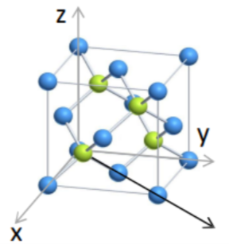
  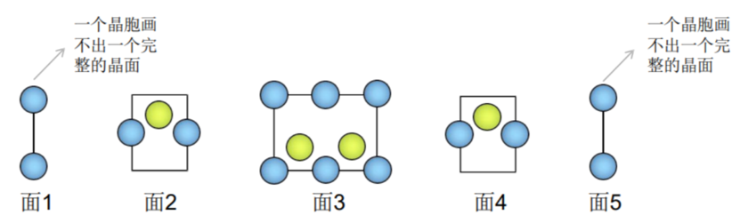
  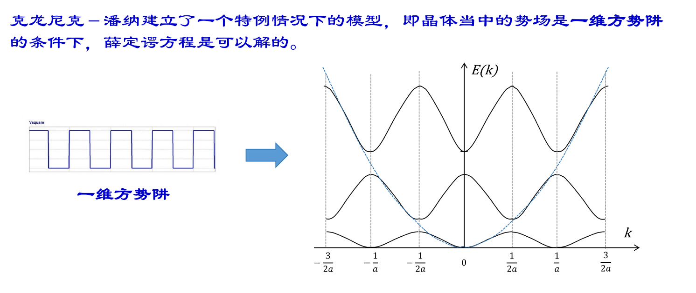
  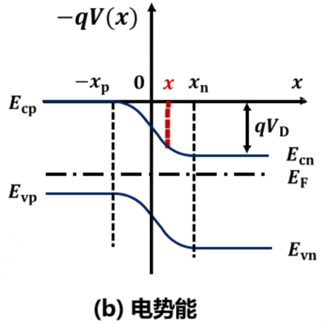
  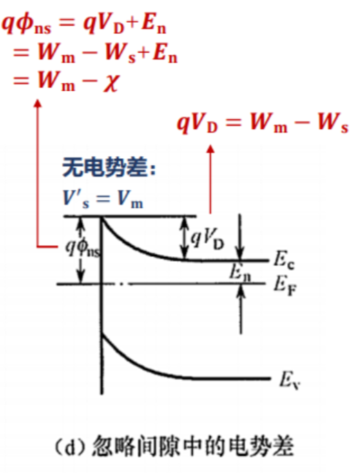
  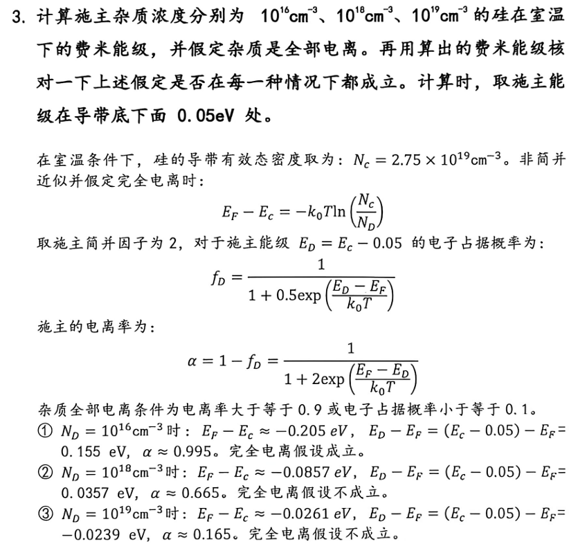
  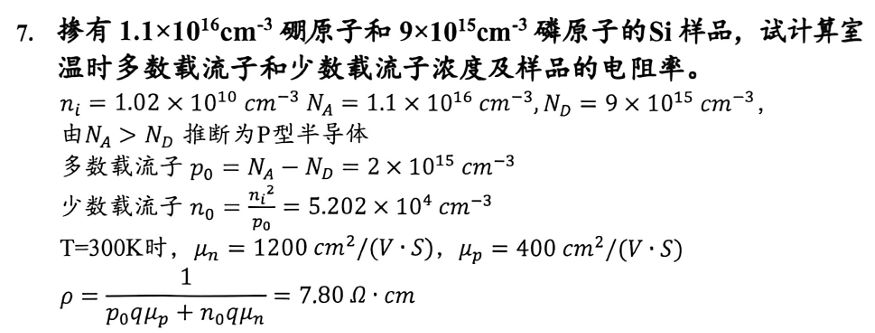
  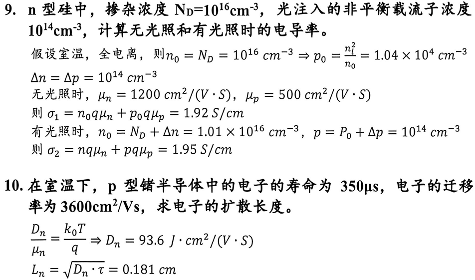
  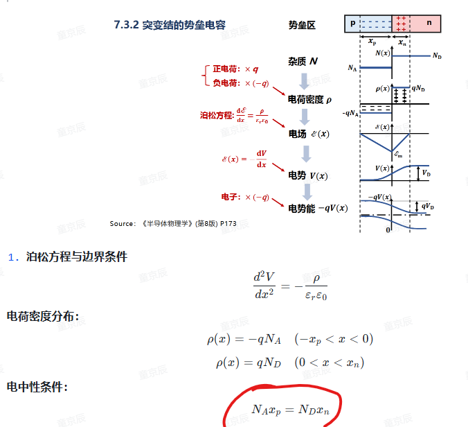
  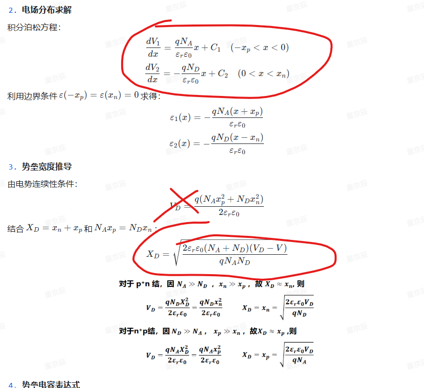
  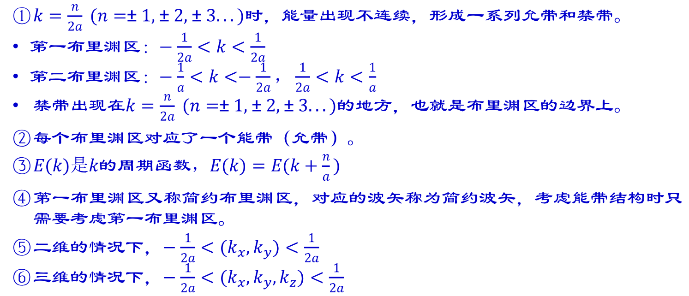
  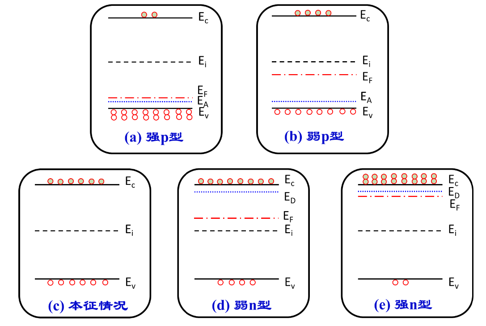

