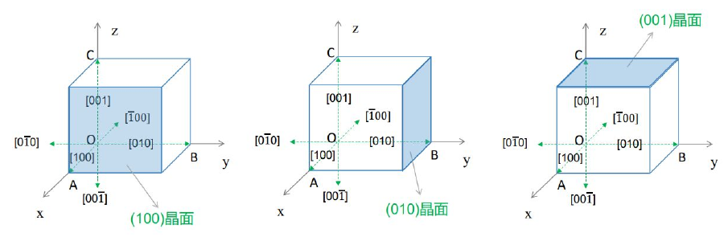

# 第一章　晶体结构与晶向晶面

[复习目录](../review-mode.md) · [本章练习](../practice.md#chapter-1) · [原笔记第 1—13 页](../resources/semiconductor-exam-notes.pdf#page=1) · [第一章课件](../resources/semiconductor-chapter-1.pdf)

## 1. 晶格、基元与晶胞

晶体结构由布拉维格子与附着在每个格点上的基元共同确定。格点是平移对称性的数学表示，不一定对应单个原子；基元可以包含多个原子。晶体中的所有格点具有相同的周围环境，平移晶格矢量后结构不变。非晶材料没有这种长程平移周期性，但近邻原子之间仍可有短程有序。

原胞是体积最小的平移重复单元，每个原胞按边界分摊后恰含一个格点。原胞的选取不唯一，形状也不一定体现全部点群对称性。常规晶胞通常选得较直观，便于表示晶轴和对称性，体积可能是原胞的整数倍。因此，“一个原胞含一个格点”不能替换为“一个原胞只含一个原子”。

立方常规胞计数时，顶点原子分摊为 $1/8$，棱上原子为 $1/4$，面心原子为 $1/2$，内部原子全部计入。计数应在确认原子位置后进行，不能仅凭晶胞的外轮廓判断结构。

| 结构 | 常规胞格点数 | 单原子基元时原子数 | 最近邻配位数 |
| --- | ---: | ---: | ---: |
| 简单立方 | 1 | 1 | 6 |
| 体心立方 | 2 | 2 | 8 |
| 面心立方 | 4 | 4 | 12 |
| 金刚石结构 | 4 | 8 | 4 |

硅和锗采用金刚石结构，可表示为面心立方格子加两个相同原子的基元，位置相差 $(a/4,a/4,a/4)$。其常规胞有 8 个原子，原胞有 2 个原子。闪锌矿结构的几何位置与之相似，但两套子晶格由不同元素占据，GaAs 是常见例子。金刚石结构与普通面心立方单原子结构的原子数、配位数不同。

## 2. 共价键与材料性质

硅原子有四个价电子，四面体配位下形成四个共价键。低温理想情况下，价电子主要处于成键态；热激发可使电子进入导带，同时在价带中留下空穴。后续的能带模型是对整个周期晶体电子状态的描述，不能把导电简单理解为电子沿某一根局域化学键移动。

材料分类需同时考虑禁带宽度、费米能级位置、载流子浓度及温度。半导体的电导率对温度、杂质和光照敏感；“电阻率处于某一区间”只是经验特征，不能单独代替能带解释。硅、锗为元素半导体，GaAs 等为化合物半导体。化合物半导体还需注意组分、极性及杂质占位的影响。

## 3. 晶向指数的确定

晶向表示平移方向，用 $[uvw]$ 记。先选同一方向上的两个点，将坐标差按晶轴单位写成比例，再化为互质整数；负指数加上划线。方向相反时全部指数变号。对称等价的一族晶向用 $\langle uvw\rangle$ 表示。

例如从 $A=(0,a/2,a/2)$ 指向 $B=(a,a/2,0)$，方向差为 $(a,0,-a/2)$，故晶向为 $[20\overline1]$。如果误用终点坐标直接化简，会丢失起点不在原点的信息。

立方晶系中，两晶向的夹角可由点积计算：

$$
\cos\theta=\frac{u_1u_2+v_1v_2+w_1w_2}{\sqrt{u_1^2+v_1^2+w_1^2}\sqrt{u_2^2+v_2^2+w_2^2}}.
$$

例如 $[100]$ 与 $[111]$ 的夹角为 $\arccos(1/\sqrt3)=54.74^\circ$。非正交或晶轴长度不同的晶系需要使用相应的度量关系，不能直接照用整数分量的欧氏点积。

## 4. 晶面指数与面间距

晶面用 $(hkl)$ 表示。确定米勒指数的步骤为：记录平面在三晶轴上的截距，以晶轴长度为单位；取倒数；消去分母，化为互质整数。与某轴平行意味着该方向截距为无穷，相应指数为零。平面通过原点时，应选同族的平行平面求截距。

**例 1：由截距求晶面。** 某平面的截距为 $(2a,3a,\infty)$，倒数比例为 $(1/2,1/3,0)$，乘以 6 得到 $(320)$。这里的“取倒数”针对晶面截距，不能用于求晶向。

立方晶系有

$$
d_{hkl}=\frac{a}{\sqrt{h^2+k^2+l^2}}.
$$

若硅的晶格常数 $a=0.543\,\mathrm{nm}$，则 $d_{111}=0.3135\,\mathrm{nm}$。公式给出几何晶面族间距；涉及衍射时还需另行检查结构因子与消光条件，不能认为每个几何晶面都会出现衍射峰。

在立方晶系中，晶向 $[hkl]$ 与晶面 $(hkl)$ 垂直。这个结论依赖立方晶系的正交等长晶轴，不应推广成所有晶系的通则。对称等价晶面族记为 $\{hkl\}$，例如立方晶体的 $\{100\}$ 包含与六个坐标正负方向垂直的面。

*图据所提供 PDF 第 11 页上部摘录，分别表示 $(100)$、$(010)$ 和 $(001)$ 晶面。图中的晶胞用于说明坐标与截距，并非金刚石结构的完整原子模型。*

## 5. 原子数密度计算

**例 2：估算硅原子密度。** 采用金刚石结构，每个常规胞 8 个原子，$a=0.543\,\mathrm{nm}=5.43\times10^{-8}\,\mathrm{cm}$，有

$$
N_{\rm atom}=\frac{8}{a^3}=5.00\times10^{22}\,\mathrm{cm^{-3}}.
$$

若掺入 $10^{16}\,\mathrm{cm^{-3}}$ 的杂质，占原子总数约 $2.0\times10^{-7}$，即约每五百万个原子一个杂质。很小的原子比例仍可显著改变载流子浓度，因为室温本征载流子浓度远低于原子密度。这里计算的是原子密度，不能用它直接代替自由电子密度。

密度题的常见数量级错误来自长度单位：$1\,\mathrm{nm}=10^{-7}\,\mathrm{cm}$，立方后为 $10^{-21}\,\mathrm{cm^3}$。若题目要求质量密度，可进一步乘摩尔质量并除以阿伏伽德罗常数。

## 6. 各向异性与后续章节

晶体的物性可能随方向变化。能带等能面若为椭球，纵向和横向有效质量不同；迁移率、应力响应、刻蚀速度也可能表现出方向性。晶体具有对称性并不代表每一个物理量都可以用单一标量表示，应结合张量阶数与晶体对称性判断。

考试中遇到“画图并解释”题，图上应标坐标轴、起点、截距及指数。比较金刚石和闪锌矿结构时，说明格子、基元元素、原胞原子数与配位数，比只记材料名称更完整。

## 7. 本章复核

- 区分格点、原子、原胞、常规胞；说明原胞选择不唯一。
- 晶向求坐标差，晶面求截距倒数；族符号与单个指数符号分开。
- 原子密度用正确的胞内原子数，面间距注明立方条件。
- 能解释结构周期性如何引出能带，以及缺陷为何破坏理想周期势。

## 8. 最新回忆卷：晶向族、GaAs 截面与密度 {#gaas-110-recall}

[最新回忆卷](../latest-recall.md)的填空和画图都涉及族的计数。立方晶系按不同法向分别计数时：$\langle100\rangle$ 有 6 个方向，$\langle110\rangle$ 有 12 个方向，$\{110\}$ 有 12 个晶面取向，$\{111\}$ 有 8 个。$\langle100\rangle$ 是三坐标轴的正负方向；$\langle110\rangle$ 则先选零分量的位置（3 种），再给两个非零分量取正负号（4 种），合计 12。若把反向法向视为同一组无定向平面，计数会减半；题面写“$\{110\}$ 的 8 个面”与上述两种约定均不符，不能照抄。

### 8.1 先写坐标，再数原子

以 $a$ 为坐标单位，Ga 的四个常规胞位置为 $(0,0,0)$、$(0,1/2,1/2)$、$(1/2,0,1/2)$、$(1/2,1/2,0)$，As 为这套位置整体平移 $(1/4,1/4,1/4)$。指定 $(110)$ 面的法向为 $[110]$，面内可选 $[1\bar10]$ 与 $[001]$。取面内矩形重复单元，边长为 $a/\sqrt2$ 和 $a$，面积为 $A_s=a^2/\sqrt2$；理想未重构的完整非极性原子层中，每单元含一个 Ga 和一个 As，故

$$
\mathrm{PD}_{(110)}=\frac{2}{A_s}=\frac{2\sqrt2}{a^2}.
$$

同一条穿过 Ga 原子的 $[110]$ 晶列上，最近的同类重复原子相距 $a/\sqrt2$，所以单条晶列 $\mathrm{LD}=\sqrt2/a$；旁边的 As 晶列不能无理由再加到这条线上。几何晶面公式给 $d_{110}=a/\sqrt2$，但 GaAs 沿此法向的占据原子层出现在 $x+y=ma/2$，相邻占据层间距为 $a/(2\sqrt2)$。二者计数对象不同，题目问“面间距”时应注明所用定义。

### 8.2 共价键面密度如何不重计

从一个 Ga 指向四个最近邻 As 的键矢量为

$$
\frac a4(1,1,1),\quad\frac a4(1,-1,-1),\quad
\frac a4(-1,1,-1),\quad\frac a4(-1,-1,1).
$$

投影到 $[110]$ 单位法向，分别得到 $a/(2\sqrt2),0,0,-a/(2\sqrt2)$：两根键在层内，另两根分别连接上下层。若问**层内独立键数/面积**，每原子贡献两根、每根被两端重复计数，得 $\mathrm{PD}\times2/2=2\sqrt2/a^2$；若问**相邻两占据层之间切面穿过的键数/面积**，每个面内单元有两根跨层键，也得 $2\sqrt2/a^2$，但两者定义不同。切开后若把两个新表面的悬挂键总数相加，还会多一个因子 2。写清“层内、穿面、单表面还是双表面”，比孤立背一个键密度更可靠。

[下一章：能带、有效质量与空穴](02-bands.md)
