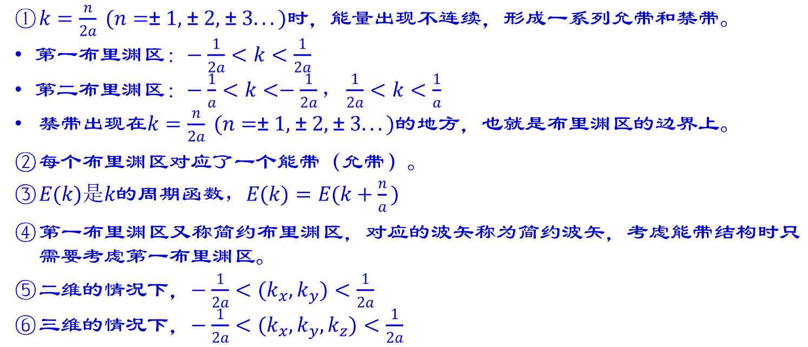

# 第二章　能带、有效质量与空穴

[复习目录](../review-mode.md) · [本章练习](../practice.md#chapter-2) · [原笔记第 13—27 页](../resources/semiconductor-exam-notes.pdf#page=13) · [第二章课件](../resources/semiconductor-chapter-2.pdf)

## 1. 从原子能级到晶体能带

孤立原子具有分立能级。大量原子组成晶体后，电子波函数相互重叠，在周期势中形成大量相近的允许能级，宏观上表现为能带。价带、导带是允许电子占据的能量范围，禁带则是在相应理想晶体模型中没有体态能级的区间；杂质、缺陷和表面可以在体材料禁带中引入局域态。

布洛赫定理将周期势中的电子波函数写为

$$
\psi_{n\mathbf k}(\mathbf r)=u_{n\mathbf k}(\mathbf r)e^{i\mathbf k\cdot\mathbf r},
$$

其中 $u_{n\mathbf k}$ 具有晶格周期性，$n$ 是能带指标，$\mathbf k$ 为波矢。$\hbar\mathbf k$ 称晶体动量，与自由空间电子的机械动量不完全相同。第一布里渊区可用于表示不重复的晶体波矢状态。

一个完整量子态最多容纳一个电子；同一能带、同一波矢通常有两个自旋状态，可各容纳一个电子。多个波矢可能具有相同能量，因此不能笼统地说“任意一个能量只能容纳两个电子”。

## 2. 能带图的两种横坐标

$E-k$ 图表示色散关系，横轴是倒空间波矢，用于讨论群速度、曲率、谷和直接/间接带隙。$E-x$ 图表示真实空间中能带边缘的变化，用于讨论电场、结和接触。两种图都画能量，但横坐标的物理含义不同。

在 $E-k$ 图中，导带最低点记为 $E_C$，价带最高点记为 $E_V$，禁带宽度为 $E_g=E_C-E_V$。直接带隙材料的导带底与价带顶位于同一波矢位置，光学跃迁较易同时满足能量和晶体动量守恒；间接带隙材料通常需要声子参与以补偿动量差。GaAs 为常见直接带隙材料，Si、Ge 为间接带隙材料。

直接带隙影响光学跃迁概率，不意味着所有直接带隙材料的电导率都大于间接带隙材料。电导率还取决于掺杂、温度与迁移率。

## 3. 群速度和有效质量的推导

在单带半经典模型中，一维群速度与外力作用满足

$$
v=\frac{1}{\hbar}\frac{dE}{dk},\qquad \hbar\frac{dk}{dt}=F.
$$

对速度求时间导数：

$$
\frac{dv}{dt}=\frac{1}{\hbar}\frac{d^2E}{dk^2}\frac{dk}{dt}
=\frac{1}{\hbar^2}\frac{d^2E}{dk^2}F.
$$

与 $a=F/m^*$ 比较得到

$$
\frac{1}{m^*}=\frac{1}{\hbar^2}\frac{d^2E}{dk^2}.
$$

斜率决定群速度，曲率决定有效质量；两者不能混淆。导带底斜率为零、速度为零，曲率仍可非零，因而有效质量有限。曲率大对应小有效质量，在同一外力下加速度较大。有效质量描述周期势背景中的响应，不是电子静止质量发生改变。

导带谷底附近可采用抛物线近似：

$$
E(\mathbf k)=E_C+\frac{\hbar^2(k_x-k_{0x})^2}{2m_x^*}
+\frac{\hbar^2(k_y-k_{0y})^2}{2m_y^*}
+\frac{\hbar^2(k_z-k_{0z})^2}{2m_z^*}.
$$

一般情形需用逆有效质量张量 $[m^{*-1}]_{ij}=\hbar^{-2}\partial^2E/(\partial k_i\partial k_j)$。硅导带具有多个等价谷，状态密度质量和电导有效质量承担不同用途。题目给出哪一类质量，就应按其定义使用，不能把单谷纵向质量直接代入所有公式。

## 4. 有效质量与速度数值例题

**例 1。** 导带底附近满足 $E=E_C+A(k-k_0)^2$，$A=14.65\,\mathrm{eV\cdot\mathring A^2}$。求有效质量和 $k-k_0=0.01\,\mathrm{\mathring A^{-1}}$ 时的群速度。

由二阶导数为 $2A$，且 $\hbar^2/(2m_0)=3.810\,\mathrm{eV\cdot\mathring A^2}$，得

$$
\frac{m^*}{m_0}=\frac{3.810}{14.65}=0.2601.
$$

用 SI 单位计算速度，$k-k_0=10^8\,\mathrm{m^{-1}}$：

$$
v=\frac{\hbar(k-k_0)}{m^*}\approx4.45\times10^4\,\mathrm{m/s}.
$$

此时电子相对带底的能量为 $A(0.01)^2=1.465\,\mathrm{meV}$。如果速度计算直接使用 eV 与焦耳制的 $\hbar$，而未乘电子伏特到焦耳的换算因子，结果会严重失真。

## 5. 价带电子与空穴

完全填满的能带在平衡对称分布下，总电流为零。一个接近填满的价带缺少电子后，可以将缺少的电子状态等效为带正电的空穴。这种表示把大量价带电子的合成运动转换为少量空穴的运动。

价带顶附近电子色散常写为 $E=E_V-\hbar^2k^2/(2m_h^*)$。对应电子的曲率有效质量为负，换成空穴后使用正电荷 $+q$ 和正有效质量 $m_h^*$。不要把“价带电子负质量”与“空穴负质量”混用。真实价带还含重空穴、轻空穴等分支，简化成单一质量时需服从题目模型。

在电场下，电子漂移速度与电场反向，空穴漂移速度与电场同向；两者产生的传统漂移电流都与电场同向。这些方向由电荷符号与速度共同决定。

## 6. 温度、合金与带隙

多数常见半导体的禁带宽度随温度升高而减小，涉及晶格热膨胀与电子—声子相互作用。经验式及参数应采用课程或题目给定值；不能将固定室温带隙外推到任意温度后仍声称精确。

带隙变化通过指数因子影响本征载流子浓度，但本征浓度同时还受有效状态密度影响。异质结材料之间的导带、价带偏移也不只由带隙差决定，需给出电子亲和能或带阶模型。这里先掌握同质材料的能带定义，器件能带弯曲在第七、八章展开。

## 7. 图像题作答要点

画 $E-k$ 图时，标横纵轴、导带底、价带顶、带隙与极值点位置；若解释直接/间接跃迁，还应说明动量守恒。画 $E-x$ 图时，标空间方向、电势变化以及费米能级，避免把谷底位置当成结的空间位置。

原笔记第 13—27 页将波动性、能带与有效质量连续介绍。复习时应能从群速度和外力关系推导有效质量，而不仅是记下二阶导数公式。[章节练习第二组](../practice.md#chapter-2)提供曲率、方向和光学跃迁的检查题。

## 8. 最新回忆卷：前三个布里渊区与横轴换算 {#brillouin-recall}

[最新回忆卷第 4 页](../latest-recall.md)附图的边界写成 $\pm1/(2a)$、$\pm1/a$，不能直接抄到本章的角波矢 $k$ 轴上。两种常见定义是

$$
k=\frac{2\pi}{\lambda},\qquad \kappa=\frac1\lambda,\qquad k=2\pi\kappa.
$$

本章波函数用 $e^{ikx}$，因此倒格矢为 $G=2\pi/a$、第一布里渊区边界为 $\pm\pi/a$。若采用 $e^{i2\pi\kappa x}$，同一位置才写成 $\pm1/(2a)$。群速度也随横轴换算：$v=\hbar^{-1}\mathrm dE/\mathrm dk=h^{-1}\mathrm dE/\mathrm d\kappa$。混用两个横轴会使边界、速度和曲率质量都差一个 $2\pi$ 或其平方。

*原始参考图保留其波数记法；下文统一使用角波矢 $k$。*

一维扩展区表示中，第一布里渊区为 $-\pi/a\le k\le\pi/a$；第二为 $[-2\pi/a,-\pi/a]$ 与 $[\pi/a,2\pi/a]$；第三为 $[-3\pi/a,-2\pi/a]$ 与 $[2\pi/a,3\pi/a]$。边界点的归属约定不改变物理结论。画图先画这些竖线，再将第一、二、三允带沿对应区段展开，在存在相应周期势耦合时于区边界处画出禁带；不要把每一个理论边界都无条件画成同样大小的带隙。

同一组状态也可折回第一布里渊区，用带指标 $n=1,2,3$ 区分多个分支。周期性应写成**按能带指标表示的** $E_n(k+G)=E_n(k)$，它说明相差倒格矢的晶体动量等价；不能把在扩展区依次拼接不同能带得到的整条曲线，误称为一个分支并强行周期重复。答题图上标清横轴约定、区编号、允带和禁带，随后才能讨论斜率和有效质量。

[上一章：晶体结构](01-crystal.md) · [下一章：杂质与缺陷](03-impurities.md)
