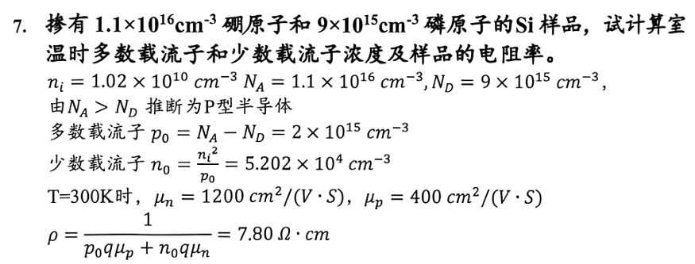

# 第五章　漂移、扩散与散射

[复习目录](../review-mode.md) · [本章练习](../practice.md#chapter-5) · [原笔记第 55—67 页](../resources/semiconductor-exam-notes.pdf#page=55) · [第五章课件](../resources/semiconductor-chapter-5.pdf)

## 1. 漂移速度与传统电流

载流子的热运动具有随机性，平衡时平均定向速度为零。电场引起额外的定向漂移。低场、近线性响应下，取迁移率为正值，有

$$
v_n=-\mu_nE,\qquad v_p=\mu_pE.
$$

电子带电 $-q$，故 $J_{n,\mathrm{drift}}=(-q)nv_n=q n\mu_nE$；空穴带电 $+q$，故 $J_{p,\mathrm{drift}}=q p\mu_pE$。两者漂移速度方向相反，传统漂移电流却都沿电场方向。

总电导率、电阻率为

$$
\sigma=q(n\mu_n+p\mu_p),\qquad \rho=\sigma^{-1}.
$$

在均匀直导体中，$R=\rho\ell/A$。若浓度或截面积随位置变化，应分段或积分求电阻。迁移率与温度、杂质浓度有关，不能在比较不同样品时只比较电子浓度。

## 2. 电导率与电阻例题

**例 1。** 室温 n 型样品中 $n=10^{16}\,\mathrm{cm^{-3}}$，少数空穴可忽略，$\mu_n=1350\,\mathrm{cm^2/(V\cdot s)}$。取 $q=1.602\times10^{-19}\,\mathrm C$，得

$$
\sigma=2.1627\,\mathrm{S/cm},\qquad \rho=0.4624\,\Omega\cdot\mathrm{cm}.
$$

若 $E=10\,\mathrm{V/cm}$，则 $v_n=-1.35\times10^4\,\mathrm{cm/s}$，$J_n=21.627\,\mathrm{A/cm^2}$。样品长 $0.1\,\mathrm{cm}$、截面积 $10^{-4}\,\mathrm{cm^2}$ 时，电压为 $1\,\mathrm V$，电流为 $2.163\,\mathrm{mA}$，电阻约 $462.4\,\Omega$，可用 $V/I$ 交叉检查。

此题不涉及速度饱和；如果电场达到高场范围，$v=\mu E$ 的常迁移率线性关系需要修正。浓度采用 $\mathrm{cm^{-3}}$ 时，迁移率也使用厘米制，可避免不必要的多次单位换算。

## 3. 扩散电流的符号

粒子扩散通量沿浓度降低的方向：$\Gamma_n=-D_n\,dn/dx$。乘上电子电荷得到电子扩散电流 $J_{n,\mathrm{diff}}=qD_n\,dn/dx$。对空穴乘正电荷，符号相反。因此一维漂移—扩散方程为

$$
J_n=q\mu_n nE+qD_n\frac{dn}{dx},\qquad
J_p=q\mu_p pE-qD_p\frac{dp}{dx}.
$$

当 $dn/dx>0$，电子向负 $x$ 扩散，电子扩散电流向正 $x$。判断方向时可分两步：先看粒子通量，再乘电荷符号。只记“从高浓度到低浓度”不足以确定传统电流方向。

均匀掺杂不一定没有扩散。局部光照、结注入、表面复合等仍可使过剩载流子形成空间梯度。只有相关载流子的浓度确实均匀时，其扩散项才为零。

## 4. 爱因斯坦关系与平衡内建场

非简并、近局部热平衡的载流子满足

$$
\frac{D_n}{\mu_n}=\frac{D_p}{\mu_p}=V_T=\frac{kT}{q}.
$$

在 $300\,\mathrm K$，$V_T=0.02585\,\mathrm V$。例 1 的电子扩散系数 $D_n=34.90\,\mathrm{cm^2/s}$。简并统计下的广义关系会改变，不能无条件使用固定 $V_T$ 的形式。

**例 2：非均匀浓度的热平衡。** 若 $n(x)=n_0e^{-x/\ell}$、$\ell=10\,\mu\mathrm m=10^{-3}\,\mathrm{cm}$，由平衡时 $J_n=0$，得到

$$
E=-\frac{D_n}{\mu_n}\frac{1}{n}\frac{dn}{dx}=\frac{V_T}{\ell}=25.85\,\mathrm{V/cm}.
$$

电子扩散向正 $x$，扩散电流向负 $x$；正向电场产生正向漂移电流，二者抵消。热平衡的总电流为零不意味着内部没有电场，也不意味着两种输运分量分别为零。

## 5. 散射、弛豫时间与迁移率

在简单单带弛豫时间模型中，$\mu=q\tau_m/m_c^*$，其中 $\tau_m$ 为动量弛豫时间，$m_c^*$ 为电导有效质量。它与第六章描述过剩载流子消失的复合寿命不同，不应因为都用 $\tau$ 就直接等同。

晶格振动与离化杂质是常见散射机制。在常用的非简并近似模型中，声学声子散射限制的迁移率常近似随 $T^{-3/2}$ 下降；离化杂质散射限制的迁移率常近似随 $T^{3/2}/N_I$ 上升，其中还可有缓变对数因子。这些是指定模型下的趋势，不是所有材料和温区的精确幂律。

若散射机制近似独立，可用 Matthiessen 规则

$$
\frac1\mu\approx\frac1{\mu_L}+\frac1{\mu_I}.
$$

**例 3。** 晶格散射对应迁移率 $2000$、杂质散射对应 $4000\,\mathrm{cm^2/(V\cdot s)}$，总迁移率约为 $1333\,\mathrm{cm^2/(V\cdot s)}$，小于任一单独机制下的数值。直接将两迁移率相加会得到相反结论。

## 6. 霍尔效应与强场现象

在单一载流子、简单弱磁场模型且霍尔因子取 1 时，$R_H=-1/(qn)$ 对应电子，$R_H=1/(qp)$ 对应空穴；霍尔系数的正负可用于判断主要导电类型。若电子与空穴同时参与，低场两载流子形式为

$$
R_H=\frac{p\mu_p^2-n\mu_n^2}{q(p\mu_p+n\mu_n)^2}.
$$

符号受到迁移率平方加权，不能仅凭浓度较大者判断。真实材料还需考虑散射相关霍尔因子，数值题应使用给定模型。

高场下载流子从电场获得较多能量，可能出现速度饱和、热载流子及谷间转移。部分多能谷材料中，电子转移到较低迁移率的谷后，漂移速度可能随电场增加而下降，表现为负微分迁移率；这不是普通低场欧姆定律。Gunn 效应的材料与能带条件应单独说明，不能把它作为所有半导体的共同现象。

## 7. 温度曲线题

分析电导率随温度的变化，先分开讨论 $n(T),p(T)$ 与 $\mu(T)$。低温冻结区，载流子浓度升高通常是重要因素；杂质饱和区，多数载流子近似恒定，迁移率的变化更显著；高温本征区，本征激发的指数增长常占主导。原笔记第 66 页的饱和区文字应按这一含义理解：近似恒定的是多数载流子浓度，不是 $n_i(T)$。

解题最后检查电流符号、单位、载流子种类及低场条件。需要求空间分布时，仅有漂移—扩散式还不够，还需配合下一章的连续性方程与边界条件。

## 8. 最新回忆卷专题：补偿样品的电阻率 {#recall-resistivity}

[2026—2027 回忆卷](../latest-recall.md)计算题第 2 题附有一张完整的参考例题截图，但回忆文字中的数据尚未核实。下面先按**截图参考例题**计算，不将截图数据当作考试原题。

给定 $T=300\,\mathrm K$，硼受主浓度 $N_A=1.1\times10^{16}$、磷施主浓度 $N_D=9.0\times10^{15}\,\mathrm{cm^{-3}}$，$n_i=1.02\times10^{10}\,\mathrm{cm^{-3}}$，$\mu_n=1200$、$\mu_p=400\,\mathrm{cm^2/(V\cdot s)}$。假定浅杂质完全电离、非简并、热平衡和低场输运。

**第一步：先判断导电类型。** 硼提供受主，磷提供施主。二者补偿后 $N_A>N_D$，所以是 p 型，净受主浓度为

$$
\Delta=N_A-N_D=2.0\times10^{15}\,\mathrm{cm^{-3}}.
$$

这里求多数浓度使用的是“差”，不是杂质总量。若误用 $N_A+N_D$，电中性式 $p+N_D=n+N_A$ 便无法满足。

**第二步：求两类载流子。** 联立 $p-n=\Delta$ 和 $np=n_i^2$，正根为

$$
p_0=\frac{\Delta+\sqrt{\Delta^2+4n_i^2}}2
\approx2.0\times10^{15}\,\mathrm{cm^{-3}},
$$

$$
n_0=\frac{n_i^2}{p_0}=5.202\times10^4\,\mathrm{cm^{-3}}.
$$

$\Delta/n_i\approx1.96\times10^5$，因此 $p_0\approx\Delta$ 的近似充分成立。少数电子虽可忽略其电导贡献，题目要求浓度时仍应写出。

**第三步：算电导率，再取倒数。** 用 $q=1.602\times10^{-19}\,\mathrm C$：

$$
\sigma=q(p_0\mu_p+n_0\mu_n)
\approx0.12816\,\mathrm{S/cm},\qquad
\rho\approx7.803\,\Omega\cdot\mathrm{cm}.
$$

检查电子项与空穴项之比 $n_0\mu_n/(p_0\mu_p)\approx7.8\times10^{-11}$，可确认近似 $\sigma\approx qp_0\mu_p$。答案若写成 $7.80\,\Omega$，还缺了长度单位；电阻率与样品电阻不是同一物理量。

**回忆数值怎样使用？** 回忆文字记有 $1.25\times10^{16}$ 和 $9.5\times10^{15}$，尚未确定其物理量。若另设练习条件为 $N_A=1.25\times10^{16}$、$N_D=9.5\times10^{15}\,\mathrm{cm^{-3}}$，其余参数沿用上例，便有 $p_0\approx3.0\times10^{15}$、$n_0\approx3.468\times10^4\,\mathrm{cm^{-3}}$、$\rho\approx5.202\,\Omega\cdot\mathrm{cm}$。这只是明确假设后的变式，不能标作原卷标准答案。

## 9. 最新回忆卷专题：散射温度题怎样解释

“高掺杂时迁移率随温度怎样变”应先写主导散射：在电离杂质散射主导、非简并等模型条件下，载流子热运动加快，库仑散射作用相对减弱，$\mu_I\propto T^{3/2}/N_I$，故迁移率随温度升高而增大。若升温后声子散射占主导，$\mu_L\propto T^{-3/2}$，趋势会反转。不能把“高掺杂”当作所有温度下都单调上升的保证。

补偿还带来第二个区别：多数载流子取决于 $|N_D-N_A|$，离化杂质散射通常与 $N_D^++N_A^-$ 有关。因此净掺杂相同的两个样品，不一定迁移率相同。题目若已经给出迁移率，计算时使用题设数值；只有要求讨论机制时，才进一步解释杂质总量。

**自测。** 两个完全电离的 p 型样品净受主浓度都为 $2\times10^{15}\,\mathrm{cm^{-3}}$，其中一个无补偿，另一个是上例的补偿样品。能否断言电阻率相同？

??? note "核对思路"

    不能。多数浓度近似相同，但补偿样品的离化杂质总量是 $2\times10^{16}\,\mathrm{cm^{-3}}$，明显大于无补偿样品的 $2\times10^{15}\,\mathrm{cm^{-3}}$。若电离杂质散射重要，补偿样品迁移率较低，电阻率可更高；若题目人为指定相同迁移率，才得到相同电阻率。

[上一章：载流子统计](04-statistics.md) · [下一章：非平衡载流子](06-nonequilibrium.md)
