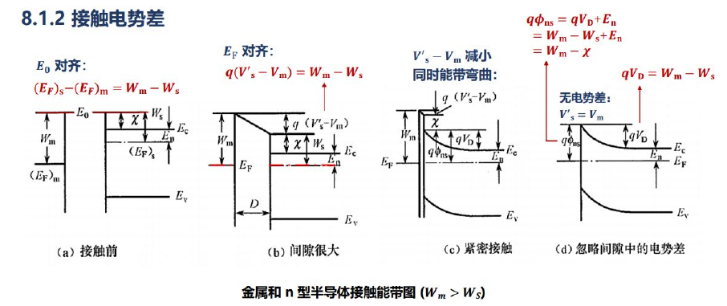

# 第八章　金属—半导体接触

[复习目录](../review-mode.md) · [本章练习](../practice.md#chapter-8) · [原笔记第 97—102 页](../resources/semiconductor-exam-notes.pdf#page=97) · [第八章课件](../resources/semiconductor-chapter-8.pdf)

## 1. 功函数、电子亲和能和能量参考

以真空能级 $E_0$ 为参考，金属功函数、半导体功函数和电子亲和能定义为

$$
W_m=E_0-E_{Fm},\qquad W_s=E_0-E_{Fs},\qquad \chi=E_0-E_C.
$$

因此 $W_s=\chi+(E_C-E_F)$。改变掺杂会移动半导体的费米能级，因而改变 $W_s$；简单理想模型中的电子亲和能主要由材料及表面取向等因素决定。真实界面偶极和表面处理会引入额外影响，不能将理想模型理解成绝对无条件的材料常数关系。

本章将 $W_m,W_s,\chi,E_g$ 作为能量，常用 eV；将 $\phi_{Bn},\phi_{Bp},V_{bi}$ 作为电势，单位 V。因此能量关系写作 $q\phi_{Bn}=W_m-\chi$。当能量数值均以 eV 表示时，势垒电压的伏特数值与能量差的电子伏特数值相同，但量纲仍应分开。

## 2. 理想 n 型接触的形成

先考虑无界面态钉扎、忽略界面氧化层和偶极的理想模型。若 $W_m>W_s$，接触前半导体费米能级相对真空参考更高，电子会从半导体流向金属。金属侧带负电，半导体侧留下正的离化施主，形成耗尽区；达到热平衡后两侧费米能级对齐。

半导体靠近界面的导带向上弯曲，形成多数电子的势垒。定义电子肖特基势垒高度及半导体内建电势：

$$
q\phi_{Bn}=W_m-\chi,\qquad qV_{bi}=W_m-W_s.
$$

两者之差为 $q(\phi_{Bn}-V_{bi})=E_C-E_F$，右端取远离界面的体区值。肖特基势垒高度与体区至界面的能带弯曲量不同；把两者都写成 $W_m-W_s$ 是常见错误。

*图据所提供 PDF 第 98 页局部摘录。图中 $\varphi_{ns}$ 对应本章 $\phi_{Bn}$，$V_D$ 对应 $V_{bi}$；中间示意为形成过程，最终平衡接触看右图。*

## 3. 耗尽宽度计算

当半导体侧存在均匀耗尽区、施主完全电离时，金属侧屏蔽尺度通常远小于半导体耗尽宽度，可将电势降主要归于半导体。零偏时

$$
W=\sqrt{\frac{2\varepsilon_sV_{bi}}{qN_D}}.
$$

采用正偏降低势垒的电压约定，偏压下可将 $V_{bi}$ 换为 $V_{bi}-V$，同时检查耗尽近似仍成立。单位面积势垒电容同样近似为 $C'=\varepsilon_s/W$。

**例 1。** 给定 $W_m=4.80\,\mathrm{eV}$、$\chi=4.05\,\mathrm{eV}$、体区 $E_C-E_F=0.22\,\mathrm{eV}$、$N_D=10^{16}\,\mathrm{cm^{-3}}$、$\varepsilon_s=11.7\varepsilon_0$。先求

$$
W_s=4.27\,\mathrm{eV},\quad \phi_{Bn}=0.75\,\mathrm V,\quad V_{bi}=0.53\,\mathrm V.
$$

因 $W_m>W_s$，理想模型给出 n 型耗尽型整流接触。再代入宽度式，得 $W\approx0.262\,\mu\mathrm m$。如果误将 $\phi_{Bn}=0.75\,\mathrm V$ 作为耗尽势降，就会高估宽度。

## 4. p 型接触与欧姆接触

理想模型中，空穴势垒与电子势垒满足

$$
q\phi_{Bp}=E_g-q\phi_{Bn}.
$$

对 p 型材料，较低的金属功函数常使半导体表面空穴耗尽，形成空穴势垒；较高的功函数有利于空穴积累。n 型材料的趋势相反。作图应由功函数比较、电荷转移、能带弯曲依次判断，不能把 n 型图机械平移后当作 p 型图。

欧姆接触指工作范围内近似线性、正反方向低接触电阻的电学行为。实现方法包括功函数及界面工程，以及接触区重掺杂。重掺杂使势垒变窄，多数载流子可以隧穿，即使势垒高度仍存在，也可能形成低阻接触。因此“有势垒必定整流”不成立。

## 5. 表面态与费米能级钉扎

真实表面存在悬挂键、缺陷、吸附和界面反应等，可产生禁带内表面态。表面态的占据引入界面电荷，改变势垒及能带弯曲。界面态密度很高时，改变金属功函数所引起的势垒高度变化可能远小于理想公式预测，称费米能级钉扎。

因此理想 $\phi_{Bn}=(W_m-\chi)/q$ 适合基本能带题，但不能无条件用来选择实际接触金属。若题目给出表面态模型或实验势垒，应使用相应信息。答概念题时可比较理想功函数控制与真实界面电荷控制两个层次。

## 6. 热电子发射与扩散模型

原笔记第 101 页同时介绍扩散与热电子发射。两者是不同输运近似：当势垒区输运受碰撞和漂移—扩散过程限制时，用扩散模型；当跨越界面的发射过程主要限制电流、碰撞影响可在相应近似中处理时，可采用热电子发射模型。实际模型选择还涉及平均自由程、耗尽区尺度、温度与掺杂，重掺杂时可能需要热场发射或隧穿模型。

理想热电子发射常写为

$$
J=J_0\left(e^{qV/(\eta kT)}-1\right),\qquad
J_0=A^{**}T^2e^{-q\phi_{Bn}/(kT)}.
$$

$A^{**}$ 为有效 Richardson 常数，理想因子 $\eta=1$ 对应理想表达；实际拟合中的 $\eta$ 可偏离 1。$J_0$ 的量纲为电流密度，若求电流还应乘接触面积。温度与势垒高度均显著影响反向漏电，不能只根据“多数载流子器件”推断其漏电很小。

**例 2。** 在相同温度和相同 $A^{**}$ 下，两接触势垒相差 $0.10\,\mathrm{eV}$。$300\,\mathrm K$ 时，较低势垒样品的 $J_0$ 是较高势垒样品的 $e^{0.10/0.02585}\approx47.9$ 倍。比较时先取比值，可消去未知的共同前因子。

## 7. 肖特基与 pn 二极管的比较

| 比较项 | 理想 pn 结 | 常见 n 型肖特基接触 |
| --- | --- | --- |
| 主要正向输运 | 少数载流子注入及准中性区扩散 | 多数电子越过或穿过势垒 |
| 电荷存储 | 存在少数载流子存储 | 通常较少，仍有结电容等动态效应 |
| 势垒参数 | 两侧掺杂、材料及 $n_i$ | 功函数、亲和能和界面状态等 |
| 反向特性 | 与产生复合、扩散等有关 | 热发射、势垒降低和隧穿等可能显著 |

肖特基接触常具有较快开关速度及较低正向压降，但这不是所有材料、电流和温度下的无条件大小关系。原 PDF 第 102 页将其概括为“漂移导电”过于简略；完整解释应指出多数载流子及具体发射、扩散或隧穿机制。

## 8. 能带作图与答题步骤

接触前以共同真空能级标出 $W_m,W_s,\chi,E_g$；判断电子转移方向；接触后画水平费米能级和半导体侧带弯曲；分别标注 $q\phi_B$ 与 $qV_{bi}$；最后判断整流或低阻接触，并声明是否忽略表面态与隧穿。原笔记的 n 型图在第 98 页，p 型图在第 99 页，应对照电荷和带弯曲理解。

[上一章：pn 结](07-pn-junction.md) · [进入分章练习](../practice.md)
